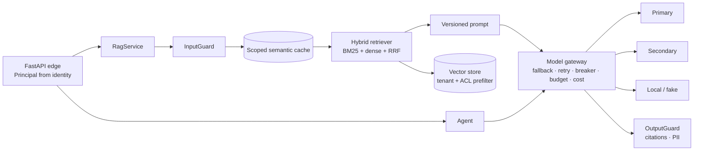

# ai_architecture: a GenAI reference architecture in Python

A **self-sufficient boilerplate** for building enterprise GenAI systems the way an AI architect would defend them in a design review. It covers a provider-agnostic model gateway, hybrid RAG with tenant/ACL isolation, layered guardrails, a bounded tool-using agent, a scoped semantic cache, cost accounting, OTel-style tracing and an eval gate in CI.

It runs **fully offline out of the box**: no API keys, GPU, Docker or model downloads needed. Real providers (OpenAI, Azure OpenAI, Ollama, vLLM, or any LiteLLM gateway fronting Anthropic, Gemini or watsonx.ai) are turned on by configuration, not by code changes.

```powershell
git clone https://github.com/rahulb-20/ai_architecture.git; cd ai_architecture
.\tasks.ps1 setup      # venv + install (Windows). On macOS/Linux: make setup
.\tasks.ps1 check      # lint, type-check, 42 tests, golden-set eval gate
.\tasks.ps1 ask "How many annual leave days can be carried forward?"
.\tasks.ps1 serve      # API + Swagger UI at http://127.0.0.1:8000/docs
```

## What the architecture looks like



Every request ends in one of four explicit states: **answered** (with citations), **abstained** (no grounding, so no guess), **blocked** (policy), or **degraded** (all models down, sources returned). The full design is in [docs/architecture/HLD.md](docs/architecture/HLD.md).

## Design principles (each one is enforced in code and tested)

| Principle | Where | Test |
|---|---|---|
| Domain and services never import vendor SDKs; adapters are wired in one composition root | `ports/`, `container.py` | every test runs with fakes |
| One gateway for every LLM call: ordered fallbacks, jittered retries, circuit breaker, token budget, cost | `services/gateway.py` | `tests/unit/test_gateway.py` |
| Authorisation is in the data path: tenant and ACL filtered **before** ranking | `adapters/vectorstore/memory.py` | `test_acl_and_tenant_prefilter_never_leak`, eval `acl_leaks == 0` |
| Hybrid retrieval by default; abstain when nothing is relevant | `services/retrieval.py` | `test_retriever_abstains_on_irrelevant_query` |
| Semantic cache is scoped per tenant/groups/region and invalidated by document version | `adapters/cache/semantic.py` | `test_second_ask_hits_cache_and_reingest_invalidates` |
| Guardrails are layered: injection and PII on input; citation validity and PII on output | `services/guardrails.py` | `tests/unit/test_guardrails.py` |
| Agents are bounded: allowlisted tools, typed args, HITL for side effects, step limit, no `eval` | `services/agents/` | `tests/unit/test_agent.py` |
| Prompts are versioned and quality is a release gate | `services/prompts.py`, `evaluation/runner.py` | CI `Eval gate` step |
| Telemetry uses OpenTelemetry GenAI attribute names, with prompts redacted | `adapters/telemetry/tracer.py` | `test_spans_follow_otel_genai_names` |
| Cost is modelled before launch and measured per answer | `services/cost.py`, `config/prices.json` | `aiarch estimate` |

Each principle has an ADR with the options considered and the consequences: [docs/architecture/adr/](docs/architecture/adr/).

## Repository layout

```text
src/aiarch/
  domain/            models.py (Principal, Document, Chunk, Answer...), errors.py — no dependencies
  ports/             Protocols: LLMClient, Embedder, VectorStore, AnswerCache, Tracer
  adapters/
    llm/             fake.py (offline, deterministic) · openai_compatible.py (OpenAI/Azure/Ollama/vLLM/gateways)
    embeddings/      hashing.py (offline) · SentenceTransformerEmbedder (optional extra)
    vectorstore/     memory.py (numpy, tenant partitions, ACL prefilter)
    cache/           semantic.py (scoped, TTL, doc invalidation)
    telemetry/       tracer.py (JSON spans, OTel GenAI names)
  services/
    chunking.py      markdown/recursive chunking, versioned chunk IDs
    retrieval.py     BM25 + dense + RRF, pluggable reranker, abstain threshold
    prompts.py       versioned prompt registry (stable prefix first, for prompt caching)
    guardrails.py    input/output guards, PII masking
    gateway.py       routes, retries, circuit breaker, budget, cost, spans
    rag.py           the RAG use case — read this first
    ingestion.py     ingest + cache invalidation, markdown loader with ACL header
    cost.py          PriceBook + monthly cost/sensitivity estimator
    agents/          tools.py (typed, permissioned, HITL) · agent.py (bounded plan/act loop)
  evaluation/        runner.py — golden-set metrics and CI gate
  api/app.py         FastAPI: /healthz /readyz /v1/ask /v1/agent /v1/documents
  container.py       composition root (the only place that knows concrete classes)
  config.py          typed settings from AIARCH_* env vars, offline defaults
  cli.py             aiarch ask | agent | eval | estimate | serve
tests/               unit + integration (offline, run in under 1 second)
evals/golden.jsonl   answerable, ACL-restricted, out-of-scope, injection and cross-tenant cases
data/sample_docs/    seed corpus (HR, IT, finance, confidential HR, security runbook)
config/prices.json   model prices (placeholders, so update them)
docs/architecture/   HLD, NFRs, ADRs
docs/guides/         extending, Windows setup, production checklist
docs/curriculum/     44-day GenAI Architect study path: notes, labs, interview bank
Dockerfile · compose.yaml · .github/workflows/ci.yml · tasks.ps1 · Makefile
```

## Configure real providers

Copy `.env.example` to `.env`. Routes are tried in order, and a key is read from the env var you name (it is never stored in config):

```powershell
$env:AIARCH_LLM_ROUTES='[{"name":"ollama","base_url":"http://localhost:11434/v1","model":"llama3.2:3b","timeout_s":60},{"name":"fake","kind":"fake"}]'
.\tasks.ps1 eval
```

To add a new provider, vector DB, reranker, guardrail, tool or telemetry backend, see [docs/guides/extending.md](docs/guides/extending.md). Before going past a pilot, work through [docs/guides/production-checklist.md](docs/guides/production-checklist.md).

## API

```powershell
Invoke-RestMethod -Method Post http://127.0.0.1:8000/v1/ask -ContentType 'application/json' `
  -Headers @{ 'x-tenant'='acme'; 'x-groups'='hr' } -Body '{"question":"What is the salary midpoint for band B5?"}'
```

Identity headers (`x-user`, `x-tenant`, `x-groups`, `x-region`) stand in for claims from a validated JWT at your API gateway. Set `AIARCH_API_KEYS` to require `x-api-key`. Ingesting documents requires the `kb-admin` group.

## Cost model

```powershell
.\.venv\Scripts\aiarch estimate --users 50000 --input-per-m 3 --output-per-m 15 --prefix-cache-hit 0.9
```

This prints monthly cost and the sensitivity to a 20% change in each driver. Calls per query and traffic dominate.

## Learning path

[docs/curriculum/](docs/curriculum/README.md) holds the 44-day study path that this code distils: Week 1 foundations, Week 2 production retrieval, Week 3 agentic systems, Week 4 cloud and production, then revision drills. Each day has a concept brief, a trade-off table, runnable labs, interview questions and a decision record. The index maps each day to the module that implements it.
