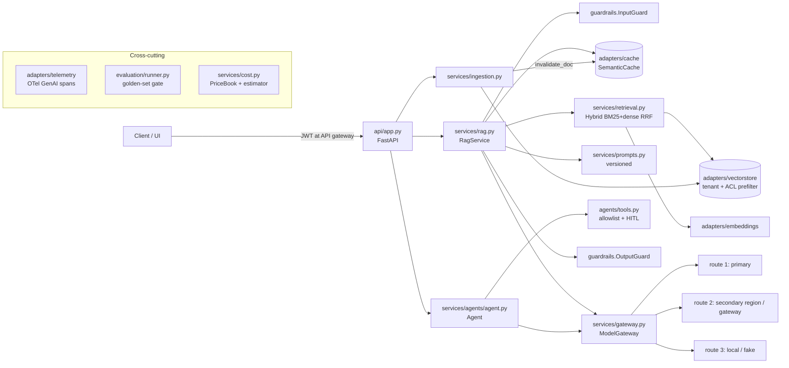

# High-level design

## Context

An enterprise knowledge assistant and tool-using agent. It is multi-tenant, ACL-aware, provider-agnostic and observable. The code in `src/aiarch` implements this design; each box below names its module.

## Request path (`POST /v1/ask`)

1. The API derives a `Principal` (user, tenant, groups, region). In production this comes from a validated JWT at the API gateway.
2. `InputGuard`: length limit, injection heuristics, PII masking. A violation returns **BLOCKED**.
3. `SemanticCache.get` within scope `region|tenant|groups`. A hit returns the cached answer (zero LLM cost).
4. `HybridRetriever`: dense + BM25 over **pre-filtered** chunks, then RRF and the top-k. If nothing is relevant, the answer is **ABSTAINED**.
5. `PromptRegistry` renders `grounded_qa@2`: the stable system block comes first for prefix caching, then numbered sources, then the question.
6. `ModelGateway`: budget check, then routes in order with retries and a breaker per route. If every route fails, the answer is **DEGRADED** (sources only).
7. `OutputGuard`: valid citations are required and PII is masked. Failure returns **ABSTAINED**.
8. Cache put (tagged with the cited doc_ids). The `Answer` carries status, citations, model, prompt version, usage, cost and trace_id.

## Deployment view

| Concern | Local (default) | Production pattern |
|---|---|---|
| LLM | `FakeLLM` / Ollama | Azure OpenAI / Bedrock / Vertex / watsonx.ai via private endpoint, optionally behind LiteLLM or APIM |
| Vector store | `InMemoryVectorStore` | pgvector, Azure AI Search, Milvus, Elastic, Weaviate (adapter implements the `VectorStore` port) |
| Cache | in-process | Redis / Valkey with RedisVL, one namespace per scope |
| Telemetry | JSON spans to stdout | OTel SDK → collector → Langfuse / Phoenix / App Insights |
| Runtime | `uvicorn` | Container (this Dockerfile) on AKS/EKS/GKE/OpenShift, HPA on CPU or KEDA on queue depth |
| Identity | headers + optional API key | OIDC at the API gateway; the workload identity reads secrets from Key Vault / Secrets Manager |

## Where to extend

See [guides/extending.md](../guides/extending.md). Decisions and their trade-offs are in [adr/](adr/).
