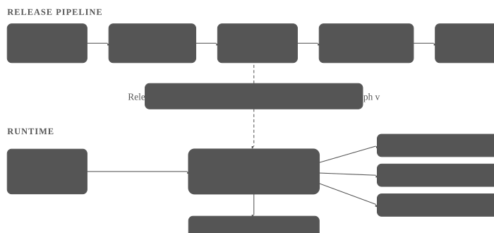

# Day 32 — Revision Drill: LangGraph HITL & Eval Gates

> Part of the [GenAI Architect study path](../../README.md) · Revision drill · [Original interactive pack](https://claude.ai/artifact/UW9xy8xed1UXarfV2qpP6J) · [Offline HTML](../../archive/html/day-32.html)


Day 32 · Revision drill · Tue 10 Nov 2026

# Revision drill: LangGraph human-in-the-loop and CI/CD eval gates

Two topics re-tested at interview depth: Day 17 (LangGraph state, checkpointing, interrupts) and Day 26 (eval gates, prompt and model versioning, rollback). They meet in one place: a paused agent run that outlives a deployment. Eight hard questions, a 20-minute local drill, then one design scenario.

## Versions to quote (checked on PyPI and npm today)

| Package | Latest stable | Released | Why it matters today |
| --- | --- | --- | --- |
| `langgraph` | 1.2.20 | 5 Nov 2026 | `interrupt()` + `Command(resume=…)` is the HITL API; static `interrupt_before` is for debugging. |
| `langgraph-checkpoint-postgres` | 3.2.0 | 14 Oct 2026 | The production checkpointer for multi-replica deployments. |
| `langgraph-checkpoint-sqlite` | 3.1.3 | 30 Oct 2026 | Local durability; used in the drill below. |
| `langchain` | 1.4.9 | 4 Nov 2026 | `HumanInTheLoopMiddleware` gives approve / edit / reject on tool calls for `create_agent`. |
| `deepeval` | 4.3.3 | 4 Nov 2026 | Pytest-style evals; `deepeval test run` exits non-zero on failure, so it gates CI. |
| `promptfoo` (npm) | 0.125.1 | Oct 2026 | Declarative YAML evals and red-teaming; has a GitHub Action that posts before/after diffs on PRs. |

## Eight interview questions

Answer each aloud in under 90 seconds before opening the model answer. Q1–4 are LangGraph, Q5–8 are CI/CD eval gates.

Q1A node calls `interrupt()` for approval. When the human resumes, what code runs again, and how does that bite you in production?

**Model answer**

Resume does not continue from the line after `interrupt()`. LangGraph restarts the **whole node** from the top, and on reaching the `interrupt()` call it returns the resume value instead of pausing. So everything before the interrupt runs twice.

- **Side effects:** if the node sent an email or wrote a ticket before interrupting, it does it again. Put side effects after the interrupt, in a separate downstream node, or make them idempotent with a key derived from `thread_id` + node.
- **Multiple interrupts in one node** are matched to resume values by order. Conditional or loop-dependent interrupt calls can shift that order and mis-map answers. Keep the sequence deterministic, or use one interrupt per node.
- **Exceptions:** `interrupt()` works by raising a special exception. A bare `try/except Exception` around it swallows the pause.
- **Cost:** an LLM call before the interrupt is paid twice. Move it into the previous node so its result is in checkpointed state.

Q2Choose and defend a checkpointer for an agent serving 5,000 concurrent users across 6 pods. What are the NFRs on it?

**Model answer**

`InMemorySaver` loses state on pod restart and is pod-local, so it is for tests. SQLite is single-writer and file-local. For six stateless pods you need a shared store: **Postgres** (`PostgresSaver` / `AsyncPostgresSaver`) is the default; Redis-based savers suit short-lived, high-churn threads. Any pod can then resume any thread.

- **Write volume:** one checkpoint per super-step per thread. A 10-step agent at 50 runs/s is about 500 writes/s plus blob writes. Size the DB on that, use PgBouncer, and use the async saver.
- **Growth:** checkpoints are append-only history. Set retention (keep latest N per thread or prune by age) or the table grows without bound.
- **Security:** checkpoints contain prompts, tool outputs and PII. Encrypt at rest (the `EncryptedSerializer` in `langgraph.checkpoint.serde.encrypted`, or DB-level TDE), scope `thread_id` by tenant so one user cannot resume another's thread, and cover it in DPDP erasure requests.
- **DR:** checkpoints are now business state (pending approvals), so they need a stated RPO/RTO like any transactional DB.

watsonx mapping: the same pattern applies if the agent runs on watsonx.ai with Orchestrate as the approval UI; the checkpointer stays in your Postgres (e.g. IBM Cloud Databases for PostgreSQL).

Q3Approvals sometimes wait four days. You deploy a new graph version on day two. What breaks, and what is your compatibility policy?

**Model answer**

The checkpoint stores the old state shape and the names of the next nodes to run. The new code resumes it. Things that break:

- A **renamed or removed node** that a paused thread is waiting on.
- A **state field** renamed, retyped, or made required (old checkpoints lack it).
- A changed **interrupt payload** contract with the approval UI.
- A changed prompt or model, so the resumed half of the run behaves differently from the half the approver saw.

**Policy:** treat state as a versioned schema. Add fields only as optional with defaults; never rename node names in place (add a new node, keep the old one as a shim for one release); stamp `graph_version` in state and branch on it if needed. Add a CI test that loads a fixture of real paused checkpoints from the previous release and resumes them on the new graph. For breaking changes, drain: stop new runs on the old version and keep an old-version worker until its paused threads finish or expire.

Q4How do you let a reviewer edit a tool call before it executes, and how would you use checkpoint history to debug a bad run in production?

**Model answer**

**Edit before execute:** interrupt with the proposed tool name and arguments; the resume value is one of approve / edit (new arguments) / reject (with feedback that goes back to the model as a tool message). In LangChain 1.x, `HumanInTheLoopMiddleware` on `create_agent` does this per tool with an allow-list of decision types. In a custom graph, write the edited call into state, then route to the tool node.

**Debugging:** `get_state_history(config)` lists every checkpoint for the thread. Find the step where things went wrong, then fork: `update_state(config_at_that_checkpoint, corrected_values)` creates a new branch, and invoking with that config replays from there. This is the cheapest way to turn a production incident into a regression test case: export the state at that checkpoint as a fixture in your eval set.

Q5Design the eval tiers for a RAG + agent product. What runs on every PR, nightly, and before release, and what does each one block?

**Model answer**

| Tier | Contents | Budget | Blocks |
| --- | --- | --- | --- |
| PR (every push) | Unit tests, JSON-schema checks, tool-call contract tests, ~50 golden questions with deterministic or cheap metrics, prompt-injection smoke set, resume-old-checkpoints test | < 10 min, < $2 | Merge |
| Nightly | Full golden set (300–1,000), LLM-as-judge faithfulness / relevance, retrieval recall@k, agent trajectory checks, cost and latency per query | ~1 h | Next release candidate |
| Pre-release | Red-team suite (promptfoo redteam), load test at p95 SLO, canary with online evals on live traffic sample | hours | Promotion to 100% |

Gate on **delta against the main-branch baseline**, not just absolute thresholds, and on **slice-level** scores (per document type, language, tenant), because averages hide regressions in small but important slices.

Q6Your LLM-as-judge gate fails one PR in five with no code change. Fix it without removing the gate.

**Model answer**

- **Pin the judge:** dated model snapshot, temperature 0, versioned judge prompt. A judge on a floating alias is an untested dependency.
- **Measure the noise:** run the baseline 5 times; the gate threshold must sit outside that spread. Use a bootstrap confidence interval on the score difference and fail only when the CI excludes zero.
- **Bigger, fixed sample:** 30 items cannot detect a 3-point drop. Fix the seed and the item set for PR runs.
- **Prefer deterministic checks** where they exist: exact-match on extracted fields, citation-ID overlap, schema validity. Use the judge only for what needs judgment.
- **Calibrate:** agreement with ~200 human labels (Cohen's kappa) before trusting it as a gate; recheck when you change judge model.
- **Cache** responses keyed by (prompt version, model, input) so unchanged paths are not re-sampled.

Q7Production answers degrade after a release. You must roll back in 10 minutes. What exactly is the unit of release, and what makes rollback fast?

**Model answer**

The unit is a **release bundle**, not the container image: {app image digest, prompt versions, model ID + snapshot, embedding model, index version, retriever config (k, reranker), guardrail policy version, graph version}. Any one of these can cause the regression.

- Prompts and config live in a registry (Langfuse prompt management, MLflow, or Git-tagged config) and are referenced by label, so rollback is moving the `production` label, no rebuild.
- Indexes are blue-green behind an alias. Re-embedding takes hours, so you keep the previous index until the new one has passed a canary.
- Canary: 5% traffic with online evals (groundedness on a sample, thumbs-down rate, cost/request) and automatic rollback on breach.
- Paused HITL threads (Q3) must still resume after a rollback, so the old graph version must stay compatible with checkpoints the new one wrote. Test both directions.

Q8Nothing in your repo changed, but quality dropped. The provider updated the model behind an alias. How should your pipeline have caught it?

**Model answer**

CI gates only fire on your commits, so you also need a **scheduled eval against the production configuration** (nightly cron in GitHub Actions or a Tekton/Argo job) that alerts on drift from the last accepted baseline. Then: pin dated model snapshots in production, never floating aliases; keep a model deprecation calendar per provider; when a snapshot is retiring, open a PR that swaps it and let the normal gates run. Log model ID and response metadata on every trace so you can show which model served which answer. The same applies to a self-hosted model: pin the weights hash and the vLLM version.

## 20-minute local drill: pause, kill, resume

This proves to yourself that a paused run survives a process exit, and lets you see Q1 and Q4 in action. No GPU or API key needed; it runs on native Windows.

```text
mkdir hitl-drill; cd hitl-drill
py -m venv .venv
.\.venv\Scripts\Activate.ps1
python -m pip install langgraph==1.2.20 langgraph-checkpoint-sqlite==3.1.3
```

Save as `hitl.py`:

`lab/hitl.py`

```python
import sqlite3, sys
from typing import TypedDict
from langgraph.graph import StateGraph, START, END
from langgraph.types import interrupt, Command
from langgraph.checkpoint.sqlite import SqliteSaver

class State(TypedDict):
    request: str
    refund_inr: int
    status: str

def draft(state: State) -> dict:
    return {"refund_inr": 18000, "status": "drafted"}

def approve(state: State) -> dict:
    # Everything before interrupt() re-runs on resume, so keep this node side-effect free.
    if state["refund_inr"] <= 10000:
        return {"status": "auto-approved"}
    decision = interrupt({"question": "Approve refund?", "amount": state["refund_inr"]})
    if decision.get("approved"):
        return {"refund_inr": decision.get("amount", state["refund_inr"]), "status": "approved"}
    return {"status": "rejected"}

def execute(state: State) -> dict:
    return {"status": state["status"] + "+executed" if state["status"] != "rejected" else "closed"}

g = StateGraph(State)
g.add_node("draft", draft); g.add_node("approve", approve); g.add_node("execute", execute)
g.add_edge(START, "draft"); g.add_edge("draft", "approve"); g.add_edge("approve", "execute"); g.add_edge("execute", END)

conn = sqlite3.connect("checkpoints.db", check_same_thread=False)
app = g.compile(checkpointer=SqliteSaver(conn))
cfg = {"configurable": {"thread_id": "ticket-4711"}}

if sys.argv[1:] == ["start"]:
    out = app.invoke({"request": "refund for duplicate charge"}, cfg)
    print("paused:", out["__interrupt__"][0].value)
    print("next node:", app.get_state(cfg).next)
else:  # run again later, in a new process: python hitl.py resume
    out = app.invoke(Command(resume={"approved": True, "amount": 15000}), cfg)
    print("final:", out)
    for snap in app.get_state_history(cfg):
        print(snap.config["configurable"]["checkpoint_id"][-8:], snap.next, snap.values.get("status"))
```

```text
python hitl.py start
python hitl.py resume
```

Expected output (checkpoint IDs will differ). Tested today with langgraph 1.2.20:

paused: {'question': 'Approve refund?', 'amount': 18000}
next node: ('approve',)
final: {'request': 'refund for duplicate charge', 'refund\_inr': 15000, 'status': 'approved+executed'}
eaef94e7 () approved+executed
ff9dbeed ('execute',) approved
6f992a42 ('approve',) drafted
705a3456 ('draft',) None
1ff82e63 ('\_\_start\_\_',) None

**Then break it on purpose (10 min):**

1. Add `print("SENDING EMAIL")` above the `interrupt()` line, delete `checkpoints.db`, and run start + resume. It prints twice. That is Q1.
2. Run `start`, then rename the node `"approve"` to `"review"` and run `resume`. Note what happens to the paused thread. That is Q3, and the CI test you should write for it.

## Design scenario (25 minutes, paper first)

**Brief.** A general insurer is building a claims-triage agent on LangGraph. It reads the claim, retrieves policy wording (RAG), checks fraud signals through an MCP tool, and proposes a payout. Payouts above ₹50,000 need a human adjuster, who may take up to five working days and may edit the amount. The team wants to ship weekly, roll back in under 10 minutes, and show IRDAI auditors why each payout was approved. Volume: 8,000 claims a day.

**Your deliverable:** the runtime HLD, the release pipeline with its gates, three NFRs with numbers, and one ADR.



One possible shape, for checking your answer after you sketch your own.

**What a strong answer covers**

- **Graph shape.** Retrieve → assess → fraud check → propose → (conditional) adjuster interrupt → pay. The payment call is its own node after the interrupt, with an idempotency key of claim ID + bundle version, so a resume or retry can never pay twice.
- **Approval payload.** The interrupt carries the proposed amount, cited policy clauses (chunk IDs), fraud score and the model's rationale. That payload, plus the adjuster's decision and edits, is the audit record, written to an append-only store, not just the checkpoint table.
- **Five-day pauses vs weekly releases.** State schema versioning and the resume-old-checkpoints test in staging (Q3). Keep the previous graph version deployable for at least one release so rollback does not orphan paused claims.
- **Gates.** PR: payout-amount exact match on a golden set of past claims, clause-citation overlap, refusal on out-of-policy claims, injection tests on claim text. Nightly: full set with slices by product line and claim size. Gate on any regression in the > ₹50k slice even if the average holds.
- **Rollback.** Label flip in the bundle registry; blue-green policy index; canary with automatic rollback on adjuster-override rate (a strong online quality signal here).
- **NFR examples:** auto-decided claims p95 end-to-end < 20 s; zero duplicate payouts (idempotency verified by chaos test that kills pods mid-run); 100% of payouts traceable to bundle version, cited clauses and approver within 1 minute of query.
- **ADR candidate:** LangGraph `interrupt()` with a Postgres checkpointer vs an external workflow engine (Temporal, or watsonx Orchestrate approval flows) owning the five-day wait. Argue it on who owns long-running state, ops maturity, and audit requirements.

## Read before tomorrow (optional, 20 min)

- [LangGraph docs: Interrupts](https://docs.langchain.com/oss/python/langgraph/interrupts) — read the rules on re-execution and multiple interrupts per node (Q1).
- [promptfoo: CI/CD integration](https://www.promptfoo.dev/docs/integrations/ci-cd/) — thresholds, caching and PR comments for eval gates.
- [DeepEval: unit testing in CI/CD](https://deepeval.com/docs/evaluation-unit-testing-in-ci-cd) — the pytest-style alternative, and how `deepeval test run` fails a build.

## Tomorrow

Day 33 drill: guardrails and prompt-injection defence (Day 21) with GenAI observability (Day 27).

## Lab files in this folder

- [`lab/hitl.py`](lab/hitl.py)
