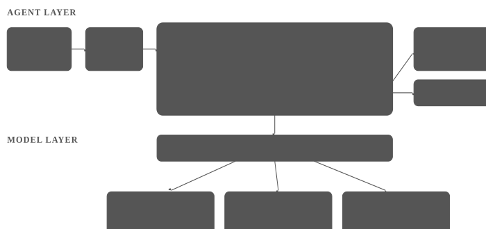

# Day 34 — Revision Drill: Multi-Agent & Kubernetes

> Part of the [GenAI Architect study path](../../README.md) · Revision drill · [Original interactive pack](https://claude.ai/artifact/Du7pK5vK7Q9KmVVxSSPxVL) · [Offline HTML](../../archive/html/day-34.html)


Day 34 · Revision drill · Thu 12 Nov 2026

# Revision drill: multi-agent patterns and Kubernetes for GenAI

Two topics re-tested at interview depth: Day 18 (supervisor, hierarchical and handoff patterns, ReAct vs plan-and-execute, when not to go multi-agent) and Day 25 (autoscaling, GPU scheduling, KServe, inference routing). They meet in one place: every extra agent is extra model calls, and those calls land on a GPU pool you have to size, scale and pay for. Eight hard questions, a 25-minute local drill that measures the multiplier, then one design scenario.

**Worth knowing before an interview**

**The prebuilt `langgraph-supervisor` and `langgraph-swarm` packages have gone quiet:** last releases 19 Nov 2025 (0.0.31) and 4 Dec 2025 (0.1.0), while `langgraph` itself shipped 1.2.20 on 5 Nov 2026. LangChain's current docs teach multi-agent as patterns (subagents as tools, handoffs, routers) built with `create_agent` and plain LangGraph `Command`. If asked, say you treat the prebuilt packages as reference code and build the pattern yourself, which is also what today's drill does.

## Versions to quote (checked on PyPI today)

| Package / project | Latest | Released | Note |
| --- | --- | --- | --- |
| `langgraph` | 1.2.20 | 5 Nov 2026 | Python ≥3.10; `Command(goto=…, update=…)` is the handoff primitive. |
| `langchain-core` | 1.8.0 | 11 Nov 2026 | Released yesterday; pin it in demos rather than float. |
| `langgraph-supervisor` | 0.0.31 | 19 Nov 2025 | No release in ~12 months. Reference only. |
| `langgraph-swarm` | 0.1.0 | 4 Dec 2025 | Same status. |
| `kserve` (Python SDK) | 0.21.0 | 25 Sep 2026 | LLM path is `LLMInferenceService`, which builds on llm-d and the Gateway API Inference Extension. |
| `kubernetes` (Python client) | 37.0.2 | 6 Nov 2026 | For the stretch goal only. |
| Kubernetes DRA | GA | v1.34 | Dynamic Resource Allocation: GPUs requested through `ResourceClaim`s, not only the `nvidia.com/gpu` count. |
| KEDA | 2.20 | — | Current minor; Prometheus scaler is what you use for vLLM queue depth. |

## Eight interview questions

Answer each aloud in under 90 seconds before opening the model answer. Q1–4 are multi-agent, Q5–7 are Kubernetes, Q8 is where the two meet.

Q1A client's team has drawn seven agents for an invoice-processing flow. You think one agent is enough. Make the case, and say what would change your mind.

**Model answer**

**The default is one agent with good tools,** because every hop between agents costs a model call, re-sends context, and is a place where information gets lost. Anthropic's write-up of its multi-agent research system reports such systems using roughly 15× the tokens of a chat interaction; today's drill shows 2.5× on a trivial task and 10× when one worker is vague. Seven agents for a mostly linear flow is a workflow drawn as an org chart.

For invoices, most steps are deterministic (extract, validate against PO, post to ERP), so I would make them graph nodes or tools, with one agent only where judgement is needed (exception handling).

**What changes my mind,** in order of strength:

- **Context isolation:** sub-tasks that each need a lot of context the others don't (one reads 200-page contracts, another queries the ERP). A sub-agent returns a summary and keeps the main context small.
- **Different trust or permissions:** the agent that reads untrusted vendor emails must not hold the "post payment" tool (the Day 21 privilege-separation argument).
- **Real parallelism:** independent research branches that can run at the same time and cut wall-clock time.
- **Separate ownership:** different teams own, version and evaluate different capabilities.
- **Tool overload:** more than ~20–30 tools in one agent, where tool-selection accuracy measurably drops on your eval set.

Then I would ask for the evidence: an eval showing the single agent fails on a named slice of cases.

Q2Compare supervisor, hierarchical, and handoff (swarm) topologies. Which one do you pick for a customer-support assistant with billing, tech-support and retention specialists?

**Model answer**

| Topology | How control flows | Pick when | Failure mode |
| --- | --- | --- | --- |
| Supervisor (subagents as tools) | Central agent calls specialists and gets results back | You need one place to enforce policy, budget and the final answer | Supervisor is a bottleneck and an extra call per hop; it paraphrases specialist output and loses detail |
| Hierarchical | Supervisors of supervisors | Large domains with team ownership per branch | Latency stacks per layer; errors are hard to localise |
| Handoffs / swarm | The active agent transfers control to a peer; the user then talks to that peer | Conversational flows where the specialist should own the dialogue | Ping-pong transfers, and no single place to enforce policy |
| Router (one-shot) | A classifier picks one agent, no return | Clear, mostly disjoint intents | Misroutes on mixed intents; needs a fallback |

**For support:** a router up front plus handoffs, because the specialist should own the conversation and a supervisor in the loop adds a model call to every turn. Add rules the model cannot override in code: retention may only be entered from billing, at most 2 transfers per conversation, then a human. Keep a shared, typed conversation state (customer ID, intent, verified flag) so a handoff does not re-ask the customer.

Q3ReAct or plan-and-execute for a 15-step data-migration agent (your Snowflake-to-PySpark case)? Defend it on cost, reliability and auditability.

**Model answer**

- **ReAct** decides the next step after every observation. It adapts well, but every step re-reads the growing history, so cost grows roughly quadratically in steps, and it drifts on long tasks.
- **Plan-and-execute** makes an explicit plan once (with a strong model), then executes steps with cheaper models or plain code, and re-plans only on failure. Cost is close to linear, and the plan is an artefact you can review, approve and diff.
- **For a migration:** plan-and-execute. The plan (object inventory, dependency order, conversion per object, validation queries) goes through a human approval step in LangGraph (`interrupt`), each step is checkpointed so a failure resumes rather than restarts, and the plan plus per-step results become the audit trail the client signs off.
- Use **ReAct inside a step** where it helps, for example fixing one failing PySpark conversion against test output, with a step budget.
- Failure modes to name: a stale plan after an early surprise (fix: re-plan triggers on validation failure), and over-planning trivial work (fix: route simple objects straight to a deterministic converter).

Q4The multi-agent system works in demos but loops or gives inconsistent answers in production. How do you debug it, and what controls do you add?

**Model answer**

- **Trace first.** One root span per run with child spans per agent and per handoff (Day 27's `invoke_agent` and `execute_tool` spans). Look at the handoff payloads: most failures are information lost or mangled at a handoff, not a bad model.
- **Common causes:** ping-pong delegation (A thinks B owns it, B hands back); a worker reports "it depends" and the supervisor re-delegates forever (today's `--flaky` run); a specialist sees the full history and acts on another agent's instructions; temperature > 0 on routing calls.
- **Controls in code, not prompts:** hop and token budgets per run that end in escalation (the drill's `MAX_HOPS`), with `recursion_limit` only as a backstop; typed handoff contracts (a Pydantic schema per hand-off with a required `status: done | blocked | needs_input`); temperature 0 and structured output for routing; idempotent tools so a retry does not double-act.
- **Reproduce from checkpoints:** replay the failing run from its LangGraph checkpoint with the same state, then fix and add it to the regression set.
- **Evaluate at two levels:** each agent against its own golden set, and the whole system on end-to-end tasks, tracking calls and cost per task as metrics that gate releases.

Q5You deploy vLLM on Kubernetes with an HPA on CPU at 70%. Users see 20-second waits at 10 a.m. while the HPA shows nothing wrong. Explain and fix it.

**Model answer**

LLM serving is GPU- and memory-bound. CPU stays low while requests queue for KV-cache space, so CPU is the wrong signal. Fix:

- **Scale on serving signals** from vLLM's Prometheus endpoint: requests waiting in the queue (`vllm:num_requests_waiting`) and KV-cache usage, through KEDA's Prometheus scaler or the HPA with a custom-metrics adapter. Example target: scale out when the average waiting count per pod exceeds 3 for 60 s. Check the exact metric names against your vLLM version, because they have been renamed between releases.
- **Cold start is the real problem:** a new pod needs a GPU node (minutes if the cluster autoscaler or Karpenter must add one), a 10 GB+ image pull, and weight loading. Mitigations: keep warm minimum replicas sized for the morning peak, schedule scale-up ahead of known peaks (KEDA cron scaler), pre-pull images, and cache weights on a node-local disk or a shared volume.
- **Admission control:** cap concurrency per pod and return 429 with a retry-after at the gateway instead of letting latency grow without limit.
- Scale-to-zero is fine for dev and batch, rarely for interactive production.

Q6One cluster must host a 70B model, a 3B guard model, an embedding model and nightly fine-tuning jobs. How do you schedule GPUs without wasting them?

**Model answer**

- **Separate node pools** by GPU class, with taints and tolerations, so a CPU pod never lands on a GPU node and small models do not take an H100.
- **70B:** tensor parallelism across the GPUs of one node (for example 4× 80 GB). If it must span nodes, use LeaderWorkerSet so the group is scheduled and restarted as a unit.
- **Small models:** share GPUs. MIG gives hardware isolation with fixed slices (A100/H100); time-slicing or MPS is more flexible but without memory isolation, so one noisy model can push another out of memory. Put the guard model on a MIG slice because it is latency-critical.
- **DRA (GA since Kubernetes 1.34)** lets pods request devices by attributes (memory, MIG profile) through `ResourceClaim`s instead of a bare `nvidia.com/gpu: 1`. Name it as the direction, and check whether your managed service and the NVIDIA DRA driver support it yet.
- **Fine-tuning jobs:** a lower PriorityClass and a batch queue (Kueue) with quotas, so training uses idle GPUs at night and is pre-empted when serving needs them. Checkpoint often so pre-emption is cheap.
- Report GPU utilisation and cost per namespace (DCGM exporter), because idle reserved GPUs are the largest waste in most GenAI clusters.

Q7Why is a normal Kubernetes Service a poor load balancer for LLM pods, and what do you use instead? Where do KServe and llm-d fit?

**Model answer**

- A Service spreads connections roughly evenly, but LLM requests vary 100× in cost (10 tokens vs 8,000), and pods differ in queue length, KV-cache use, and which prompt prefixes or LoRA adapters they already hold. Even spreading creates hot pods and wastes prefix-cache hits.
- **Gateway API Inference Extension:** an `InferencePool` of model-server pods and an endpoint picker that chooses a pod per request using queue depth, KV-cache use, adapter affinity and request criticality. Envoy-based gateways (Istio, kgateway, agentgateway, NGINX Gateway Fabric) implement it.
- **llm-d** adds prefix-cache-aware routing and prefill/decode disaggregation on top of vLLM. **KServe's `LLMInferenceService`** packages this as one custom resource, with the platform concerns (autoscaling, rollout, storage) KServe already handles.
- **Put an AI gateway in front** (LiteLLM or your API gateway, Day 23) for auth, quotas, provider fallback and cost tags. Inference routing inside the cluster and the AI gateway at the edge are different layers. On IBM's side, OpenShift AI ships llm-d-based distributed inference, which is a useful mapping for watsonx clients running on-prem.

Q8You're putting a LangGraph multi-agent system on Kubernetes. Is each agent its own microservice? How do you handle state, long runs and rollouts?

**Model answer**

- **Agents are code, not services.** One graph is one deployable. Split an agent into its own service only when it needs different scaling, a different security boundary (for example the tool-holding agent in a separate namespace with its own service account), or a different owning team. Splitting by default adds network hops and makes tracing and versioning harder.
- **Stateless pods, durable state:** a Postgres checkpointer holds graph state, so any pod can resume a run and a pod restart does not lose work. Human-in-the-loop pauses become rows in the database, not open connections.
- **Long runs** (minutes) go through a queue: the API enqueues, worker pods run graphs, and KEDA scales workers on queue length. Clients stream progress or poll. Keep the HTTP tier separate from the workers.
- **Models are a shared pool** behind the gateway, not per agent. Size it from calls per task × tasks per second, which is why the multiplier from today's drill matters for capacity planning.
- **Rollouts:** version the graph with its prompts as one release bundle (Day 26), canary by percentage of new runs, never move in-flight runs to a new graph version, and gate promotion on eval scores plus calls-per-task and cost-per-task.

## 25-minute local drill: measure the multi-agent tax

The same three HR tasks go through (A) one agent with two tools and (B) a supervisor that hands off to two specialist agents with LangGraph `Command`. A deterministic stub model meters calls, tokens and approximate latency, so the numbers are repeatable. It runs on native Windows with no GPU and no API key.

```text
mkdir agent-tax; cd agent-tax
py -m venv .venv
.\.venv\Scripts\Activate.ps1
python -m pip install langgraph==1.2.20
```

Save as `multi_vs_single.py`:

`lab/multi_vs_single.py`

```python
"""Day 34 drill: what a supervisor multi-agent design really costs.
Runs the same 3 tasks through (A) one agent with two tools and (B) a supervisor
that hands off to two specialist agents, using LangGraph Command handoffs.
A deterministic stub "LLM" meters calls, tokens and simulated latency, so it
runs on any laptop with no GPU or API key.

  python multi_vs_single.py            # compare both designs
  python multi_vs_single.py --flaky    # a worker gives vague answers: watch the loop guard
"""
import sys
from typing import Annotated, Literal, TypedDict
import operator
from langgraph.graph import StateGraph, START, END
from langgraph.types import Command
from langgraph.errors import GraphRecursionError

FLAKY = "--flaky" in sys.argv
MAX_HOPS = 6  # explicit business-level budget, tighter than LangGraph's recursion_limit

# ---- metering stub LLM ---------------------------------------------------------
class Meter:
    def __init__(self): self.calls = self.tin = self.tout = 0; self.ms = 0.0
    def charge(self, prompt_tokens: int, out_tokens: int):
        self.calls += 1; self.tin += prompt_tokens; self.tout += out_tokens
        self.ms += 250 + prompt_tokens * 0.05 + out_tokens * 20   # TTFT + prefill + decode (rough 3B-class numbers)

def toks(history: list[str]) -> int:
    return sum(len(h.split()) * 4 // 3 for h in history) + 300   # +300 for system prompt and tool schemas

POLICY = {"carry forward": "Max carry-forward is 45 days (hr-leave-v4#2)."}
def policy_tool(q): return next((v for k, v in POLICY.items() if k in q), "No policy found.")
def calc_tool(q): return "Encashment = 30 days x Rs 2,000 = Rs 60,000."

TASKS = [
    "What is the leave carry forward limit?",
    "Compute leave encashment for 30 days at Rs 2,000 per day.",
    "What is the carry forward limit, and compute encashment for 30 days at Rs 2,000?",
]

def needs(task):  # what the "model" would decide to call
    n = []
    if "carry forward" in task: n.append("policy")
    if "compute" in task.lower(): n.append("calc")
    return n

# ---- (A) single agent: one ReAct loop, two tools --------------------------------
def single_agent(task, m: Meter):
    hist = [task]
    for tool in needs(task):                      # one model call per tool decision
        m.charge(toks(hist), 30)
        hist.append((policy_tool if tool == "policy" else calc_tool)(task))
    m.charge(toks(hist), 60)                      # final answer
    return " ".join(hist[1:])

# ---- (B) supervisor + two specialist agents, Command handoffs --------------------
class S(TypedDict):
    task: str
    history: Annotated[list[str], operator.add]
    done: Annotated[list[str], operator.add]
    hops: int
    answer: str

def make_supervisor(m: Meter):
    def supervisor(state: S) -> Command[Literal["policy_agent", "calc_agent", "__end__"]]:
        m.charge(toks(state["history"]), 20)      # routing decision is an LLM call
        if state["hops"] >= MAX_HOPS:
            return Command(goto=END, update={"answer": "ESCALATE: hop budget exhausted"})
        todo = [n for n in needs(state["task"]) if n not in state["done"]]
        if not todo:
            m.charge(toks(state["history"]), 60)  # synthesis call
            return Command(goto=END, update={"answer": " ".join(state["history"][1:])})
        return Command(goto=f"{todo[0]}_agent", update={"hops": state["hops"] + 1})
    return supervisor

def make_worker(name, tool, m: Meter):
    def worker(state: S) -> Command[Literal["supervisor"]]:
        m.charge(toks(state["history"]), 30)      # worker decides to call its tool
        out = tool(state["task"])
        m.charge(toks(state["history"] + [out]), 40)  # worker writes its report
        if FLAKY and name == "calc":
            return Command(goto="supervisor", update={"history": ["calc_agent: it depends on the salary basis."]})
        return Command(goto="supervisor", update={"history": [f"{name}_agent: {out}"], "done": [name]})
    return worker

def build(m: Meter):
    g = StateGraph(S)
    g.add_node("supervisor", make_supervisor(m))
    g.add_node("policy_agent", make_worker("policy", policy_tool, m))
    g.add_node("calc_agent", make_worker("calc", calc_tool, m))
    g.add_edge(START, "supervisor")
    return g.compile()

def row(label, m):
    cost = m.tin * 0.15 + m.tout * 0.60   # USD per 1M requests at $0.15 in / $0.60 out per 1M tokens
    print(f"  {label:<11} calls={m.calls:<3} in_tok={m.tin:<6} out_tok={m.tout:<5} ~latency={m.ms/1000:5.1f}s  ~${cost:,.0f} per 1M requests")

if __name__ == "__main__":
    print(f"flaky={FLAKY}  max_hops={MAX_HOPS}\n")
    for t in TASKS:
        print(f"TASK: {t}")
        a, b = Meter(), Meter()
        single_agent(t, a)
        try:
            out = build(b).invoke({"task": t, "history": [t], "done": [], "hops": 0, "answer": ""},
                                  {"recursion_limit": 25})
            ans = out["answer"]
        except GraphRecursionError:
            ans = "GraphRecursionError (no business-level guard!)"
        row("single", a); row("supervisor", b)
        print(f"  supervisor/single: calls x{b.calls/a.calls:.1f}, input tokens x{b.tin/a.tin:.1f}, latency x{b.ms/a.ms:.1f}")
        print(f"  answer: {ans}\n")
```

```text
python multi_vs_single.py
python multi_vs_single.py --flaky
```

Expected output (tested today on Python 3.13 with langgraph 1.2.20; the numbers are deterministic). Normal run, mixed task:

TASK: What is the carry forward limit, and compute encashment for 30 days at Rs 2,000?
single calls=3 in\_tok=989 out\_tok=120 ~latency= 3.2s ~$220 per 1M requests
supervisor calls=8 in\_tok=2654 out\_tok=260 ~latency= 7.3s ~$554 per 1M requests
supervisor/single: calls x2.7, input tokens x2.7, latency x2.3
answer: policy\_agent: Max carry-forward is 45 days (hr-leave-v4#2). calc\_agent: Encashment = 30 days x Rs 2,000 = Rs 60,000.

With `--flaky` the calc agent keeps saying "it depends", the supervisor keeps re-delegating, and the hop budget stops it:

TASK: Compute leave encashment for 30 days at Rs 2,000 per day.
single calls=2 in\_tok=641 out\_tok=90 ~latency= 2.3s ~$150 per 1M requests
supervisor calls=19 in\_tok=6503 out\_tok=560 ~latency= 16.3s ~$1,311 per 1M requests
supervisor/single: calls x9.5, input tokens x10.1, latency x7.0
answer: ESCALATE: hop budget exhausted

**Then break it on purpose (10 min):**

1. Set `MAX_HOPS = 99` and run `--flaky` again. Now only LangGraph's `recursion_limit=25` stops it: 37 calls, about 21× the input tokens, and a `GraphRecursionError` instead of a clean escalation. That is Q4: the framework limit is a backstop, not a business control.
2. The supervisor passes the whole history to every worker. Change `make_worker` so a worker sees only `[state["task"]]` and compare input tokens. That is the context-isolation argument from Q1, measured.

**Stretch goals:**

- **Real model, real numbers.** `ollama pull llama3.2:3b` and `python -m pip install langchain-ollama`, then replace the supervisor's routing with `ChatOllama(model="llama3.2:3b", temperature=0).with_structured_output(...)` returning `{"next": "policy_agent" | "calc_agent" | "FINISH"}`. Record real `prompt_eval_count` and latency on your RTX 3050, and count how often a 3B model misroutes the mixed task.
- **Turn calls into GPU capacity (Q8).** Take 50 tasks per second at peak, multiply by calls per task from your run, assume 0.8 s of GPU time per call on one replica that serves 8 concurrent requests, and work out the replica count for the single-agent and supervisor designs. Then write the KEDA `ScaledObject` (Prometheus trigger on `vllm:num_requests_waiting`) you would deploy. Running it locally needs Docker Desktop with WSL2 and `kind`; reading and writing the YAML does not.

## Design scenario (25 minutes, paper first)

**Brief.** A general insurer in India wants an agentic motor-claims assistant. It reads the claim form, photos and the surveyor's report, checks the policy wording, scores fraud signals, and drafts a settlement recommendation for a human adjuster. Volume is 40,000 claims a day, rising to 10× for two weeks after monsoon floods. Data must stay in India, so models are self-hosted open-weight models on the insurer's Kubernetes platform (OpenShift, 16× L40S GPUs today). Targets: a draft within 3 minutes for 95% of claims, no settlement without adjuster approval, and a cost per claim the CFO can see.

**Your deliverable:** the agent topology and why, the Kubernetes layout and scaling signals, a capacity estimate for the flood peak, three NFRs with numbers, and one ADR.



One possible shape, for checking your answer after you sketch your own.

**What a strong answer covers**

- **Topology:** plan-and-execute with mostly deterministic steps, and only two real sub-agents: vision (photos and the surveyor's report need large, separate context) and fraud (it holds data the drafting step should not see, and has its own evaluation and owner). No supervisor chatting in the loop. Hop budget per claim, then route to a human queue.
- **Human approval** is a LangGraph `interrupt` persisted in Postgres. The settlement tool is not callable by any agent; it is called by the adjuster's UI after approval.
- **Capacity, roughly:** 40,000 claims a day is about 0.5 claims a second on average; plan for 2 a second at the normal daytime peak and 20 a second in a flood. At about 12 model calls per claim, the flood peak is about 240 calls a second. Because the 3-minute target is lenient, queue the work and let it run at higher batch sizes instead of buying for instant latency. Work out GPUs from measured calls per second per replica, then decide what to do with the gap: burst capacity from an Indian region of a cloud provider, or a degraded mode (vision only for claims above a value threshold) during floods.
- **Kubernetes:** separate node pools per model; KEDA scales graph workers on queue length and model replicas on `num_requests_waiting`; the cron scaler pre-warms when the IMD issues a flood warning; Kueue gives batch re-scoring a lower priority than live claims; the router uses an InferencePool so prefix caching works for the long, shared policy-wording prompts.
- **Cost per claim:** tokens per call and GPU-seconds per call from traces, multiplied by the internal GPU-hour rate, shown per claim type on a dashboard; alert if calls per claim rises above its baseline, since that is how a loop shows up in cost before it shows up in complaints.
- **NFR examples:** 95% of drafts within 3 minutes at 10× baseline load; 0 settlements without a recorded adjuster ID (contract test plus daily audit query); recovery point of the last completed step after a pod or node failure (checkpointer); median model calls per claim ≤ 12, a release gate.
- **ADR candidate:** two sub-agents within one deployable versus separate microservices per agent. Argue it on the security boundary for fraud data, independent scaling of the vision path during floods, and tracing and release complexity.

## Repos to revisit (10 min each)

- [langchain-ai/langgraph](https://github.com/langchain-ai/langgraph) — read how `Command` and `interrupt` are implemented, and the Postgres checkpointer package.
- [kserve/kserve](https://github.com/kserve/kserve) — the `LLMInferenceService` CRD and its sample manifests.
- [kubernetes-sigs/gateway-api-inference-extension](https://github.com/kubernetes-sigs/gateway-api-inference-extension) — the `InferencePool` spec and the endpoint picker's scoring plugins.
- [kedacore/keda](https://github.com/kedacore/keda) — the Prometheus and cron scalers you would combine for Q5.

## Read before tomorrow (optional, 20 min)

- [LangChain: choosing the right multi-agent architecture](https://www.langchain.com/blog/choosing-the-right-multi-agent-architecture) — their own framing of subagents, handoffs and routers; useful for Q2.
- [Anthropic: how we built our multi-agent research system](https://www.anthropic.com/engineering/multi-agent-research-system) — source of the ~15× token figure in Q1, and when multi-agent pays for itself.
- [LangChain docs: multi-agent](https://docs.langchain.com/oss/python/langchain/multi-agent/index) — the current patterns with `create_agent`.
- [Kubernetes blog: introducing the Gateway API Inference Extension](https://kubernetes.io/blog/2025/06/05/introducing-gateway-api-inference-extension/) — why model-aware routing exists (Q7).
- [Kubernetes v1.34: DRA has graduated to GA](https://kubernetes.io/blog/2025/09/01/kubernetes-v1-34-dra-updates/) — the GPU-request model for Q6.

## Tomorrow

Day 35 drill: agent memory (Day 19) with cloud reference architectures for GenAI (Day 22).

## Lab files in this folder

- [`lab/multi_vs_single.py`](lab/multi_vs_single.py)
