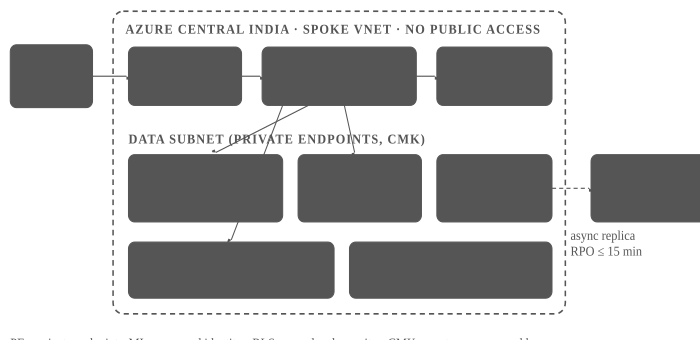

# Day 35 — Revision Drill: Agent Memory & Cloud Architectures

> Part of the [GenAI Architect study path](../../README.md) · Revision drill · [Original interactive pack](https://claude.ai/artifact/SaMH77tGs552KJYyS7SMQX) · [Offline HTML](../../archive/html/day-35.html)


Day 35 · Revision drill · Fri 13 Nov 2026

# Revision drill: agent memory and cloud reference architectures

Two topics re-tested at interview depth: Day 19 (short-term, long-term, episodic and procedural memory; summarisation; the LangGraph store) and Day 22 (Azure, AWS, GCP and watsonx reference architectures: private networking, IAM, data residency). They meet in one uncomfortable place: memory is personal data that persists, so where it lives, who can reach it over the network, and how you erase it are architecture decisions, not library settings. Eight hard questions, a 25-minute local drill that shows a cross-tenant leak and an incomplete erasure, then one design scenario.

**Worth knowing before an interview**

**Every hyperscaler now sells managed agent memory,** and they differ in ways that matter for a regulated client: AWS AgentCore Memory added an `IngestData` API on 8 Sep 2026 that writes straight to long-term memory without a short-term event; Microsoft Foundry's memory is still labelled preview; Google's Memory Bank docs now sit under the Gemini Enterprise Agent Platform name. On the IBM side, IBM and Yotta announced general availability of their sovereign agentic platform (watsonx Orchestrate on Yotta's Shakti Cloud, India) at the end of September 2026, after announcing the plan on 7 May. Meanwhile `langmem` has not released since 27 Oct 2025 (0.0.30), so quote it as reference code, not as a dependency.

## Versions and services to quote (checked today)

| Package / service | Latest | Released | Note |
| --- | --- | --- | --- |
| `langgraph` | 1.2.21 | 12 Nov 2026 | Checkpointer = short-term (per thread); `Store` = long-term (cross-thread, namespaced, optional vector index). |
| `langgraph-checkpoint-postgres` | 3.2.0 | 14 Oct 2026 | Production checkpointer and `PostgresStore` (pgvector for semantic search). |
| `langgraph-checkpoint-sqlite` | 3.1.3 | 30 Oct 2026 | Ships `SqliteSaver` and `SqliteStore`: persistence on Windows with no Docker (stretch goal 1). |
| `mem0ai` | 2.2.1 | 25 Sep 2026 | Framework-agnostic memory layer (extract → dedupe/update → retrieve). |
| `langmem` | 0.0.30 | 27 Oct 2025 | No release in ~12 months. Read its extraction prompts; don't depend on it. |
| `bedrock-agentcore` SDK | 1.26.0 | 10 Nov 2026 | AgentCore Memory strategies: semantic, user preference, summary, episodic; built-in, built-in with overrides, or self-managed. |
| Microsoft Foundry Agent Service | — | docs 29 Oct 2026 | Private networking = BYO VNet with a subnet delegated to `Microsoft.App/environments`, plus BYO Cosmos DB, AI Search and Storage. |

## Eight interview questions

Answer each aloud in under 90 seconds before opening the model answer. Q1–4 are memory, Q5–7 are cloud architecture, Q8 is where the two meet.

Q1A product owner wants the HR copilot to "remember everything about each employee". Design the memory model you would actually build, and say what you would refuse to store.

**Model answer**

| Layer | What it holds | Store / scope | Lifetime |
| --- | --- | --- | --- |
| Short-term (thread) | The current conversation, tool results, graph state | Checkpointer, keyed by `thread_id` | Session; purge after N days |
| Semantic: profile | A small typed document: role, location, language, stated preferences | Store, `(tenant, user, "profile")`, one key | Until changed; overwrite, not append |
| Semantic: collection | Facts the user told the assistant ("my project is X") | Store with vector index, `(tenant, user, "memories")` | TTL plus "last used" decay |
| Episodic | Past task outcomes used as few-shot examples ("how we resolved a similar request") | Store, often per team rather than per user, after redaction | Curated; reviewed |
| Procedural | Instructions and prompts the agent improves over time | Prompt registry, versioned and evaluated (Day 26) | Release-managed |

**Refuse:** anything the HR system of record already owns (salary, leave balance, performance rating). Fetch it live with the user's own authorisation instead, so memory never becomes a stale, unaudited copy of HR data. Also refuse health, grievances and other sensitive categories by default, with a classifier on the write path. Every memory row carries `source` (user said / inferred / tool), `created_at`, `last_used_at` and a confidence, so you can show it, correct it and expire it.

Q2Hot-path or background memory writes? The user said "I moved to Pune" last month and "I'm in Bengaluru" today. What happens in your design?

**Model answer**

- **Hot path** (the agent calls a "save memory" tool during the turn): visible to the user, immediate, but adds latency and a model decision on every turn, and the agent writes too much or too little.
- **Background** (a worker reads finished threads after a delay and extracts memories): no user latency, better extraction with a stronger model and more context, but the memory appears minutes later and needs a queue and a debounce so one chat is not processed five times.
- **Default:** background extraction, plus a hot-path tool only for explicit "remember this" requests. AgentCore's built-in strategies, Mem0 and Memory Bank all follow this extract-then-consolidate shape.
- **Contradictions are a consolidation problem.** On write, search existing memories for the same attribute and decide ADD / UPDATE / DELETE / NOOP (Mem0's model). Location belongs in the profile document, so the new value replaces the old one and the old one goes to history with a timestamp. Never keep both as free text in a vector collection, because retrieval will return whichever is closer to the query wording.
- Measure it: a memory eval set of multi-session scripts with expected recalled facts, including contradictions and deletions, scored for precision (no stale facts) as well as recall.

Q3How can long-term memory become a security vulnerability, and what controls do you put in?

**Model answer**

- **Cross-tenant or cross-user leakage:** a namespace built from anything the model or the request body controls, or a shared namespace (today's `--leaky` run). Control: the namespace is built server-side from the authenticated identity (LangGraph runtime `context`, AgentCore `actorId`), never from the prompt; add a test that user B can never retrieve user A's memory; for strict tenants, a separate index or database per tenant.
- **Memory poisoning:** an indirect prompt injection in a retrieved document or email gets extracted as a "fact" or "instruction" and then influences every future session (OWASP LLM01 and LLM04 territory). Controls: extract only from user turns by default, never from tool output; store facts, not instructions; label recalled memory as untrusted data in the prompt; run the Day 21 guard model on the write path.
- **Sensitive data accumulation:** PII masking (Presidio) before writing, encryption with customer-managed keys, retention limits.
- **No visibility:** users and auditors must be able to see, correct and delete memories. A "what do you remember about me" screen is both a trust feature and a compliance control.

Q4An employee invokes the right to erasure under India's DPDP Act. List every place your agent has their data, and how you prove it's gone.

**Model answer**

- **Long-term store:** all keys under `(tenant, user, *)`, including the vector index entries.
- **Checkpoints:** every thread the user owns. Today's drill shows memories deleted while the checkpoint still holds 14 messages. You need a `user_id → thread_ids` index to find them, then `checkpointer.delete_thread(thread_id)`.
- **Derived data:** summaries, episodic examples copied into team memory, fine-tuning or eval datasets built from conversations, semantic-cache entries keyed on their prompts.
- **Telemetry:** traces in Langfuse, LangSmith or App Insights, which often hold full prompts. Set retention, mask PII at ingestion, and support delete by user ID.
- **Provider side:** whether the model provider keeps prompts for abuse monitoring, and for how long; this is a contract and configuration question (for example, Azure's modified abuse monitoring for approved customers).
- **Backups:** usually handled by documented expiry rather than surgery, which you state in the privacy notice.
- **Proof:** an erasure job that produces an audit record per store with counts deleted, plus a test that searches every store for the user ID afterwards. On timing: the DPDP Rules were notified in November 2025 with a 12–18 month phase-in, so most data-fiduciary obligations apply from around May 2027. Design for it now.

Q5The security team says "we put a private endpoint on the Foundry resource, so the agent is private." Why is that only half the answer?

**Model answer**

- **A private endpoint controls inbound access** to the service. It says nothing about outbound traffic: where the agent's runtime goes when it calls a tool, an MCP server or a web API.
- **For Foundry Agent Service, outbound control needs the standard setup with private networking:** your own VNet with a subnet delegated to `Microsoft.App/environments` (Microsoft's docs recommend /24; /27 is the minimum in the portal steps), in the same region as the Foundry resource, and bring-your-own Cosmos DB (thread storage), AI Search (vector stores) and Storage (files), each with public access disabled and its own private endpoint, which are not created for you.
- **Then route egress** through Azure Firewall or a NAT gateway with an allow-list of FQDNs per tool, so an injected instruction cannot make the agent post data to an arbitrary URL.
- **DNS is where it usually breaks:** private DNS zones for every service, and conditional forwarders from on-prem to Azure DNS (168.63.129.16).
- **Identity:** the project's managed identity gets data-plane roles on each BYO resource; no keys in config. The same split applies elsewhere: on AWS, VPC endpoints (PrivateLink) for Bedrock inbound and a VPC configuration for AgentCore Runtime outbound; on GCP, VPC Service Controls around Vertex AI plus Private Service Connect; on IBM Cloud, private service endpoints for watsonx.ai.

Q6An Indian bank requires all customer data to stay in India. Walk through what "data residency" means for a GenAI system on Azure or AWS, and where it is commonly broken.

**Model answer**

- **Inference location:** on Azure, Global deployments may process prompts in any region; Data Zone deployments keep processing within a named geography; a regional Standard or Provisioned deployment in Central India or South India keeps it in-region. Check which models are offered as regional deployments in India, because the newest models often arrive as Global first. On AWS, cross-region inference profiles route requests across several regions in a geography; check that the profile you use does not route outside India, or call the model in-region without a profile.
- **Data at rest:** vector index, memory store, checkpoints, uploaded files, fine-tuning data, all in Indian regions, encrypted with customer-managed keys in a key vault in India.
- **Where it is commonly broken:** observability (a SaaS tracing tool hosted in the US receives full prompts); evaluation (an LLM-as-judge call to a Global deployment); semantic cache in a shared global Redis; the provider's abuse-monitoring storage; support tickets with pasted transcripts; DR replicas in a non-Indian paired region.
- **DR inside the boundary:** Central India ↔ South India for Azure; Mumbai ↔ Hyderabad for AWS.
- **If no compliant hosted model exists:** open-weight models self-hosted in an Indian region or on-prem, or watsonx on OpenShift, or the IBM–Yotta sovereign platform on Shakti Cloud. Map RBI's payment-data localisation rules and DPDP cross-border provisions with the bank's legal team; the architect's job is to show every data flow on one diagram.

Q7Managed agent platform (AgentCore, Foundry Agent Service, Vertex/Gemini Enterprise Agent Platform, watsonx Orchestrate) or your own LangGraph on Kubernetes? Defend a choice for a client that is "Azure-first but wants to avoid lock-in".

**Model answer**

- **Managed platforms give you** runtime, identity integration, managed memory, tool hosting and evaluation hooks in weeks, with the provider's compliance attestations. You give up control of the agent loop, upgrade timing, and portability of memory and thread data, and your agent definitions become provider-specific resources.
- **Self-hosted LangGraph** on AKS or Container Apps gives you a portable graph, your own Postgres for checkpoints and memory, and any model through a gateway. You own scaling, patching, HITL storage and the security reviews.
- **For "Azure-first, avoid lock-in":** keep the agent logic in a portable framework (LangGraph or Microsoft Agent Framework), run it on Azure Container Apps or AKS inside the client's VNet, call models through an AI gateway (Azure API Management or LiteLLM) so the provider can change, and keep memory in your own Postgres with pgvector behind a small `MemoryStore` interface. Use managed pieces where lock-in is cheap to reverse: Azure OpenAI as a model, AI Search as an index.
- **What I would choose differently:** for a team with little platform-engineering capacity and a single-cloud strategy, the managed agent service is the better trade, and I would write down the exit cost in the ADR (how threads and memory would be exported).

Q8Draw where agent memory sits in a cloud reference architecture. What network, identity and key-management controls does it get that a plain vector index for documents doesn't?

**Model answer**

- **Position:** memory is a data-tier service beside the document index, reached only by the agent runtime in the private subnet, never by the client or the model provider directly. The model receives a few recalled lines in the prompt, nothing more.
- **Document index vs memory:** documents are shared, curated and permissioned by ACL groups; memory is per-person, created by the system, mutable and subject to erasure. That changes the controls:
- **Identity:** row- or namespace-level authorisation bound to the end user's token (on-behalf-of), not just the service identity, so a bug in the agent cannot read another user's namespace. Postgres row-level security keyed on `user_id` is a cheap way to enforce this in the database.
- **Keys:** customer-managed keys; for strict tenants, a key per tenant so crypto-shredding is an erasure option.
- **Network:** private endpoint only, no public access, and no egress from the memory tier.
- **Operations:** retention and TTL jobs, an erasure API, an access log of every read (who, which memory, which run), and memory-level metrics on the observability dashboard: memories per user, recall hit rate, writes rejected by the PII classifier.

## 25-minute local drill: scope memory correctly, then break it

A small LangGraph app with both kinds of memory: a checkpointer for each thread and a `Store` with semantic search for facts that cross threads. The tenant and user come from the runtime context (standing in for your auth layer), never from the prompt. A toy hashed embedding keeps it deterministic and offline. It runs on native Windows with no GPU and no API key.

```text
mkdir agent-memory; cd agent-memory
py -m venv .venv
.\.venv\Scripts\Activate.ps1
python -m pip install langgraph==1.2.21 numpy
```

Save as `memory_drill.py`:

`lab/memory_drill.py`

```python
"""Day 35 drill: short-term vs long-term agent memory in LangGraph, and the ways it leaks.

Short-term = per-thread state persisted by a checkpointer (here InMemorySaver).
Long-term  = cross-thread memories in a Store, namespaced (tenant, user, "memories"),
             with semantic search through a toy embedding so it runs with no GPU/API key.

  python memory_drill.py           # correct scoping
  python memory_drill.py --leaky   # namespace built without the tenant/user: watch data cross users
"""
import hashlib
import math
import sys
from dataclasses import dataclass
from typing import Annotated, TypedDict
import operator

from langgraph.checkpoint.memory import InMemorySaver
from langgraph.graph import END, START, StateGraph
from langgraph.runtime import Runtime
from langgraph.store.memory import InMemoryStore

LEAKY = "--leaky" in sys.argv
WINDOW = 4  # short-term: keep the last N messages verbatim, fold older ones into a summary

# ---- toy embedding: hashed bag of words, 64 dims (swap for nomic-embed-text via Ollama) ----
DIMS = 64
def embed(texts: list[str]) -> list[list[float]]:
    out = []
    for t in texts:
        v = [0.0] * DIMS
        for w in t.lower().replace(",", " ").replace(".", " ").replace("?", " ").split():
            v[int(hashlib.md5(w.encode()).hexdigest(), 16) % DIMS] += 1.0
        n = math.sqrt(sum(x * x for x in v)) or 1.0
        out.append([x / n for x in v])
    return out

def toks(texts: list[str]) -> int:
    return sum(len(t.split()) * 4 // 3 for t in texts)

@dataclass
class Ctx:               # trusted identity comes from the auth layer, never from the prompt
    tenant: str
    user_id: str

class S(TypedDict):
    messages: Annotated[list[str], operator.add]
    summary: str
    prompt_tokens: int
    recalled: list[str]

def ns(ctx: Ctx) -> tuple:
    return ("memories",) if LEAKY else (ctx.tenant, ctx.user_id, "memories")

def agent(state: S, runtime: Runtime[Ctx]) -> dict:
    ctx, store = runtime.context, runtime.store
    msg = state["messages"][-1]
    if msg.lower().startswith("remember"):                      # hot-path write (explicit ask)
        fact = msg.split(" ", 1)[1]
        store.put(ns(ctx), hashlib.sha1(fact.encode()).hexdigest()[:8], {"text": fact, "source": "user"})
        reply = f"OK, saved: {fact}"
        recalled = []
    else:
        hits = store.search(ns(ctx), query=msg, limit=2)        # semantic recall
        recalled = [f"{h.value['text']} (score {h.score:.2f})" for h in hits]
        reply = "Using memory: " + "; ".join(h.value["text"] for h in hits) if hits else "No memory found."
    # short-term: summary + last WINDOW messages is what the model would actually see
    window = state["messages"][-WINDOW:]
    prompt = [state.get("summary", "")] + window + [r for r in recalled]
    return {"messages": [f"AI: {reply}"], "prompt_tokens": toks(prompt) + 200, "recalled": recalled}

def summarize(state: S) -> dict:
    """Fold messages that fell out of the window into a running summary (a cheap model in real life)."""
    old = state["messages"][:-WINDOW]
    if not old:
        return {}
    return {"summary": f"[summary of {len(old)} earlier messages]"}

def build():
    g = StateGraph(S, context_schema=Ctx)
    g.add_node("agent", agent)
    g.add_node("summarize", summarize)
    g.add_edge(START, "agent")
    g.add_edge("agent", "summarize")
    g.add_edge("summarize", END)
    store = InMemoryStore(index={"embed": embed, "dims": DIMS, "fields": ["text"]})
    return g.compile(checkpointer=InMemorySaver(), store=store), store

def say(app, text, thread, ctx):
    out = app.invoke({"messages": [f"User: {text}" if not text.lower().startswith("remember") else text]},
                     {"configurable": {"thread_id": thread}}, context=ctx)
    print(f"  [{ctx.tenant}/{ctx.user_id} · {thread}] {text}")
    print(f"      -> {out['messages'][-1]}   (history={len(out['messages'])} msgs, prompt~{out['prompt_tokens']} tok)")
    return out

if __name__ == "__main__":
    app, store = build()
    rahul = Ctx("acme", "rahul")
    priya = Ctx("globex", "priya")
    print(f"leaky={LEAKY}  window={WINDOW}\n")

    print("1) Long-term writes in thread t1")
    say(app, "remember I prefer answers with Azure and watsonx mappings", "t1", rahul)
    say(app, "remember my project is the HR policy assistant for 50k employees", "t1", rahul)

    print("\n2) New thread t2: short-term is empty, long-term recall still works")
    say(app, "Which cloud mappings should you include for me?", "t2", rahul)

    print("\n3) Another tenant's user asks a similar question")
    out = say(app, "Which cloud mappings and project should you use?", "p1", priya)
    leaked = any("watsonx" in r or "HR policy" in r for r in out["recalled"])
    print(f"      cross-tenant leak: {'YES  <-- incident' if leaked else 'no'}")

    print("\n4) Long thread: prompt stays bounded because of window + summary")
    for i in range(6):
        out = say(app, f"Follow-up question number {i} about leave policy", "t2", rahul)
    print(f"      summary: {out['summary']!r}; full history would be ~{toks(out['messages']) + 200} tok and growing")

    print("\n5) Right to erasure (DPDP / GDPR): delete Rahul's long-term memories")
    for item in store.search(ns(rahul), limit=100):
        store.delete(ns(rahul), item.key)
    say(app, "Which cloud mappings should you include for me?", "t3", rahul)
    cp = app.get_state({"configurable": {"thread_id": "t2"}})
    print(f"      ...but thread t2's checkpoint still holds {len(cp.values['messages'])} messages: erasure must cover checkpoints too")
```

```text
python memory_drill.py
python memory_drill.py --leaky
```

Expected output (tested today on Python 3.13 with langgraph 1.2.21; deterministic). Normal run, abridged:

2) New thread t2: short-term is empty, long-term recall still works
[acme/rahul · t2] Which cloud mappings should you include for me?
-> AI: Using memory: I prefer answers with Azure and watsonx mappings; my project is the HR policy assistant for 50k employees (history=2 msgs, prompt~241 tok)
3) Another tenant's user asks a similar question
[globex/priya · p1] Which cloud mappings and project should you use?
-> AI: No memory found. (history=2 msgs, prompt~212 tok)
cross-tenant leak: no
4) Long thread: prompt stays bounded because of window + summary
...
summary: '[summary of 10 earlier messages]'; full history would be ~468 tok and growing
5) Right to erasure (DPDP / GDPR): delete Rahul's long-term memories
[acme/rahul · t3] Which cloud mappings should you include for me?
-> AI: No memory found. (history=2 msgs, prompt~212 tok)
...but thread t2's checkpoint still holds 14 messages: erasure must cover checkpoints too

With `--leaky` the namespace drops tenant and user, and Priya at another company gets Rahul's memories:

3) Another tenant's user asks a similar question
[globex/priya · p1] Which cloud mappings and project should you use?
-> AI: Using memory: I prefer answers with Azure and watsonx mappings; my project is the HR policy assistant for 50k employees (history=2 msgs, prompt~241 tok)
cross-tenant leak: YES <-- incident

**Then fix it properly (10 min):**

1. **Finish the erasure.** Keep a `user_id → [thread_id]` map as threads are created, then call `app.checkpointer.delete_thread(tid)` for each in step 5. Re-run and confirm `app.get_state(...)` for t2 comes back empty. That is Q4 in code.
2. **Make the leak impossible, not just absent.** Wrap the store in a small class whose methods take only the `Ctx` and build the namespace themselves, so no node can pass a raw namespace. Add an assertion test: after Rahul writes, every search as Priya returns nothing.

**Stretch goals:**

- **Persistence and real embeddings.** `python -m pip install langgraph-checkpoint-sqlite==3.1.3 langchain-ollama` and `ollama pull nomic-embed-text`. Swap in `SqliteSaver.from_conn_string("mem.db")` and `SqliteStore.from_conn_string("mem.db", index={"embed": OllamaEmbeddings(model="nomic-embed-text"), "dims": 768, "fields": ["text"]})` (both are context managers, so use `with`). Restart the script between steps 1 and 2 and confirm recall survives. Note how scores change compared with the toy embedding.
- **Consolidation (Q2).** Add a profile document at `(tenant, user, "profile")` with a `city` field. When the user says "I moved to X", overwrite the field and append the old value to a `history` list with a timestamp. Then ask "where am I based?" in a new thread and check that only the current city comes back.

## Design scenario (25 minutes, paper first)

**Brief.** A private-sector Indian bank wants a relationship-manager copilot for 6,000 RMs serving 2 million customers. It should remember each RM's working preferences and, per customer, the commitments made in past meetings ("promised a callback on the FD rate next week"), draft meeting briefs, and answer product-policy questions. Azure is the strategic cloud. All customer data must stay in India, the bank's network has no public internet egress, the CISO wants every memory read logged, and DR must recover within 4 hours with at most 15 minutes of data loss.

**Your deliverable:** the memory model (what is per RM, what is per customer, who can read it), the network and identity layout, the residency and DR story, three NFRs with numbers, and one ADR.



One possible shape, for checking your answer after you sketch your own.

**What a strong answer covers**

- **Memory model:** per-RM profile (preferences, language, products they cover); per-customer commitments as structured records (`customer_id, rm_id, commitment, due_date, status, source_meeting`), not free-text vectors, so they can be listed, closed and audited. Access follows the CRM's relationship mapping: when a customer is reassigned, the new RM sees the commitments and the old one stops seeing them. That is an authorisation lookup at read time, not a copy.
- **Why structured beats "remember everything":** commitments have due dates and owners; the copilot's best feature is "you have 3 open promises with this customer", which a vector store does badly.
- **Network and identity:** no public endpoints; Foundry or Azure OpenAI reached through a private endpoint; agent runtime in a delegated subnet; egress only through the firewall to CRM and core-banking APIs; on-behalf-of tokens so CRM calls run as the RM, and Postgres RLS on `rm_id` plus a relationship check.
- **Residency:** regional deployments only (no Global or cross-geography routing), evaluation and LLM-as-judge on the same regional deployment, tracing self-hosted in India (Langfuse on the same platform) or Azure Monitor in-region, abuse-monitoring terms reviewed in the contract.
- **DR:** Postgres asynchronous replica in South India meets RPO 15 min; AI Search is rebuilt from source documents in the standby (an index is derived data, so rebuild rather than replicate); model deployments pre-created in South India with quota reserved, because quota is the item that fails a DR drill; run the drill quarterly.
- **NFR examples:** p95 brief generation ≤ 8 s; 100% of memory reads written to the audit log within 60 s (alert on gaps); erasure completed across all stores within 7 days with an audit record; RTO 4 h, RPO 15 min, verified by drill.
- **ADR candidate:** the one below: managed agent memory versus your own Postgres memory store.

## Architect's lens: one ADR

### ADR-035: Agent memory on self-managed Postgres + pgvector, behind a MemoryStore interface

**Context.** The RM copilot needs per-RM and per-customer memory with India residency, per-read audit, structured commitments, erasure within 7 days, and a 15-minute RPO. Azure is the strategic cloud; the bank wants to avoid lock-in on customer data.

**Options.** (A) Foundry Agent Service threads and memory (managed, but memory is preview and data lives in service-shaped stores); (B) Mem0 self-hosted (good extraction and consolidation, an extra component to secure); (C) Azure Database for PostgreSQL with pgvector, accessed through LangGraph's `PostgresStore` and a thin MemoryStore interface; (D) Cosmos DB with vector search.

**Decision.** C. It is GA, in-region with an asynchronous cross-region replica, supports row-level security and customer-managed keys, holds structured commitments and vectors in one database, and the same Postgres already holds LangGraph checkpoints, so one erasure job covers both.

**Consequences.** We build extraction and consolidation ourselves (borrowing prompts from LangMem and Mem0). We own vacuum, index tuning and capacity. The interface lets us move to a managed memory service later if it becomes GA with the controls we need; the exit cost is a data migration, written down here. Revisit in 6 months or when Foundry memory goes GA.

## Repos to revisit (10 min each)

- [langchain-ai/langgraph](https://github.com/langchain-ai/langgraph) — `libs/checkpoint/langgraph/store/base` for the Store API (namespaces, TTL, index config), and the Postgres store in `libs/checkpoint-postgres`.
- [mem0ai/mem0](https://github.com/mem0ai/mem0) — the update step that decides ADD / UPDATE / DELETE / NOOP against existing memories (Q2).
- [aws/bedrock-agentcore-sdk-python](https://github.com/aws/bedrock-agentcore-sdk-python) — the memory client: how `actorId`, sessions and strategies map to namespaces.
- [langchain-ai/langmem](https://github.com/langchain-ai/langmem) — reference only (no release since Oct 2025): read the memory-manager extraction prompts.

## Read before tomorrow (optional, 20 min)

- [LangGraph docs: memory](https://docs.langchain.com/oss/python/langgraph/memory) — semantic, episodic and procedural memory; hot-path vs background writes; profile vs collection.
- [AWS: AgentCore Memory strategies](https://docs.aws.amazon.com/bedrock-agentcore/latest/devguide/memory-strategies.html) — built-in, override and self-managed extraction pipelines.
- [Microsoft Learn: private networking for Foundry Agent Service](https://learn.microsoft.com/azure/foundry/agents/how-to/virtual-networks) — the BYO VNet and BYO resources requirements behind Q5.
- [Google Cloud: Memory Bank overview](https://docs.cloud.google.com/agent-builder/agent-engine/memory-bank/overview) — Google's managed long-term memory, for the GCP column of Q7.

## Tomorrow

Day 36 drill: tool and function calling across providers (Day 16) with security, governance and responsible AI (Day 28).

## Lab files in this folder

- [`lab/memory_drill.py`](lab/memory_drill.py)
