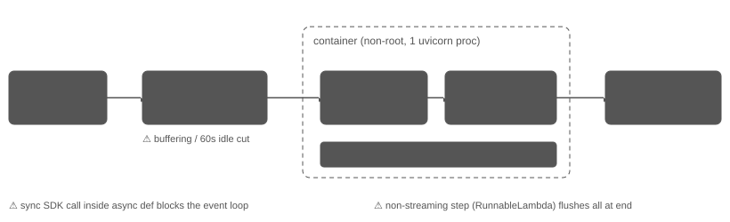

# Day 37 — Revision Drill: LangChain Core & Containerizing

> Part of the [GenAI Architect study path](../../README.md) · Revision drill · [Original interactive pack](https://claude.ai/artifact/PaArr4iS7pDv1NT4VRZtpH) · [Offline HTML](../../archive/html/day-37.html)


GenAI Architect prep · revision drill

# Day 37 — LangChain core & containerizing GenAI services

Two topics from Weeks 3–4 that meet in one place: the LCEL chain you write (Day 15) and the streaming FastAPI container that ships it (Day 24). Eight hard questions, one design scenario, a 60-minute drill.

Revisits **Day 15** + **Day 24**
langchain **1.5.0** · core **1.8.0**
fastapi **0.163.0** (native SSE since 0.135)
langchain-ollama **1.1.0**

## Why this matters for the JD

- **Agentic frameworks:** "LangChain, LangGraph, tool calling" — you must say which parts of LangChain v1 you'd use in production and which you'd keep out.
- **CI/CD & productionization:** "Docker, API deployment, model endpoints, observability, rollback, scaling" — a streaming LLM API is the most common thing you'll be asked to containerize and defend.
- **Python backend/APIs + security:** secrets out of images, non-root containers, health probes that don't burn tokens.

## Recap in one picture

Where tokens travel, and every place that can silently buffer or kill a stream.



## Eight hard questions

Answer out loud in ≤ 90 s each, then compare

1

LangChain · scope

### LangChain v1 slimmed the package and pushed legacy chains into langchain-classic . In a design review, what do you allow from LangChain and what do you ban?

**Allow:** `langchain-core` primitives (messages, prompt templates, chat-model interface, LCEL composition, `with_structured_output`, `with_fallbacks`, callbacks/tracing) and provider packages (`langchain-ollama`, `langchain-ibm`, `langchain-openai`). For agents, `create_agent` with middleware, or LangGraph directly when you need explicit state, checkpoints and human-in-the-loop.

**Ban or justify:** `langchain-classic` chains (opaque prompts, hard to version), deep custom subclassing of framework internals, and LangServe (archived May 2026 — serve with your own FastAPI instead). The rule: the framework is an adapter layer at the edge; your domain logic, prompts and contracts stay in plain Python you own.

2

Streaming · debugging

### The chain streams token-by-token in a notebook, but through the deployed API the user sees nothing for 8 s and then the full answer. Walk the diagnosis.

1. **Code path:** is the endpoint calling `.ainvoke()` instead of `.astream()`? Is there a `RunnableLambda` or a parser that needs the full output (e.g. a JSON parser without partial mode) in the chain? Any non-streaming step forces aggregation.
2. **Event loop:** a sync SDK call in `async def` stalls every stream on that worker.
3. **Middleware:** `GZipMiddleware` or a response-logging middleware that reads the body buffers it.
4. **Proxy:** Nginx `proxy_buffering on`, an API gateway that buffers responses, or a CDN. FastAPI's native SSE already sends `X-Accel-Buffering: no` and `Cache-Control: no-cache`; check the gateway honours them.
5. **Prove it** with `curl -N` at each hop (pod IP → service → ingress → gateway) and measure time-to-first-token at each one.

3

Resilience

### You add .with\_retry() and .with\_fallbacks() to every chain. What can go wrong at scale?

**Retry storms:** a 429 from the provider multiplied by client retries × gateway retries × chain retries. Retry in exactly one layer, with jittered backoff and a budget, and treat 429 as "shed or queue", not "retry harder".

**Mid-stream failure:** once tokens have reached the user you cannot transparently fail over; the fallback restarts the answer. Fail over only before the first token, and emit an explicit SSE event if you restart.

**Silent quality change:** the fallback model behaves differently (format, refusals, context limit). Tag every response with the model that served it, include fallback rate on the dashboard, and run the eval suite against the fallback model too. **Cost:** retries on long prompts double spend; cap with token budgets per request.

4

Change management

### LangChain ships minor releases almost weekly. How do you keep upgrades from breaking production?

- Lock the full dependency tree (`uv.lock` or hashed `requirements.txt`); `langchain-core` is the compatibility anchor for every provider package.
- Contract tests with `GenericFakeChatModel`: assert prompt rendering, stream shape and parser behaviour without a model call — fast and deterministic in CI.
- An eval gate on a golden set against the real model for any dependency or prompt change; block on regression of faithfulness/format-validity, alert on latency.
- Renovate/Dependabot PRs batched weekly, deployed canary-first with the version in a response header and trace attribute so you can correlate incidents.

5

Protocol choice

### SSE, WebSocket, or plain chunked HTTP for streaming LLM tokens to an enterprise web app? Defend your pick.

**Default to SSE.** It is plain HTTP, passes through corporate proxies and API gateways (Azure APIM, AWS API Gateway HTTP APIs, Kong), works with standard auth headers, and gives you event types, ids and `Last-Event-ID` resume for free. FastAPI now supports it natively. Use POST-based SSE when the request body is large (a fetch-based client rather than browser `EventSource`, which is GET-only).

**WebSocket** only when the channel is truly bidirectional (voice, barge-in, collaborative agents): it costs you sticky sessions, custom auth on upgrade, and weaker gateway support. **Chunked JSON-lines** is fine service-to-service. Whatever you pick, set gateway idle timeouts above your worst TTFT and send keep-alive pings (FastAPI's SSE sends one every 15 s).

6

Concurrency & scaling

### One Uvicorn process per container, or --workers 4 ? And what actually limits concurrency in an LLM proxy service?

On Kubernetes: **one process per container** and let HPA/KEDA scale replicas. Probes, memory limits and OOM-kills then map to one process, and scaling is visible to the scheduler. Multiple workers make sense on a single VM or Docker Compose.

A thin LLM proxy is I/O-bound: one async process holds hundreds of open streams. The real limits are open connections and file descriptors, the provider's TPM/RPM quota, memory per stream if you buffer for logging, and any CPU-bound work in-process (tokenization, PII masking, reranking) that should move to a thread pool or separate service. Scale on **concurrent streams or queue depth**, not CPU — CPU stays low while users wait.

7

Health probes

### Design liveness, readiness and startup probes for a GenAI API that depends on an external model endpoint.

- **Liveness** (`/healthz`): process and event loop respond. No dependency calls. If it checks the model, a provider outage restarts every pod and makes things worse.
- **Readiness** (`/readyz`): cheap dependency check (model endpoint's list/health route, vector DB ping) with a 1–2 s timeout and a cached result. Never a real completion: probes every 10 s × N pods is real token spend.
- **Startup:** covers slow warm-up (loading an embedding model, a reranker, or a local vLLM pulling weights) so liveness doesn't kill the pod mid-load.
- Graceful shutdown: `preStop` sleep + Uvicorn `--timeout-graceful-shutdown` longer than a typical answer, so rolling deploys don't cut streams mid-sentence.

8

Image security

### A security reviewer finds an API key in layer 4 of your image. Fix it, and list the image-hardening controls you'd make mandatory.

**Fix:** rotate the key now (deleting it in a later layer doesn't remove it from history), rebuild, purge the old tags from the registry. Runtime secrets come from the platform (Kubernetes Secret via CSI driver from Key Vault / Secrets Manager / IBM Secrets Manager, or workload identity so there is no key at all). Build-time secrets (private package index) use BuildKit `RUN --mount=type=secret`, which never lands in a layer.

**Mandatory:** multi-stage build, slim or distroless base pinned by digest, non-root UID, read-only root filesystem, `.dockerignore` excluding `.env`/`.git`, SBOM + vulnerability scan (Trivy/Grype) as a CI gate, signed images (cosign) verified by admission policy, and no shell in the final image where you can manage it.

## Design scenario

### Streaming support copilot for 4,000 concurrent agents

A contact-centre copilot drafts replies for live support agents. Peak: 4,000 concurrent agents, about 1 request per agent per 90 s, answers of ~350 output tokens streamed. Traffic enters through the bank's existing API gateway (60 s idle timeout, response buffering on by default). Model: watsonx.ai Granite primary, Azure OpenAI fallback. Data must stay in India regions. The team wants to "just use LangChain for everything".

**Your 15-minute whiteboard answer should cover:**

1. Throughput math: ~44 req/s at peak; with ~6 s average stream time that's ~270 concurrent streams. Size pods for it and add headroom for retries.
2. Gateway changes: buffering off for the route, idle timeout ≥ 120 s, SSE keep-alive pings, auth at the gateway with per-tenant rate limits.
3. Service shape: FastAPI + native SSE, one Uvicorn process per pod, HPA on concurrent-stream metric, PodDisruptionBudget, graceful drain.
4. LangChain boundary: LCEL for prompt → model → parser with `with_fallbacks` (only before first token); no classic chains; prompts versioned in the repo.
5. Residency for the fallback: a regional (not Global) Azure OpenAI deployment in an India region, if your model is offered there; otherwise fail closed or degrade to a smaller self-hosted model.
6. Observability: TTFT, tokens/s, fallback rate, cost per conversation, with OpenTelemetry GenAI attributes into Langfuse or Instana.
7. Rollback: image tag + prompt version + model id pinned per release; canary 5% with eval gate on draft acceptance rate.

## Hands-on drill (60–75 min)

Build a streaming LCEL service, measure time-to-first-token, then containerize it properly. Part A runs natively on Windows. Part B needs **Docker Desktop with the WSL2 backend**.

**Model choice:** `qwen2.5:3b` (~2 GB Q4) fits comfortably in the RTX 3050's 6 GB. Swap in `llama3.2:3b` if you prefer.

### Part A — streaming service (PowerShell)

setup

```text
ollama pull qwen2.5:3b
mkdir genai-stream-svc; cd genai-stream-svc; mkdir app
py -3.13 -m venv .venv
.\.venv\Scripts\Activate.ps1
python -m pip install fastapi==0.163.0 "uvicorn[standard]==0.54.0" langchain-core==1.8.0 langchain-ollama==1.1.0 httpx
python -m pip freeze > requirements.txt
New-Item app\__init__.py -ItemType File
```

app/main.py

`lab/stream_app.py`

```python
import os
from collections.abc import AsyncIterable

import httpx
from fastapi import FastAPI, Request, Response
from fastapi.sse import EventSourceResponse, ServerSentEvent
from langchain_core.output_parsers import StrOutputParser
from langchain_core.prompts import ChatPromptTemplate
from langchain_ollama import ChatOllama
from pydantic import BaseModel, Field

OLLAMA_URL = os.getenv("OLLAMA_BASE_URL", "http://localhost:11434")
MODEL = os.getenv("MODEL", "qwen2.5:3b")

llm = ChatOllama(model=MODEL, base_url=OLLAMA_URL, temperature=0, num_predict=256)
prompt = ChatPromptTemplate.from_messages([
    ("system", "You are a concise enterprise assistant. Answer in at most 120 words."),
    ("human", "{question}"),
])
# LCEL: prompt -> model -> parser. Every step is a Runnable, so .astream() works end to end.
chain = (prompt | llm | StrOutputParser()).with_config(run_name="ask_chain")

app = FastAPI(title="genai-stream-svc")

class Ask(BaseModel):
    question: str = Field(min_length=3, max_length=2000)

@app.get("/healthz")  # liveness: the process is up
async def healthz() -> dict:
    return {"status": "ok"}

@app.get("/readyz")  # readiness: the model backend answers
async def readyz(response: Response) -> dict:
    try:
        async with httpx.AsyncClient(timeout=2) as client:
            r = await client.get(f"{OLLAMA_URL}/api/tags")
            r.raise_for_status()
        return {"status": "ready", "model": MODEL}
    except Exception as exc:
        response.status_code = 503
        return {"status": "not-ready", "error": type(exc).__name__}

@app.post("/ask/stream", response_class=EventSourceResponse)
async def ask_stream(body: Ask, request: Request) -> AsyncIterable[ServerSentEvent]:
    n = 0
    async for chunk in chain.astream({"question": body.question}):
        if await request.is_disconnected():  # stop paying for tokens nobody reads
            break
        n += 1
        yield ServerSentEvent(data={"token": chunk}, event="token", id=str(n))
    yield ServerSentEvent(raw_data="[DONE]", event="done")
```

client.py — measures time-to-first-token

`lab/stream_client.py`

```python
import json
import sys
import time

import httpx

url = sys.argv[1] if len(sys.argv) > 1 else "http://localhost:8000/ask/stream"
q = {"question": "Explain RAG vs fine-tuning to a CFO in 3 bullets."}
t0, first, event = time.perf_counter(), None, None
with httpx.stream("POST", url, json=q, timeout=120) as r:
    for line in r.iter_lines():
        if line.startswith("event:"):
            event = line[6:].strip()
        elif line.startswith("data:") and event == "token":
            first = first or time.perf_counter() - t0
            print(json.loads(line[5:])["token"], end="", flush=True)
print(f"\n\nTTFT: {first:.2f}s   total: {time.perf_counter() - t0:.2f}s")
```

run (two terminals)

```text
# terminal 1
uvicorn app.main:app --port 8000
# terminal 2
python client.py
curl.exe -s http://localhost:8000/readyz
```

**Expected:** three bullets appear word by word, then a line like `TTFT: 0.6s total: 4.1s` (first call is slower while Ollama loads the model to GPU). `/readyz` returns `{"status":"ready","model":"qwen2.5:3b"}`; stop Ollama and it returns 503 while `/healthz` stays 200.

### Part B — production-shaped container (Docker Desktop)

Dockerfile

```text
# syntax=docker/dockerfile:1
FROM python:3.13-slim AS builder
ENV PIP_NO_CACHE_DIR=1 PIP_DISABLE_PIP_VERSION_CHECK=1
RUN python -m venv /opt/venv
ENV PATH=/opt/venv/bin:$PATH
COPY requirements.txt .
RUN pip install -r requirements.txt

FROM python:3.13-slim AS runtime
ENV PATH=/opt/venv/bin:$PATH PYTHONUNBUFFERED=1 PYTHONDONTWRITEBYTECODE=1
RUN useradd --create-home --uid 10001 app
COPY --from=builder /opt/venv /opt/venv
WORKDIR /srv
COPY --chown=app:app app ./app
USER 10001
EXPOSE 8000
HEALTHCHECK --interval=15s --timeout=3s --start-period=10s --retries=3 \
  CMD python -c "import urllib.request,sys; sys.exit(0 if urllib.request.urlopen('http://127.0.0.1:8000/healthz', timeout=2).status == 200 else 1)"
CMD ["uvicorn", "app.main:app", "--host", "0.0.0.0", "--port", "8000", "--proxy-headers", "--timeout-graceful-shutdown", "20"]
```

.dockerignore

```text
.venv
.git
.env
__pycache__
*.pyc
client.py
```

build & run (PowerShell)

```text
# remove Windows-only packages from the freeze if pip complains (e.g. pywin32, colorama is fine)
docker build -t genai-stream-svc:0.1 .
docker run --rm -p 8000:8000 -e OLLAMA_BASE_URL=http://host.docker.internal:11434 --read-only --tmpfs /tmp genai-stream-svc:0.1
python client.py
docker ps        # STATUS should show (healthy) after ~15 s
docker image ls genai-stream-svc
```

**Expected:** the same streamed answer through the container, the container reports `(healthy)`, it runs as UID 10001 with a read-only root filesystem, and the image is in the low hundreds of MB.

### Stretch goals

1. **Fallback before first token:** wrap `llm` as `ChatOllama(model="qwen2.5:3b").with_fallbacks([ChatOllama(model="llama3.2:1b")])`, point the primary at a model you haven't pulled, and emit a first SSE event `event: meta` naming the model that served the answer. Explain why you would not fail over after tokens have been sent.
2. **Contract test without a GPU:** write a pytest that swaps `chain` for `prompt | GenericFakeChatModel(...) | StrOutputParser()` (from `langchain_core.language_models`) and asserts the SSE content type, ordered ids and the final `[DONE]`. This is the test that would gate a LangChain upgrade in CI.

## GitHub repos to study

| Repo | What to look at |
| --- | --- |
| [langchain-ai/langchain](https://github.com/langchain-ai/langchain) | `libs/core/langchain_core/runnables/` — how `astream`, fallbacks and retry are implemented; `libs/partners/ollama` for a provider package's shape. |
| [fastapi/full-stack-fastapi-template](https://github.com/fastapi/full-stack-fastapi-template) | Backend Dockerfile, compose files and CI workflows: a reference layout for config, migrations, tests and image builds. |
| [astral-sh/uv-docker-example](https://github.com/astral-sh/uv-docker-example) | Multi-stage Dockerfile with cached `uv sync` layers — the faster alternative to the pip builder used above. |
| [docker/genai-stack](https://github.com/docker/genai-stack) | Compose wiring of Ollama, a vector store and LangChain apps; compare its service health and model-pull steps with your probes. |

**Avoid:** `langchain-ai/langserve` is archived (May 2026) and deprecated; don't cite it as a serving option in interviews.

## Read / watch

- [LangChain v1 migration guide](https://docs.langchain.com/oss/python/migrate/langchain-v1) — what moved to `langchain-classic`, `create_agent` and middleware replacing hooks.
- [FastAPI: Server-Sent Events](https://fastapi.tiangolo.com/tutorial/server-sent-events/) — native `EventSourceResponse`, keep-alive pings, `Last-Event-ID` resume, POST SSE.
- [FastAPI in Containers](https://fastapi.tiangolo.com/deployment/docker/) and [Docker building best practices](https://docs.docker.com/build/building/best-practices/) — one process per container on Kubernetes, exec-form CMD, multi-stage, pinned bases.

## Architect's lens — ADR-037

Title
:   LangChain usage boundary and streaming transport for GenAI APIs

Context
:   Multiple teams ship LLM APIs. LangChain v1 changes fast and LangServe is archived. Traffic crosses a corporate API gateway; users expect token streaming.

Options
:   (a) LangChain end to end incl. classic chains; (b) `langchain-core` LCEL + provider packages at the model edge, own FastAPI service; (c) raw provider SDKs with a thin in-house abstraction.

Decision
:   **(b).** LCEL for prompt → model → parser, fallbacks and tracing; LangGraph only where state or human approval is needed. FastAPI native SSE as the streaming contract. One Uvicorn process per pod, hardened multi-stage image, liveness without dependency calls.

Consequences
:   + Provider swap (watsonx ↔ Azure OpenAI ↔ Ollama) is a config change; + contract tests with fake models make upgrades safe. − Weekly dependency churn needs Renovate + an eval gate; − teams must hand-write serving code LangServe used to give them (mitigated by a shared service template).

## Tomorrow

Day 38 revision drill: Architect deliverables (HLD/NFRs/token-cost model) + semantic and prompt caching.

Versions checked on PyPI on 15 Nov 2026. The drill code was run against a fake chat model; run it locally against Ollama for real latencies.

## Lab files in this folder

- [`lab/stream_app.py`](lab/stream_app.py)
- [`lab/stream_client.py`](lab/stream_client.py)
