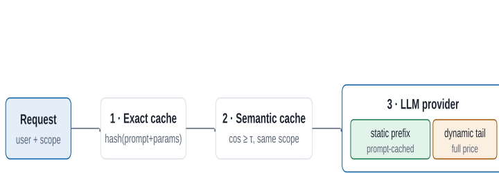

# Day 38 — Revision Drill: Caching & Architect Deliverables

> Part of the [GenAI Architect study path](../../README.md) · Revision drill · [Original interactive pack](https://claude.ai/artifact/BeDewo7Pm3XVJsiCwb9JCh) · [Offline HTML](../../archive/html/day-38.html)


Day 38 · Revision drill · Mon 16 Nov 2026

# Caching for cost & latency, and the architect's cost model

Today pairs Day 13 (semantic and prompt caching) with Day 29 (NFRs, token-cost estimation, DR, ADRs). In a design review these come up together, because "what will this cost at 50k users, and what happens when the provider goes down?" is one question.

Day 13 · Caching & latency/costDay 29 · Architect deliverables~75 min

## Why this matters for the JD

The JD asks for *latency/cost* evaluation, *cost controls* in productionization, and *HLD/LLD, NFRs, decision logs, cost estimates* plus *scalability, resilience, DR*. Caching is the cheapest lever on the cost line, and a defensible token-cost model is the artifact that gets a GenAI design approved by finance and the architecture board.

## Concept recap

### Three caches, three different things they skip



Only the semantic cache can change what the user sees. Exact and prefix caches are correctness-neutral; that asymmetry drives most review discussions.

- **Provider prompt (prefix) caching.** The provider reuses KV-cache for an identical prompt prefix. On Anthropic, cache writes cost 1.25× base input (5-min TTL) or 2× (1-hour TTL), reads 0.1× (lower on some newer models); up to 4 breakpoints; the cache hierarchy is tools → system → messages, so changing a tool definition invalidates everything after it. On OpenAI, caching is automatic above a minimum prompt size (1,024 tokens on current models), hits show in `usage…cached_tokens`, and `prompt_cache_key` helps route related requests to the same cache. Design rule: **stable content first, volatile content last**, and never put timestamps or request IDs in the system prompt.
- **Semantic cache.** Embed the query, nearest-neighbour lookup, return the stored answer above a threshold τ. Biggest savings, but it is the only layer that can serve a *wrong* answer. It needs scope partitioning (tenant, ACL group, locale), TTLs tied to source-document versions, and an offline-measured false-hit rate. LiteLLM's own docs warn that semantic caching replays stale responses on multi-turn and agentic traffic.
- **Token-cost model (Day 29).** Cost per query = calls/query × [(static prefix × cache factor) + retrieved + user] × input price + output × output price. The term people forget is **calls per query**: query rewriting, reranking LLMs, retries, and agent steps multiply everything. In the lab model a 20% change in calls/query moves cost 20%; a 20% change in the cached prefix moves it about 7%.
- **NFRs that belong in the HLD:** p95 time-to-first-token, p95 end-to-end latency, groundedness/faithfulness floor on the golden set, availability (with degraded mode defined), cost per query ceiling, RPO/RTO for the vector index and conversation store, data residency.

## Trade-offs & decision table

| Lever | Pick when | Failure mode | Cost / latency effect |
| --- | --- | --- | --- |
| **Exact-match cache** (Redis key = hash of normalised prompt + model + params) | Repeated system jobs, batch summarisation, deterministic tool calls | Near-zero hit rate on free-text chat | Hit ≈ 1–5 ms; full saving per hit |
| **Provider prefix caching** | Long stable system prompt, tool schemas, few-shot, or a big shared document | Silent misses from a dynamic token early in the prompt; write premium wasted on low-traffic prefixes | Cached input at ~0.1× price; lower TTFT on long prompts |
| **Semantic cache** (RedisVL, LiteLLM redis/qdrant-semantic) | High-volume FAQ-style intents with stable answers (HR policy, IT how-to) | False hits on near-duplicates ("casual" vs "sick" leave), cross-tenant leakage, stale answers after a policy update | Hit skips retrieval + LLM: seconds to ~10s of ms. Adds an embedding call on every miss |
| **Retrieval-result cache** (query → chunk IDs) | Expensive hybrid + rerank pipelines; you still want a fresh generation | Stale after re-index unless keyed by index version | Saves rerank latency; LLM cost unchanged |
| **Context trimming** (fewer, better chunks after rerank) | Always evaluate first; often the biggest win | Context recall drops; groundedness regresses | Linear input-token saving, faster prefill |
| **Model routing** (small model for easy intents) | Clear intent classes, eval set per class | Router mistakes send hard questions to a weak model | Large per-call saving; adds router latency |

## Hands-on lab (~75 min)

**Goal:** build the two numbers you'd defend in a review: a monthly cost estimate with sensitivity, and a measured false-hit rate for a semantic cache at your chosen threshold. Everything runs on CPU; Ollama is used only in the optional demo and runs natively on Windows (no WSL2 or Docker needed). Redis is deliberately avoided here because on Windows it needs Docker Desktop or WSL2.

### Setup (PowerShell)

**PowerShell**

```powershell
mkdir genai-d38; cd genai-d38
py -3.13 -m venv .venv
.\.venv\Scripts\Activate.ps1
python -m pip install --upgrade pip
python -m pip install "sentence-transformers>=5" numpy ollama
# optional demo model (about 2 GB, fits the RTX 3050 6 GB)
ollama pull llama3.2:3b
```

**Note:** the first run downloads `all-MiniLM-L6-v2` (~90 MB) from Hugging Face. If PowerShell blocks `Activate.ps1`, run `Set-ExecutionPolicy -Scope CurrentUser RemoteSigned` once.

### Part A · Token-cost model with sensitivity (20 min)

**cost_model.py** · `lab/cost_model.py`

```python
"""Token-cost model for a RAG assistant, with prompt caching and a semantic cache.
Prices below are ILLUSTRATIVE placeholders (USD per 1M tokens). Replace with your
provider's current price sheet before using the numbers in a review."""
from dataclasses import dataclass, replace

@dataclass
class Workload:
    users: int = 50_000
    active_ratio: float = 0.30          # share of users active on a working day
    queries_per_active_user: float = 4
    working_days: int = 22
    llm_calls_per_query: float = 1.6    # rewrite + answer, occasional retry/agent step
    static_prefix_tok: int = 2_500      # system prompt + tool schemas + few-shot
    retrieved_tok: int = 3_000          # top-k chunks after rerank
    user_tok: int = 120                 # question + short history
    output_tok: int = 350

@dataclass
class Pricing:
    input_per_m: float = 3.00
    output_per_m: float = 15.00
    cache_read_mult: float = 0.10       # e.g. 0.1x base input on a prefix-cache hit
    cache_write_mult: float = 1.25      # e.g. 1.25x for a 5-minute cache write

def monthly_cost(w: Workload, p: Pricing, prefix_hit: float = 0.0, sem_hit: float = 0.0):
    queries = w.users * w.active_ratio * w.queries_per_active_user * w.working_days
    calls = queries * (1 - sem_hit) * w.llm_calls_per_query
    static_eff = w.static_prefix_tok * (prefix_hit * p.cache_read_mult
                                        + (1 - prefix_hit) * (p.cache_write_mult if prefix_hit else 1.0))
    in_tok = calls * (static_eff + w.retrieved_tok + w.user_tok)
    out_tok = calls * w.output_tok
    cost = in_tok / 1e6 * p.input_per_m + out_tok / 1e6 * p.output_per_m
    return queries, cost

if __name__ == "__main__":
    w, p = Workload(), Pricing()
    scenarios = [("Baseline (no caching)", 0.0, 0.0),
                 ("Prompt caching, 90% prefix hits", 0.9, 0.0),
                 ("+ semantic cache, 15% hits", 0.9, 0.15),
                 ("+ trim retrieved context to 1,800 tok", 0.9, 0.15)]
    base = None
    for name, ph, sh in scenarios:
        ww = replace(w, retrieved_tok=1_800) if "trim" in name else w
        q, c = monthly_cost(ww, p, ph, sh)
        base = base or c
        print(f"{name:<40} queries/mo={q:>10,.0f}  cost/mo=${c:>9,.0f}  ({c/base:6.1%} of baseline)  per query=${c/q:.4f}")
    # Sensitivity: which knob moves cost most? (+20% on each)
    print("\nSensitivity of baseline cost to +20% on each input:")
    _, c0 = monthly_cost(w, p)
    for f in ["llm_calls_per_query", "static_prefix_tok", "retrieved_tok", "output_tok", "queries_per_active_user"]:
        _, c1 = monthly_cost(replace(w, **{f: getattr(w, f) * 1.2}), p)
        print(f"  {f:<26} {c1/c0-1:+6.1%}")
```

Expected output (with the placeholder prices; this exact output was produced by running the script):

**output**

```text
Baseline (no caching)                    queries/mo= 1,320,000  cost/mo=$   46,696  (100.0% of baseline)  per query=$0.0354
Prompt caching, 90% prefix hits          queries/mo= 1,320,000  cost/mo=$   34,262  ( 73.4% of baseline)  per query=$0.0260
+ semantic cache, 15% hits               queries/mo= 1,320,000  cost/mo=$   29,123  ( 62.4% of baseline)  per query=$0.0221
+ trim retrieved context to 1,800 tok    queries/mo= 1,320,000  cost/mo=$   22,660  ( 48.5% of baseline)  per query=$0.0172

Sensitivity of baseline cost to +20% on each input:
  llm_calls_per_query        +20.0%
  static_prefix_tok           +6.8%
  retrieved_tok               +8.1%
  output_tok                  +4.7%
  queries_per_active_user    +20.0%
```

**Takeaway:** trimming retrieved context saved more than the semantic cache did, at zero correctness risk. Calls per query and traffic are the dominant sensitivities, so they're what you must pin down with the business.

### Part B · Semantic cache: hit rate vs false-hit rate (40 min)

**semcache.py** · `lab/semcache.py`

```python
"""Semantic cache lab: measure hit rate vs FALSE-hit rate across thresholds,
then (optionally) show latency saved against a local Ollama model.
Run:  python semcache.py --sweep        (no LLM needed)
      python semcache.py --demo         (needs `ollama pull llama3.2:3b`)"""
import argparse, time
import numpy as np
from sentence_transformers import SentenceTransformer

EMB = SentenceTransformer("sentence-transformers/all-MiniLM-L6-v2")  # 384-d, CPU-friendly

# (query, intent_id, scope). Scope = tenant / ACL partition; never share hits across scopes.
SEED = [
    ("How do I reset my VPN password?", "vpn_reset", "it"),
    ("How do I reset my email password?", "mail_reset", "it"),
    ("What is the leave carry-forward limit?", "leave_cf", "hr"),
    ("How many sick leaves do I get per year?", "sick_quota", "hr"),
    ("How do I claim travel reimbursement?", "travel_claim", "finance"),
    ("What is the per-diem for Bengaluru travel?", "perdiem_blr", "finance"),
]
PROBES = [  # paraphrases (should hit) and traps (look similar, different answer)
    ("I forgot my VPN password, how can I reset it?", "vpn_reset", "it"),
    ("steps to reset vpn pwd", "vpn_reset", "it"),
    ("How do I reset my Outlook password?", "mail_reset", "it"),
    ("How do I reset my laptop BIOS password?", "bios_reset", "it"),          # trap
    ("How much leave can I carry forward to next year?", "leave_cf", "hr"),
    ("How many casual leaves do I get per year?", "casual_quota", "hr"),     # trap
    ("Process for submitting a travel expense claim?", "travel_claim", "finance"),
    ("What is the per-diem for Mumbai travel?", "perdiem_mum", "finance"),   # trap
    ("How do I reset my VPN password?", "vpn_reset", "hr"),                  # scope trap
]

class SemanticCache:
    def __init__(self, threshold: float):
        self.t, self.vecs, self.items = threshold, [], []
    def _emb(self, text):
        return EMB.encode([text], normalize_embeddings=True)[0]
    def put(self, q, answer, intent, scope):
        self.vecs.append(self._emb(q)); self.items.append((answer, intent, scope))
    def get(self, q, scope):
        if not self.vecs:
            return None, 0.0
        sims = np.vstack(self.vecs) @ self._emb(q)                      # cosine (normalised)
        sims = np.where([it[2] == scope for it in self.items], sims, -1.0)  # scope filter FIRST
        i = int(sims.argmax())
        return (self.items[i], float(sims[i])) if sims[i] >= self.t else (None, float(sims[i]))

def sweep():
    print(f"{'thr':>5} {'hits':>5} {'false':>6} {'hit%':>6} {'false%':>7}")
    for thr in (0.60, 0.70, 0.75, 0.80, 0.85, 0.90, 0.95):
        c = SemanticCache(thr)
        for q, intent, scope in SEED:
            c.put(q, f"<answer for {intent}>", intent, scope)
        hits = false = 0
        for q, intent, scope in PROBES:
            item, sim = c.get(q, scope)
            if item:
                hits += 1
                false += item[1] != intent
        print(f"{thr:>5.2f} {hits:>5} {false:>6} {hits/len(PROBES):>6.0%} {false/max(hits,1):>7.0%}")

def demo(model="llama3.2:3b", thr=0.85):
    import ollama
    c = SemanticCache(thr)
    for q, intent, scope in [SEED[0], PROBES[0], PROBES[3]]:
        t0 = time.perf_counter()
        item, sim = c.get(q, scope)
        if item:
            print(f"HIT  sim={sim:.3f} {1000*(time.perf_counter()-t0):7.1f} ms  <- {q}")
            continue
        r = ollama.chat(model=model, messages=[{"role": "user", "content": q + " Answer in 2 lines."}])
        dt = time.perf_counter() - t0
        print(f"MISS sim={sim:.3f} {1000*dt:7.1f} ms  in={r.prompt_eval_count} out={r.eval_count} tok <- {q}")
        c.put(q, r.message.content, intent, scope)

if __name__ == "__main__":
    ap = argparse.ArgumentParser()
    ap.add_argument("--sweep", action="store_true"); ap.add_argument("--demo", action="store_true")
    a = ap.parse_args()
    if a.demo: demo()
    else: sweep()
```
**PowerShell**

```powershell
python semcache.py --sweep
python semcache.py --demo     # optional, needs Ollama running
```

**What to expect** (exact similarities vary by model version, so read the shape, not the digits):

- Low thresholds (0.60–0.75) show the highest hit% but non-zero false%: the BIOS, casual-leave and Mumbai traps match their look-alike seeds.
- High thresholds (0.90+) push false% to 0, but hit% falls, and casual paraphrases like "steps to reset vpn pwd" start missing.
- The scope trap (same VPN question, `hr` scope) never hits at any threshold, because the scope filter runs before ranking.
- In `--demo`, the miss costs seconds on the 3B model; the hit costs only the embedding time, in tens of ms.

Write one sentence for your notes: "At τ = \_\_, hit rate \_\_%, false-hit rate \_\_% on 9 probes, so semantic cache is (approved / rejected) for (intent class)."

### Stretch goals

1. Add a **verifier**: on a semantic hit with similarity between τ and τ+0.05, ask the local LLM "Do these two questions have the same answer? yes/no" before serving. Measure what it does to false% and to latency.
2. Extend `cost_model.py` with an **embedding + vector DB line** and a **DR line** (warm standby region at 30% capacity), then print a one-page cost table you could paste into an HLD.

## GitHub repos to study

- [BerriAI/litellm](https://github.com/BerriAI/litellm): read `litellm/caching/` (exact and semantic backends) and the proxy's spend tracking. It also supports watsonx.ai as a provider, so it can serve as a gateway in front of Granite.
- [redis/redis-vl-python](https://github.com/redis/redis-vl-python): the `extensions/` semantic cache, with filterable fields (use them for tenant/ACL scope) and TTL handling.
- [AgentOps-AI/tokencost](https://github.com/AgentOps-AI/tokencost): maintained price table plus token counting. A good reference for keeping a cost model's price sheet data-driven instead of hard-coded.

## Read

- [Anthropic: Prompt caching](https://platform.claude.com/docs/en/build-with-claude/prompt-caching). Read the pricing multipliers, the "what invalidates the cache" table, and the breakpoint rules.
- [OpenAI: Prompt caching guide](https://developers.openai.com/api/docs/guides/prompt-caching), plus the [Prompt Caching 201 cookbook](https://developers.openai.com/cookbook/examples/prompt_caching_201) on structuring prompts for hit rate.
- [LiteLLM: Semantic caching](https://docs.litellm.ai/docs/proxy/caching_semantic). Note the scoping option and the warning about agentic traffic.

## hard interview questions

**Day 13 Q1. Your semantic cache shows a 35% hit rate and the team wants to roll it out globally. What do you need to see before approving?**

The false-hit rate, not the hit rate. I'd ask for a labelled probe set (paraphrases plus adversarial near-duplicates) per intent class, false-hit % at the proposed τ, and the cost of a false hit in each class (a wrong leave policy is cheap; a wrong compliance answer is not). I'd also want proof that the cache is partitioned by tenant, ACL group and locale before similarity is ranked, that keys include the source-document version, and that it is off for multi-turn and agentic flows. Rollout goes behind a flag with a 'was this answer right?' signal and sampled LLM-judge review of hits.

**Day 13 Q2. Prompt caching is enabled but cached\_tokens is near zero in production. Diagnose it.**

Something dynamic is sitting in the prefix: a timestamp, user name, request ID, or retrieved chunks placed before the stable instructions. Other causes are tool definitions being reordered or serialised non-deterministically (on Anthropic a tool change invalidates tools, system and messages), the prompt being under the minimum cacheable length, traffic too sparse for the TTL, or requests spread across cache shards (use prompt\_cache\_key on OpenAI). Fix: canonicalise tool JSON, move all per-request content to the tail, and alert on cached-token ratio per route.

**Day 13 Q3. How do you invalidate a semantic cache when HR updates a policy document?**

Treat the cache as derived data of the index. Store with each entry the doc IDs and versions it was grounded on (from the citations). The ingestion pipeline emits a doc-updated event, and a consumer deletes entries tagged with that doc ID. Alternatively put the index version in the cache namespace, so a re-index rotates the whole namespace. Add a TTL as a backstop. Never rely on TTL alone for policy content.

**Day 13 Q4. Where should caching live: application, gateway, or provider?**

Provider prefix caching always: it's free correctness-wise and needs only prompt discipline. Put exact and semantic caches in the gateway (LiteLLM, APIM, Kong) when several apps share intents and you want central metrics, scoping and kill-switches. Put them in the application when the cache needs domain context the gateway can't see, such as ACL groups, intent classification or document versions. In regulated setups the application usually owns the semantic cache, because scoping is a security control.

**Day 29 Q5. Build a token-cost estimate for a new assistant live, on a whiteboard. What are the inputs and the biggest uncertainty?**

Users × active ratio × queries/user/day × working days gives queries. Then × calls/query × (static prefix × cache factor + retrieved + user) × input price, plus output tokens × output price, plus embeddings, vector DB, reranker, observability and egress. Present it as low/base/high with sensitivity. The biggest uncertainty is usually calls/query (agent loops, retries) and adoption, not price, so I'd put a budget guard (per-user rate limits, max agent steps) in the design rather than trust the estimate.

**Day 29 Q6. What NFRs would you put in the HLD of a GenAI assistant that you would not put in a normal web app?**

p95 time-to-first-token separately from end-to-end latency; a groundedness/faithfulness floor on a versioned golden set as a release gate; refusal/abstention rate; cost per query and per user ceilings; tokens-per-minute quota headroom per provider and region; a model and prompt version pinning policy; a defined degraded mode (retrieval-only answers); guardrail block rate and PII-leak tolerance (zero); and data residency for prompts, logs and caches, not only the documents.

**Day 29 Q7. How do you design DR for an LLM dependency you don't control?**

Assume region, quota and model-deprecation failures. Use a gateway with ordered fallbacks: same model in a second region, then an alternative model that has been pre-evaluated on the golden set and has its own prompt variant. Circuit breakers on 429 and 5xx. Replicate or snapshot the vector index and conversation store to the DR region within residency limits. Have a degraded mode that returns ranked sources without generation. Set RTO/RPO per component (index rebuild time is often the real RTO) and run game-days. The fallback model needs its own eval pass; that's the most commonly skipped step.

**Day 29 Q8. Explain to a non-technical steering committee why the cheapest model isn't the cheapest option.**

Total cost is model price × number of calls × tokens per call, plus the cost of wrong answers. A cheaper model that needs more retries, longer prompts, or more human escalations can cost more overall, and its errors land on employees or customers. I show one table: cost per resolved question (not per call) and accuracy on our own test set, for two or three models. Then we pick the cheapest model that clears the accuracy bar, and route only the hard questions to the expensive one.

## Design scenario

**Prompt:** "Our HR/IT knowledge assistant serves 50k employees in India and the EU. It costs ₹38 lakh a month and p95 latency is 9 s. The CFO wants cost halved within a quarter; legal says EU data must stay in the EU; the CIO wants it to survive a full regional outage of the primary LLM provider with RTO 30 min. Walk us through your plan."

**Model answer outline**

1. **Measure before cutting.** Instrument per-request tokens by component (prefix, retrieved, user, output) and calls per query using Langfuse or OTel GenAI spans. Feed the real distribution into the cost model and run sensitivity. Typical findings: 2–3 calls per query, and 5–8k retrieved tokens.
2. **Correctness-neutral levers first:** reorder prompts for prefix caching (target over 80% cached prefix), cut top-k after reranking from 10 to 4–5 with the golden-set groundedness as a gate, collapse query rewrite into the answer call where eval allows, and route simple intents to a small model.
3. **Semantic cache only for whitelisted intents** (policy FAQs, IT how-tos), partitioned by region + ACL group + language, keyed with the source-doc version, τ chosen from a measured false-hit budget (for example ≤0.5%), with a 24h TTL plus invalidation on re-index.
4. **Residency:** separate EU and India stacks (vector index, caches, logs, conversation store); the gateway routes by user home region. Caches are data stores too and fall under residency.
5. **DR:** the gateway (LiteLLM or APIM) holds a primary and a secondary model deployment in a second in-jurisdiction region or provider. The fallback model has been pre-evaluated on the golden set. The vector index is replicated or snapshotted (RPO 24h is fine for docs; conversation store needs tighter). There is a degraded mode (search results with links, no generation), and DR is tested quarterly.
6. **Latency:** stream tokens (TTFT matters more than total), run retrieval and rerank in parallel with guardrail checks, and prefix caching cuts prefill.
7. **Deliverables:** before/after cost model, an NFR table, ADRs for caching and failover, and an eval-gated rollout behind a feature flag at 10% → 50% → 100%.

## Architect's lens: ADR-038

Title
:   Layered caching policy for the enterprise knowledge assistant

Context
:   Cost is 2× budget. Traffic is roughly 40% repeated FAQ intents. The system is multi-tenant with ACL-filtered retrieval and spans two residency regions. Answers must cite current policy.

Options
:   (A) Global semantic cache on all traffic. (B) Provider prefix caching plus context trimming only. (C) B plus a scoped semantic cache for whitelisted intents, behind a feature flag.

Decision
:   **C.** Prefix caching and trimming are on everywhere. The semantic cache is limited to intents with a measured false-hit rate ≤0.5% at the chosen τ, partitioned by region/ACL/locale, with keys that include the source-document version, and it is disabled for multi-turn and agentic flows.

Consequences
:   + Most of the saving comes from correctness-neutral levers, and cache risk is bounded and measurable. − More moving parts: intent classifier, invalidation hooks on re-index, a cache-hit dashboard. The false-hit eval must run in CI whenever the embedding model or τ changes. Revisit in 90 days with production hit/false-hit telemetry.

## Tomorrow

Day 39 revision drill: LangGraph state and checkpointing (Day 17) and CI/CD rollback with blue-green deployments (Day 26), with failure-recovery as the theme.

Prices and cache multipliers were checked against the provider docs on 16 Nov 2026 and change often, so confirm against the live price sheet before quoting them in a review. The cost model's prices are placeholders.

## Lab files in this folder

- [`lab/cost_model.py`](lab/cost_model.py)
- [`lab/semcache.py`](lab/semcache.py)
