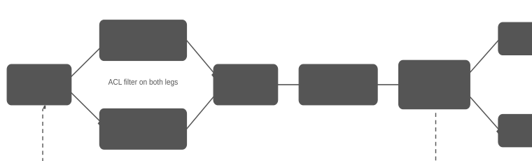

# Day 39 — Revision Drill: Hybrid Search & Agentic RAG

> Part of the [GenAI Architect study path](../../README.md) · Revision drill · [Original interactive pack](https://claude.ai/artifact/317iCV9yt2PWd7VQkFVoX3) · [Offline HTML](../../archive/html/day-39.html)


GenAI Architect prep · Day 39 · Revision drill · Tue 17 Nov 2026

# Hybrid search, reranking and corrective RAG loops

The first revision pass covered weeks 3–4 (Days 31–38). This pass pairs a week-2 retrieval topic with the week-3 orchestration that uses it: hybrid search and reranking (Day 9), driven by a LangGraph corrective-RAG loop (Days 10 and 17). Eight hard questions, one design scenario and a 45-minute drill.

Day 9 · Hybrid + rerankDay 10 · Corrective RAGDay 17 · LangGraphlanggraph 1.2.22sentence-transformers 6.3.0

## Why this matters for the JD

The JD names *hybrid search, metadata filtering* and *RAG optimization (chunking, reranking, hybrid, feedback loops)* as must-have and preferred skills, and *LangGraph, planning, guardrails* under agentic frameworks. In a review, the question is rarely "do you use hybrid?" It is "why that fusion, that candidate depth, that reranker, and what happens when the loop doesn't converge?"

## Five-minute recap



### Hybrid + fusion

BM25 catches exact tokens (error codes, SKUs, clause numbers) that embeddings blur; dense catches paraphrase. RRF fuses by rank, `Σ 1/(k + rank)`, so BM25's unbounded scores and cosine similarities never need normalising. Elastic's `rank_constant` defaults to 60 and Azure AI Search recommends a small k such as 60. Qdrant offers RRF and DBSF and lets you set k from v1.16, but its docs list a different default, so check each engine.

### Reranking

Bi-encoders score query and document separately. Cross-encoders read them together, which makes them more accurate and O(N) per query. Retrieve wide (30–100), rerank narrow (5–8). Current options: MiniLM cross-encoders (CPU), `bge-reranker-v2-m3` (0.6B, multilingual, Apache-2.0), and managed Cohere `rerank-v4.0-pro/fast` (32k context). Cohere now also lists a Rerank 5.

### Corrective loop (LangGraph)

`retrieve → grade → (generate | rewrite → retrieve | abstain)`, built as a `StateGraph` with conditional edges. The attempt count lives in state, and the loop is bounded by both your own `MAX_ATTEMPTS` and LangGraph's `recursion_limit`. A grader can be the reranker score (cheap, deterministic) or an LLM (flexible, costly). The abstain branch is a feature: it is how you control hallucination.

## Decision table

| Choice | Pick when | Failure mode | Cost / latency |
| --- | --- | --- | --- |
| **Dense only** | Conversational queries, few identifiers, domain-tuned embedder | Misses exact codes; a "VPN-809" query returns VPN-812 | 1 ANN query; cheapest |
| **BM25 + dense, RRF** | Enterprise default; mixed identifiers and prose | Long natural-language questions pull BM25 noise into the top-k | 2 queries in parallel, +10–30 ms; two indexes to keep in sync |
| **Weighted (convex) fusion** | You have a golden set to tune α and score normalisation on | Weights drift when the corpus or embedder changes; needs re-tuning | Same as RRF, plus a tuning job |
| **Learned sparse (SPLADE, BGE-M3 sparse)** | Vocabulary mismatch hurts BM25; GPU available for indexing | Bigger posting lists; model-bound vocabulary; reindex on model upgrade | Inference at index and query time |
| **Self-hosted cross-encoder** | Data residency, predictable volume, multilingual (bge-reranker-v2-m3) | GPU contention adds to p99; a sigmoid vs logit mix-up breaks thresholds | GPU node; ~N × (q + d) tokens per query |
| **Managed reranker (Cohere, Azure semantic ranker, Vertex ranking)** | Fast time to value; long documents (32k context) | Egress and residency review; per-search pricing; vendor rate limits | Network round trip; pay per call |
| **Corrective loop** | Retrieval quality varies by query; abstaining is acceptable | Unbounded loops, query drift, p99 explosion | Each loop adds retrieve + rerank (+ LLM rewrite) |

## Eight hard interview questions

**Q1 RRF or weighted score fusion? Defend your choice.**

I'd start with RRF. It uses only ranks, so mismatched score scales (BM25 is unbounded, cosine sits in [-1, 1]) don't matter, it needs no tuning, and it holds up when the corpus or embedder changes. The cost is that it ignores magnitude: a very confident dense hit and a marginal one at the same rank count the same.

Once there is a golden set, I'd test a convex combination with normalised scores (α·dense + (1−α)·bm25). Published analyses, for example Bruch et al. on fusion functions for hybrid retrieval, find that a tuned convex combination can beat RRF and needs few labelled queries. I'd ship whichever wins on nDCG@10 for each query slice, and re-tune α in CI whenever the embedder changes. Fusion defaults also differ by engine, so state the k you use and don't assume it.

**Q2 Your reranker adds 400 ms at p95. Bring it under 150 ms without losing quality.**

- **Measure first:** latency is roughly linear in N × (query + passage tokens). Plot nDCG@10 against N. Quality usually plateaus around 20–40 candidates, so cut N from 100 to that point.
- **Truncate passages** to the window the model was trained on (often 256–512 tokens) and rerank the chunks, not the parent documents.
- **Run on GPU with batching** in a dedicated pool so rerank calls don't queue behind LLM inference. Use FP16 or ONNX/int8, and a smaller model for the long tail.
- **Cache** scores keyed on (normalised query hash, chunk id, model version). FAQ-heavy helpdesks get high hit rates.
- **Degrade gracefully:** put a hard timeout on the rerank call and fall back to the fused order, and emit a metric when that happens. The system should get slower or slightly worse, never fail.

**Q3 Where do ACLs go in a hybrid pipeline, and what is the classic bug?**

Security filters go into **both** retrieval legs as pre-filters, before fusion. The classic bug is filtering only the dense leg, or post-filtering after top-k. Unauthorised BM25 hits then leak into the fused list, or restrictive post-filters leave empty results. The reranker and the LLM are never the enforcement point. Filtered HNSW can also lose recall when a filter is very selective, so check the engine's filtered-search strategy (Qdrant payload indexes, Elastic filters on kNN, Azure `vectorFilterMode`). Test with low-cardinality tenants, and log the principal's group claims with every retrieval for audit.

**Q4 Why use the reranker score as the corrective-RAG grader instead of an LLM grader?**

It is already computed, so it adds no extra call. It is also deterministic, which makes the gate testable in CI, and fast (milliseconds against hundreds of milliseconds). The catch is calibration: the scores are not probabilities that carry across domains, and a sigmoid applied twice, or not at all, silently shifts every threshold. I'd set τ from a golden set using precision of the "answerable" decision, use the LLM grader only for the ambiguous band (for example 0.2 ≤ score ≤ 0.45), and re-derive τ whenever the reranker version changes. That threshold is a versioned config value, not a magic number in the code.

**Q5 Name four ways an agentic RAG loop fails in production and how you contain each.**

- **Non-convergence:** cap attempts in state, set `recursion_limit`, and end in a defined abstain node rather than an exception.
- **Query drift:** the rewrite answers a different question. Keep the original question for generation and grading, log the rewrite, and eval rewrite fidelity.
- **Tail latency and cost:** every loop multiplies p99 and tokens. Carry a budget (ms and tokens) in state and stop when it runs out. Stream a "searching more sources…" status to the user.
- **Unobservable trajectories:** evaluating only the final answer hides bad paths. Trace each node (OTel GenAI spans or Langfuse) and evaluate trajectories: loop rate, abstain rate, and answer quality broken down by attempt count.

**Q6 When would you not add BM25?**

I'd skip it when the queries are conversational and the corpus has no identifiers, when the embedder is already fine-tuned on in-domain query–document pairs and the offline eval shows hybrid adds less than about 1 point of recall@k, or when the language isn't served well by the analyser (Indic scripts or code-mixed Hinglish with a default analyser). In that last case, learned sparse or multilingual dense may do better. The second index also adds ingestion complexity, so the decision is driven by data broken down by query slice, not by habit.

**Q7 LangGraph or a plain Python loop for corrective RAG?**

For one retrieve–grade–rewrite loop with no pauses, a plain function is simpler, and I'd say so in the review. LangGraph pays off when you need what the graph runtime gives you: checkpointing (resume after a crash, time-travel debugging), `interrupt()` for human review of low-confidence answers, per-node streaming of status to the UI, durable threads, and a graph that can be drawn and reviewed. The deciding question is whether the workflow needs state that persists across steps, pauses or branches. If not, use a function.

**Q8 How do you choose between bge-reranker-v2-m3, a MiniLM cross-encoder and Cohere Rerank 4?**

Score them against fixed criteria. Quality: nDCG@10 on our golden set, broken out by language. Latency: p95 at our N on target hardware. Cost: per 1,000 queries, including GPU idle time. Plus license, data residency and context length. A typical outcome: MiniLM for an English-only CPU path, bge-reranker-v2-m3 on our own GPUs where data must stay in-region or queries are multilingual, and Cohere where long semi-structured documents need the 32k window and data can leave our environment. Record the result as an ADR with a re-evaluation trigger (new model release, more than 5% eval drift, or a cost change).

## Design scenario

**Brief.** An IT and HR helpdesk assistant for 50,000 employees in India. The corpus is about 2M chunks: policies in English and Hindi, plus IT runbooks full of error codes like `VPN-812`. Volume is about 200k queries a day. Documents carry business-unit ACLs, the latency target is p95 under 3 s to the first token, and data must stay in-region. Design retrieval and orchestration, then defend the latency budget.

### Model answer outline

1. **Ingest:** Docling-style parsing, structure-aware chunking, and ACL group IDs plus `lang`, `dept` and `doc_version` as payload. Embed with a multilingual model and index BM25 with a code-preserving analyser (keep `VPN-812` as one token).
2. **Engine:** one engine with native hybrid search (Elastic/OpenSearch, Azure AI Search in an India region, or Qdrant with sparse vectors), so fusion and filtering happen server-side in a single round trip.
3. **Query path:** a regex and small-classifier router extracts codes and department, then hybrid retrieval with the ACL pre-filter, RRF to the top 40, bge-reranker-v2-m3 to the top 6, and the score gate. Above the threshold, generate with citations. Below it, do one rewrite (drop the department filter, transliterate) and retry. Otherwise abstain with a ticket link.
4. **Capacity:** 200k/day averages about 2.3 QPS. With an assumed 5× business-hours peak, plan for about 12 QPS × 40 pairs, roughly 500 rerank pairs a second. Size the GPU pool by load test, not by datasheet.
5. **Controls:** rerank timeout with fallback to fused order, a semantic cache for top FAQs, eval gates in CI (faithfulness, nDCG, abstain precision), and traces per node.

| Stage (p95 target) | ms |
| --- | --- |
| Router + query embedding | 40 |
| Hybrid retrieval + RRF (server-side) | 80 |
| Rerank 40 pairs on GPU | 150 |
| Optional single rewrite loop (worst case) | 300 |
| LLM time to first token (in-region endpoint) | 900 |
| **Total worst case (headroom remains under 3,000)** | **1,470** |

The budget figures are illustrative targets to defend in a review. Replace them with your own load-test numbers.

## 45-minute drill: hybrid → rerank → corrective loop

A single file that runs on CPU. It shows BM25 and dense disagreeing, RRF fusing them, a cross-encoder reranking the result, and a LangGraph loop that rewrites the query or abstains. Ollama is optional; without it the script prints the grounded context instead of an answer.

**PowerShell · setup**

```powershell
mkdir day39; cd day39
py -3.13 -m venv .venv
.\.venv\Scripts\Activate.ps1
python -m pip install -U pip
python -m pip install "langgraph==1.2.22" "sentence-transformers==6.3.0" "rank-bm25==0.2.2" numpy
# optional: local LLM for the generate node
python -m pip install "langchain-ollama==1.1.0"
ollama pull qwen3:1.7b
# save the script below as hybrid_crag.py, then:
python hybrid_crag.py
```
**hybrid_crag.py** · `lab/hybrid_crag.py`

```python
"""Day 39 drill: hybrid retrieval (BM25 + dense, RRF) -> cross-encoder rerank -> LangGraph corrective loop.
Runs on CPU in ~1-2 GB RAM. Optional: Ollama for the final answer (falls back to printing context).
"""
from __future__ import annotations

import re
import time
from typing import TypedDict

import numpy as np
import torch
from rank_bm25 import BM25Okapi
from sentence_transformers import CrossEncoder, SentenceTransformer
from langgraph.graph import END, START, StateGraph

# ---------------------------------------------------------------- corpus
DOCS = [
    {"id": "HR-4.1", "dept": "hr", "text": "Employees accrue 1.75 days of paid leave per month; unused leave above 30 days lapses on 31 March."},
    {"id": "HR-4.3", "dept": "hr", "text": "Parental leave is 26 weeks for the primary caregiver and 4 weeks for the secondary caregiver."},
    {"id": "HR-6.2", "dept": "hr", "text": "Remote work requires manager approval; a maximum of 3 remote days per week applies to client-facing roles."},
    {"id": "IT-2.7", "dept": "it", "text": "Error VPN-809 means the device certificate has expired; re-enrol the laptop through the Company Portal."},
    {"id": "IT-2.9", "dept": "it", "text": "Error VPN-812 indicates MFA push timeout; approve the prompt within 60 seconds or use a TOTP code."},
    {"id": "IT-3.1", "dept": "it", "text": "Personal USB storage is blocked on corporate laptops; request an exception via ticket category SEC-USB."},
    {"id": "IT-5.4", "dept": "it", "text": "Laptops are refreshed every 4 years; engineers with GPU workloads may request an RTX-class workstation."},
    {"id": "FIN-1.2", "dept": "finance", "text": "Travel claims must be filed within 15 days of return with itemised receipts above INR 500."},
    {"id": "FIN-1.5", "dept": "finance", "text": "International per diem for the US is USD 75 per day, covering meals and incidentals."},
    {"id": "FIN-3.3", "dept": "finance", "text": "Purchase orders above INR 5 lakh need CFO approval and three competing vendor quotes."},
    {"id": "SEC-1.1", "dept": "security", "text": "Customer PII must never be pasted into public AI chatbots; use the approved internal assistant only."},
    {"id": "SEC-2.4", "dept": "security", "text": "Production secrets are stored in the vault and rotated every 90 days; never commit them to git."},
]

def tok(s: str) -> list[str]:
    # keep codes like vpn-809 and 1.75 intact: exact-match tokens are where BM25 beats dense
    return re.findall(r"[a-z0-9]+(?:[-.][a-z0-9]+)*", s.lower())

print("Loading models (first run downloads ~200 MB)...")
EMB = SentenceTransformer("BAAI/bge-small-en-v1.5", device="cpu")
RERANK = CrossEncoder("cross-encoder/ms-marco-MiniLM-L6-v2", device="cpu",
                      activation_fn=torch.nn.Sigmoid())  # explicit: scores in 0..1 so a threshold means something
QUERY_PREFIX = "Represent this sentence for searching relevant passages: "  # bge v1.5 query instruction

BM25 = BM25Okapi([tok(d["text"]) for d in DOCS])
DOC_VECS = EMB.encode([d["text"] for d in DOCS], normalize_embeddings=True)

# ---------------------------------------------------------------- retrieval primitives
def bm25_rank(q: str, allowed: list[int], k: int) -> list[int]:
    s = BM25.get_scores(tok(q))
    return sorted(allowed, key=lambda i: -s[i])[:k]

def dense_rank(q: str, allowed: list[int], k: int) -> list[int]:
    qv = EMB.encode(QUERY_PREFIX + q, normalize_embeddings=True)
    sims = DOC_VECS @ qv
    return sorted(allowed, key=lambda i: -sims[i])[:k]

def rrf(rankings: list[list[int]], k: int = 60) -> list[int]:
    """Reciprocal Rank Fusion: score(d) = sum 1/(k + rank). Rank-based, so no score normalisation needed."""
    scores: dict[int, float] = {}
    for ranking in rankings:
        for r, i in enumerate(ranking, start=1):
            scores[i] = scores.get(i, 0.0) + 1.0 / (k + r)
    return sorted(scores, key=lambda i: -scores[i])

def hybrid(q: str, dept: str | None, k_each: int = 6) -> list[int]:
    allowed = [i for i, d in enumerate(DOCS) if dept is None or d["dept"] == dept]  # pre-filter, like a metadata filter
    return rrf([bm25_rank(q, allowed, k_each), dense_rank(q, allowed, k_each)])

def rerank(q: str, cand: list[int], top_n: int = 3) -> list[tuple[int, float]]:
    scores = RERANK.predict([(q, DOCS[i]["text"]) for i in cand])
    order = np.argsort(-scores)[:top_n]
    return [(cand[j], float(scores[j])) for j in order]

# ---------------------------------------------------------------- LangGraph corrective loop
class S(TypedDict, total=False):
    question: str
    query: str
    dept: str | None
    hits: list[tuple[int, float]]
    attempts: int
    answer: str

THRESHOLD = 0.30   # tune on a golden set, never by eye
MAX_ATTEMPTS = 2

def retrieve(state: S) -> S:
    q = state.get("query") or state["question"]
    cand = hybrid(q, state.get("dept"))
    return {"query": q, "hits": rerank(q, cand), "attempts": state.get("attempts", 0) + 1}

def route(state: S) -> str:
    best = state["hits"][0][1] if state["hits"] else 0.0
    if best >= THRESHOLD:
        return "generate"
    return "rewrite" if state["attempts"] < MAX_ATTEMPTS else "abstain"

def rewrite(state: S) -> S:
    # cheap deterministic rewrite: drop the metadata filter (maybe the router guessed wrong) and strip filler words.
    # Stretch goal: replace with an LLM rewrite via Ollama.
    stop = {"what", "is", "the", "how", "do", "i", "my", "a", "an", "for", "of", "to", "can", "does"}
    q = " ".join(w for w in tok(state["question"]) if w not in stop)
    return {"query": q, "dept": None}

def generate(state: S) -> S:
    ctx = "\n".join(f"[{DOCS[i]['id']}] {DOCS[i]['text']}" for i, _ in state["hits"])
    try:
        from langchain_ollama import ChatOllama
        llm = ChatOllama(model="qwen3:1.7b", temperature=0)
        msg = llm.invoke("Answer ONLY from the context and cite ids in [brackets]. "
                         "If the context does not contain the answer, say you don't know.\n\n"
                         f"Context:\n{ctx}\n\nQuestion: {state['question']}")
        return {"answer": msg.content}
    except Exception as e:  # no Ollama running -> still show the grounded context
        return {"answer": f"(LLM unavailable: {type(e).__name__}) Top context:\n{ctx}"}

def abstain(state: S) -> S:
    return {"answer": "I couldn't find this in the policy corpus. Raise a ticket with HR/IT."}

g = StateGraph(S)
for name, fn in [("retrieve", retrieve), ("rewrite", rewrite), ("generate", generate), ("abstain", abstain)]:
    g.add_node(name, fn)
g.add_edge(START, "retrieve")
g.add_conditional_edges("retrieve", route, {"generate": "generate", "rewrite": "rewrite", "abstain": "abstain"})
g.add_edge("rewrite", "retrieve")
g.add_edge("generate", END)
g.add_edge("abstain", END)
app = g.compile()

# ---------------------------------------------------------------- demo
if __name__ == "__main__":
    tests = [
        ("What does error VPN-812 mean?", "it"),            # exact code: BM25 carries it
        ("How long can new mothers take off work?", "hr"),   # paraphrase: dense carries it
        ("What is the US daily allowance?", "hr"),           # wrong filter -> rewrite drops it
        ("What is the canteen menu on Friday?", None),       # not in corpus -> abstain
    ]
    for q, dept in tests:
        print(f"\nQ: {q}  (filter={dept})")
        print(f"  bm25 : {[DOCS[i]['id'] for i in bm25_rank(q, list(range(len(DOCS))), 3)]}")
        print(f"  dense: {[DOCS[i]['id'] for i in dense_rank(q, list(range(len(DOCS))), 3)]}")
        t = time.perf_counter()
        out = app.invoke({"question": q, "dept": dept})
        ms = (time.perf_counter() - t) * 1000
        print(f"  reranked: {[(DOCS[i]['id'], round(s, 3)) for i, s in out['hits']]}  attempts={out['attempts']}  {ms:.0f} ms")
        print("  ->", out["answer"].replace("\n", "\n     "))
```

### What you should see

- **VPN-812:** BM25 ranks `IT-2.9` first. Dense may put `IT-2.7` (VPN-809) alongside or above it, which is the exact-code failure. After the rerank, `IT-2.9` is on top and the answer comes in one attempt.
- **"New mothers":** there is no lexical overlap with "parental leave", so dense carries `HR-4.3` and BM25 doesn't.
- **US daily allowance with the wrong `hr` filter:** attempt 1 scores low, the rewrite drops the filter, and attempt 2 finds `FIN-1.5`.
- **Canteen menu:** both attempts score below the threshold, so the graph abstains.
- Exact scores vary by model version. Per-query latency after warm-up should be well under a second on CPU.

### Stretch goals

1. Build 20 labelled queries and compute recall@3 for BM25, dense and RRF, then RRF with k = 10, 60 and 200. Which slice (codes or paraphrases) moves?
2. Replace `rewrite()` with an Ollama LLM rewrite and add a `budget_ms` field to the state that stops the loop. Then run `BAAI/bge-reranker-v2-m3` on the RTX 3050 (`device="cuda"`, FP16) and compare its latency with MiniLM on CPU.

Windows notes: everything here is native. No WSL2 or Docker is needed. If `import torch` fails on Python 3.13, install the CPU wheel with `python -m pip install torch --index-url https://download.pytorch.org/whl/cpu`, or the CUDA wheel matching your driver for the GPU stretch goal.

## Repos to revisit

- [langchain-ai/langgraph](https://github.com/langchain-ai/langgraph): read `libs/langgraph/langgraph/graph/state.py` to see how conditional edges and reducers resolve, and the checkpointer interface beside it.
- [FlagOpen/FlagEmbedding](https://github.com/FlagOpen/FlagEmbedding): the reranker folder covers training data format and layerwise or lightweight reranker variants you can trade for latency.
- [AnswerDotAI/rerankers](https://github.com/AnswerDotAI/rerankers): one API over cross-encoders, ColBERT, LLM rerankers and Cohere. Use it to A/B rerankers behind a single interface.
- [qdrant/qdrant](https://github.com/qdrant/qdrant): see how server-side prefetch plus fusion (RRF/DBSF) and payload-indexed filtering are implemented. Development happens on the `dev` branch.

## Read

- [LangGraph: Agentic RAG tutorial](https://docs.langchain.com/oss/python/langgraph/agentic-rag), the official retrieve, grade, rewrite and generate graph. Compare its LLM grader with the score gate above.
- [Azure AI Search: hybrid search ranking (RRF)](https://learn.microsoft.com/en-us/azure/search/hybrid-search-ranking) and [Elastic RRF retriever](https://www.elastic.co/docs/reference/elasticsearch/rest-apis/reciprocal-rank-fusion), for how two managed engines expose fusion parameters.
- [Cormack, Clarke & Büttcher (SIGIR 2009): Reciprocal Rank Fusion](https://cormack.uwaterloo.ca/cormacksigir09-rrf.pdf), the four-page origin of k = 60.

## Architect's lens: ADR-039

|  |  |
| --- | --- |
| Context | A multilingual helpdesk corpus with error codes and in-region residency. p95 TTFT target under 3 s. Retrieval misses are the top cause of wrong answers in pilot traces. |
| Options | (a) Dense only. (b) Hybrid with RRF and no rerank. (c) Hybrid with RRF, a self-hosted cross-encoder and a score gate. (d) Hybrid with a managed reranker. |
| Decision | (c): engine-native hybrid with RRF (k recorded in config), bge-reranker-v2-m3 on an in-region GPU pool, a top-40 → top-6 rerank, τ derived from the golden set, and one bounded rewrite before abstaining. |
| Consequences | + Exact-code recall and residency. + A deterministic, testable gate. − A GPU pool to run and capacity-plan. − τ must be re-derived on every reranker upgrade. Fallback to fused order on rerank timeout. Revisit if eval shows managed reranking at least 3 nDCG points better and residency allows it. |

## Tomorrow

Day 40 drill: RAG evaluation (Day 11) with GenAI observability (Day 27), covering golden sets, LLM-as-judge pitfalls and eval dashboards wired to traces.

Versions checked on PyPI on 17 Nov 2026: langgraph 1.2.22, langchain-core 1.8.1, langchain-ollama 1.1.0, sentence-transformers 6.3.0, rank-bm25 0.2.2. Links verified the same day.

## Lab files in this folder

- [`lab/hybrid_crag.py`](lab/hybrid_crag.py)
