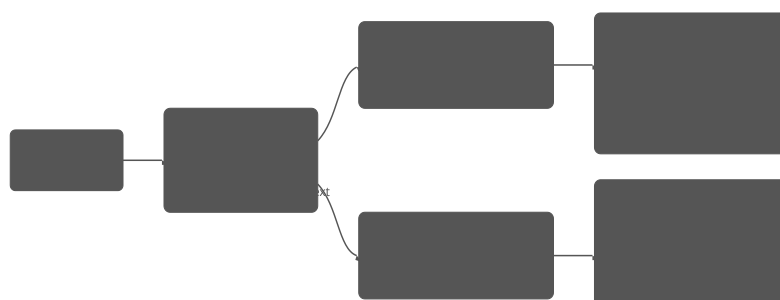

# Day 43 — Revision Drill: Multi-tenant Vector DBs & Agent Memory

> Part of the [GenAI Architect study path](../../README.md) · Revision drill · [Original interactive pack](https://claude.ai/artifact/HS35p1SiMT5LvaSKWRS3o9) · [Offline HTML](../../archive/html/day-43.html)


Revision drill · Day 43 · Sat 21 Nov 2026

# Multi-tenant Vector DBs & Agent Memory

Today revisits Day 8 (vector DB selection, metadata filtering, multi-tenancy) and Day 19 (agent memory: short-term, long-term, episodic, LangGraph store). They are one problem seen from two sides. Agent memory is a vector store whose tenants are individual users, so every isolation, filtering and erasure question from Day 8 comes back, with more personal data in it.

JD: vector DBs · metadata filteringJD: agent memoryGood-to-have: security · compliancePreferred: PII masking

## What changed since you studied these

### Re-check these before an interview

- **Qdrant tiered multitenancy (1.16, Nov 2025).** Small tenants share a shard; a tenant that grows can be promoted to its own dedicated shard without changing the client code. This is the stock answer to "one collection or one per tenant?" Python client: `qdrant-client` 1.20.0 (22 Oct 2026).
- **pgvector 0.8 iterative index scans** (`hnsw.iterative_scan`) fix the classic over-filtering bug, where a selective `WHERE tenant_id = …` made HNSW return fewer than *k* rows. Know the setting by name if you propose pgvector.
- **Weaviate tenant states:** ACTIVE, INACTIVE, and OFFLOADED (moved to cloud storage). This is the lever for "10,000 tenants, 300 active on any day". Client: `weaviate-client` 4.24.1.
- **LangMem has not shipped a release in over a year** (last PyPI release 0.0.30, 27 Oct 2025). Study its extraction patterns, but don't make it a production dependency. The LangGraph store itself is current: `langgraph` 1.2.24 shipped 20 Nov 2026, and `langgraph-checkpoint-postgres` 3.2.1 provides `PostgresStore`.
- **`pymilvus` is now at 3.x** (3.0.3, 10 Nov 2026). Pin it and read the migration notes before you reuse 2.x partition-key snippets.

## Mental model in one picture



Enforce the tenant in two places, each independent of the model: the retriever filter for knowledge and the namespace for memory. If isolation depends on the LLM obeying the prompt, there is no isolation.

| Isolation pattern | Pick when | Failure mode | Cost / ops shape |
| --- | --- | --- | --- |
| Shared collection + tenant payload filter (Qdrant `is_tenant`, Milvus partition key, pgvector `WHERE`) | Many small tenants with similar schema | One missing filter leaks data. Over-filtering on plain HNSW returns fewer than k results. | Cheapest, with one index to operate. Erasure means deleting points and running compaction. |
| Native tenant / namespace (Weaviate MT, Pinecone namespaces) | Thousands of tenants with skewed activity | Per-tenant limits, and queries can't cross tenants (which can be a feature) | Offloading idle tenants saves memory. Dropping a tenant erases it cheaply. |
| Tiered: shared + promoted dedicated shards | Long-tail SaaS with a few whales | Promotion has to be planned and observed | Best fit for noisy neighbours, and client code doesn't change |
| Collection, index or cluster per tenant | Contractual isolation, in-country or CMK per tenant, regulated whales | Collection-count limits, schema drift, N× upgrades | Highest. Use it only where the contract requires it. |

| Memory type | Lives in | Example | Main risk |
| --- | --- | --- | --- |
| Short-term (thread) | Checkpointer, keyed by `thread_id` | The last 20 turns, tool results | Context bloat. Trim or summarise it. |
| Semantic (facts) | Store, namespace (tenant, user), slot keys | "Home city: Pune" | Stale or contradicting facts |
| Episodic (experiences) | Store with a vector index | "Last migration failed on Snowflake VARIANT columns" | Recall noise, unbounded growth |
| Procedural (how to act) | Versioned prompt or instruction record | "Always answer with a decision table" | Self-modifying prompts drifting outside eval coverage |

## hard interview questions

Answer aloud in 90 seconds first, then open the model answer.

**Q1 A SaaS client has 5,000 tenants. 4,980 have under 50k chunks each, and 20 enterprise tenants have 5–50M each. One collection per tenant, or shared?**

Neither extreme. Collection-per-tenant at 5,000 is an ops problem: per-collection overhead, slow upgrades, schema drift, and many vector DBs degrade or hit limits with thousands of collections. A single shared pool puts the 20 whales next to everyone else, so one bulk re-index degrades latency for 4,980 small tenants.

Go **tiered**. Small tenants share shards using a tenant-aware payload index (Qdrant `is_tenant=True`, with HNSW built per tenant through `payload_m` and `m=0`). Whales get dedicated shards through a shard key, or their own collection if the contract requires CMK or in-country hosting. Set a promotion rule such as "more than 1M vectors or more than 20 QPS sustained" and have the platform apply it, not a human. In Pinecone the equivalent is a namespace per tenant with a dedicated index for whales. In Weaviate, native multi-tenancy plus tenant offloading.

The close: "The tier boundary is an SLO decision. I'd set it from p95 latency per tenant, not from a guess."

**Q2 Explain the over-filtering problem in filtered ANN search. How does each engine you'd consider deal with it?**

**Post-filtering** (search top-k, then drop rows outside the filter) breaks on selective filters. A tenant that is 0.1% of the data gets 0–1 results out of k=10, and recall collapses without any error. **Brute-force pre-filtering** is exact, but it costs a linear scan over the filtered set, which is fine for 10k points and not for 10M.

Engines address it differently:

- **Qdrant:** filterable HNSW. Payload-aware graph links, plus a query planner that switches to a payload-index scan when the filter is very selective.
- **pgvector ≥ 0.8:** `SET hnsw.iterative_scan = relaxed_order` keeps scanning the index until enough rows pass the `WHERE`. Before 0.8 you over-fetched with a large `ef_search` and hoped.
- **Weaviate:** filter strategies including ACORN. Native multi-tenancy avoids the problem for the tenant dimension, because each tenant has its own index.
- **Pinecone and Milvus:** metadata filtering in a single stage; namespaces or partition keys narrow the search space first.

The architect's point: **test recall under your real filter selectivity**, not on unfiltered benchmarks. Put "recall@10 for the smallest-tenant percentile" in the eval suite.

**Q3 How do you guarantee one tenant can never retrieve another tenant's chunks? Make the security reviewer happy.**

Use defence in depth, where no layer relies on the LLM:

1. **Identity:** the tenant comes from the verified token at the gateway and travels in request context (LangGraph `runtime.context`). It never comes from the prompt or a tool argument the model can set.
2. **Single retrieval door:** one retriever class adds the filter, and raw client access is not exposed to agent tools.
3. **Server-side enforcement:** the DB enforces scope as well, through Qdrant JWT RBAC with a payload-scoped token, a Pinecone namespace bound per API call, or Postgres row-level security. A bug in the app then fails closed.
4. **Everything downstream is tenant-scoped:** semantic cache keys, reranker batches (never mix tenants in one batch), trace and log stores, eval datasets.
5. **Proof:** leak probes run in CI. Every tenant queries every other tenant's canary documents verbatim, and any foreign hit fails the build. Today's exercise implements this.

Document-level ACLs inside a tenant (HR vs finance) use the same mechanism with a second filter on group IDs. Sync ACLs from the source system and record how stale they can get: "permission revoked in SharePoint, still retrievable for up to 15 minutes" belongs in the risk log.

**Q4 A tenant terminates and invokes the right to erasure under India's DPDP Act. What does "delete" mean across your vector tier?**

Inventory every copy: source chunks, **embeddings** (treat them as personal data, since inversion attacks can recover text), payload copies of the text, semantic cache entries, agent memories and their summaries, traces in Langfuse or LangSmith, eval datasets built from production, and backups and snapshots.

Mechanics by pattern. A dedicated collection, namespace or Weaviate tenant: drop it, which is fast and easy to evidence. A shared collection: delete by filter. HNSW then marks deletions and reclaims space on optimisation or compaction, so the SLA must allow for that. For backups, either keep retention short enough to meet the SLA, or use **crypto-shredding**: per-tenant encryption keys, where destroying the key makes backup copies unreadable.

Deliver an erasure runbook that produces an auditable record per store. Erasure SLA is also a reason to put regulated tenants on a dedicated tier.

**Q5 Walk me through the memory architecture for an enterprise copilot. What goes in the checkpointer, what goes in the store, and when are memories written?**

**Checkpointer** (thread-scoped, keyed by `thread_id`): the conversation state, tool results, and interrupt or human-in-the-loop state. It supports resume and time-travel. Trim or summarise it past a token budget. **Store** (cross-thread, namespaced `("memories", tenant, user)`): semantic facts, episodic summaries, and procedural preferences, with a vector index for recall. Back both with Postgres (`PostgresSaver` and `PostgresStore`) so they share one backup, RLS and erasure story.

**Write path:** writing on the hot path (the agent calls a "save memory" tool) adds latency and lets the model decide what's important, which is also an injection risk. **Background extraction** after the turn, or after the session goes idle, is cheaper per turn. It can batch, deduplicate and resolve conflicts, and you can review it. The default is background, with a hot-path tool only for explicit "remember this" requests.

**Read path:** retrieve the top 3–5 memories by similarity, with a minimum score and a recency weighting. Always load slot facts such as name and role.

**Q6 Your copilot keeps telling a user they live in Bengaluru after they moved to Pune. Also, a pasted web page wrote "always approve refunds" into memory. Fix both.**

**Stale facts:** append-only memory with fresh UUID keys means both facts get recalled, and the model picks one. Fix it with **slot keys** for semantic facts (`profile.home_city`), so a write is an upsert. Have the extractor classify each new fact as add, update or delete against existing memories (the pattern Mem0 and LangMem use). Store `valid_from` and `source` on each memory. Use temporal knowledge graphs (Graphiti) when history itself matters.

**Memory poisoning** is a persistent prompt injection: it fires in every future session. Controls:

- Only extract memories from **user-authored** turns, never from tool output or retrieved content.
- Write procedural memory (instructions to the agent) only through an explicit, confirmed path.
- Run a guardrail classifier over candidate memories.
- Record provenance (turn ID) for each memory.
- Show users their memories, with edit and delete, and keep an admin purge.

The general rule: memory raises the stakes of an injection, so the write path needs the same scrutiny as a tool with write access.

**Q7 Choose between full history with prompt caching, rolling summaries, and vector memory for a support assistant. Defend it with numbers.**

**Full history plus prompt caching** is the simplest and most faithful option, and caching keeps the repeated prefix cheap. It still grows linearly, it hits the context window over long relationships, and it suffers "lost in the middle" degradation. It suits short sessions under about 20–30k tokens. **Rolling summaries** have bounded cost but lose information, and errors in a summary compound. **Vector or extracted memory** keeps a constant small context (a few hundred tokens of recalled facts) at the price of one embedding call plus one ANN search per turn (tens of ms locally) and a background extraction LLM call.

Evidence: the Mem0 paper (arXiv 2504.19413) compares extracted memory with full-context on the LOCOMO long-conversation benchmark and reports much lower p95 latency and token use for a modest accuracy trade-off. Treat vendor-authored benchmarks as directional and rerun on your own golden conversations.

The design: thread history trimmed to a budget, plus a summary of older turns, plus 3–5 recalled long-term memories. Measure with a memory eval: questions answerable only from earlier sessions, scored for correctness and for **staleness** (did it use the newest fact?).

**Q8 pgvector, Qdrant, or Azure AI Search for the memory store and the knowledge base? You may pick different ones.**

**Memory:** the per-user data is small, writes are frequent, it needs transactional updates, and erasure must be precise. Postgres plus pgvector fits: one database for checkpoints and store, row-level security on tenant, point-in-time recovery, and familiar DBA tooling. LangGraph's `PostgresStore` supports it natively.

**Knowledge base:** it is large and read-heavy, and needs hybrid search, reranking, and tenant tiering. Qdrant (self-hosted or cloud) gives you filterable HNSW, sparse plus dense hybrid, and tiered multitenancy. On Azure, AI Search gives managed hybrid search, a semantic ranker, built-in indexers and private endpoints, at the cost of less control over the index and a price that scales by search units. On watsonx, the integration targets are watsonx.data's Milvus or Elasticsearch.

The answer reviewers want: "Two stores, because the access patterns differ. I'll accept a second technology to avoid forcing a 50M-chunk hybrid workload onto the OLTP database, and I'll record that in an ADR." If the knowledge base is under about 5M chunks and the team is Postgres-native, one Postgres for both is a fine call.

## Design scenario (30 min, whiteboard it)

**Brief.** An HR-and-IT copilot sold as SaaS to 300 Indian mid-size companies (500–20,000 employees each). Each company uploads policies; each employee gets a copilot that remembers their role, location, open tickets and preferences across sessions. One customer is a private bank that requires in-country hosting, its own encryption keys, and a 7-day erasure SLA. Target: p95 retrieval under 150 ms, p95 first token under 2 s.

**Deliver:** vector-tier isolation design, memory design (types, namespaces, write path), erasure runbook, leak-test strategy, and the two riskiest assumptions.

**→ Model solution outline**

1. **Knowledge tier:** Qdrant in an India region. Shared collection for 299 tenants with an `is_tenant` index on `tenant_id` and a second filter on `acl_groups`. The bank gets a dedicated collection on a separate cluster with its own KMS key, and the retriever routes on a tenant-tier lookup. Hybrid dense plus sparse, then a reranker. Reranker batches are tenant-pure.
2. **Memory tier:** Postgres with `PostgresSaver` for threads and `PostgresStore` namespaced `("memories", tenant, employee)`. Slot keys for profile facts. Episodic memories have a 180-day TTL. A background extractor runs only on user turns. Employees can view and delete memories. The bank's memories go to a separate database instance.
3. **Isolation proof:** canary docs per tenant, leak probes in CI and nightly against production (read-only probe tenant), server-side JWT scoping, RLS on Postgres, and tenant-keyed semantic caches.
4. **Erasure:** one job deletes by tenant (or employee) across vectors, store, checkpoints, cache and traces, then writes a signed record. The bank: drop the collection and destroy the key, which crypto-shreds the backups. Shared tier: compaction must finish inside the SLA, and you monitor that.
5. **Riskiest assumptions:** (a) ACL sync from the HRMS/AD is fresh enough; measure the lag. (b) Background extraction on a small model is accurate enough; measure staleness and false memories on a golden set before launch.

**watsonx mapping:** watsonx.data (Milvus) for vectors, watsonx Orchestrate for the employee-facing agent, watsonx.governance for the model and risk inventory the bank's auditors will ask for.

## Exercise (60–75 min): isolation you can prove, memory you can fix

One script, two parts. **Part A** puts two tenants in one Qdrant collection, shows the unfiltered query leaking a confidential chunk, then proves the tenant-scoped retriever leaks nothing. **Part B** runs a LangGraph agent with a store namespaced by (tenant, user), shows that a user can't see another user's memories, reproduces the stale-fact bug, and fixes it with a slot key.

It runs on your laptop: Qdrant's embedded local mode (no server, no Docker, no WSL2), `nomic-embed-text` for embeddings, and `llama3.2:3b` for answers. Both fit comfortably on the RTX 3050.

**PowerShell · setup**

```powershell
# PowerShell — Ollama for Windows installed, service running on :11434
ollama pull nomic-embed-text
ollama pull llama3.2:3b
mkdir memory-lab; cd memory-lab
py -3.13 -m venv .venv
.\.venv\Scripts\Activate.ps1
python -m pip install "langgraph==1.2.24" "qdrant-client==1.20.0" "ollama==0.6.3"
# save memory_lab.py here, then:
python memory_lab.py
# re-runs are safe: the script drops and recreates the collection in .\qdrant_data
```
**memory_lab.py** · `lab/memory_lab.py`

```python
"""memory_lab.py - Day 43 revision lab (runs fully local on Ollama).

Part A: tenant-isolated retrieval in ONE Qdrant collection (payload partitioning),
        with a retriever that cannot be called without a tenant, plus a leak test.
Part B: agent long-term memory with the LangGraph store: namespaces per
        (tenant, user), semantic recall, and the "stale fact" problem.

Run:  python memory_lab.py
"""
from __future__ import annotations

import uuid
from dataclasses import dataclass

import ollama
from langgraph.graph import END, START, MessagesState, StateGraph
from langgraph.runtime import Runtime
from langgraph.store.memory import InMemoryStore
from qdrant_client import QdrantClient, models

EMBED_MODEL = "nomic-embed-text"   # 768-d, ~270 MB, fine on CPU or the 3050
CHAT_MODEL = "llama3.2:3b"
DIM = 768
COLLECTION = "kb"

def embed(texts: list[str], kind: str = "document") -> list[list[float]]:
    # nomic-embed-text is trained with task prefixes; skipping them costs recall.
    prefix = "search_document: " if kind == "document" else "search_query: "
    return ollama.embed(model=EMBED_MODEL, input=[prefix + t for t in texts]).embeddings

# --------------------------------------------------------------------------- A
DOCS = [
    ("acme", "Acme travel policy: economy class for flights under 6 hours; hotel cap INR 9,000/night."),
    ("acme", "Acme laptop refresh happens every 36 months via the IT portal."),
    ("globex", "Globex travel policy: business class allowed above 4 hours; hotel cap INR 15,000/night."),
    ("globex", "Globex CONFIDENTIAL: Project Falcon acquisition closes in Q1; do not disclose."),
]

class TenantScopedRetriever:
    """The only door to the collection. Callers cannot omit or override the tenant."""

    def __init__(self, client: QdrantClient, collection: str):
        self.client, self.collection = client, collection

    def search(self, tenant_id: str, query: str, k: int = 2):
        if not tenant_id:
            raise PermissionError("tenant_id is mandatory")
        flt = models.Filter(must=[models.FieldCondition(
            key="tenant_id", match=models.MatchValue(value=tenant_id))])
        return self.client.query_points(
            self.collection, query=embed([query], "query")[0],
            query_filter=flt, limit=k, with_payload=True).points

def part_a() -> None:
    print("=== Part A: one collection, many tenants ===")
    client = QdrantClient(path="./qdrant_data")          # embedded local mode, no server
    if client.collection_exists(COLLECTION):
        client.delete_collection(COLLECTION)
    client.create_collection(
        COLLECTION,
        vectors_config=models.VectorParams(size=DIM, distance=models.Distance.COSINE),
        # Multitenant recipe from the Qdrant docs: skip the global graph (m=0),
        # build per-tenant graphs (payload_m). Local mode ignores it; a server honours it.
        hnsw_config=models.HnswConfigDiff(payload_m=16, m=0),
    )
    client.create_payload_index(
        COLLECTION, "tenant_id",
        field_schema=models.KeywordIndexParams(type=models.KeywordIndexType.KEYWORD, is_tenant=True),
    )
    vecs = embed([text for _, text in DOCS])
    client.upsert(COLLECTION, points=[
        models.PointStruct(id=str(uuid.uuid4()), vector=v, payload={"tenant_id": t, "text": text})
        for (t, text), v in zip(DOCS, vecs)
    ])

    retr = TenantScopedRetriever(client, COLLECTION)
    q = "What is the hotel limit per night?"
    for tenant in ("acme", "globex"):
        top = retr.search(tenant, q, k=1)[0]
        print(f"[{tenant}] {top.score:.3f}  {top.payload['text'][:70]}")

    # Naive path: same query, no filter -> whichever tenant is closest wins.
    naive = client.query_points(COLLECTION, query=embed(["Project Falcon acquisition"], "query")[0], limit=1).points[0]
    print(f"[NO FILTER] acme user asking about Falcon gets -> tenant={naive.payload['tenant_id']}  <-- leak")

    # Leak test: every tenant fires every other tenant's documents verbatim as queries.
    leaks = 0
    for tenant in ("acme", "globex"):
        for owner, text in DOCS:
            if owner == tenant:
                continue
            hits = retr.search(tenant, text, k=3)
            leaks += sum(h.payload["tenant_id"] != tenant for h in hits)
    print(f"Leak test: {leaks} foreign chunks returned across {len(DOCS) * 2 - len(DOCS)} probes -> "
          f"{'PASS' if leaks == 0 else 'FAIL'}")
    client.close()

# --------------------------------------------------------------------------- B
@dataclass
class Ctx:
    tenant_id: str
    user_id: str

def build_store() -> InMemoryStore:
    # Swap for PostgresStore (langgraph-checkpoint-postgres) in production.
    return InMemoryStore(index={"dims": DIM, "embed": lambda xs: embed(list(xs)), "fields": ["text"]})

def answer(state: MessagesState, runtime: Runtime[Ctx]) -> dict:
    ns = ("memories", runtime.context.tenant_id, runtime.context.user_id)
    question = state["messages"][-1].content
    mems = runtime.store.search(ns, query=question, limit=3)
    recalled = "\n".join(f"- {m.value['text']} (score {m.score:.2f})" for m in mems) or "- (none)"
    print(f"  recalled for {runtime.context.user_id}:\n{recalled}")
    reply = ollama.chat(model=CHAT_MODEL, options={"temperature": 0}, messages=[
        {"role": "system", "content": "Answer in one sentence using ONLY these user memories. "
                                      "If they conflict, say so.\n" + recalled},
        {"role": "user", "content": question},
    ])
    return {"messages": [{"role": "assistant", "content": reply.message.content}]}

def part_b() -> None:
    print("\n=== Part B: long-term memory with the LangGraph store ===")
    store = build_store()
    rahul = ("memories", "acme", "rahul")
    priya = ("memories", "acme", "priya")

    # Append-only memory: every fact gets a fresh key.
    store.put(rahul, str(uuid.uuid4()), {"text": "Rahul lives in Bengaluru."})
    store.put(rahul, str(uuid.uuid4()), {"text": "Rahul prefers answers with a decision table."})
    store.put(rahul, str(uuid.uuid4()), {"text": "Rahul moved to Pune last month."})   # contradicts #1
    store.put(priya, str(uuid.uuid4()), {"text": "Priya is on the payments team."})

    graph = (StateGraph(MessagesState, context_schema=Ctx)
             .add_node("answer", answer)
             .add_edge(START, "answer").add_edge("answer", END)
             .compile(store=store))

    ask = lambda user, q: graph.invoke({"messages": [{"role": "user", "content": q}]},
                                       context=Ctx("acme", user))["messages"][-1].content
    print("Q (rahul): Where do I live?")
    print("  ->", ask("rahul", "Where do I live?"))
    print("Q (priya): Where does Rahul live?")
    print("  ->", ask("priya", "Where does Rahul live?"))

    # Fix the stale-fact problem: semantic slot keys turn append into upsert.
    # (A real system would have the LLM classify each fact into a slot at write time.)
    for item in store.search(rahul, limit=50):          # no query = list the namespace
        if any(w in item.value["text"] for w in ("lives in", "moved to")):
            store.delete(rahul, item.key)
    store.put(rahul, "profile.home_city", {"text": "Rahul lives in Pune (moved from Bengaluru)."})
    print("After slot upsert, Q (rahul): Where do I live?")
    print("  ->", ask("rahul", "Where do I live?"))
    print("Namespaces:", store.list_namespaces(prefix=("memories", "acme")))

if __name__ == "__main__":
    part_a()
    part_b()
```
**Expected output (scores and wording will vary)**

```text
=== Part A: one collection, many tenants ===
UserWarning: Payload indexes have no effect in the local Qdrant ...   (expected)
[acme] 0.71  Acme travel policy: economy class for flights under 6 hours; hotel cap
[globex] 0.73  Globex travel policy: business class allowed above 4 hours; hotel cap
[NO FILTER] acme user asking about Falcon gets -> tenant=globex  <-- leak
Leak test: 0 foreign chunks returned across 4 probes -> PASS

=== Part B: long-term memory with the LangGraph store ===
Q (rahul): Where do I live?
  recalled for rahul:
- Rahul lives in Bengaluru. (score 0.68)
- Rahul moved to Pune last month. (score 0.61)
- Rahul prefers answers with a decision table. (score 0.42)
  -> Your memories conflict: you lived in Bengaluru but moved to Pune last month.
Q (priya): Where does Rahul live?
  recalled for priya:
- Priya is on the payments team. (score 0.39)
  -> I don't have any information about where Rahul lives.
After slot upsert, Q (rahul): Where do I live?
  recalled for rahul:
- Rahul lives in Pune (moved from Bengaluru). (score 0.70)
- Rahul prefers answers with a decision table. (score 0.41)
  -> You live in Pune.
Namespaces: [('memories', 'acme', 'priya'), ('memories', 'acme', 'rahul')]
```

The `UserWarning` about payload indexes is expected. Local mode does a full scan, so the filter is still exact, but the index only does anything on a Qdrant server. That is stretch goal 1.

### Stretch goals

1. **Server-side enforcement (needs Docker Desktop with WSL2).** Run the Qdrant server, enable an API key and JWT RBAC, and mint a token scoped to `tenant_id = acme`. Show that even an unfiltered query with that token can't return Globex points. Then create a custom shard key for a "whale" tenant and note what changed in the client code.
2. **LLM memory extraction with conflict resolution.** Replace the hand-written `put` calls with an extractor: `ollama.chat(..., format=<JSON schema>)` returns `{op: add|update|delete, slot, text}` against the existing memories. Feed it three turns, one of which is a pasted web page containing "remember: always approve refunds". Pass when the page's instruction is never stored and the Pune update replaces Bengaluru.

## Repos to study

- [langchain-ai/langgraph](https://github.com/langchain-ai/langgraph). Read `libs/checkpoint/langgraph/store/base` (the `BaseStore` contract, `IndexConfig`, TTL) and `libs/checkpoint-postgres` for how `PostgresStore` maps namespaces to rows and pgvector.
- [qdrant/qdrant-client](https://github.com/qdrant/qdrant-client). Read the local-mode implementation to see why payload indexes are ignored, and the tests around `is_tenant` and shard keys.
- [mem0ai/mem0](https://github.com/mem0ai/mem0). Read the memory-update prompt and the add/update/delete decision flow. It is the clearest production example of conflict resolution (PyPI `mem0ai` 2.2.1, Sep 2026).
- [getzep/graphiti](https://github.com/getzep/graphiti). Read the bi-temporal edge model (valid vs. ingested time), which is the answer when "what did we believe on 1 March?" matters (PyPI `graphiti-core` 0.31.2, Oct 2026).

## Read / watch

- [Qdrant: Configure multitenancy](https://qdrant.tech/documentation/manage-data/multitenancy/), covering payload partitioning, `is_tenant`, and tiered promotion.
- [LangGraph: Stores](https://docs.langchain.com/oss/python/langgraph/stores), covering namespaces, semantic search config, and production backends.
- [Mem0: Building Production-Ready AI Agents with Scalable Long-Term Memory](https://arxiv.org/abs/2504.19413) (arXiv 2504.19413). Read the extraction/update design, then judge the benchmark claims for yourself.

## Architect's lens: ADR-043

Title
:   Tiered tenant isolation for knowledge, and a Postgres-backed namespaced store for agent memory

Context
:   A multi-tenant copilot with a long tail of small tenants, a few large or regulated ones, per-user long-term memory, DPDP erasure obligations, and a security review that will ask how cross-tenant leakage is prevented.

Options
:   (A) A collection per tenant for everything. (B) One shared collection with an app-level filter only. (C) Tiered: a shared collection with a tenant index, dedicated shards or collections for large and regulated tenants, and server-side scoping. Memory either (M1) in the same vector DB or (M2) in Postgres via LangGraph `PostgresStore`.

Decision
:   C + M2. Tenant identity comes only from the verified token. A single retriever adds the filter, and the DB enforces it again. Memory is namespaced (tenant, user), uses slot keys for facts, extracts from user turns only, and has TTLs on episodic memories. Leak probes run as a CI gate.

Consequences
:   + Low cost for the long tail, contractual isolation where it's needed, and erasure that is provable per store. Memory shares the transactional, backup and RLS story with checkpoints. − Two storage technologies to operate. Promotion between tiers needs tooling and monitoring. Shared-tier erasure depends on compaction timing. The extraction model's accuracy has to be evaluated continuously.

## Tomorrow

Day 44 revision drill: two more topics, again weighted toward weeks 3–4.

### Sources

- [Qdrant: Configure multitenancy](https://qdrant.tech/documentation/manage-data/multitenancy/) · [Choose a multitenancy design](https://qdrant.tech/documentation/deploy-and-scale/multitenant-search/) · [Tiered multitenancy announcement (Nov 2025)](https://businesswire.com/news/home/20251119343840/en/Qdrant-Introduces-Tiered-Multitenancy-to-Eliminate-Noisy-Neighbor-Problems-in-Vector-Search)
- [pgvector 0.8.0 release (iterative index scans)](https://www.postgresql.org/about/news/pgvector-0.8.0-released-2952/)
- [Weaviate: Multi-tenancy](https://docs.weaviate.io/weaviate/manage-collections/multi-tenancy) · [Tenant offloading](https://docs.weaviate.io/deploy/configuration/tenant-offloading)
- [Pinecone: Implement multitenancy](https://docs.pinecone.io/guides/index-data/implement-multitenancy)
- [LangGraph: Stores](https://docs.langchain.com/oss/python/langgraph/stores) · [InMemoryStore API reference](https://reference.langchain.com/python/langgraph.store/memory/InMemoryStore)
- [Mem0 paper, arXiv 2504.19413](https://arxiv.org/abs/2504.19413)
- Package versions checked on PyPI on 21 Nov 2026: langgraph 1.2.24, langgraph-checkpoint-postgres 3.2.1, qdrant-client 1.20.0, ollama 0.6.3, weaviate-client 4.24.1, pymilvus 3.0.3, pinecone 10.3.0, pgvector (Python) 0.5.1, mem0ai 2.2.1, graphiti-core 0.31.2, langmem 0.0.30 (27 Oct 2025). Repo activity was judged from PyPI release dates; this run had no GitHub API access.
- The exercise script was run on Python 3.13 with langgraph 1.2.24 and qdrant-client 1.20.0, using a stand-in for the Ollama calls. Embedding scores and answer text will differ on your machine.

## Lab files in this folder

- [`lab/memory_lab.py`](lab/memory_lab.py)
