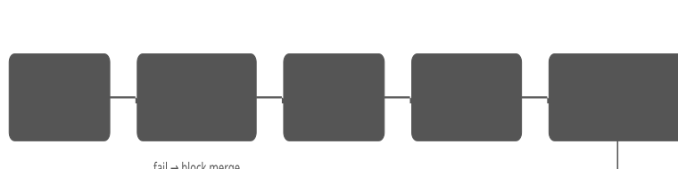

# Day 44 — Revision: K8s + CI/CD for GenAI

> Part of the [GenAI Architect study path](../../README.md) · Revision drill · [Original interactive pack](https://claude.ai/artifact/APojcuxHb57x3XQUUyruQd) · [Offline HTML](../../archive/html/day-44.html)


Day 44 · Revision drill · Sun 22 Nov 2026

# Kubernetes for GenAI + CI/CD for GenAI

Revisits Day 25 and Day 26. You get a two-minute recap, 8 hard questions with model answers, one design scenario, and a 20-minute warm-up you can run on your laptop.

Day 25 · K8s, GPUs, autoscalingDay 26 · eval gates, versioning, rollbackJD: CI/CD & productionization

## Two-minute recap: what changed since Day 25–26

### Serving on Kubernetes

- **DRA is GA** since Kubernetes 1.34. GPUs can be requested via ResourceClaims with attributes (model, memory, MIG profile) instead of the opaque `nvidia.com/gpu: 1` count.
- **Gateway API Inference Extension** (InferencePool + endpoint picker) routes on model-server state like queue depth and KV cache, not round-robin. Istio, NGINX Gateway Fabric and GKE implement it.
- **llm-d** (CNCF sandbox, 1.0 this year) adds prefix-cache-aware routing and prefill/decode disaggregation on top of vLLM. **KServe 0.18** integrates it through `LLMInferenceService`.
- **KEDA 2.2x** remains the standard way to scale on Prometheus metrics such as `vllm:num_requests_waiting`.

### Shipping changes safely

- The release unit is a **bundle**: prompt + model ID/snapshot + embedding model + index version + retrieval config + guardrail policy. Version it as one thing.
- **Three eval tiers:** PR (fast, deterministic plus a small golden set), nightly (full set plus red-team), release (online canary metrics).
- **promptfoo** (npm 0.126.x) ships a GitHub Action that posts before/after diffs on PRs. DeepEval runs the same checks as pytest tests.
- **Argo Rollouts** AnalysisTemplates can gate canary steps on Prometheus queries, including GenAI SLIs.

watsonx mapping: Red Hat OpenShift AI ships KServe and vLLM, so the K8s answers carry over to watsonx.ai on-prem / Cloud Pak for Data. watsonx.governance plays the role of the eval and monitoring gate on the managed side.

## Release pipeline you should be able to draw from memory



## hard questions

Answer out loud first, then open the model answer. Aim for 90 seconds each.

**Q1 Your vLLM pods sit at 35% CPU while users wait 20 s for the first token. HPA isn't scaling. Fix the autoscaling design. Day 25 · autoscaling**

CPU and even GPU utilisation are the wrong signals: a decode-bound GPU reads "busy" at low load and "busy" at overload. Scale on **saturation of the model server**: queue depth (`vllm:num_requests_waiting`) or KV-cache utilisation, through KEDA's Prometheus scaler. Target something like "average waiting requests per replica < 2". Keep `minReplicaCount ≥ 1` for interactive paths, since a cold start means scheduling a GPU node plus loading weights (minutes). Pair it with the cluster autoscaler or Karpenter for GPU nodes, and set a generous scale-down stabilisation window so you don't thrash expensive nodes.

Trap: proposing scale-to-zero for a chat endpoint. It fits batch or internal tools only, behind a queue.

**Q2 Three teams want GPUs on one cluster: an 8B chat model, an embedding service and nightly LoRA fine-tunes. How do you allocate? Day 25 · GPU scheduling**

- **Embeddings:** small and bursty. Share with MIG slices (hard isolation on A100/H100-class cards) or time-slicing where isolation matters less. Time-slicing has no memory isolation, so one OOM can take down neighbours.
- **Chat model:** dedicated full GPUs on a tainted node pool, with a PriorityClass above batch.
- **Fine-tunes:** preemptible, queued (Kueue), on spot capacity where the cloud allows, with checkpointing.
- Express requests through **DRA ResourceClaims** (GA in 1.34) when the driver supports it, so a pod can ask for "≥ 40 GB, MIG 3g" instead of a bare count. Add ResourceQuotas per namespace for chargeback.

**Q3 Why is a plain Kubernetes Service (round-robin) a poor load balancer for LLM replicas, and what replaces it? Day 25 · routing**

Requests vary by orders of magnitude in cost (prompt length × output length), and each replica holds a different prefix cache. Round-robin sends a 30k-token RAG prompt to an already saturated pod and throws away cache hits. Use an **inference-aware gateway**: the Gateway API Inference Extension's endpoint picker scores pods on queue depth, KV-cache use and LoRA adapters loaded. llm-d adds **prefix-cache-aware** routing, which helps RAG and agents with long shared system prompts. Measure the win as TTFT p95 and throughput per GPU, not RPS.

**Q4 A new replica takes 6 minutes to become ready. Break the time down and cut it. Day 25 · cold start**

- **Node provisioning** (GPU VM + driver): keep warm headroom nodes, or use a buffer of low-priority placeholder pods that get evicted.
- **Image pull** (CUDA images run 8–15 GB): slim images, pre-pulled or streamed images, registry in-region.
- **Weight download**: never pull from Hugging Face at start-up. Cache on node-local NVMe or a shared PVC (KServe has a local model cache), or ship weights as an OCI artifact.
- **Load + CUDA graph capture/warm-up**: tune or skip graph capture for dev; send a warm-up request before readiness passes.
- Use separate startup, readiness and liveness probes. A liveness probe that fires during model load creates a crash loop.

**Q5 LLM output is non-deterministic. How do you build a CI eval gate that doesn't flake but still catches regressions? Day 26 · eval gates**

- Layer checks: deterministic asserts first (schema valid, citation present, refusal on out-of-scope, no PII), then graded metrics.
- Gate on **delta vs. the stored baseline**, not an absolute score, with a tolerance band sized from repeated runs (run the set 3× once to measure variance).
- Pin temperature to 0 where possible, and pin the **judge model snapshot** and judge prompt version. A judge upgrade is itself a change that needs re-baselining.
- Keep the PR tier small (50–150 cases, a few minutes, cents per run). The full set runs nightly.
- Make "critical" cases (safety, compliance) zero-tolerance, separate from the averaged score.

Trap: one aggregate "accuracy ≥ 0.8" threshold. It hides a total failure on one slice, such as a single policy document.

**Q6 The team wants to swap the embedding model in the same release as a prompt change. What's your release plan? Day 26 · versioning**

Split them. An embedding change invalidates the whole index, because vectors from different models aren't comparable. Treat it as a **blue-green index migration**: build index v2 offline, run retrieval evals (recall@k, context precision) on v2 against v1, then switch the alias with v1 kept warm for rollback. Dual-write new documents to both until cut-over. Ship the prompt change separately, so a regression points to one cause. Record both in the bundle manifest: `embed=model@ver, index=kb-v2, prompt=answer@1.7`.

**Q7 What does a canary analysis for a GenAI service check that a normal web canary doesn't? Day 26 · progressive delivery**

- Latency split into **TTFT** and inter-token latency, not just total.
- **Tokens and cost per request**: a prompt change can double output length with no errors at all.
- **Guardrail block rate** and refusal rate, both directions.
- **Sampled online quality**: LLM-judge groundedness on 1–5% of traffic, plus thumbs-down rate.
- Wire them as Argo Rollouts AnalysisTemplates on Prometheus. Size the canary step and duration so each metric gets enough samples; quality signals need far more traffic than error rates.

**Q8 Your provider retires the model snapshot you depend on in 60 days. How does your CI/CD absorb it, and what does "rollback" mean here? Day 26 · rollback**

You can't roll back a provider. So: always pin dated snapshots, never floating aliases. Keep the candidate model in the routing layer (LiteLLM or an AI gateway) and run it in **shadow** on mirrored traffic, scoring offline. Re-baseline the golden set and fix prompt drift, then canary. "Rollback" means routing back to the previous model while it still exists, or to a **pre-qualified fallback** (a second provider or a self-hosted model that already passed the eval gate). Track deprecation dates in the ADR log with an owner.

## Design scenario

### HR policy copilot, 40k employees, two regions

Self-hosted Granite/Llama 8B on vLLM in an AKS or OpenShift cluster, Azure OpenAI as overflow, RAG over 30k documents. Peaks at 09:30 IST (about 25 RPS). Leadership wants weekly prompt releases and zero-downtime model upgrades. Spend 25 minutes designing it, then compare with the outline.

**→ Model answer outline**

- **Serving:** vLLM via KServe on a tainted GPU node pool per region. Inference gateway with an endpoint picker. LiteLLM in front for overflow and failover to Azure OpenAI (same region for data residency) once queue depth crosses a threshold.
- **Scaling:** KEDA on waiting requests, min 2 replicas per region, a scheduled pre-scale at 09:00 IST via a cron trigger, and a node buffer for the morning ramp.
- **Pipeline:** GitOps (Argo CD). A PR runs the promptfoo/DeepEval gate on about 120 golden HR questions with zero tolerance on policy-critical cases. Nightly runs the full set plus injection red-team. Release goes through an Argo Rollouts canary: 5% for 30 min, then 25% for 2 h, gated on TTFT p95, cost/request, block rate and sampled groundedness.
- **Versioning:** one bundle manifest in git. Index changes are blue-green behind an alias. Model upgrades go shadow, then canary.
- **NFRs to state:** TTFT p95 < 1.5 s, availability 99.9%, RPO 24 h for the index (rebuildable), RTO 1 h via the other region, PII masked before logging.
- **Sizing check to say aloud:** 25 RPS × ~600 output tokens is about 15k output tok/s at peak. Benchmark per-GPU throughput for your model and quantisation, then add N+1 per region. Don't quote a number you haven't measured.

## Warm-up (20 min, on your laptop)

Build a tiny regression gate that compares a model run against a stored baseline and fails with exit code 1. That is exactly the step a GitHub Actions job runs. It needs only Ollama; no Docker or WSL2.

**PowerShell**

```powershell
ollama pull qwen2.5:1.5b
mkdir evalgate; cd evalgate
py -m venv .venv; .\.venv\Scripts\Activate.ps1
python -m pip install "ollama>=0.6"
python gate.py --write-baseline   # first run records baseline.json
python gate.py                    # later runs compare; exit 1 on regression
echo $LASTEXITCODE
```
**gate.py** · `lab/gate.py`

```python
import json, sys, time, statistics, pathlib
from ollama import chat

MODEL = "qwen2.5:1.5b"
PROMPT_VERSION = "hr-answer@1.0"
SYSTEM = ("Answer only from CONTEXT. If the answer is not in CONTEXT, reply exactly: "
          "I don't know. Keep answers under 40 words.")
CONTEXT = ("Employees get 24 days of paid leave per year. Up to 8 unused days carry over. "
           "Remote work is allowed 2 days per week with manager approval.")

# golden set: (question, must_contain_any, critical)
GOLDEN = [
    ("How many paid leave days do I get?", ["24"], False),
    ("How many unused days carry over?", ["8", "eight"], False),
    ("How many remote days per week?", ["2", "two"], False),
    ("What is the CEO's salary?", ["i don't know"], True),     # must abstain
    ("Can I work remotely without approval?", ["approval", "no"], False),
]
BASE = pathlib.Path("baseline.json")
TOLERANCE = 0.0   # allowed drop in pass rate vs baseline
LAT_SLACK = 1.5   # allowed p95 latency multiplier

def run():
    results, lats = [], []
    for q, expect, critical in GOLDEN:
        t0 = time.perf_counter()
        r = chat(model=MODEL, options={"temperature": 0, "seed": 7},
                 messages=[{"role": "system", "content": SYSTEM},
                           {"role": "user", "content": f"CONTEXT:\n{CONTEXT}\n\nQ: {q}"}])
        lats.append(time.perf_counter() - t0)
        text = r.message.content.strip().lower()
        ok = any(e in text for e in expect)
        results.append({"q": q, "ok": ok, "critical": critical, "answer": text[:120],
                        "out_tokens": r.eval_count})
    p95 = sorted(lats)[max(0, int(len(lats) * 0.95) - 1)]
    return {"model": MODEL, "prompt": PROMPT_VERSION,
            "pass_rate": sum(r["ok"] for r in results) / len(results),
            "p95_s": round(p95, 2), "mean_out_tokens": statistics.mean(r["out_tokens"] for r in results),
            "results": results}

cur = run()
for r in cur["results"]:
    print(("PASS " if r["ok"] else "FAIL ") + ("[critical] " if r["critical"] else "") + r["q"])
print(f"pass_rate={cur['pass_rate']:.2f} p95={cur['p95_s']}s out_tokens={cur['mean_out_tokens']:.0f}")

if "--write-baseline" in sys.argv:
    BASE.write_text(json.dumps(cur, indent=2)); print("baseline written"); sys.exit(0)

base = json.loads(BASE.read_text())
reasons = []
if any(r["critical"] and not r["ok"] for r in cur["results"]):
    reasons.append("critical case failed")
if cur["pass_rate"] < base["pass_rate"] - TOLERANCE:
    reasons.append(f"pass_rate {cur['pass_rate']:.2f} < baseline {base['pass_rate']:.2f}")
if cur["p95_s"] > base["p95_s"] * LAT_SLACK:
    reasons.append(f"p95 {cur['p95_s']}s > {LAT_SLACK}x baseline {base['p95_s']}s")
if cur["mean_out_tokens"] > base["mean_out_tokens"] * 1.3:
    reasons.append("output tokens +30% (cost regression)")
print("GATE: " + ("FAIL - " + "; ".join(reasons) if reasons else "PASS"))
sys.exit(1 if reasons else 0)
```

**Expected:** five PASS/FAIL lines, a summary line such as `pass_rate=1.00 p95=0.9s out_tokens=14` (numbers vary on your RTX 3050), and `GATE: PASS` on the second run. Now break it: change `SYSTEM` to drop the "I don't know" rule and re-run. The critical case should fail and `$LASTEXITCODE` should be 1.

- **Stretch 1:** add the GitHub Actions job below to a scratch repo (it needs a self-hosted runner or a hosted API model, since GitHub's hosted runners have no Ollama by default).
- **Stretch 2:** run the set 3× and set `TOLERANCE` from the observed spread instead of 0.0. Note how big the band gets with only 5 cases; that is your argument for a 100+ case golden set.

**.github/workflows/eval-gate.yml** · saved as `lab/github/workflows/eval-gate.yml`

```yaml
name: eval-gate
on:
  pull_request:
    paths: ["prompts/**", "rag/**", "bundle.yaml"]
jobs:
  gate:
    runs-on: self-hosted        # GPU box with Ollama, or swap MODEL for a hosted API
    steps:
      - uses: actions/checkout@v4
      - uses: actions/setup-python@v5
        with: { python-version: "3.13" }
      - run: python -m pip install "ollama>=0.6"
      - run: python gate.py     # non-zero exit blocks the merge
      - if: always()
        uses: actions/upload-artifact@v4
        with: { name: eval-report, path: baseline.json }
```
**keda-scaledobject.yaml (for review, not for your laptop)** · saved as `lab/keda-scaledobject.yaml`

```yaml
apiVersion: keda.sh/v1alpha1
kind: ScaledObject
metadata: { name: hr-copilot-vllm }
spec:
  scaleTargetRef: { name: hr-copilot-vllm }
  minReplicaCount: 2
  maxReplicaCount: 8
  advanced:
    horizontalPodAutoscalerConfig:
      behavior:
        scaleDown: { stabilizationWindowSeconds: 600 }
  triggers:
    - type: prometheus
      metadata:
        serverAddress: http://prometheus.monitoring:9090
        query: sum(vllm:num_requests_waiting{app="hr-copilot-vllm"})
        threshold: "4"          # target waiting requests per replica
    - type: cron                # pre-scale for the 09:30 IST peak
      metadata: { timezone: Asia/Kolkata, start: "0 9 * * 1-5", end: "0 11 * * 1-5", desiredReplicas: "4" }
```

Running the KEDA manifest locally would need Docker Desktop (WSL2 backend) plus kind, and there is no GPU passthrough worth using on a 6 GB laptop card. Read it, don't deploy it.

## Decision to defend

| ADR-044 | Autoscaling signal for self-hosted LLM endpoints |
| --- | --- |
| Context | vLLM on GPU nodes; interactive traffic with a sharp morning peak; GPU nodes take minutes to provision. |
| Options | (a) HPA on CPU/GPU utilisation; (b) KEDA on queue depth; (c) KEDA on KV-cache utilisation; (d) fixed capacity plus overflow to a managed API. |
| Decision | (b) as the primary trigger, a cron pre-scale for known peaks, and (d) as a safety valve through the gateway once waiting requests stay above threshold for 60 s. |
| Consequences | Better TTFT under burst, and overflow keeps latency bounded during node provisioning. Costs: managed-API spend becomes a variable line item (needs a budget alert), the overflow model must pass the same eval gate, and data residency for the overflow region needs sign-off. |

## Read if you have 30 more minutes

- [Kubernetes v1.34: DRA has graduated to GA](https://kubernetes.io/blog/2025/09/01/kubernetes-v1-34-dra-updates/): what ResourceClaims change for GPU requests.
- [Red Hat Developer: KServe + llm-d for optimized GenAI inference](https://developers.redhat.com/articles/2026/04/21/kserve-llm-d-optimized-gen-ai-inference): closest to the OpenShift AI / watsonx on-prem stack.
- [promptfoo GitHub Action docs](https://www.promptfoo.dev/docs/integrations/github-action): a production version of today's warm-up.

### Repos to skim

- [llm-d/llm-d](https://github.com/llm-d/llm-d): read the "well-lit paths" guides for prefix-aware routing.
- [kserve/kserve](https://github.com/kserve/kserve): the LLMInferenceService CRD and its examples.
- [kedacore/keda](https://github.com/kedacore/keda): the Prometheus scaler implementation and the CHANGELOG.

**Tomorrow (Day 45):** revision drill on Day 27 (GenAI observability) and Day 28 (security, governance and responsible AI).
Sources

- [kubernetes.io: DRA GA in v1.34](https://kubernetes.io/blog/2025/09/01/kubernetes-v1-34-dra-updates/)
- [kubernetes.io: Gateway API Inference Extension](https://kubernetes.io/blog/2025/06/05/introducing-gateway-api-inference-extension/)
- [KServe 0.18 release](https://kserve.github.io/website/blog/kserve-0.18-release)
- [CNCF: llm-d](https://www.cncf.io/projects/llm-d/)
- [KEDA 2.21.0 release](https://newreleases.io/project/github/kedacore/keda/release/v2.21.0)
- [promptfoo CI/CD integration](https://www.promptfoo.dev/docs/integrations/ci-cd/)

## Lab files in this folder

- [`lab/gate.py`](lab/gate.py)
- [`lab/github/workflows/eval-gate.yml`](lab/github/workflows/eval-gate.yml)
- [`lab/keda-scaledobject.yaml`](lab/keda-scaledobject.yaml)
