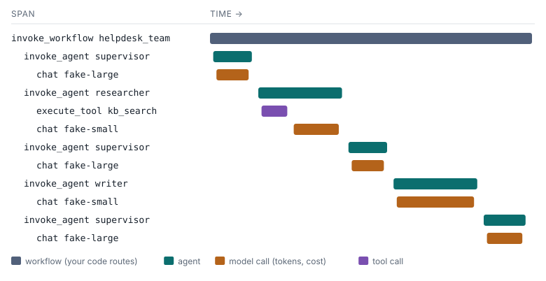

# Day 46 — Revision: Multi-Agent + Observability

> Part of the [GenAI Architect study path](../../README.md) · Revision drill · [Original interactive pack](https://claude.ai/artifact/DmuGMz1n7B5Jah7GPbVQev)


Day 46 · Revision drill · Tue 24 Nov 2026

# Multi-agent patterns + GenAI observability

Revisits Day 18 and Day 27, last drilled on Days 34 and 33. The two belong together: a team of agents is only defensible in a design review if you can show, from traces, where its tokens, time and failures go. You get a two-minute recap, 8 hard questions with model answers, one design scenario and a 60-minute lab that runs offline on your laptop.

JD lines covered: agentic frameworks (multi-agent, planning, guardrails) · GenAI observability (tracing, eval dashboards) · cost controls.

## Two-minute recap: what is current

### Multi-agent (Day 18)

- **The cost is real and published.** Anthropic reports that agents use about 4× the tokens of a chat and multi-agent systems about 15×. On their internal research eval the multi-agent setup beat a single agent by 90.2%, and token usage alone explained 80% of the variance on BrowseComp. Multi-agent buys quality by spending tokens in parallel, so it pays only on high-value, breadth-first tasks.
- **Read is easy, write is hard.** Cognition's April 2026 follow-up to "Don't Build Multi-Agents" says the patterns that work keep **writes single-threaded**: extra agents contribute research, review or a stronger second opinion, and one agent owns the output. A reviewer with a clean context catches more than one that shared the author's context.
- **Failures are mostly design failures.** The MAST taxonomy (1,600+ annotated traces, 7 frameworks) groups 14 failure modes under three headings: system design issues, inter-agent misalignment and task verification. A better model fixes few of them.
- **Libraries.** `langgraph` is at 1.2.24 on PyPI. The prebuilt helpers `langgraph-supervisor` (0.0.31) and `langgraph-swarm` (0.1.0) are still 0.x, so treat them as reference code and own the graph yourself. `openai-agents` (0.25.0) has handoffs and tracing built in.

### GenAI observability (Day 27)

- **OpenTelemetry GenAI conventions are still in Development status**, and they now live in their own repo, `open-telemetry/semantic-conventions-genai` (spec pages link semconv 1.45). Nothing under `gen_ai.*` is stable yet, so pin the version you emit.
- **Agent spans have a shape.** `invoke_workflow` when your code decides control flow (a LangGraph `StateGraph`), `invoke_agent {gen_ai.agent.name}` when a model decides it, `execute_tool`, and `chat` for the model call. `gen_ai.provider.name` replaced `gen_ai.system`. Token usage is `gen_ai.usage.input_tokens` and `gen_ai.usage.output_tokens`.
- **Content capture is off by default.** `OTEL_INSTRUMENTATION_GENAI_CAPTURE_CONTENT` defaults to `NO_CONTENT`. Messages, system instructions and tool arguments are opt-in attributes, with `_ref` variants so content can sit in a store you control.
- **Backends.** Langfuse Python SDK v5 shipped on 14 Oct 2026 (needs Langfuse server 4.59+ and Python 3.11+; 5.2.0 on PyPI). Arize Phoenix is at 22.0.1; its October releases added eval badges on the trace tree and a `DECISION` span kind for routers and classifiers.

watsonx mapping: an agent with collaborator agents in watsonx Orchestrate is the supervisor pattern, and watsonx.governance is where evaluation and monitoring of those agents sits. Instana accepts OpenTelemetry traces, so the span design below carries over. Check the current IBM docs for exact feature names before you quote them in an interview.

## The trace you should be able to draw from memory



Three things to say while drawing it. Every model call hangs under exactly one agent span, which is what makes cost attribution a tree walk. The supervisor appears between every worker, and each time it re-reads the transcript on the most expensive model. The workflow span carries the conversation ID, the tenant and the outcome, so one query answers "what did this conversation cost and how did it end".

## 8 hard questions

Answer out loud first, then open the model answer. Aim for 90 seconds each.

**Q1 A team proposes six specialised agents for an HR policy copilot. How do you decide whether it should be multi-agent at all? (Day 18 · when not to)**

Start from the task, not the framework. Multi-agent earns its cost when three things hold: the work splits into parts that are largely independent, the combined context would not fit or would degrade in one window, and the value per task covers roughly 15× the tokens of a chat. HR policy Q&A fails all three: one retrieval, one answer, low value per request, and a latency SLO. So the default is one agent with good tools and a retrieval step. "Specialisation" is usually better expressed as tools, prompts selected by a router, or skills loaded on demand.

I would ask the team for a single-agent baseline on the golden set first. If six agents do not beat it by an agreed margin at an acceptable cost per resolved question, the extra coordination surface is not justified.

Trap: arguing from org-chart analogy ("a researcher, a writer, a reviewer"). Roles are not a reason; context isolation and parallelism are.

**Q2 Compare supervisor, handoff (swarm) and agents-as-tools. Where does the context live in each, and what does that cost? (Day 18 · patterns)**

- **Supervisor (router):** a central agent picks the next worker each turn. Context sits in shared state that the supervisor re-reads on every decision. Easy to govern and trace. Costs an extra model call per hop, and the supervisor becomes the most expensive component, as the lab shows.
- **Handoff / swarm:** the active agent transfers control directly to a peer, and the conversation history travels with it. Fewer calls and lower latency, good for conversational triage. Control flow is decided by whichever agent is active, so loops and "who owns this" bugs are harder to bound.
- **Agents-as-tools (sub-agents):** the lead agent calls a worker like a function. The worker gets a brief, runs in its own context and returns a condensed result. Best context isolation and the easiest to parallelise. The risk is the brief: whatever the lead did not write down, the worker does not know.

In a review I pick by where state must live: shared and audited (supervisor), conversational (handoff), or isolated and summarised (sub-agents).

**Q3 Two parallel sub-agents each draft half of a migration plan and the halves contradict each other. Why does this happen, and how do you redesign? (Day 18 · failure modes)**

Each agent made implicit decisions (naming, ordering, assumptions about the target schema) that the other never saw. This is Cognition's point that actions carry implicit decisions, and it is MAST's inter-agent misalignment category. More prompt text in the brief reduces it but cannot remove it.

Redesign so that **writes are single-threaded**. Parallel agents gather facts and return findings with sources. One writer produces the plan with all findings in its context. A reviewer with a clean context then checks the plan against the requirements. If parallel writing is unavoidable, fix the shared decisions first in an explicit contract (interfaces, naming, constraints) and give every writer the same contract.

**Q4 Finance says the agent service cost 12× the forecast last month. You have traces. Walk me through finding where the money went. (Day 18 + 27 · cost attribution)**

Work from the span tree, top down.

1. Group workflow spans by tenant, route and outcome. Is it volume, or cost per conversation? Look at the p99, because agent cost is heavy-tailed and a few runaway conversations often carry the bill.
2. Inside the expensive traces, roll every `chat` span up to its nearest `invoke_agent` ancestor and price it by `gen_ai.request.model`. This usually points at the supervisor: it runs on the largest model and its input grows with every hop.
3. Look at the path. Repeated edges between the same two agents mean a loop. Repeated tool calls with the same arguments mean retries without backoff or a tool error the agent keeps re-trying.
4. Check input versus output tokens and cache-read tokens. Growth in input with flat output is transcript accumulation, which is fixed with isolation or summarisation, not with a cheaper model.

Then separate observation from control: add per-conversation token and handoff budgets in the orchestrator, and alert on cost per resolved task.

Trap: answering "switch to a smaller model". That treats the price, not the shape.

**Q5 The OpenTelemetry GenAI conventions are still marked Development. Do you build on them? (Day 27 · standards)**

Yes, with guard rails. The alternative is a vendor's private schema, which is a harder lock-in than an unstable open one. What I do about the instability:

- Pin the semconv version in one instrumentation module, and record it as a resource attribute. No service sets `gen_ai.*` attributes directly.
- Keep our own attributes under a separate namespace (`app.tenant`, `app.outcome`) so a rename upstream never collides with ours.
- Normalise in the OpenTelemetry Collector. A transform processor can map old names to new ones (the `gen_ai.system` to `gen_ai.provider.name` rename is the example) so dashboards survive an upgrade.
- Build dashboards and alerts on a small set of derived metrics, not on raw attribute names scattered through queries.

I would also say plainly that auto-instrumentation libraries lag the spec, so mixed attribute names across services are normal for a while.

**Q6 Compliance says no prompts or responses in telemetry. Engineers say they cannot debug agents without them. Design it. (Day 27 · privacy)**

Split structure from content. Spans always carry structure: operation, agent, model, tokens, latency, tool name, error type, outcome, conversation ID. That is enough for cost, loops, latency and error analysis, and it is what the default `NO_CONTENT` setting gives you.

Content goes to a separate store in the same region as the data, encrypted, with its own retention and access control, and the span holds only a reference. Access is by role and is audited; a debugging session opens a specific conversation for a stated reason. Mask PII before content is written, not at read time. Capture content for a sampled fraction, plus every conversation with a thumbs-down, an error or a guardrail block, because those are the ones engineers need.

Two details reviewers ask about: erasure requests must reach the content store (key it by user and conversation), and tool arguments and results count as content too.

**Q7 50,000 users, each agent run emits around 40 spans. What is your sampling strategy? (Day 27 · scale)**

Head sampling alone is wrong for agents, because the interesting traces (loops, errors, expensive runs) are rare and you only know they are interesting at the end. So:

- Compute metrics from **100%** of spans in the Collector before any sampling: tokens, cost, latency, error and block rates by route, model and tenant. Billing and SLOs never depend on sampled data.
- **Tail-sample** traces: keep every trace with an error, a guardrail block, a budget breach, a cost or duration above a threshold, or user feedback. Keep a small random share of the rest as a baseline.
- Tail sampling needs all spans of a trace on the same collector, so use a load-balancing layer keyed on trace ID, and size the decision window for long agent runs. A two-minute run does not fit a ten-second window.

For very long-running agents, add a per-conversation summary record so you can still answer questions when the full trace was dropped.

**Q8 How do you evaluate a multi-agent system in production? What is the unit of evaluation? (Day 18 + 27 · evals)**

Three units, each catching different failures.

- **End state:** did the task succeed, judged against the user's goal? This is the number the business sees. It says nothing about why.
- **Trajectory:** was the path reasonable? Number of hops, tool choice, repeated edges, whether verification ran. Deterministic checks on the span tree are cheap and catch most regressions.
- **Step:** was each decision right? Router accuracy against labelled examples, groundedness of each worker's output against its retrieved context, tool-argument validity.

Attach scores to spans, not only to traces, so the trace view shows which step failed; Phoenix now surfaces eval badges on the tree for this reason. Use the MAST categories as failure labels so that review of bad traces produces counts you can trend. Run step and trajectory checks on sampled production traces, and the same checks in CI on a fixed set of scenarios.

Trap: one LLM-judge score for the whole conversation. It hides compensating errors and cannot be acted on.

## Design scenario

### Contract review team for a procurement group, three regions

A procurement group reviews about 6,000 supplier contracts a month (30 to 120 pages each) across India, the EU and the US. They want a draft risk memo per contract: non-standard clauses, deviations from the playbook, and a recommendation. Constraints: results within 3 minutes (asynchronous is fine), at most $0.40 per contract in model cost, EU contracts processed and stored in the EU, 7-year audit trail of what the system read and concluded, and no contract text in the observability platform.

Sketch your answer before reading the outline.

- **Shape:** a workflow with fixed stages, not a free-form team. Parse and segment the contract; fan out clause-extraction workers in parallel by clause family (liability, IP, termination, data protection); one risk-assessment step with the playbook in context; one writer; one clean-context verifier that checks every claim in the memo against cited clauses. Parallel agents only read. One agent writes.
- **Why multi-agent is justified here:** the work splits cleanly, a 120-page contract plus the playbook strains one context, and the value per contract supports the token spend. Say explicitly that the HR copilot from Q1 does not meet this bar.
- **Budget:** $0.40 forces a small model for extraction workers and a larger one only for assessment and writing. Workers return structured findings (clause ID, text span reference, classification), never prose, so the writer's input stays small. Enforce a token budget per contract in the orchestrator, with a "partial memo, needs human" outcome when it trips.
- **Residency:** region is decided at intake from contract metadata and pinned for the whole run: regional model endpoint, regional queue, regional stores. The trace carries a region attribute and a policy test fails any trace that crosses.
- **Observability:** `invoke_workflow` per contract with contract ID as the conversation ID, `invoke_agent` per stage, `chat` and `execute_tool` beneath. Content capture off. Findings and the memo go to the regional audit store, referenced from spans. Metrics from 100% of spans; tail-keep traces with errors, verifier failures or budget breaches.
- **Audit:** the 7-year record is the audit store (inputs by hash and location, findings, memo, model and prompt versions, verifier result), not the tracing backend, whose retention is weeks.
- **Evaluation:** a golden set of contracts annotated by lawyers. Clause-level recall for extraction, precision of flagged deviations, and verifier agreement. Release is gated on those, and reviewer edits to memos feed back as new cases.
- **Failure modes to name:** a worker silently skipping a clause family (count findings per family and alert on zero), verifier sharing the writer's context, queue backlog at month-end, a model snapshot retiring mid-quarter.

## Lab (60 min): find the money in a multi-agent trace

You will run a three-agent supervisor team with a scripted fake model, export OpenTelemetry spans to a file, and write the report an architect gets asked for: cost by agent, the handoff path, loops and errors. It needs no GPU, no API key, no Docker and no WSL2. The only dependency is `opentelemetry-sdk` (1.45.2 at the time of writing).

### Setup (PowerShell)

```powershell
mkdir day46; cd day46
py -3.13 -m venv .venv
.\.venv\Scripts\Activate.ps1
python -m pip install --upgrade pip
python -m pip install "opentelemetry-sdk>=1.45,<2"
```

If activation is blocked, run `Set-ExecutionPolicy -Scope Process RemoteSigned` in the same window first. Save the two files below into the folder.

### traced_team.py

```python
"""Day 46 lab, part 1: a supervisor team that emits OpenTelemetry GenAI spans.

Runs offline with a scripted fake model (no GPU, no API key). Spans follow the
OpenTelemetry GenAI semantic conventions (status: Development, semconv 1.45):
  invoke_workflow <team>  ->  invoke_agent <agent>  ->  chat <model> / execute_tool <tool>
Anything under the "app." prefix is our own attribute, not part of the spec.

Usage:
  python traced_team.py --scenario ok
  python traced_team.py --scenario pingpong --no-guard
  python traced_team.py --scenario pingpong
  python traced_team.py --scenario ok --context isolated
"""
from __future__ import annotations

import argparse
import json
import uuid
from collections.abc import Sequence
from dataclasses import dataclass, field
from pathlib import Path

from opentelemetry import trace
from opentelemetry.sdk.resources import Resource
from opentelemetry.sdk.trace import ReadableSpan, TracerProvider
from opentelemetry.sdk.trace.export import SimpleSpanProcessor, SpanExporter, SpanExportResult
from opentelemetry.trace import SpanKind, Status, StatusCode

SUPERVISOR_MODEL = "fake-large"   # the router gets the expensive model
WORKER_MODEL = "fake-small"
OUT_TOKENS = {"supervisor": 20, "researcher": 120, "writer": 180}
HARD_STOP = 12                    # keeps --no-guard runs finite


class JsonlExporter(SpanExporter):
    """Writes one JSON object per finished span. Stands in for an OTLP exporter."""

    def __init__(self, path: Path) -> None:
        self.path = path

    def export(self, spans: Sequence[ReadableSpan]) -> SpanExportResult:
        with self.path.open("a", encoding="utf-8") as fh:
            for s in spans:
                fh.write(json.dumps({
                    "trace_id": format(s.context.trace_id, "032x"),
                    "span_id": format(s.context.span_id, "016x"),
                    "parent_id": format(s.parent.span_id, "016x") if s.parent else None,
                    "name": s.name,
                    "kind": s.kind.name,
                    "start_ns": s.start_time,
                    "end_ns": s.end_time,
                    "status": s.status.status_code.name,
                    "attributes": dict(s.attributes or {}),
                }) + "\n")
        return SpanExportResult.SUCCESS

    def shutdown(self) -> None:  # nothing to close
        return None


@dataclass
class Team:
    scenario: str
    context: str                      # "shared" or "isolated"
    guard: bool
    max_handoffs: int
    token_budget: int
    tracer: trace.Tracer
    transcript: list[str] = field(default_factory=list)
    tokens_used: int = 0
    handoffs: int = 0
    evidence: str = ""
    draft: str = ""

    # ---- model and tool calls (each one is a span) -------------------------
    def chat(self, agent: str, model: str, prompt: str, reply: str) -> str:
        in_tok, out_tok = max(1, len(prompt) // 4), OUT_TOKENS[agent]
        with self.tracer.start_as_current_span(f"chat {model}", kind=SpanKind.CLIENT) as span:
            span.set_attribute("gen_ai.operation.name", "chat")
            span.set_attribute("gen_ai.provider.name", "fake")
            span.set_attribute("gen_ai.request.model", model)
            span.set_attribute("gen_ai.usage.input_tokens", in_tok)
            span.set_attribute("gen_ai.usage.output_tokens", out_tok)
        self.tokens_used += in_tok + out_tok
        return reply + " " + "x" * (out_tok * 4 - len(reply) - 1)   # pad to the token count

    def kb_search(self, query: str) -> str:
        with self.tracer.start_as_current_span("execute_tool kb_search", kind=SpanKind.INTERNAL) as span:
            span.set_attribute("gen_ai.operation.name", "execute_tool")
            span.set_attribute("gen_ai.tool.name", "kb_search")
            if self.scenario == "tool_error":
                span.set_attribute("error.type", "TimeoutError")
                span.set_status(Status(StatusCode.ERROR, "kb_search timed out after 2 s"))
                return ""
            return "POL-7 s3.2: VPN passwords expire every 90 days."

    # ---- agents ---------------------------------------------------------------
    def view(self, brief: str) -> str:
        """What a worker sees: the whole transcript, or only its brief."""
        return "\n".join(self.transcript) if self.context == "shared" else brief

    def run_agent(self, name: str, came_from: str, brief: str) -> None:
        with self.tracer.start_as_current_span(f"invoke_agent {name}", kind=SpanKind.INTERNAL) as span:
            span.set_attribute("gen_ai.operation.name", "invoke_agent")
            span.set_attribute("gen_ai.agent.name", name)
            span.set_attribute("app.handoff.from", came_from)
            if name == "researcher":
                self.evidence = self.kb_search(brief)
                out = self.chat(name, WORKER_MODEL, self.view(brief) + self.evidence,
                                f"EVIDENCE: {self.evidence or 'none found'}")
            else:
                verdict = "NEED_MORE_EVIDENCE" if self.scenario == "pingpong" else "DRAFT_READY"
                if not self.evidence:
                    verdict = "ABSTAIN"
                self.draft = verdict
                out = self.chat(name, WORKER_MODEL, self.view(brief) + self.evidence, f"{verdict}:")
            # shared: the full output joins the transcript. isolated: a one-line summary does.
            self.transcript.append(f"[{name}] " + (out if self.context == "shared" else out[:80]))

    def route(self) -> str:
        """The supervisor's decision. One chat span per decision, on the large model."""
        with self.tracer.start_as_current_span("invoke_agent supervisor", kind=SpanKind.INTERNAL) as span:
            span.set_attribute("gen_ai.operation.name", "invoke_agent")
            span.set_attribute("gen_ai.agent.name", "supervisor")
            if not self.evidence and self.draft != "ABSTAIN" and self.handoffs == 0:
                nxt = "researcher"
            elif self.draft in ("", "NEED_MORE_EVIDENCE") and self.transcript[-1].startswith("[researcher]"):
                nxt = "writer"
            elif self.draft == "NEED_MORE_EVIDENCE":
                nxt = "researcher"
            else:
                nxt = "FINISH"
            self.chat("supervisor", SUPERVISOR_MODEL, "\n".join(self.transcript), f"next={nxt}")
            span.set_attribute("app.route.next", nxt)
            return nxt

    # ---- the workflow ---------------------------------------------------------
    def run(self, question: str) -> str:
        conversation_id = f"conv-{uuid.uuid4().hex[:8]}"   # in production: the real session id
        with self.tracer.start_as_current_span("invoke_workflow helpdesk_team", kind=SpanKind.INTERNAL) as root:
            root.set_attribute("gen_ai.operation.name", "invoke_workflow")
            root.set_attribute("gen_ai.conversation.id", conversation_id)
            root.set_attribute("app.scenario", self.scenario)
            root.set_attribute("app.context_mode", self.context)
            root.set_attribute("app.tenant", "acme")
            self.transcript.append(f"[user] {question}")
            outcome = "answered"
            for _ in range(HARD_STOP):
                nxt = self.route()
                if nxt == "FINISH":
                    break
                if self.guard and (self.handoffs >= self.max_handoffs or self.tokens_used >= self.token_budget):
                    outcome = "budget_exceeded"
                    root.set_attribute("error.type", "budget_exceeded")
                    root.set_status(Status(StatusCode.ERROR, "handoff or token budget exceeded"))
                    break
                self.handoffs += 1
                self.run_agent(nxt, "supervisor", question)
            else:
                outcome = "hard_stop"
                root.set_attribute("error.type", "hard_stop")
                root.set_status(Status(StatusCode.ERROR, "loop hit the hard stop"))
            if outcome == "answered" and self.draft == "ABSTAIN":
                outcome = "abstained"
            root.set_attribute("app.outcome", outcome)
            root.set_attribute("app.handoffs", self.handoffs)
        return f"{conversation_id} outcome={outcome} handoffs={self.handoffs} tokens={self.tokens_used}"


def main() -> None:
    ap = argparse.ArgumentParser()
    ap.add_argument("--scenario", choices=["ok", "pingpong", "tool_error"], default="ok")
    ap.add_argument("--context", choices=["shared", "isolated"], default="shared")
    ap.add_argument("--no-guard", action="store_true", help="disable the handoff and token budgets")
    ap.add_argument("--max-handoffs", type=int, default=4)
    ap.add_argument("--token-budget", type=int, default=4000)
    ap.add_argument("--out", type=Path, default=Path("spans.jsonl"))
    args = ap.parse_args()

    provider = TracerProvider(resource=Resource.create({"service.name": "helpdesk-team"}))
    provider.add_span_processor(SimpleSpanProcessor(JsonlExporter(args.out)))
    team = Team(args.scenario, args.context, not args.no_guard, args.max_handoffs,
                args.token_budget, provider.get_tracer("day46.lab"))
    print(team.run("How often do VPN passwords expire, and what is the policy reference?"))
    provider.shutdown()


if __name__ == "__main__":
    main()
```

### trace_report.py

```python
"""Day 46 lab, part 2: turn raw spans into the numbers an architect is asked for.

Reads spans.jsonl (written by traced_team.py) and prints, per conversation:
tokens and cost by agent, the handoff path, loops, errors and unattributed
model calls. With --gate it exits 1 when a conversation breaks a rule, so the
same script works as a CI check or as an alert rule prototype.

Usage:
  python trace_report.py spans.jsonl
  python trace_report.py spans.jsonl --gate --max-cost 0.02
"""
from __future__ import annotations

import argparse
import json
import sys
from collections import Counter, defaultdict
from pathlib import Path

# Placeholder prices in USD per 1M tokens (input, output). Replace with your contract rates.
PRICES = {"fake-large": (3.00, 15.00), "fake-small": (0.25, 1.25)}
LOOP_THRESHOLD = 3   # the same agent->agent edge this many times is a loop


def load(path: Path) -> dict[str, list[dict]]:
    traces: dict[str, list[dict]] = defaultdict(list)
    for line in path.read_text(encoding="utf-8").splitlines():
        if line.strip():
            span = json.loads(line)
            traces[span["trace_id"]].append(span)
    return traces


def owning_agent(span: dict, by_id: dict[str, dict]) -> str | None:
    """Walk up the tree to the nearest invoke_agent span."""
    cur = by_id.get(span["parent_id"] or "")
    while cur is not None:
        if cur["attributes"].get("gen_ai.operation.name") == "invoke_agent":
            return cur["attributes"].get("gen_ai.agent.name")
        cur = by_id.get(cur["parent_id"] or "")
    return None


def analyse(spans: list[dict]) -> dict:
    by_id = {s["span_id"]: s for s in spans}
    root = next(s for s in spans if s["parent_id"] is None)
    tokens: dict[str, list[int]] = defaultdict(lambda: [0, 0])
    cost: dict[str, float] = defaultdict(float)
    unattributed = 0
    for s in spans:
        a = s["attributes"]
        if a.get("gen_ai.operation.name") != "chat":
            continue
        agent = owning_agent(s, by_id)
        if agent is None:
            unattributed += 1
            agent = "(unattributed)"
        i, o = a.get("gen_ai.usage.input_tokens", 0), a.get("gen_ai.usage.output_tokens", 0)
        p_in, p_out = PRICES[a["gen_ai.request.model"]]
        tokens[agent][0] += i
        tokens[agent][1] += o
        cost[agent] += (i * p_in + o * p_out) / 1_000_000
    agents = sorted((s for s in spans if s["attributes"].get("gen_ai.operation.name") == "invoke_agent"),
                    key=lambda s: s["start_ns"])
    path = [s["attributes"]["gen_ai.agent.name"] for s in agents]
    edges = Counter(zip(path, path[1:]))
    loops = {f"{a}->{b}": n for (a, b), n in edges.items() if n >= LOOP_THRESHOLD}
    errors = [f'{s["name"]}: {s["attributes"].get("error.type", "error")}'
              for s in spans if s["status"] == "ERROR"]
    return {
        "conversation": root["attributes"].get("gen_ai.conversation.id", "?"),
        "scenario": root["attributes"].get("app.scenario", "?"),
        "context": root["attributes"].get("app.context_mode", "?"),
        "outcome": root["attributes"].get("app.outcome", "?"),
        "duration_ms": (root["end_ns"] - root["start_ns"]) / 1e6,
        "tokens": dict(tokens), "cost": dict(cost), "total_cost": sum(cost.values()),
        "path": path, "loops": loops, "errors": errors, "unattributed": unattributed,
    }


def main() -> int:
    ap = argparse.ArgumentParser()
    ap.add_argument("spans", type=Path)
    ap.add_argument("--gate", action="store_true")
    ap.add_argument("--max-cost", type=float, default=0.02, help="USD per conversation")
    args = ap.parse_args()

    failed = False
    for spans in load(args.spans).values():
        r = analyse(spans)
        print(f'\n{r["conversation"]}  scenario={r["scenario"]}  context={r["context"]}  outcome={r["outcome"]}')
        print(f'  {"agent":<16}{"in_tok":>8}{"out_tok":>9}{"cost_usd":>11}{"share":>8}')
        for agent, (i, o) in sorted(r["tokens"].items(), key=lambda kv: -r["cost"][kv[0]]):
            share = r["cost"][agent] / r["total_cost"] if r["total_cost"] else 0
            print(f'  {agent:<16}{i:>8}{o:>9}{r["cost"][agent]:>11.5f}{share:>8.0%}')
        print(f'  {"TOTAL":<16}{sum(v[0] for v in r["tokens"].values()):>8}'
              f'{sum(v[1] for v in r["tokens"].values()):>9}{r["total_cost"]:>11.5f}')
        print("  path:   " + " > ".join(r["path"]))
        problems = []
        if r["loops"]:
            problems.append(f'loop {r["loops"]}')
        if r["errors"]:
            problems.append("errors " + "; ".join(r["errors"]))
        if r["unattributed"]:
            problems.append(f'{r["unattributed"]} model call(s) with no owning agent')
        if r["total_cost"] > args.max_cost:
            problems.append(f'cost {r["total_cost"]:.5f} > budget {args.max_cost}')
        print("  checks: " + ("PASS" if not problems else "FAIL - " + " | ".join(problems)))
        failed = failed or bool(problems)
    return 1 if (args.gate and failed) else 0


if __name__ == "__main__":
    sys.exit(main())
```

### Run it

```powershell
Remove-Item spans.jsonl -ErrorAction SilentlyContinue
python traced_team.py --scenario ok
python traced_team.py --scenario ok --context isolated
python traced_team.py --scenario pingpong --no-guard
python traced_team.py --scenario pingpong
python traced_team.py --scenario tool_error
python trace_report.py spans.jsonl --gate
echo "exit code: $LASTEXITCODE"
```

### Expected output

Conversation IDs differ on every run. The token and cost figures are deterministic.

```text
conv-6d1a6753  scenario=ok  context=shared  outcome=answered
  agent             in_tok  out_tok   cost_usd   share
  supervisor           484       60    0.00235     85%
  writer               154      180    0.00026     10%
  researcher            30      120    0.00016      6%
  TOTAL                668      360    0.00277
  path:   supervisor > researcher > supervisor > writer > supervisor
  checks: PASS

conv-565ffc53  scenario=ok  context=isolated  outcome=answered
  ...
  TOTAL                180      360    0.00166
  checks: PASS

conv-d0732fab  scenario=pingpong  context=shared  outcome=hard_stop
  supervisor         10140      240    0.03402     88%
  ...
  TOTAL              20424     2040    0.03884
  checks: FAIL - loop {'supervisor->researcher': 6, ...} | errors invoke_workflow helpdesk_team: hard_stop | cost 0.03884 > budget 0.02

conv-56238f97  scenario=pingpong  context=shared  outcome=budget_exceeded
  TOTAL               2542      700    0.00718
  checks: FAIL - errors invoke_workflow helpdesk_team: budget_exceeded

conv-86e2cc5a  scenario=tool_error  context=shared  outcome=abstained
  checks: FAIL - errors execute_tool kb_search: TimeoutError
exit code: 1
```

### What to take from the numbers

- The supervisor does no "work" and takes 85% of the cost. It runs on the large model and re-reads the transcript before every decision.
- Isolated context cuts input tokens from 668 to 180 on the same task. The workers see a brief, and only a one-line summary returns to the transcript.
- The unguarded loop costs 14× the healthy run (0.03884 against 0.00277). With the guard on, the same fault stops at 0.00718. The report found the loop; the budget in the orchestrator is what stopped it. Observability does not control anything.
- The tool timeout produced an abstention, which is the right user-facing behaviour, and it is still flagged, because the error is on the span.

### Questions to answer in your notes

1. In `pingpong` with `--context isolated --no-guard`, total cost drops to about 0.011 but the loop is identical. Which metric would you alert on so that isolation does not hide the loop?
2. The lab makes up a conversation ID. The spec says not to substitute a UUID or trace ID when no real one exists. What would you use in a system with a session service, and what breaks in dashboards if you use the trace ID?
3. Where would a `plan` span and a verifier agent sit in this tree?

### Stretch goals

1. **See it in a real backend.** `python -m pip install arize-phoenix opentelemetry-exporter-otlp-proto-http`, start it with `phoenix serve`, and add a second span processor with `OTLPSpanExporter(endpoint="http://localhost:6006/v1/traces")`. Phoenix needs Python 3.11+ and runs natively on Windows. Compare its trace tree with your report. (Confirm the port in the Phoenix docs if the UI does not show traces.)
2. **Use a real model.** Replace the body of `chat` with a call to Ollama (`python -m pip install ollama`, then `ollama pull llama3.2:3b`, which fits in 6 GB of VRAM). Fill `gen_ai.usage.input_tokens` from `prompt_eval_count` and `gen_ai.usage.output_tokens` from `eval_count` in the response, set `gen_ai.provider.name` to `ollama`, and let the supervisor's reply decide the route. Then see how often a 3B model loops without the guard.

## Decision to defend

**Title:** Trace schema and cost control for agent teams

**Status:** Proposed · 2026-11-24

**Context:** Several teams are building agent workflows on different frameworks (LangGraph, OpenAI Agents SDK, watsonx Orchestrate). Finance wants cost per conversation and per agent. Compliance forbids prompt and response text in the monitoring platform. The OpenTelemetry GenAI conventions are in Development status and attribute names have changed before.

**Options:** (A) Each team uses its framework's native tracing and backend. (B) One schema: OpenTelemetry GenAI conventions at a pinned version, emitted through a shared instrumentation module, normalised in the Collector, backend replaceable. (C) Structured logs only, with cost computed from provider invoices.

**Decision:** B. Every model call sits under exactly one `invoke_agent` span and every run under one `invoke_workflow` span that carries conversation ID, tenant and outcome. Our own attributes use the `app.` namespace. Content capture is off; content goes to a regional store and spans hold references. Metrics come from 100% of spans, traces are tail-sampled. Token and handoff budgets are enforced in the orchestrator, and a CI check fails any scenario trace with an unattributed model call, a repeated edge above the threshold or a cost above budget.

**Consequences:** + One cost and reliability view across frameworks, a backend that can be swapped, and a compliance position that holds by default. Loops are bounded by design and detected by test. − We own an instrumentation module and Collector transforms, and must track spec changes until the conventions stabilise. Framework auto-instrumentation will not match our schema exactly, so some spans need mapping. Debugging without content is slower until the reference store and its access process exist.

## Read if you have 30 more minutes

- [How we built our multi-agent research system](https://www.anthropic.com/engineering/multi-agent-research-system) (Anthropic). The source of the 4× and 15× token figures, plus what they say about tracing and rainbow deployments.
- [Multi-Agents: What's Actually Working](https://cognition.com/blog/multi-agents-working) (Cognition, April 2026), read after the original [Don't Build Multi-Agents](https://cognition.com/blog/dont-build-multi-agents). Single-threaded writes and clean-context review.
- [Why Do Multi-Agent LLM Systems Fail?](https://arxiv.org/abs/2503.13657) The MAST taxonomy. Read the 14 failure modes and map three of them to systems you have built.
- [Instrumenting AI Agents: A Practical OpenTelemetry Guide](https://www.honeycomb.io/blog/instrumenting-ai-agents-agent-timeline-opentelemetry-guide) (Honeycomb, June 2026). A worked example of the same attributes the lab uses.

### Repos to skim

- [open-telemetry/semantic-conventions-genai](https://github.com/open-telemetry/semantic-conventions-genai): read [`docs/gen-ai/gen-ai-agent-spans.md`](https://raw.githubusercontent.com/open-telemetry/semantic-conventions-genai/main/docs/gen-ai/gen-ai-agent-spans.md) for the rule on `invoke_agent` versus `invoke_workflow`.
- [Arize-ai/phoenix](https://github.com/arize-ai/phoenix): how evals attach to spans, and the trace tree UI you would compare your report with.
- [langfuse/langfuse-python](https://github.com/langfuse/langfuse-python): the OpenTelemetry-based SDK; look at how `@observe` nests observations.
- [openai/openai-agents-python](https://github.com/openai/openai-agents-python): handoffs and agents-as-tools in one small codebase, with tracing built in.

## Tomorrow

Day 47: another revision drill on two earlier topics, drawn from the ones revised least recently.

## Sources

- <https://www.anthropic.com/engineering/multi-agent-research-system>
- <https://cognition.com/blog/dont-build-multi-agents>
- <https://cognition.com/blog/multi-agents-working>
- <https://arxiv.org/abs/2503.13657>
- <https://www.langchain.com/blog/how-and-when-to-build-multi-agent-systems>
- <https://raw.githubusercontent.com/open-telemetry/semantic-conventions-genai/main/docs/gen-ai/gen-ai-agent-spans.md>
- <https://raw.githubusercontent.com/open-telemetry/semantic-conventions-genai/main/docs/gen-ai/gen-ai-spans.md>
- <https://dev.to/azena-ai/opentelemetrys-genai-semantic-conventions-are-not-stable-yet-heres-what-actually-shipped-in-2026-3mke>
- <https://www.honeycomb.io/blog/instrumenting-ai-agents-agent-timeline-opentelemetry-guide>
- <https://langfuse.com/changelog/2026-10-14-python-sdk-v5-js-sdk-v6.md>
- <https://arize.com/docs/phoenix/release-notes/10-2026/10-01-2026-trace-tree-evals-and-decision-spans>
- <https://github.com/arize-ai/phoenix>
- <https://github.com/langfuse/langfuse-python>
- <https://github.com/openai/openai-agents-python>
- Library versions were read from PyPI on 24 Nov 2026.

## Lab files in this folder

- [`lab/traced_team.py`](lab/traced_team.py)
- [`lab/trace_report.py`](lab/trace_report.py)
- [`diagrams/fig-1.svg`](diagrams/fig-1.svg)
