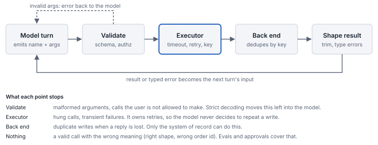

# Day 49 — Revision: Tool Calling + LangChain Core

> Part of the [GenAI Architect study path](../../README.md) · Revision drill · [Original interactive pack](https://claude.ai/artifact/PVenjC3aW7HkuFFS23sszz)

Day 49 · Revision drill · Fri 27 Nov 2026

# Tool calling + LangChain core

Revisits Day 16 and Day 15, last drilled on Days 36 and 37. Day 36 covered who is allowed to call a tool. Today covers whether the call works: argument validity, retries, duplicate writes, catalogue size, and how much of that LangChain does for you. You get a two-minute recap, 8 hard questions with model answers, one design scenario and a 60 to 75 minute lab that runs offline on your laptop.

JD lines covered: agentic frameworks (LangChain, tool calling, guardrails) · multi-provider LLM integration · evaluation (latency and cost) · NFRs, cost estimates and decision logs · explaining complex AI simply to stakeholders.

## Two-minute recap: what is current

### Tool calling (Day 16)

- **Strict arguments are available on the three big APIs, with different switches.** OpenAI: `"strict": true` on the function, which requires `additionalProperties: false` and every property listed in `required`. In the Responses API, if you omit `strict` the API tries to normalise your schema into strict mode and falls back to non-strict when it cannot. Anthropic: `"strict": true` on the tool definition, documented as stable, with the guarantee that the tool `input` follows the `input_schema` and the tool name is valid. Gemini: a `validated` function-calling mode next to `auto`, `any` and `none`.
- **Ollama's tool-calling page documents no strict flag.** Arguments arrive as a parsed dict and the page does not say they are checked against your schema. On local models, validate on your side. Its examples use `qwen3`, and it supports several tool calls in one response and tool calls while streaming.
- **Both OpenAI and Google now tell you to keep the active tool set small.** OpenAI: "Aim for fewer than 20 functions available at the start of a turn", described as a soft suggestion. Gemini: keep the active set to 10 to 20.
- **Deferred tools are the vendor answer to large catalogues.** Anthropic has two tool search tools (regex and BM25) and `defer_loading: true` on a tool, with no beta header listed in the current reference. OpenAI has `tool_search` with namespaces and `defer_loading`, on `gpt-5.4` and later. Anthropic's launch post (Nov 2025) reported about 72K tokens of definitions falling to about 8.7K. Those are launch-era figures from the vendor, so measure your own.
- **Programmatic tool calling has real limits.** On Anthropic the model writes Python that calls your tools inside a code-execution container. The docs list what it cannot do: no `strict: true`, no forcing through `tool_choice`, no MCP connector tools, and it is not ZDR or HIPAA eligible. On one benchmark the docs report unchanged scores at about 8% higher cost, so it is not a free win.
- **Reasoning state has to travel with the tool call.** OpenAI's guide says reasoning items must be passed back with function results for reasoning models. Gemini's says steps that include a thought and a function call must be returned exactly as received in stateless use. This matters for provider failover (Q5).
- **MCP changed shape in July.** The current revision is `2026-07-28`. Per a third-party timeline and the SDK release notes, it removes protocol sessions and the `initialize` handshake in favour of a stateless core, and moves tasks into an extension. I did not read the specification itself, so check before you quote details. The Python SDK is `mcp` 2.3.0, a server is now `from mcp.server import MCPServer`, and the README tells 1.x users to pin `mcp>=1.28,<2`.

### LangChain core (Day 15)

- **Versions on PyPI today:** `langchain` 1.5.2 (18 Nov), `langchain-core` 1.8.5 (25 Nov), `langgraph` 1.2.24 (20 Nov), `langgraph-prebuilt` 1.1.3, `langchain-ollama` 1.2.0. `langchain` and `langchain-core` require Python 3.11 or newer.
- **`create_agent` is the standard agent builder.** Import it from `langchain.agents`. It replaced `langgraph.prebuilt.create_react_agent` and it uses LangGraph's `ToolNode` internally.
- **Middleware is where policy goes.** The built-in list now includes `ToolRetryMiddleware`, `ModelRetryMiddleware`, `ModelFallbackMiddleware`, `ToolCallLimitMiddleware`, `ModelCallLimitMiddleware`, `HumanInTheLoopMiddleware`, `PIIMiddleware`, `LLMToolSelectorMiddleware` and `ToolErrorMiddleware`. Custom hooks include `wrap_model_call` and `wrap_tool_call`.
- **Two defaults to know before a review.** `ToolNode`'s default error handler turns invalid model-supplied arguments into an error message for the model and re-raises errors from inside the tool. `ToolErrorMiddleware` with no handler converts nothing, so exceptions propagate.
- **Legacy chains moved out.** Old chains, retrievers, `OutputFixingParser` and the hub now live in `langchain-classic`. If a codebase still imports them from `langchain`, it is on 0.x habits.
- **Runnable defaults are wide.** In `langchain-core` 1.8.5, `with_retry` defaults to `retry_if_exception_type=(Exception,)` and three attempts, and `with_fallbacks` defaults to `exceptions_to_handle=(Exception,)`. Both treat a bug the same as an outage unless you narrow them. The lab shows this.
- **Standard content blocks.** Messages expose `content_blocks` for provider-neutral access to text, reasoning and tool calls. The release notes list five integrations that support it so far: Anthropic, AWS, OpenAI, Google GenAI and Ollama.

## The picture to draw: five control points on one tool call

When a reviewer asks "what happens when the tool call goes wrong", draw this and say which box owns which failure.



## Where each reliability control lives

| Failure | Control | Who owns it | What LangChain gives you | What it costs |
|---|---|---|---|---|
| Arguments do not match the schema | Strict decoding, plus server-side validation | Model API and your tool layer | Pydantic `args_schema` on `@tool`. `ToolNode` returns the error to the model by default | One extra model turn per repair |
| Tool times out or returns 5xx | Timeout, bounded retry with backoff | Executor | `with_retry`, `ToolRetryMiddleware` | Tail latency. Each retry adds the timeout plus the backoff |
| Reply lost after a write | Idempotency key, deduplication | The back end | Nothing. You design the key and the back end honours it | A key store with a retention period |
| Provider outage | Fallback model | Gateway or middleware | `with_fallbacks`, `ModelFallbackMiddleware` | A second prompt and eval set to maintain |
| Model loops | Turn and tool-call caps | Orchestrator | `ToolCallLimitMiddleware`, `ModelCallLimitMiddleware`, LangGraph recursion limit | Some legitimate long tasks get cut off |
| Valid call, wrong meaning | Evals on outcomes, approval for high-impact writes | You | `HumanInTheLoopMiddleware` | Human time, slower tasks |
| Too many tools | Routing, deferred tools, sub-agents | Architecture | `LLMToolSelectorMiddleware`, provider tool search | An extra call, and a new miss mode when search does not find the tool |

## 8 hard questions

### Q1. Strict mode is on everywhere and tool calls still fail in production. What does strict guarantee, and what does it leave to you? (Day 16 · contracts)

Strict mode guarantees shape. Anthropic states it as: the tool input follows the input schema and the tool name is valid. OpenAI states that calls adhere to the function schema instead of being best effort.

It leaves four things to me.

1. **Meaning.** `order_id: "ORD-10423"` is valid and wrong if the customer said 10422. No schema catches that. Outcome evals and approvals do.
2. **Business rules.** A schema can cap an amount at 500. It cannot know this customer already had a refund. The back end must check.
3. **Coverage gaps.** Strict uses a subset of JSON Schema. On Anthropic it cannot be combined with programmatic tool calling. OpenAI notes that for fine-tuned models strict is disabled when several functions are called in one turn. Ollama's docs describe no enforcement at all.
4. **Trust.** A constrained model is still an untrusted caller. The server validates every call again, because the request may not have come from the model I think it did.

So the design rule is: strict decoding lowers the repair rate, and server-side validation is what makes the call safe. In the lab, turning strict on moves pass^1 from 0.83 to 0.87. The remaining failures are wrong-meaning calls and tool faults.

### Q2. The agent retried a payment call that timed out and the customer was refunded twice. Fix the design. (Day 16 · side effects)

The timeout was ambiguous. The write happened and the reply was lost. A retry without identity is a second write.

- **Classify every tool** in the contract: read, idempotent write, non-idempotent write, irreversible. Retry policy follows the class.
- **Idempotency key on every write.** Derive it from the task id, the tool name and the logical arguments, so each retry of the same call carries the same key. A random key per attempt protects nothing.
- **The back end deduplicates.** It stores key and result, and returns the first result on a repeat. Only the system of record can do this. The orchestrator cannot.
- **The executor owns retries.** The model never sees "timeout, try again?" for a write. If it did, it may reissue the call with slightly different arguments, which defeats the key.
- **When retries run out, report unknown.** The agent says "I could not confirm the refund" and a reconciliation job resolves it. It does not say "failed".

Lab numbers: adding repair and retries without keys lifts the pass rate and produces 87 duplicate writes per 1,000 runs. Adding keys takes that to zero.

### Q3. The assistant has 60 tools. Tool-selection accuracy is falling and cost per task is rising. What are the options? (Day 16 · catalogue size)

Every turn pays for every definition, and both OpenAI and Google now recommend an active set of roughly 20 or fewer.

| Option | When it fits | New failure mode |
|---|---|---|
| Route first, then bind 5 to 10 tools for that intent | Intents are few and stable | Misroute means the right tool is not there |
| Provider tool search with deferred loading | Large or changing catalogue, single provider | Search miss. On Anthropic a deferred tool cannot carry `cache_control` |
| LLM tool selector before the main call | You need it to be provider-neutral | One more model call per turn |
| Sub-agents that each own a tool group | Domains are separable | Handoff loss, more turns |
| Fewer, coarser tools | The 60 are thin wrappers over a few APIs | Bigger arguments, harder schemas |
| Prompt caching of the tool prefix | Catalogue is stable within a session | Any change to the tool list invalidates the cache |

I would start with the cheapest pair: cache the prefix and route by intent. In part C of the lab, with illustrative prices, caching the 60 definitions cuts cost per task to about a third, and loading only 6 definitions with caching takes it to about 18%. I would add a metric before changing anything: tool recall, meaning how often the tool the task needed was in the active set.

### Q4. When do you allow parallel tool calls and when do you switch them off? (Day 16 · latency)

Allow them for independent reads. Three lookups in one turn save two model turns. In part C the p95 budget goes from 22.8 s sequential to 16.2 s with three reads in parallel, which is the difference between missing and meeting a 20 s target.

Switch them off, or serialise in the executor, when:

- calls are writes with an order dependency (create the refund, then email the receipt number);
- two calls touch the same record;
- an approval step sits between them.

Mechanics: OpenAI's `parallel_tool_calls: false` gives zero or one call per turn. Anthropic has `disable_parallel_tool_use`. Each call has its own id and every result must come back in the next turn, including failures. Plan for partial failure: two reads succeed and one times out. The executor returns two results and one typed error. It does not fail the batch.

One more control: even with parallel calls allowed, the executor caps concurrency per back end so one model turn cannot open 15 connections to the same API.

### Q5. You abstract providers behind LangChain. Where does the abstraction leak, and can you fail over to another provider in the middle of a task? (Day 15 + 16 · multi-provider)

It holds for the common path: `bind_tools`, tool-call dicts on `AIMessage`, `ToolMessage` results, and `content_blocks` for text, reasoning and tool calls on the five integrations that support it.

It leaks in four places.

1. **Strict semantics differ.** Different schema subsets, different behaviour with parallel calls. I write tool schemas to the intersection and test each provider.
2. **Reasoning state is provider-specific.** OpenAI reasoning items and Gemini thought signatures must be returned as received. A transcript that contains them cannot be replayed to another vendor as is.
3. **Provider-side tools** such as tool search and code execution do not exist on the other side.
4. **Prompts are tuned per model.** A fallback model with the primary's prompt is an untested system.

So failover happens at a task or checkpoint boundary. I keep a canonical transcript (user turns, tool calls, tool results, no vendor reasoning blocks) and replay it to the fallback. Writes already made are safe because of idempotency keys. `with_fallbacks` or `ModelFallbackMiddleware` is fine for a single call. For a multi-turn task I want the gateway or orchestrator to make the decision, and I narrow the exceptions that trigger it. The fallback has its own eval run in CI.

### Q6. LCEL, LangGraph or `create_agent`: what do you use for what, and what do you avoid? (Day 15 · framework choice)

- **LCEL pipe** for a fixed, linear path: prompt, model, parser, or retrieve then answer. You get streaming, batch and async for free. I avoid encoding branching and loops in it. Once there is a cycle or shared state, it is the wrong tool.
- **`create_agent` with middleware** for a standard tool loop. Limits, retries, approvals and PII handling are configuration I can review in one place.
- **LangGraph directly** when the control flow is the product: explicit states, checkpoints, human approval that resumes after hours, different retry rules for different nodes.
- **Plain Python** for a single call with a schema. A framework adds nothing there.

What I avoid: anything from `langchain-classic` in new code, default-width `with_retry` and `with_fallbacks`, and letting framework types cross into the domain layer. In a hexagonal design the framework sits in an adapter behind a port. LangChain shipped `langchain` 1.5.2 nine days ago and `langchain-core` 1.8.5 two days ago, so I pin exact versions, upgrade on a schedule, and keep the offline eval gate as the upgrade test.

### Q7. The product owner asks for "a 99% reliable agent". Turn that into requirements you can test. (Day 16 · NFRs)

First I fix the unit and the definition. The unit is a task. Success means the outcome was verified in the system of record with no duplicate write. A reply that sounds right does not count.

Then the maths. Per-task success is the product of per-step success. A 95% task target over six tool calls needs 99.15% per call. A 99% call gives 94.1% per task and a 97% call gives 83.3%. So 99% per task over six calls needs about 99.83% per call, which I would not sign without measured evidence.

Then consistency. The tau-bench paper measured pass^k, the chance that k runs of the same task all succeed. Its abstract reports gpt-4o succeeding on under 50% of tasks, with pass^8 under 25% in the retail domain. In the lab the best configuration has pass^1 of 0.87 and pass^8 of 0.44. A user who repeats a task daily experiences something closer to pass^k.

The NFR table I would write:

| SLI | Target | Measured by |
|---|---|---|
| Verified task success, 28 days | at least 95% | Outcome check against the system of record |
| Duplicate writes | 0 | Back-end dedupe hits versus ledger |
| Schema-invalid tool calls | under 1% of calls | Executor counter |
| End-to-end p95 | at most 20 s | Trace root span |
| Cost per task | at most the agreed figure | Token usage per trace |
| pass^4 on the golden set | at least 0.6, tracked per release | CI eval, 4 trials per case |

With 6,000 tasks a day, a 95% target is an error budget of 8,400 failed tasks per 28 days. The budget policy says what stops when it is spent, for example write tools go behind approval.

### Q8. The CFO asks why the agent costs three times the estimate. Two minutes, no jargon. (Day 16 · stakeholder)

"The estimate assumed one question and one answer. The agent works in steps. For a refund it looks up the order, the customer and the policy, makes the refund, sends the email and updates the ticket. That is six steps and a summary.

At every step it re-reads everything: its instructions, the conversation so far, and the manual for every tool it has. We gave it 60 tools. So for each refund it reads the full manual seven times, and we pay by the word.

Two changes fix most of it. First, we hand it only the six pages of the manual this job needs. Second, the provider gives a large discount for text it has already read in the same session, and we were not using it. On our model those two together bring the cost to about a fifth of today's.

There is a third cost, retries. When a step fails the agent tries again, and each try is another full read. We now count those and cap them.

What I need from you is agreement on a cost per completed refund, so we manage to that number and not to a monthly invoice."

For the architect: bring cost per task split into definitions, context, output and retries. The split shows which lever to pull.

## Design scenario

### Order-change and refund agent for a retailer

A retailer wants an agent that handles refunds and order changes in chat. 6,000 tasks a day, 60 tools across five back ends (orders, payments, customers, email, ticketing) exposed through MCP servers. Two LLM providers are contracted. Customers are in the EU and India. Refunds above EUR 200 need a human. Targets: 95% verified task success, p95 under 20 s, zero duplicate refunds.

Produce, on paper, in 25 minutes:

1. **A tool contract table** for the six tools in a refund: effect class, timeout, retry policy, idempotency key recipe, approval rule, owner.
2. **The NFR table** from Q7 with your numbers.
3. **A failure table:** payments timeout after commit, provider outage at turn 4, tool search miss, model loop, MCP server redeploy during a task.
4. **One ADR.**

What a strong answer contains:

- Tools are classified, and only reads and keyed writes are retried. The key is derived from task, tool and arguments. The payments API stores keys for at least as long as a task can be resumed.
- Reads go out in parallel. Writes are serialised by the executor. Refunds above 200 pause at a checkpoint for approval and resume with the same key.
- Routing by intent binds 6 to 10 tools. The tool prefix is cached. Tool recall is a tracked metric.
- Provider failover happens at checkpoints with a canonical transcript, and the fallback has its own eval run.
- With the MCP `2026-07-28` stateless core, a server redeploy during a task should not strand a session, but the Python SDK major version changed in July, so server and client versions are pinned and tested together.
- Availability is stated honestly. In part C, six dependencies in series give 99.55%, a second LLM provider lifts that to 99.65%, and everything except the LLM is already at 99.65%. After failover, the tools set the ceiling.
- Data residency decides which provider region and which MCP servers a given customer's task may use, and that is enforced in routing, not in the prompt.

## Lab (60 to 75 min): measure it, then build the loop

Three short parts. Parts A and C use only the standard library. Part B needs `langchain-core`. Nothing needs a GPU, a key, Docker or WSL2.

### Setup (PowerShell)

```powershell
mkdir day49; cd day49
py -3.13 -m venv .venv
.\.venv\Scripts\Activate.ps1
python -m pip install --upgrade pip
python -m pip install "langchain-core>=1.8,<2" "pydantic>=2.9,<3"
```

If activation is blocked, run `Set-ExecutionPolicy -Scope Process RemoteSigned` first. Save the three files below into the folder.

### Part A · tool_reliability.py (25 min)

A Monte Carlo model of a six-call refund task under four configurations. The failure rates at the top are assumptions. Change them and watch which control matters.

```python
"""Day 49 lab, part A: what retries, idempotency keys and strict schemas do to a tool-calling agent.

Offline simulation, standard library only. No model, no network, no GPU.
Run:  python tool_reliability.py
"""
from __future__ import annotations

import math
import random
import statistics
from dataclasses import dataclass, field

# ---- the task: a refund workflow, six tool calls, three of them write ----
STEPS = [
    ("lookup_order", False),
    ("get_customer", False),
    ("check_policy", False),
    ("create_refund", True),
    ("send_email", True),
    ("update_ticket", True),
]

# ---- failure rates (edit these; they are assumptions, not measurements) ----
P_BAD_ARGS = 0.04        # model emits arguments that fail the schema (non-strict decoding)
P_REPAIR_OK = 0.90       # model fixes the arguments after seeing the validation error
P_WRONG_CALL = 0.015     # valid schema, wrong meaning (wrong order id). Nothing below catches it.
P_TRANSIENT = 0.05       # tool call fails with a timeout or 5xx
P_ACK_LOST = 0.50        # share of write failures where the write happened and the reply was lost
TOOL_TIMEOUT_S = 3.0
MAX_RETRIES = 2
TRIALS = 8               # trials per task, for pass^k
TASKS = 400


@dataclass(frozen=True)
class Config:
    name: str
    repair: bool        # feed validation errors back to the model
    retry: bool         # retry transient tool failures with backoff
    idempotent: bool    # send an idempotency key; the back end deduplicates
    strict: bool        # constrained decoding: arguments always match the schema


@dataclass
class Trial:
    ok: bool = True
    duplicates: int = 0     # a write that happened twice
    orphans: int = 0        # a write that happened, but the agent believes it failed
    latency: float = 0.0
    llm_turns: int = 0
    committed: dict[str, int] = field(default_factory=dict)


def llm_turn(rng: random.Random, t: Trial) -> None:
    t.llm_turns += 1
    t.latency += rng.lognormvariate(math.log(1.2), 0.45)


def call_tool(rng: random.Random, t: Trial, name: str, write: bool, cfg: Config) -> bool:
    """One logical tool call, with retries. Returns True if the agent saw a success."""
    attempts = 1 + (MAX_RETRIES if cfg.retry else 0)
    for attempt in range(attempts):
        if attempt:
            t.latency += 0.5 * 2 ** (attempt - 1) + rng.uniform(0, 0.25)   # backoff + jitter
        failed = rng.random() < P_TRANSIENT
        happened = (not failed) or (write and rng.random() < P_ACK_LOST)
        if write and happened:
            already = t.committed.get(name, 0)
            if not (cfg.idempotent and already):          # same key: back end returns the first result
                t.committed[name] = already + 1
        if not failed:
            t.latency += rng.lognormvariate(math.log(0.3), 0.5)
            return True
        t.latency += TOOL_TIMEOUT_S
    return False


def run_trial(rng: random.Random, cfg: Config, difficulty: float) -> Trial:
    t = Trial()
    for name, write in STEPS:
        llm_turn(rng, t)                                   # model decides on the call
        if rng.random() < P_WRONG_CALL * difficulty:
            t.ok = False                                   # silent: schema-valid, semantically wrong
        if not cfg.strict and rng.random() < P_BAD_ARGS:
            if not cfg.repair:
                t.ok = False
                break
            llm_turn(rng, t)                               # error goes back, model tries again
            if rng.random() > P_REPAIR_OK:
                t.ok = False
                break
        if not call_tool(rng, t, name, write, cfg):
            t.ok = False
            if write and t.committed.get(name):
                t.orphans += 1
            break
    llm_turn(rng, t)                                       # final answer to the user
    t.duplicates = sum(n - 1 for n in t.committed.values() if n > 1)
    return t


def pass_hat_k(successes: list[int], n: int, k: int) -> float:
    """tau-bench's pass^k: chance that k trials of the same task all succeed, averaged over tasks."""
    return statistics.fmean(math.comb(c, k) / math.comb(n, k) for c in successes)


def evaluate(cfg: Config, seed: int = 49) -> dict[str, float]:
    rng = random.Random(seed)
    per_task, lat, turns = [], [], []
    dup = orphan = 0
    for _ in range(TASKS):
        difficulty = rng.choice([0.5, 1.0, 1.0, 4.0])       # a quarter of tasks are hard
        good = 0
        for _ in range(TRIALS):
            t = run_trial(rng, cfg, difficulty)
            clean = t.ok and t.duplicates == 0
            good += clean
            dup += t.duplicates
            orphan += t.orphans
            lat.append(t.latency)
            turns.append(t.llm_turns)
        per_task.append(good)
    runs = TASKS * TRIALS
    lat.sort()
    return {
        "pass1": pass_hat_k(per_task, TRIALS, 1),
        "pass4": pass_hat_k(per_task, TRIALS, 4),
        "pass8": pass_hat_k(per_task, TRIALS, 8),
        "dup_per_1k": 1000 * dup / runs,
        "orphan_per_1k": 1000 * orphan / runs,
        "p50": lat[len(lat) // 2],
        "p95": lat[int(len(lat) * 0.95)],
        "turns": statistics.fmean(turns),
    }


CONFIGS = [
    Config("A naive", repair=False, retry=False, idempotent=False, strict=False),
    Config("B repair+retry", repair=True, retry=True, idempotent=False, strict=False),
    Config("C B+idempotency", repair=True, retry=True, idempotent=True, strict=False),
    Config("D C+strict", repair=True, retry=True, idempotent=True, strict=True),
]

if __name__ == "__main__":
    print(f"{TASKS} tasks x {TRIALS} trials, {len(STEPS)} tool calls per task. "
          "A run passes only if it finished AND wrote nothing twice.\n")
    head = f"{'config':<18}{'pass^1':>8}{'pass^4':>8}{'pass^8':>8}{'dup/1k':>8}{'orphan/1k':>11}{'p50 s':>7}{'p95 s':>7}{'turns':>7}"
    print(head)
    print("-" * len(head))
    for cfg in CONFIGS:
        r = evaluate(cfg)
        print(f"{cfg.name:<18}{r['pass1']:>8.3f}{r['pass4']:>8.3f}{r['pass8']:>8.3f}"
              f"{r['dup_per_1k']:>8.1f}{r['orphan_per_1k']:>11.1f}{r['p50']:>7.1f}{r['p95']:>7.1f}{r['turns']:>7.2f}")
    print("\ndup/1k    = writes that happened twice, per 1,000 runs (duplicate refunds, duplicate emails)")
    print("orphan/1k = writes that happened while the agent reported failure, per 1,000 runs")
```

```powershell
python tool_reliability.py
```

Expected output:

```text
400 tasks x 8 trials, 6 tool calls per task. A run passes only if it finished AND wrote nothing twice.

config              pass^1  pass^4  pass^8  dup/1k  orphan/1k  p50 s  p95 s  turns
----------------------------------------------------------------------------------
A naive              0.497   0.062   0.007     0.0       55.9   10.4   14.2   5.79
B repair+retry       0.764   0.376   0.165    87.2        0.0   12.3   18.2   7.16
C B+idempotency      0.834   0.528   0.318     0.0        0.0   12.3   18.2   7.16
D C+strict           0.870   0.619   0.435     0.0        0.3   11.9   17.6   7.00

dup/1k    = writes that happened twice, per 1,000 runs (duplicate refunds, duplicate emails)
orphan/1k = writes that happened while the agent reported failure, per 1,000 runs
```

What to take from it:

- **B looks better than A and is worse.** Retries lift the completion rate and create 87 duplicate writes per 1,000 runs. If your success metric only asks "did the agent finish", B wins the eval and loses in production.
- **A hides writes.** Without retries, 56 runs per 1,000 made a write and reported failure.
- **Strict helps and is not the main lever.** C to D moves pass^1 by under four points. The wrong-meaning calls remain.
- **pass^8 is less than half of pass^1 even in D.** Quote both.

### Part B · lcel_tool_loop.py (25 min)

The same ideas in `langchain-core`, with a scripted fake model. Read `execute`, `safe_execute` and `idempotency_key` first.

```python
"""Day 49 lab, part B: the tool loop in langchain-core, and the three things it will not do for you.

Offline: a scripted fake chat model stands in for the LLM. Needs only langchain-core.
Run:  python lcel_tool_loop.py
"""
from __future__ import annotations

import hashlib
import json

from langchain_core.language_models.fake_chat_models import GenericFakeChatModel
from langchain_core.messages import AIMessage, HumanMessage, ToolMessage
from langchain_core.runnables import RunnableLambda
from langchain_core.tools import tool
from pydantic import BaseModel, ConfigDict, Field, ValidationError

TASK_ID = "task-7781"


# ---------- a back end that loses the reply to the first refund request ----------
class Payments:
    def __init__(self) -> None:
        self.ledger: list[tuple[str, float]] = []
        self.seen: dict[str, str] = {}
        self.calls = 0

    def refund(self, order_id: str, amount: float, key: str | None) -> str:
        self.calls += 1
        if key and key in self.seen:
            return self.seen[key]                      # same key: return the first result, write nothing
        self.ledger.append((order_id, amount))
        receipt = f"refund-{len(self.ledger):03d}"
        if key:
            self.seen[key] = receipt
        if self.calls == 1:
            raise TimeoutError("payments API: no reply within 3s")   # the write happened, the ack did not arrive
        return receipt


PAYMENTS = Payments()
USE_KEYS = False


def idempotency_key(tool_name: str, args: dict) -> str:
    """Derived from the task and the logical call, so every retry of the same call gets the same key."""
    blob = json.dumps({"task": TASK_ID, "tool": tool_name, "args": args}, sort_keys=True)
    return hashlib.sha256(blob.encode()).hexdigest()[:16]


# ---------- the tool contract: a strict Pydantic schema is the server-side check ----------
class RefundArgs(BaseModel):
    model_config = ConfigDict(extra="forbid")
    order_id: str = Field(pattern=r"^ORD-\d{5}$", description="Order id, e.g. ORD-10422")
    amount: float = Field(gt=0, le=500, description="Refund amount in EUR, at most 500")


@tool(args_schema=RefundArgs)
def create_refund(order_id: str, amount: float) -> str:
    """Refund part or all of an order to the original payment method."""
    args = {"order_id": order_id, "amount": amount}
    key = idempotency_key("create_refund", args) if USE_KEYS else None
    return PAYMENTS.refund(order_id, amount, key)


TOOLS = {create_refund.name: create_refund}


def execute(call: dict) -> ToolMessage:
    """Run one tool call. Invalid arguments become an error message the model can read."""
    try:
        return TOOLS[call["name"]].invoke(call)        # a tool-call dict in, a ToolMessage out
    except ValidationError as exc:
        problems = "; ".join(f"{'.'.join(map(str, e['loc']))}: {e['msg']}" for e in exc.errors())
        return ToolMessage(content=f"Invalid arguments: {problems}", tool_call_id=call["id"], status="error")


# Retry only what is worth retrying. The default retries on every Exception.
safe_execute = RunnableLambda(execute).with_retry(
    retry_if_exception_type=(TimeoutError,), stop_after_attempt=3, wait_exponential_jitter=False
)


def scripted_model() -> GenericFakeChatModel:
    """What a real model might emit: one bad call, one corrected call, then the answer."""
    return GenericFakeChatModel(messages=iter([
        AIMessage(content="", tool_calls=[{"name": "create_refund", "id": "call_1",
                                           "args": {"order_id": "10422", "amount": -40}}]),
        AIMessage(content="", tool_calls=[{"name": "create_refund", "id": "call_2",
                                           "args": {"order_id": "ORD-10422", "amount": 40}}]),
        AIMessage(content="Your refund of EUR 40 for ORD-10422 has been issued."),
    ]))


def run_task(use_keys: bool) -> None:
    global PAYMENTS, USE_KEYS
    PAYMENTS, USE_KEYS = Payments(), use_keys
    model = scripted_model()
    messages: list = [HumanMessage("Refund 40 euros on order 10422, the kettle arrived broken.")]
    for turn in range(1, 6):                           # hard cap on turns: a loop needs a budget
        ai = model.invoke(messages)
        messages.append(ai)
        if not ai.tool_calls:
            print(f"  turn {turn}: answer  -> {ai.content}")
            break
        for call in ai.tool_calls:
            result = safe_execute.invoke(call)
            messages.append(result)
            print(f"  turn {turn}: {call['name']}({call['args']}) -> [{result.status}] {result.content}")
    print(f"  back-end requests: {PAYMENTS.calls}   refunds in the ledger: {len(PAYMENTS.ledger)}"
          f"   {'OK' if len(PAYMENTS.ledger) == 1 else 'DUPLICATE REFUND'}")


def fallback_demo() -> None:
    def primary(_: str) -> str:
        raise ConnectionError("provider A: 529 overloaded")

    def buggy(_: str) -> str:
        return {}["missing"]                           # a programming error, not an outage

    backup = RunnableLambda(lambda q: f"(provider B) answer to: {q}")
    narrow = (ConnectionError, TimeoutError)
    print("  outage, narrow fallback :", RunnableLambda(primary).with_fallbacks([backup], exceptions_to_handle=narrow).invoke("hi"))
    print("  bug, default fallback   :", RunnableLambda(buggy).with_fallbacks([backup]).invoke("hi"), " <- the bug is hidden")
    try:
        RunnableLambda(buggy).with_fallbacks([backup], exceptions_to_handle=narrow).invoke("hi")
    except KeyError as exc:
        print(f"  bug, narrow fallback    : KeyError({exc}) raised  <- the bug is visible")


if __name__ == "__main__":
    print("1. Tool loop with retries, no idempotency key")
    run_task(use_keys=False)
    print("\n2. Same loop, key derived from task + tool + arguments")
    run_task(use_keys=True)
    print("\n3. with_fallbacks: what the default catches")
    fallback_demo()
```

```powershell
python lcel_tool_loop.py
```

Expected output:

```text
1. Tool loop with retries, no idempotency key
  turn 1: create_refund({'order_id': '10422', 'amount': -40}) -> [error] Invalid arguments: order_id: String should match pattern '^ORD-\d{5}$'; amount: Input should be greater than 0
  turn 2: create_refund({'order_id': 'ORD-10422', 'amount': 40}) -> [success] refund-002
  turn 3: answer  -> Your refund of EUR 40 for ORD-10422 has been issued.
  back-end requests: 2   refunds in the ledger: 2   DUPLICATE REFUND

2. Same loop, key derived from task + tool + arguments
  turn 1: create_refund({'order_id': '10422', 'amount': -40}) -> [error] Invalid arguments: order_id: String should match pattern '^ORD-\d{5}$'; amount: Input should be greater than 0
  turn 2: create_refund({'order_id': 'ORD-10422', 'amount': 40}) -> [success] refund-001
  turn 3: answer  -> Your refund of EUR 40 for ORD-10422 has been issued.
  back-end requests: 2   refunds in the ledger: 1   OK

3. with_fallbacks: what the default catches
  outage, narrow fallback : (provider B) answer to: hi
  bug, default fallback   : (provider B) answer to: hi  <- the bug is hidden
  bug, narrow fallback    : KeyError('missing') raised  <- the bug is visible
```

What to take from it:

- `tool.invoke(tool_call)` takes the tool-call dict and returns a `ToolMessage`. The Pydantic schema is your server-side check, and the error text is what lets the model repair the call.
- `with_retry` made the second request. The framework retried and nothing in the framework prevented the second refund. The key did.
- The default `with_fallbacks` answered from provider B when the primary had a `KeyError`. In production that is a bug you never see, at the fallback's price.

### Part C · nfr_budget.py (15 min)

Turns a task-level target into per-step numbers for an HLD. Replace every input with your own.

```python
"""Day 49 lab, part B: turn a task-level SLO into per-step numbers you can put in an HLD.

Standard library only.  Run:  python nfr_budget.py
Every input below is an assumption to replace with your own measurements and contract values.
"""
from __future__ import annotations

# ---- targets the business agreed to ----
TASK_SUCCESS_SLO = 0.95        # share of refund tasks finished correctly, 28-day window
TASK_P95_S = 20.0              # end-to-end, user-visible
TASKS_PER_DAY = 6_000
WINDOW_DAYS = 28

# ---- shape of one task ----
TOOL_CALLS = 6
LLM_TURNS = TOOL_CALLS + 1     # one turn per call plus the final answer
PARALLEL_READS = 3             # the three lookups can go out in one turn

# ---- dependencies in the serving path: (name, availability SLA) ----
SERIAL = [("api gateway", 0.9995), ("orchestrator", 0.9995), ("LLM provider", 0.999),
          ("order API", 0.999), ("payments API", 0.9995), ("email API", 0.999)]
FALLBACK_LLM = 0.999           # second provider, assumed independent
FAILOVER_DETECT = 0.98         # share of primary outages the router actually catches

# ---- token model for cost ----
CATALOGUE_TOOLS = 60           # tools registered for this assistant
TOKENS_PER_TOOL_DEF = 150
BASE_INPUT_TOKENS = 1_800      # system prompt + conversation so far
OUTPUT_TOKENS_PER_TURN = 120
PRICE_IN_PER_M = 1.00          # USD per million input tokens (illustrative)
PRICE_OUT_PER_M = 5.00         # USD per million output tokens (illustrative)
DEFERRED_TOOLS_LOADED = 6      # with tool search: definitions actually pulled in
CACHE_READ_DISCOUNT = 0.10     # cached input billed at 10% (illustrative)


def series(avails: list[float]) -> float:
    out = 1.0
    for a in avails:
        out *= a
    return out


def cost_per_task(tool_defs: int, cached_prefix: bool) -> float:
    defs = tool_defs * TOKENS_PER_TOOL_DEF
    total = 0.0
    for turn in range(LLM_TURNS):
        grow = turn * 350                              # earlier calls and results stay in context
        prefix = defs + BASE_INPUT_TOKENS
        rate = CACHE_READ_DISCOUNT if (cached_prefix and turn > 0) else 1.0
        total += (prefix * rate + grow) * PRICE_IN_PER_M / 1e6
        total += OUTPUT_TOKENS_PER_TURN * PRICE_OUT_PER_M / 1e6
    return total


if __name__ == "__main__":
    print("1. Success budget")
    per_step = TASK_SUCCESS_SLO ** (1 / TOOL_CALLS)
    budget = round((1 - TASK_SUCCESS_SLO) * TASKS_PER_DAY * WINDOW_DAYS)
    print(f"   task SLO {TASK_SUCCESS_SLO:.0%} over {TOOL_CALLS} calls needs {per_step:.4f} per call "
          f"(a 99% call gives {0.99 ** TOOL_CALLS:.1%} per task, a 97% call {0.97 ** TOOL_CALLS:.1%})")
    print(f"   error budget: {budget:,} failed tasks per {WINDOW_DAYS} days out of {TASKS_PER_DAY * WINDOW_DAYS:,}")

    print("\n2. Availability of the serving path")
    one = series([a for _, a in SERIAL])
    llm = 0.999
    llm_with_fallback = llm + (1 - llm) * FAILOVER_DETECT * FALLBACK_LLM
    two = one / llm * llm_with_fallback
    mins = WINDOW_DAYS * 24 * 60
    print(f"   single LLM provider : {one:.4%}  -> {(1 - one) * mins:,.0f} min down per {WINDOW_DAYS} days")
    print(f"   with LLM fallback   : {two:.4%}  -> {(1 - two) * mins:,.0f} min down per {WINDOW_DAYS} days")
    tools_only = series([a for n, a in SERIAL if n != "LLM provider"])
    print(f"   everything except the LLM: {tools_only:.4%}. Failover cannot lift the path above this.")
    print("\n3. Latency budget (p95, seconds)")
    llm_p95, tool_p95, overhead = 2.4, 0.9, 0.6
    serial_total = LLM_TURNS * llm_p95 + TOOL_CALLS * tool_p95 + overhead
    turns_par = LLM_TURNS - (PARALLEL_READS - 1)
    par_total = turns_par * llm_p95 + (TOOL_CALLS - PARALLEL_READS + 1) * tool_p95 + overhead
    print(f"   all sequential      : {LLM_TURNS} turns x {llm_p95} + {TOOL_CALLS} calls x {tool_p95} + {overhead} = {serial_total:.1f}"
          f"  ({'inside' if serial_total <= TASK_P95_S else 'OVER'} the {TASK_P95_S:.0f}s target)")
    print(f"   3 reads in parallel : {turns_par} turns x {llm_p95} + {TOOL_CALLS - PARALLEL_READS + 1} waits x {tool_p95} + {overhead} = {par_total:.1f}"
          f"  ({'inside' if par_total <= TASK_P95_S else 'OVER'})")
    print("   (summing p95s overstates the true p95; treat it as a safe upper bound for a first budget)")

    print("\n4. Cost per task (illustrative prices)")
    rows = [("all 60 tool definitions, no cache", cost_per_task(CATALOGUE_TOOLS, False)),
            ("all 60 definitions, cached prefix", cost_per_task(CATALOGUE_TOOLS, True)),
            ("tool search, 6 definitions loaded", cost_per_task(DEFERRED_TOOLS_LOADED, False)),
            ("tool search + cached prefix", cost_per_task(DEFERRED_TOOLS_LOADED, True))]
    base = rows[0][1]
    for label, c in rows:
        print(f"   {label:<36} ${c:.4f}/task  ${c * TASKS_PER_DAY * 30:>8,.0f}/month  ({c / base:>4.0%} of baseline)")
```

```powershell
python nfr_budget.py
```

Expected output:

```text
1. Success budget
   task SLO 95% over 6 calls needs 0.9915 per call (a 99% call gives 94.1% per task, a 97% call 83.3%)
   error budget: 8,400 failed tasks per 28 days out of 168,000

2. Availability of the serving path
   single LLM provider : 99.5508%  -> 181 min down per 28 days
   with LLM fallback   : 99.6484%  -> 142 min down per 28 days
   everything except the LLM: 99.6505%. Failover cannot lift the path above this.

3. Latency budget (p95, seconds)
   all sequential      : 7 turns x 2.4 + 6 calls x 0.9 + 0.6 = 22.8  (OVER the 20s target)
   3 reads in parallel : 5 turns x 2.4 + 4 waits x 0.9 + 0.6 = 16.2  (inside)
   (summing p95s overstates the true p95; treat it as a safe upper bound for a first budget)

4. Cost per task (illustrative prices)
   all 60 tool definitions, no cache    $0.0872/task  $  15,687/month  (100% of baseline)
   all 60 definitions, cached prefix    $0.0288/task  $   5,189/month  ( 33% of baseline)
   tool search, 6 definitions loaded    $0.0304/task  $   5,481/month  ( 35% of baseline)
   tool search + cached prefix          $0.0159/task  $   2,857/month  ( 18% of baseline)
```

### Questions to answer in your notes

1. In part A, set `P_ACK_LOST = 0`. Why do duplicates vanish, and why can you not rely on that in production?
2. In part B, make `idempotency_key` return `uuid.uuid4().hex`. What happens? Then explain why the tool-call id is also a weak ingredient. Hint: what does the model do after it sees an error?
3. In part C, which single input change brings the sequential latency inside 20 s? Is it realistic?

### Stretch goals

1. Add a fifth configuration to part A with an approval step on `create_refund` that catches 80% of wrong-meaning calls and adds 30 s. Report pass^1 and p95, and decide for which refund amounts it is worth it.
2. Replace the scripted model in part B with a local one: `python -m pip install langchain-ollama`, `ollama pull qwen3:4b` (check the tag on ollama.com first; a 4B model at 4-bit fits the RTX 3050 6 GB), then `ChatOllama(model="qwen3:4b").bind_tools([create_refund])`. Run the task 20 times and record the share of schema-invalid calls. That number is your real `P_BAD_ARGS`.

## Decision to defend

### ADR-049: Retries and idempotency for agent tool calls

**Status:** Proposed · 2026-11-27

**Context.** Our agents call back-end tools that write: refunds, emails, ticket updates. Tool calls time out, and some timeouts happen after the write. Today the model sees the error and decides whether to call again. We have had duplicate writes, and our eval counts a run as passed when the agent finishes.

**Options.**

- (A) Leave retries to the model and tell it in the prompt not to repeat writes.
- (B) A tool contract registry declares each tool's effect class. The executor owns timeouts and retries. Every write carries an idempotency key derived from task, tool and arguments, and back ends deduplicate on it.
- (C) Run every multi-step write flow in a durable workflow engine with compensation steps, and let the agent only choose which workflow to start.

**Decision.** B for all agent tools. C for flows that move money across more than one system, where partial completion needs compensation. Retries apply to reads and keyed writes only. When retries run out on a write, the result is "unknown" and goes to reconciliation. The eval definition of success changes to: finished, and no duplicate or orphaned write.

**Consequences.**

- Plus: a lost reply no longer causes a second write. Retry behaviour is the same for every model and provider, so failover does not change it. The contract table becomes a reviewable LLD artifact.
- Minus: every back end that accepts writes must store keys for the task-resume window, and some need changes to do it. Tools that cannot be made idempotent stay behind human approval. The registry is a new thing to own.
- Not solved: a valid call with the wrong meaning. That stays with outcome evals and approvals.

## Read if you have 30 more minutes

- [OpenAI function calling guide](https://developers.openai.com/api/docs/guides/function-calling): strict mode rules, `parallel_tool_calls`, tool search and namespaces.
- [Anthropic strict tool use](https://platform.claude.com/docs/en/agents-and-tools/tool-use/strict-tool-use) and [programmatic tool calling](https://platform.claude.com/docs/en/agents-and-tools/tool-use/programmatic-tool-calling): read the limitations sections.
- [LangChain built-in middleware](https://docs.langchain.com/oss/python/langchain/middleware/built-in.md): the retry, fallback, limit and tool-error entries.
- [tau-bench paper](https://arxiv.org/pdf/2406.12045): section on pass^k.

### Repos to skim

All four resolved over git today. Activity is from PyPI release dates where a package exists.

- [langchain-ai/langchain](https://github.com/langchain-ai/langchain) (`langchain` 1.5.2, 18 Nov 2026): the `agents/middleware` package. Read `ToolRetryMiddleware` and compare its defaults with your ADR.
- [langchain-ai/langgraph](https://github.com/langchain-ai/langgraph) (`langgraph` 1.2.24, 20 Nov 2026): `ToolNode` in the prebuilt library, especially the default error handler.
- [pydantic/pydantic-ai](https://github.com/pydantic/pydantic-ai) (`pydantic-ai` 2.76.0, released today): a different design for the same problem. A tool raises `ModelRetry` to send a correction to the model, with a per-tool retry budget.
- [sierra-research/tau-bench](https://github.com/sierra-research/tau-bench): task definitions and the pass^k computation. A newer `sierra-research/tau2-bench` repo also exists. I confirmed both exist and did not check commit activity.

## Tomorrow

Day 50: revision drill on LangGraph (Day 17) and model serving and gateways (Day 23), last drilled on Days 41 and 42.

## Sources

- https://developers.openai.com/api/docs/guides/function-calling
- https://platform.claude.com/docs/en/agents-and-tools/tool-use/strict-tool-use
- https://platform.claude.com/docs/en/agents-and-tools/tool-use/programmatic-tool-calling
- https://platform.claude.com/docs/en/agents-and-tools/tool-use/tool-reference
- https://www.anthropic.com/engineering/advanced-tool-use
- https://ai.google.dev/gemini-api/docs/function-calling.md.txt
- https://docs.ollama.com/capabilities/tool-calling
- https://docs.langchain.com/oss/python/releases/langchain-v1/index.html
- https://docs.langchain.com/oss/python/langchain/middleware/built-in.md
- https://reference.langchain.com/python/langchain/agents/middleware/tool_error/ToolErrorMiddleware
- https://reference.langchain.com/python/langgraph.prebuilt/tool_node/ToolNode
- https://reference.langchain.com/python/langchain-core/runnables/base/Runnable/with_fallbacks
- https://hidekazu-konishi.com/entry/mcp_specification_version_timeline.html
- https://releases.sh/modelcontextprotocol
- https://pypi.org/project/mcp/2.0.0/
- https://github.com/modelcontextprotocol/python-sdk
- https://arxiv.org/pdf/2406.12045
- https://sierra.ai/blog/tau-bench-shaping-development-evaluation-agents
- https://pydantic.dev/docs/ai/core-concepts/retries/
- https://pypi.org/project/langchain/ · https://pypi.org/project/langchain-core/ · https://pypi.org/project/langgraph/


## Lab files in this folder

- [`lab/tool_reliability.py`](lab/tool_reliability.py)
- [`lab/lcel_tool_loop.py`](lab/lcel_tool_loop.py)
- [`lab/nfr_budget.py`](lab/nfr_budget.py)
- [`lab/requirements.txt`](lab/requirements.txt)
- [`diagrams/fig-1.svg`](diagrams/fig-1.svg)
