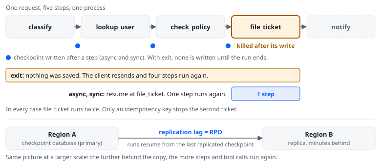

# Day 50 — Revision: LangGraph State & Durability + Architect Deliverables

> Part of the [GenAI Architect study path](../../README.md) · Revision drill · [Original interactive pack](https://claude.ai/artifact/7EnZkYFcnUUSqBYFToH2AH)

Day 50 · Revision drill · Sat 28 Nov 2026

# LangGraph state and durability + architect deliverables

Revisits Day 17 and Day 29. Day 17 was last drilled on Days 32 and 41 (human approval, crash recovery in ingestion). Day 29 was last drilled on Day 38 (the token-cost model). Today joins them in one review question: your agent keeps state, so what do you promise when a pod or a region dies? You get a two-minute recap, 8 hard questions with model answers, one design scenario and a 60 to 75 minute lab that runs offline on your laptop.

JD lines covered: agentic frameworks (LangGraph, memory, planning) · HLD/LLD, NFRs, decision logs, cost estimates · scalability, resilience, DR, compliance · cloud architecture for GenAI · explaining complex AI simply to stakeholders.

## Two-minute recap: what is current

### LangGraph state, streaming and durability (Day 17)

- **Versions on PyPI today:** `langgraph` 1.2.24 (20 Nov), `langgraph-checkpoint` 4.3.2, `langgraph-checkpoint-sqlite` 3.1.3, `langgraph-checkpoint-postgres` 3.2.1 (14 Nov), `langchain-core` 1.8.5. `langgraph` needs Python 3.10 or newer, so your 3.13 is fine.
- **A graph runs in super-steps.** Every node scheduled in a step runs in parallel, and their writes are applied together when the step ends. A state key with no reducer accepts one write per step. Two writers raise `InvalidUpdateError`. The lab reproduces this.
- **Durability is a per-run argument with three values.** `durability="sync"` persists before the next step starts. `"async"` persists while the next step executes, and it is the default. `"exit"` persists only when the graph exits. This is from the docstring of `Pregel.stream` in the installed 1.2.24 package.
- **The unit of resume is the node.** A node that was killed halfway runs again from its first line. No durability mode gives you exactly-once side effects. The lab kills a worker after a write and files two tickets under every mode unless the write carries an idempotency key.
- **Streaming has seven modes:** `values`, `updates`, `messages`, `custom`, `checkpoints`, `tasks`, `debug`. `checkpoints` and `tasks` need a checkpointer. Pass `version="v2"` (LangGraph 1.1 or later) and every chunk is a dict with `type`, `ns` and `data`, whatever combination of modes you asked for. The streaming page also recommends `stream_events(version="v3")` for new applications. I have not used that API in the lab.
- **Subgraph tokens are off by default.** Without `subgraphs=True`, a parent graph's `messages` stream does not include tokens from a compiled agent used as a node.
- **Checkpoint retention is your job.** The persistence page says to prune old checkpoints periodically or set a retention policy. In the installed packages, `PostgresSaver` implements `prune(thread_ids, strategy="keep_latest" | "delete")` and `delete_thread`. `SqliteSaver` 3.1.3 and `InMemorySaver` raise `NotImplementedError` on `prune`.
- **`DeltaChannel` is new and in beta.** It stores a marker in each checkpoint and rebuilds the value by replaying writes. In the lab it cut a 20-turn thread from 1,530 KB to 98 KB. Its docstring warns that the API and on-disk format may change, and the `prune` docstring warns that a naive keep-latest prune on a thread that uses it can silently rebuild the channel as empty.
- **Encryption at the serializer.** `EncryptedSerializer` wraps the default `JsonPlusSerializer` and encrypts the bytes with AES. `EncryptedSerializer.from_pycryptodome_aes` exists in 4.3.2.

### Architect deliverables: NFRs, DR and the decision record (Day 29)

- **Four DR strategies, in AWS's words:** backup and restore, pilot light, warm standby, multi-site active/active. The AWS whitepaper page describes them in relative terms. Warm standby "decreases the time to recovery because your workload is always-on in another Region", and active/active "can reduce your recovery time to near zero for most disasters". It also cautions that automatically initiated failover "should be used with caution".
- **Microsoft publishes approximate figures for Foundry topologies.** Hot/hot: RTO in minutes, RPO near zero. Hot/warm: RTO 30 minutes to 2 hours, RPO minutes to hours depending on replication lag. Hot/cold: RTO 2 to 8 hours, RPO hours depending on backup frequency. They are labelled approximate and carry no SLA.
- **Managed agent services do not fail over for you.** The same page says "Foundry itself doesn't provide automatic failover or disaster recovery", and that you own the durability of Cosmos DB, AI Search and Storage in Standard agent mode. Point-in-time restore for Cosmos DB has to be switched on before the incident.
- **Cross-region inference is a capacity feature.** On Bedrock, a geographic profile keeps requests inside one geography (US, EU, APAC). A global profile can route to any supported commercial Region and the page quotes about 10% lower prices. CloudWatch and CloudTrail entries stay in the source Region. It moves inference requests. It does not replicate your threads, index or audit log.
- **watsonx.** I did not read IBM's pages in this run. Before you quote a watsonx.ai DR position, check the regional availability page for which models and features exist in which region, because that decides whether a second region is usable at all.
- **An availability target is a product of dependencies.** Five dependencies at 99.9% to 99.95% give about 99.65%, which is 151 minutes down in 30 days. A 99.9% promise allows 43. The lab computes this.

## The picture to draw: where a killed run resumes

Draw this when someone asks "what happens if the pod dies mid-request" and again for "what happens if the region dies".



## Where the state lives and what protects it

| Data | Source of truth? | What a region loss costs | Control | Cost of the control |
|---|---|---|---|---|
| Graph code, prompts, tool contracts | Yes, in Git | Nothing if deployed from IaC | Pipeline that can deploy to region B | A second environment to keep in step |
| Thread checkpoints | Yes | Turns written inside the replication lag | Replicated Postgres, `sync` on steps that precede a write | Storage times two, write latency on sync steps |
| Runs in flight | Yes, but short-lived | Each restarts at its last replicated checkpoint | Idempotency keys on every write tool | A key store in each back end |
| Long-term memory store | Yes | Same as checkpoints | Same replication as checkpoints | Same |
| Vector index | No, derived from documents | Rebuild time, often hours | Replicate the index, or accept a rebuild and state it | A second index, or a long RTO |
| Traces and audit log | Yes, for compliance | Evidence for the outage window | Ship to a store outside the primary region | Egress and a second retention policy |
| Model capacity | Not data | No quota in region B means no service | Reserved or tested quota, fallback model route | Paying for capacity you hope not to use |

## 8 hard questions

### Q1. Three retrievers run in parallel and the graph throws InvalidUpdateError in production. It passed every test. Why, and what is the design rule? (Day 17 · state)

Nodes scheduled in the same super-step run in parallel and their writes are applied together at the end of the step. A plain state key holds a last-value channel that accepts one write per step. The tests ran with one source enabled, so there was one writer. Production enabled three.

The rule: any key that more than one node can write in the same step needs a reducer, declared in the schema as `Annotated[list[str], operator.add]` or a custom function. Three things follow.

1. **Do not depend on arrival order.** Parallel results merge in an order you should treat as arbitrary. If order matters, write `(rank, item)` and sort in the next node.
2. **Reducers must be deterministic.** A resume replays writes through the reducer. A reducer that calls the clock or a random source gives a different state after recovery.
3. **Design for a partial step.** If one branch fails, the step fails. The checkpointer keeps the writes of the branches that finished (that is what the `writes` table is for), so a resume does not run them again. The failed branch does run again, from its first line.

In the review I show the state schema as a table: key, type, reducer, which nodes write it. A key with two writers and no reducer is a defect you can find on paper.

### Q2. Which durability mode do you choose, and what does each one cost? (Day 17 · durability)

I choose per run, by what the run does.

| Mode | When it persists | Killed mid-run in the lab | Use it for |
|---|---|---|---|
| `exit` | Once, when the graph exits | Nothing saved. All 4 completed steps ran again | Short read-only requests where a retry from the client is acceptable |
| `async` (default) | In the background while the next step runs | Resumed at the killed node, 1 step re-ran | Most interactive work |
| `sync` | Before the next step starts | Resumed at the killed node, 1 step re-ran | Steps before an irreversible write, human approval, anything audited |

The costs. `exit` wrote 1 checkpoint for a 5-step run where the other two wrote 7, so it is the cheapest on storage and gives up mid-run recovery and time travel. `sync` adds a database write to every step's latency. On a local SQLite file that is lost in the noise. On a network Postgres it is a round trip per step, so measure it. `async` has a window: if the process dies while a checkpoint is still being written, the step it describes runs again.

The part people miss is that the idempotency column mattered more than the mode column. Under `sync` the lab still filed two tickets, because the node was killed after its write and before its return. Durability decides how much work you redo. Idempotency keys decide whether redoing it is safe. Put one side effect in one node, and key it.

### Q3. Product wants token streaming from an agent that contains subgraphs, behind the API gateway. What do you stream, and what breaks? (Day 17 · streaming)

Three kinds of events, because they serve three needs. `messages` for tokens, which is what makes time to first token short. `updates` for step boundaries, so the UI can show "searching policy wiki". `custom` for progress inside a long node, written with `get_stream_writer()`. I ask for `version="v2"` so every chunk has the same shape, `type`, `ns`, `data`, and the gateway code does not branch on which modes are on. I set `subgraphs=True`, because without it the parent's `messages` stream carries no tokens from a nested agent.

In the lab the first event arrived after 0.15 s and the answer after 0.76 s. That gap is the argument for two SLOs: p95 time to first event, and p95 time to final answer.

What breaks:

- **Buffering.** A proxy or gateway that buffers responses turns a stream into one late blob. Test through the real ingress path.
- **Idle timeouts.** A node that thinks for 40 seconds emits nothing. Send progress events or heartbeats.
- **Output guardrails.** You cannot take back a token the user has read. Either check in windows and accept a short delay, or stream only the final node and check before it starts.
- **Reconnects.** The stream is not the record. The checkpoint is. A client that drops reconnects with the thread ID and reads the current state.
- **Cost attribution.** Stream events are not usage records. Take token counts from the model response metadata in the trace.

### Q4. The checkpoint database is growing far faster than the conversations. Explain it and fix it. (Day 17 · state growth)

A plain reducer channel stores its whole value in every checkpoint, and there is a checkpoint for every super-step. A list that grows by a fixed amount per turn therefore costs storage that grows with the square of the turn count. In the lab a 20-turn thread held 36 KB of live state and 1,530 KB of history across 80 checkpoints, which is 42 times the state.

Fixes, cheapest first:

1. **Keep less in state.** Store document IDs and offsets, not retrieved passages. The lab's state is mostly retrieved text. This also reduces what you have to protect and delete.
2. **Set retention.** Prune to the latest checkpoint once a thread is idle, and delete threads when the retention period ends. In the lab pruning took the thread to 36.8 KB. `PostgresSaver` has `prune` and `delete_thread`. For SQLite I wrote the SQL.
3. **Choose `exit` for runs that do not need mid-run recovery.** One checkpoint per run.
4. **`DeltaChannel`.** 98 KB against 1,530 KB in the lab. It is beta, and pruning a thread that uses it needs care. I would trial it and not put it in a regulated workload yet.

What you give up with pruning is time travel and the step-by-step record. If audit needs that record, it belongs in the trace store with its own retention, not in the operational database.

At 50k employees the lab's model puts 30 days of threads at about 70 GB with everything kept, 15 GB with `DeltaChannel` and 6 GB pruned, on the stated assumptions. The byte count is small. What matters is that every byte is replicated, backed up, and in scope for a deletion request.

### Q5. The sponsor asks for 99.9% availability. What do you say? (Day 29 · NFRs)

I ask what "available" means, then I do the multiplication in front of them.

A request passes through the gateway, the agent service, the checkpoint database, vector search and the model endpoint. With 99.95% on the first three and 99.9% on the last two, the product is 99.65%. That is 151 minutes down in 30 days. 99.9% allows 43. Adding a second model route lifts it to 99.75%, 108 minutes. So the target is not reachable by buying a better SLA on one component.

Three ways to close the gap, and I price each:

- **Redundancy on every serial dependency**, which is a multi-zone or multi-region design.
- **Degraded modes that count as available.** If vector search is down, answer from cache or say "search is unavailable, here is what I can do". If the checkpoint database is down, serve stateless single-turn answers. This needs the sponsor to agree what a degraded success is.
- **Narrow the promise.** 99.9% for chat answers in business hours, 99.5% for agent actions that write.

Two cautions I state out loud. SLAs are refund terms, not forecasts, and failures are correlated, so the product is an optimistic bound. And the SLI must be defined on outcomes: a 200 response with an ungrounded answer is not a success.

### Q6. Define RTO and RPO for an agent platform. Which data set is the hard one? (Day 29 · DR)

RTO is how long until users are served again. RPO is how much recent data you accept losing. For an agent platform there is no single pair. I give one per data set, as in the table above.

- Code, prompts and tool contracts: RPO zero, because Git is the source of truth. RTO is pipeline time.
- Threads and memory: RPO equals replication lag. This is the true state.
- Vector index: it is derived, so RPO is not the question. Rebuild time is. Re-embedding a large corpus can take hours, so either replicate the index or write the rebuild time into the RTO.
- Audit and traces: usually the tightest RPO, because you need them to explain the incident.
- Model capacity: not data, and the most common surprise. If region B has no quota for the model, or the fine-tuned model is not deployed there, the standby cannot answer.

The hard one is runs in flight. After failover they resume from the last replicated checkpoint, which may be older than the last tool call. Every write tool they already called is called again. So the DR design depends on the idempotency design from Q2.

On managed services: Microsoft's Foundry page says the service "doesn't provide automatic failover or disaster recovery", and that thread history depends on Cosmos DB, AI Search and Storage that you configure. Bedrock cross-Region inference spreads inference across Regions for capacity. You still call it from your source Region and your state stays where you put it, so I do not count it as DR.

### Q7. Finance wants to cut the warm-standby line. Defend it or drop it. (Day 29 · cost and decisions)

I run the numbers first, and with the lab's assumptions they do not defend it on expected loss.

| Tier | Standby cost a year | Expected outage loss a year | Total |
|---|---|---|---|
| Backup and restore | 12,000 | 17,820 | 29,820 |
| Pilot light | 36,000 | 5,940 | 41,940 |
| Warm standby | 108,000 | 1,485 | 109,485 |
| Active/active | 240,000 | 99 | 240,099 |

One regional event every three years at 9,000 an hour does not pay for a 108,000 standby. Warm standby beats backup and restore only when an hour of outage costs about 53,000 or more.

So the standby is paid for by the requirement, RTO 60 minutes and RPO 15, not by the arithmetic. That changes the conversation. I take three options back to whoever owns the requirement:

1. Keep the requirement and the cost, and record that the requirement is the cost driver.
2. Relax RTO to 2 hours. Pilot light then meets it at about 42,000.
3. Keep RTO 60 for read-only chat through a stateless degraded mode in region B, and accept 2 hours for agent actions.

Then I write the ADR. Expected loss is not the only input: a regulator, a contract or a reputational risk can justify the standby. But that reason should be written down by the person who owns it, not assumed by the architect.

### Q8. Explain to a non-technical sponsor what a user sees when the region fails mid-conversation. Two minutes. (Day 29 · stakeholder)

"Think of the assistant as a clerk who writes each step in a notebook as they go. We keep a copy of that notebook in a second office, and the copy is a few minutes behind.

If the first office goes dark, the clerk in the second office picks up the copy. A user who was chatting sees a pause of up to half an hour while we switch. When they come back, the conversation is there, but the last few minutes may be missing, so they might need to repeat their last question.

If the assistant was in the middle of doing something, like raising a ticket, the second clerk starts that step again. We have built the ticket system so that asking twice creates one ticket, not two.

There are two numbers to agree. How long the pause can be, and how many minutes of conversation we can afford to lose. Shorter and fewer both cost more, because we keep more of the second office running all the time. With today's choices that is 30 minutes and 5 minutes. I can show you what 2 hours or 2 minutes would cost."

For the architect: the two numbers are RTO and RPO, and you never needed to say either.

## Design scenario

### Claims-intake agent for an insurer, two regions in India

An insurer runs a LangGraph agent that takes a motor claim from first notice to a filed claim. Eight steps: classify, fetch policy, fetch customer, extract from photos and documents, check coverage, human approval above a threshold, file the claim, notify the customer. Two steps write to core systems. Client policy keeps all claim data in India. They have a primary and a secondary cloud region in the country. Requirements: RTO 1 hour, RPO 5 minutes, 4,000 claims a day with a peak after storms, and a human may take two days to approve.

Produce in 25 minutes, on paper:

1. The state schema as a table: key, type, reducer, writers. Mark what must not be stored in state.
2. The durability mode for each step, with one line of reasoning.
3. The DR tier and what is replicated, per data set.
4. The failover runbook in six lines, including who decides.
5. An NFR table with five rows.

Points a strong answer includes:

- **State holds references.** Photo and document IDs, not the files or extracted text blobs. PII stays in the claims system. The checkpoint database still gets encryption, because names and policy numbers leak into messages.
- **`sync` on check coverage, the approval interrupt, file claim and notify.** `async` on the read steps. An approval that waits two days makes the checkpoint the only record of a pending claim, so it must be replicated before the approver is told.
- **Idempotency keys on file-claim and notify**, derived from claim ID and step. Without them a failover during a storm peak files duplicates.
- **Warm standby, because RPO 5 minutes rules out backup and restore and pilot light** on the planning figures. Postgres with a cross-region replica for checkpoints. The storm peak is when a regional event is most likely to matter, so capacity in the secondary must be tested at peak, not at average.
- **Model capacity in the second region is the open risk.** Confirm the model exists and has quota in both Indian regions before promising anything. If it does not, the fallback is a smaller model hosted in-country, with its own eval results, and the degraded mode is "claim captured, processing delayed".
- **Failover is a human decision.** The runbook names the role, the evidence (health checks plus provider status), and the step that fences the old primary so two regions do not both resume the same thread.
- **A failover test is in the NFR table**, with a date. An untested RTO is a guess.

## Lab (60 to 75 min): kill it, resume it, then price it

Two files. `state_drill.py` uses LangGraph with fake nodes and a SQLite checkpointer. `dr_nfr_model.py` is standard library only. No model, no key, no GPU, no Docker, no WSL2.

### Setup (PowerShell)

```powershell
mkdir day50; cd day50
py -3.13 -m venv .venv
.\.venv\Scripts\Activate.ps1
python -m pip install -U pip
python -m pip install "langgraph>=1.2,<2" "langgraph-checkpoint-sqlite>=3.1,<4"
```

If activation is blocked, run `Set-ExecutionPolicy -Scope Process RemoteSigned` in that window first.

### Part A · state_drill.py (40 min)

Save as `state_drill.py` and run `python state_drill.py`. It takes about 15 seconds.

```python
"""Day 50 lab, part 1: measure what a LangGraph thread costs you in a DR review.

Offline. No model, no API key, no GPU. Fake nodes sleep to stand in for LLM and tool latency.

    python state_drill.py            # runs parts A to D and writes measurements.json
    python state_drill.py --part C   # one part only

A. Parallel fan-out without a reducer fails; with a reducer it merges.
B. Streaming: time to first event versus time to the final answer.
C. Kill the process mid-run under each durability mode, then resume.
   Counts the steps that run again and the duplicate tickets filed.
D. Checkpoint growth per conversation turn: plain reducer, DeltaChannel, and pruning.
"""
from __future__ import annotations

import argparse
import json
import operator
import os
import sqlite3
import subprocess
import sys
import tempfile
import time
from pathlib import Path
from typing import Annotated, TypedDict

from langgraph.channels import DeltaChannel
from langgraph.checkpoint.sqlite import SqliteSaver
from langgraph.config import get_stream_writer
from langgraph.errors import InvalidUpdateError
from langgraph.graph import END, START, StateGraph
from langgraph.types import Send

SOURCES = ["policy_wiki", "hr_tickets", "sharepoint"]
STEP_SECONDS = 0.15  # stand-in for one retrieval or model call


# ---------------------------------------------------------------- part A
class BadState(TypedDict):
    question: str
    evidence: list[str]  # no reducer: two writers in one step is an error


class GoodState(TypedDict):
    question: str
    evidence: Annotated[list[str], operator.add]  # reducer: concatenate parallel writes
    answer: str


def _fan_out(state: dict) -> list[Send]:
    return [Send("retrieve", {"question": state["question"], "source": s}) for s in SOURCES]


def _retrieve(payload: dict) -> dict:
    time.sleep(STEP_SECONDS)
    return {"evidence": [f"{payload['source']}: passage about {payload['question']}"]}


def part_a() -> dict:
    results = {}
    for name, schema in (("no reducer", BadState), ("operator.add reducer", GoodState)):
        g = StateGraph(schema)
        g.add_node("retrieve", _retrieve)
        g.add_conditional_edges(START, _fan_out, ["retrieve"])
        g.add_edge("retrieve", END)
        try:
            out = g.compile().invoke({"question": "parental leave", "evidence": []})
            results[name] = f"ok, {len(out['evidence'])} passages merged"
        except InvalidUpdateError as exc:
            results[name] = f"InvalidUpdateError: {str(exc).splitlines()[0][:80]}"
    print("A. Parallel writers to one state key")
    for k, v in results.items():
        print(f"   {k:<22} {v}")
    return results


# ---------------------------------------------------------------- part B
def _draft(state: GoodState) -> dict:
    writer = get_stream_writer()
    for pct in (25, 50, 75, 100):
        time.sleep(STEP_SECONDS)
        writer({"progress": pct})  # shows up in stream_mode="custom"
    return {"answer": f"Answer from {len(state['evidence'])} passages"}


def build_research_graph(checkpointer=None):
    g = StateGraph(GoodState)
    g.add_node("retrieve", _retrieve)
    g.add_node("draft", _draft)
    g.add_conditional_edges(START, _fan_out, ["retrieve"])
    g.add_edge("retrieve", "draft")
    g.add_edge("draft", END)
    return g.compile(checkpointer=checkpointer)


def part_b() -> dict:
    graph = build_research_graph()
    start = time.perf_counter()
    first = None
    events = 0
    for part in graph.stream(
        {"question": "parental leave", "evidence": []},
        stream_mode=["updates", "custom"],
        version="v2",  # every chunk is {"type": ..., "ns": ..., "data": ...}
    ):
        events += 1
        if first is None:
            first = time.perf_counter() - start
    total = time.perf_counter() - start
    print("B. Streaming the same run")
    print(f"   first event after {first:.2f}s, final answer after {total:.2f}s, {events} events")
    return {"first_event_s": round(first, 2), "total_s": round(total, 2), "events": events}


# ---------------------------------------------------------------- part C
class TicketState(TypedDict):
    request_id: str
    log: Annotated[list[str], operator.add]


def _ledger(path: str) -> sqlite3.Connection:
    con = sqlite3.connect(path)
    con.execute("CREATE TABLE IF NOT EXISTS tickets (id INTEGER PRIMARY KEY, idem_key TEXT UNIQUE, body TEXT)")
    con.execute("CREATE TABLE IF NOT EXISTS runs (node TEXT)")
    con.commit()
    return con


def build_ticket_graph(checkpointer, ledger_path: str, use_key: bool, crash_in: str | None):
    def step(name: str):
        def node(state: TicketState) -> dict:
            con = _ledger(ledger_path)
            con.execute("INSERT INTO runs VALUES (?)", (name,))
            con.commit()
            time.sleep(0.02)
            if name == "file_ticket":
                key = f"{state['request_id']}:file_ticket" if use_key else None
                con.execute("INSERT OR IGNORE INTO tickets (idem_key, body) VALUES (?, ?)", (key, "laptop request"))
                con.commit()
            con.close()
            if crash_in == name:
                os._exit(137)  # the pod is killed: no cleanup, no finally blocks
            return {"log": [name]}

        return node

    g = StateGraph(TicketState)
    names = ["classify", "lookup_user", "check_policy", "file_ticket", "notify"]
    for n in names:
        g.add_node(n, step(n))
    g.add_edge(START, names[0])
    for a, b in zip(names, names[1:]):
        g.add_edge(a, b)
    g.add_edge(names[-1], END)
    return g.compile(checkpointer=checkpointer)


def worker(db: str, ledger: str, durability: str, use_key: bool) -> None:
    """Child process: runs the graph and dies inside file_ticket, after the write."""
    with SqliteSaver.from_conn_string(db) as saver:
        graph = build_ticket_graph(saver, ledger, use_key, crash_in="file_ticket")
        graph.invoke({"request_id": "REQ-1", "log": []}, {"configurable": {"thread_id": "t1"}}, durability=durability)


def part_c() -> dict:
    print("C. Kill the worker inside file_ticket (after its write), then resume")
    print(f"   {'durability':<11}{'idempotency key':<17}{'resumed from':<16}{'steps re-run':<14}{'tickets filed'}")
    rows = []
    for durability in ("exit", "async", "sync"):
        for use_key in (False, True):
            with tempfile.TemporaryDirectory(ignore_cleanup_errors=True) as tmp:
                db, ledger = str(Path(tmp, "ckpt.sqlite")), str(Path(tmp, "ledger.sqlite"))
                subprocess.run(
                    [sys.executable, __file__, "--worker", db, ledger, durability, str(int(use_key))],
                    check=False,
                )
                con = _ledger(ledger)
                before = con.execute("SELECT COUNT(*) FROM runs").fetchone()[0]
                with SqliteSaver.from_conn_string(db) as saver:
                    graph = build_ticket_graph(saver, ledger, use_key, crash_in=None)
                    cfg = {"configurable": {"thread_id": "t1"}}
                    snapshot = graph.get_state(cfg)
                    if snapshot.next:  # a checkpoint survived: continue the thread
                        resumed_from = snapshot.next[0]
                        graph.invoke(None, cfg, durability="sync")
                    else:  # nothing survived: the client has to send the request again
                        resumed_from = "(start)"
                        graph.invoke({"request_id": "REQ-1", "log": []}, cfg, durability="sync")
                after = con.execute("SELECT COUNT(*) FROM runs").fetchone()[0]
                tickets = con.execute("SELECT COUNT(*) FROM tickets").fetchone()[0]
                con.close()
                # steps that had already run before the crash and ran again afterwards
                rerun = (after - before) - (5 - before)
                rows.append(
                    {"durability": durability, "idempotency_key": use_key, "resumed_from": resumed_from,
                     "steps_rerun": rerun, "tickets": tickets}
                )
                print(f"   {durability:<11}{('yes' if use_key else 'no'):<17}{resumed_from:<16}{rerun:<14}{tickets}")
    # write cost of each mode on a healthy run
    timing = {}
    for durability in ("exit", "async", "sync"):
        with tempfile.TemporaryDirectory(ignore_cleanup_errors=True) as tmp:
            with SqliteSaver.from_conn_string(str(Path(tmp, "c.sqlite"))) as saver:
                graph = build_ticket_graph(saver, str(Path(tmp, "l.sqlite")), True, None)
                t0 = time.perf_counter()
                for i in range(20):
                    graph.invoke({"request_id": f"R{i}", "log": []}, {"configurable": {"thread_id": f"h{i}"}}, durability=durability)
                timing[durability] = round((time.perf_counter() - t0) / 20 * 1000, 1)
    print(f"   healthy-run time per 5-step request (ms): {timing}")
    return {"crash": rows, "healthy_ms_per_run": timing}


# ---------------------------------------------------------------- part D
class ChatState(TypedDict):
    messages: Annotated[list[str], operator.add]  # full list stored in every checkpoint


def _extend(state: list[str] | None, writes: list[list[str]]) -> list[str]:
    out = list(state or [])
    for w in writes:
        out.extend(w)
    return out


class DeltaChatState(TypedDict):
    # beta in langgraph 1.2: checkpoints hold a marker, the saver replays the writes
    messages: Annotated[list[str], DeltaChannel(_extend)]


def _db_bytes(con: sqlite3.Connection) -> int:
    a = con.execute("SELECT COALESCE(SUM(LENGTH(checkpoint) + LENGTH(metadata)), 0) FROM checkpoints").fetchone()[0]
    b = con.execute("SELECT COALESCE(SUM(LENGTH(value)), 0) FROM writes").fetchone()[0]
    return a + b


def _keep_latest(con: sqlite3.Connection, thread_id: str) -> None:
    """SqliteSaver 3.1 has no prune(), so this is the retention job you would schedule.
    Safe for plain reducers only. Do not run it on a thread that uses DeltaChannel."""
    latest = con.execute(
        "SELECT checkpoint_id FROM checkpoints WHERE thread_id = ? ORDER BY checkpoint_id DESC LIMIT 1", (thread_id,)
    ).fetchone()[0]
    for table in ("checkpoints", "writes"):
        con.execute(f"DELETE FROM {table} WHERE thread_id = ? AND checkpoint_id <> ?", (thread_id, latest))
    con.commit()


def _chat_run(schema, turns: int):
    def retrieve(state) -> dict:
        return {"messages": ["[context] " + "policy text " * 120]}  # about 1.4 KB of retrieved text

    def answer(state) -> dict:
        return {"messages": ["[assistant] " + "answer text " * 30]}

    g = StateGraph(schema)
    g.add_node("retrieve", retrieve)
    g.add_node("answer", answer)
    g.add_edge(START, "retrieve")
    g.add_edge("retrieve", "answer")
    g.add_edge("answer", END)
    con = sqlite3.connect(":memory:", check_same_thread=False)
    graph = g.compile(checkpointer=SqliteSaver(con))
    cfg = {"configurable": {"thread_id": "chat-1"}}
    sizes = []
    for turn in range(1, turns + 1):
        graph.invoke({"messages": [f"[user] question {turn}"]}, cfg, durability="sync")
        sizes.append(_db_bytes(con))
    return con, graph, cfg, sizes


def part_d(turns: int = 20) -> dict:
    con, graph, cfg, sizes = _chat_run(ChatState, turns)
    state = graph.get_state(cfg).values
    state_bytes = len(json.dumps(state))
    checkpoints = con.execute("SELECT COUNT(*) FROM checkpoints").fetchone()[0]
    _keep_latest(con, "chat-1")
    pruned = _db_bytes(con)
    assert graph.get_state(cfg).values == state, "pruning must not change the live state"
    _, dgraph, dcfg, dsizes = _chat_run(DeltaChatState, turns)
    assert dgraph.get_state(dcfg).values == state, "DeltaChannel must rebuild the same state"

    print("D. Checkpoint storage for one chat thread (SqliteSaver, every step kept)")
    print(f"   {'after turn':<12}{'operator.add':>14}{'DeltaChannel (beta)':>22}")
    for t in sorted({1, 5, 10, turns}):
        print(f"   {t:<12}{sizes[t - 1] / 1024:>11.1f} KB{dsizes[t - 1] / 1024:>19.1f} KB")
    print(f"   live state is {state_bytes / 1024:.1f} KB; operator.add history is {sizes[-1] / state_bytes:.0f}x that across {checkpoints} checkpoints")
    print(f"   operator.add after keep-latest pruning: {pruned / 1024:.1f} KB")
    return {
        "turns": turns,
        "kb_by_turn": [round(s / 1024, 1) for s in sizes],
        "delta_kb_by_turn": [round(s / 1024, 1) for s in dsizes],
        "live_state_kb": round(state_bytes / 1024, 1),
        "checkpoints": checkpoints,
        "pruned_kb": round(pruned / 1024, 1),
    }


def main() -> None:
    ap = argparse.ArgumentParser()
    ap.add_argument("--part", choices=list("ABCD"))
    ap.add_argument("--worker", nargs=4, metavar=("DB", "LEDGER", "DURABILITY", "USE_KEY"))
    args = ap.parse_args()
    if args.worker:
        db, ledger, durability, use_key = args.worker
        worker(db, ledger, durability, use_key == "1")
        return
    parts = {"A": part_a, "B": part_b, "C": part_c, "D": part_d}
    out = {}
    for key, fn in parts.items():
        if args.part in (None, key):
            out[key] = fn()
            print()
    if args.part is None:
        Path(__file__).with_name("measurements.json").write_text(json.dumps(out, indent=2))
        print("wrote measurements.json (dr_nfr_model.py reads it)")


if __name__ == "__main__":
    main()
```

### Expected output

Timings vary by a few percent. Counts should match.

```text
A. Parallel writers to one state key
   no reducer             InvalidUpdateError: At key 'evidence': Can receive only one value per step. Use an Annotated key to 
   operator.add reducer   ok, 3 passages merged

B. Streaming the same run
   first event after 0.15s, final answer after 0.76s, 8 events

C. Kill the worker inside file_ticket (after its write), then resume
   durability idempotency key  resumed from    steps re-run  tickets filed
   exit       no               (start)         4             2
   exit       yes              (start)         4             1
   async      no               file_ticket     1             2
   async      yes              file_ticket     1             1
   sync       no               file_ticket     1             2
   sync       yes              file_ticket     1             1
   healthy-run time per 5-step request (ms): {'exit': 131.3, 'async': 131.1, 'sync': 134.6}

D. Checkpoint storage for one chat thread (SqliteSaver, every step kept)
   after turn    operator.add   DeltaChannel (beta)
   1                   7.3 KB                4.2 KB
   5                 111.4 KB               23.9 KB
   10                403.9 KB               48.7 KB
   20               1530.0 KB               98.1 KB
   live state is 36.2 KB; operator.add history is 42x that across 80 checkpoints
   operator.add after keep-latest pruning: 36.8 KB

wrote measurements.json (dr_nfr_model.py reads it)
```

Read it this way:

- **A.** The error message is the one you will see in production logs. Learn its first line.
- **B.** 0.15 s to the first event against 0.76 s to the answer.
- **C.** The `tickets filed` column follows the key column, not the durability column. `exit` lost every completed step.
- **C, timing line.** On a local SQLite file the three modes are within noise of each other. Do not quote this as "sync is free". See stretch goal 1.
- **D.** History is 42 times the live state after 20 turns.

### Part B · dr_nfr_model.py (20 min)

Save next to the first file. It reads `measurements.json` if part A wrote one. Run `python dr_nfr_model.py`, then `python dr_nfr_model.py --rto 120 --rpo 15` and see which tier wins.

```python
"""Day 50 lab, part 2: turn the measurements into the numbers a DR review asks for.

Standard library only.

    python dr_nfr_model.py                 # uses measurements.json if state_drill.py wrote one
    python dr_nfr_model.py --rto 30 --rpo 1

Every input below is an assumption for a 50k-employee knowledge assistant. Change them
to your own figures; the point is the shape of the calculation, not these values.
"""
from __future__ import annotations

import argparse
import json
from dataclasses import dataclass
from pathlib import Path

# ---- workload assumptions ------------------------------------------------
EMPLOYEES = 50_000
DAILY_ACTIVE = 0.30          # share of employees who use it on a working day
THREADS_PER_USER_DAY = 2
TURNS_PER_THREAD = 5
RETENTION_DAYS = 30          # how long a thread must stay resumable
WORKING_DAYS_PER_MONTH = 22
PEAK_REQUESTS_PER_SECOND = 40
SECONDS_PER_AGENT_RUN = 12   # one multi-step request, start to finish

# ---- dependency availability (monthly, from each provider's SLA or your SLO)
DEPENDENCIES = {
    "API gateway": 0.9995,
    "Agent service (your pods)": 0.9995,
    "Checkpoint database": 0.9995,
    "Vector search": 0.999,
    "LLM endpoint": 0.999,
}
LLM_FALLBACK = 0.999         # a second model route in another region or provider

# ---- business inputs -----------------------------------------------------
COST_PER_OUTAGE_HOUR = 9_000     # currency units of lost productivity per hour down
REGION_OUTAGES_PER_YEAR = 0.33   # one regional event every three years
PRIMARY_RUN_COST_PER_YEAR = 240_000  # non-token platform cost of the primary region


@dataclass
class Tier:
    name: str
    rto_min: float       # time to serve again after a regional loss
    rpo_min: float       # data written in this window before the loss is gone
    standby_cost: float  # yearly cost as a fraction of the primary's run cost
    note: str


# RTO and RPO here are planning figures in the ranges Microsoft publishes as
# "approximate" for hot/cold, hot/warm and hot/hot Foundry topologies. Replace
# them with numbers from your own failover test.
TIERS = [
    Tier("Backup and restore", 360, 240, 0.05, "restore database, redeploy from IaC"),
    Tier("Pilot light", 120, 15, 0.15, "data replicated, compute scaled to zero"),
    Tier("Warm standby", 30, 5, 0.45, "replica plus a small always-on stack"),
    Tier("Active/active", 2, 1, 1.00, "both regions serve, async replication"),
]


def load_measurements() -> dict:
    path = Path(__file__).with_name("measurements.json")
    if path.exists():
        return json.loads(path.read_text())["D"]
    # values from a reference run of state_drill.py
    return {"turns": 20, "kb_by_turn": [7.3, 0, 0, 0, 111.5], "delta_kb_by_turn": [4.2, 0, 0, 0, 23.9],
            "live_state_kb": 36.2}


def storage(m: dict) -> list[tuple[str, float]]:
    threads_retained = EMPLOYEES * DAILY_ACTIVE * THREADS_PER_USER_DAY * WORKING_DAYS_PER_MONTH * RETENTION_DAYS / 30
    i = TURNS_PER_THREAD - 1
    live_kb = m["live_state_kb"] * TURNS_PER_THREAD / m["turns"]
    rows = [
        ("Every checkpoint kept, plain reducer", m["kb_by_turn"][i]),
        ("Every checkpoint kept, DeltaChannel (beta)", m["delta_kb_by_turn"][i]),
        ("Latest checkpoint only (nightly prune)", live_kb),
    ]
    return [(name, kb * threads_retained / 1024 / 1024) for name, kb in rows]


def availability() -> tuple[float, float]:
    serial = 1.0
    for a in DEPENDENCIES.values():
        serial *= a
    llm = DEPENDENCIES["LLM endpoint"]
    with_fallback = serial / llm * (1 - (1 - llm) * (1 - LLM_FALLBACK))
    return serial, with_fallback


def minutes_down(a: float) -> float:
    return (1 - a) * 30 * 24 * 60


def main() -> None:
    ap = argparse.ArgumentParser()
    ap.add_argument("--rto", type=float, default=60, help="required RTO in minutes")
    ap.add_argument("--rpo", type=float, default=15, help="required RPO in minutes")
    args = ap.parse_args()

    print("1. Checkpoint storage at steady state")
    print(f"   {EMPLOYEES:,} employees, {DAILY_ACTIVE:.0%} active, {THREADS_PER_USER_DAY} threads a day, "
          f"{TURNS_PER_THREAD} turns each, kept {RETENTION_DAYS} days")
    for name, gb in storage(load_measurements()):
        print(f"   {name:<44}{gb:>8.1f} GB")
    print("   A cross-region replica doubles whichever figure you pick, and every byte is in scope for backup and deletion requests.")

    serial, with_fb = availability()
    print("\n2. Availability you can promise (dependencies in series)")
    for name, a in DEPENDENCIES.items():
        print(f"   {name:<28}{a:.2%}")
    print(f"   {'Composite':<28}{serial:.3%}  = {minutes_down(serial):.0f} min down per 30 days")
    print(f"   {'With an LLM fallback route':<28}{with_fb:.3%}  = {minutes_down(with_fb):.0f} min down per 30 days")
    print("   A 99.9% SLO allows 43 min. Check the composite before you sign it.")

    in_flight = PEAK_REQUESTS_PER_SECOND * SECONDS_PER_AGENT_RUN
    print("\n3. DR tier against the requirement "
          f"(RTO <= {args.rto:g} min, RPO <= {args.rpo:g} min)")
    print(f"   {'tier':<20}{'RTO':>6}{'RPO':>6}{'standby/yr':>12}{'outage loss/yr':>16}{'total/yr':>10}  meets?")
    best = None
    for t in TIERS:
        standby = t.standby_cost * PRIMARY_RUN_COST_PER_YEAR
        loss = REGION_OUTAGES_PER_YEAR * (t.rto_min / 60) * COST_PER_OUTAGE_HOUR
        total = standby + loss
        ok = t.rto_min <= args.rto and t.rpo_min <= args.rpo
        if ok and (best is None or total < best[1]):
            best = (t, total)
        print(f"   {t.name:<20}{t.rto_min:>6g}{t.rpo_min:>6g}{standby:>12,.0f}{loss:>16,.0f}{total:>10,.0f}  {'yes' if ok else 'no'}")
    if best:
        print(f"   Cheapest tier that meets the requirement: {best[0].name} ({best[0].note}).")
    else:
        print("   No tier meets the requirement. Relax it or change the design.")
    cheapest = min(TIERS, key=lambda t: t.standby_cost * PRIMARY_RUN_COST_PER_YEAR
                   + REGION_OUTAGES_PER_YEAR * (t.rto_min / 60) * COST_PER_OUTAGE_HOUR)
    print(f"   Cheapest tier on expected cost alone: {cheapest.name}. "
          "If that differs from the line above, the requirement is the cost driver. Say so in the ADR.")

    print("\n4. What a failover does to work in flight")
    print(f"   At peak about {in_flight:,} agent runs are in flight ({PEAK_REQUESTS_PER_SECOND} rps x {SECONDS_PER_AGENT_RUN} s).")
    for t in TIERS:
        at_risk = PEAK_REQUESTS_PER_SECOND * t.rpo_min * 60
        print(f"   {t.name:<20} requests whose checkpoints may be missing in the standby: up to {at_risk:,.0f}")
    print("   Runs in flight restart from their last replicated checkpoint. Any write tool they had")
    print("   already called runs again, which is why part C of state_drill.py matters here.")


if __name__ == "__main__":
    main()
```

### Expected output

```text
1. Checkpoint storage at steady state
   50,000 employees, 30% active, 2 threads a day, 5 turns each, kept 30 days
   Every checkpoint kept, plain reducer            70.1 GB
   Every checkpoint kept, DeltaChannel (beta)      15.0 GB
   Latest checkpoint only (nightly prune)           5.7 GB
   A cross-region replica doubles whichever figure you pick, and every byte is in scope for backup and deletion requests.

2. Availability you can promise (dependencies in series)
   API gateway                 99.95%
   Agent service (your pods)   99.95%
   Checkpoint database         99.95%
   Vector search               99.90%
   LLM endpoint                99.90%
   Composite                   99.650%  = 151 min down per 30 days
   With an LLM fallback route  99.750%  = 108 min down per 30 days
   A 99.9% SLO allows 43 min. Check the composite before you sign it.

3. DR tier against the requirement (RTO <= 60 min, RPO <= 15 min)
   tier                   RTO   RPO  standby/yr  outage loss/yr  total/yr  meets?
   Backup and restore     360   240      12,000          17,820    29,820  no
   Pilot light            120    15      36,000           5,940    41,940  no
   Warm standby            30     5     108,000           1,485   109,485  yes
   Active/active            2     1     240,000              99   240,099  yes
   Cheapest tier that meets the requirement: Warm standby (replica plus a small always-on stack).
   Cheapest tier on expected cost alone: Backup and restore. If that differs from the line above, the requirement is the cost driver. Say so in the ADR.

4. What a failover does to work in flight
   At peak about 480 agent runs are in flight (40 rps x 12 s).
   Backup and restore   requests whose checkpoints may be missing in the standby: up to 576,000
   Pilot light          requests whose checkpoints may be missing in the standby: up to 36,000
   Warm standby         requests whose checkpoints may be missing in the standby: up to 12,000
   Active/active        requests whose checkpoints may be missing in the standby: up to 2,400
   Runs in flight restart from their last replicated checkpoint. Any write tool they had
   already called runs again, which is why part C of state_drill.py matters here.
```

### Questions to answer in your notes

1. In part C, why does `sync` still file two tickets without a key? Which line of the node would you move to change that, and why does moving it not fully solve it?
2. Change `COST_PER_OUTAGE_HOUR` until warm standby has the lowest total. What figure did you reach, and who in a real organisation could confirm it?
3. Which of the five dependencies would you give a degraded mode first, and what does the user see?

### Stretch goals

1. **Measure `sync` on a real network hop.** Replace `SqliteSaver` with `PostgresSaver` from `langgraph-checkpoint-postgres` against a Postgres container, rerun the timing line in part C, then call `saver.prune([...], strategy="keep_latest")` in part D. This needs Docker Desktop with the WSL2 back end. Add 50 ms of latency to the connection if you can, to stand in for a cross-zone write.
2. **Stream real tokens.** Replace the fake `_draft` node with a small Ollama model you have already pulled (a 4B-class quantised model fits the RTX 3050 6 GB) through `langchain-ollama`, add `"messages"` to `stream_mode`, and measure time to first token against time to first `updates` event.

## Decision to defend

### ADR-050: Durability and DR tier for stateful agents

Title
:   Durability and DR tier for stateful agents

Status
:   Proposed · 2026-11-28

Context
:   Our agents run on LangGraph with a Postgres checkpointer in one region. Threads can wait days for a human approval, and two tools write to core systems. The business has asked for RTO 60 minutes and RPO 15 minutes. We keep every checkpoint for ever, and the checkpoint database is the fastest-growing store we own. On our assumptions the expected yearly loss from regional outages is lower than the cost of any standby above backup and restore.

Options
:   (A) Single region with backup and restore. Default `async` durability everywhere. (B) Warm standby: cross-region replica of checkpoints and memory, a small always-on stack, tested model quota in the second region. `sync` durability on steps before a write and on approval interrupts, `async` elsewhere, `exit` for read-only requests. Idempotency keys on every write tool. Prune to the latest checkpoint after 24 idle hours and delete threads at 30 days. (C) Active/active in two regions with a fencing mechanism per thread.

Decision
:   B. The requirement, not the expected loss, is the reason, and the ADR names the owner of that requirement. Failover is started by a named role, not by a health check. A failover test runs every quarter and its measured RTO replaces the planning figure. `DeltaChannel` is not adopted while it is in beta.

Consequences
:   + A pod loss costs one step of rework and a region loss costs at most the replication lag. Duplicate writes are prevented by keys, so a resume is safe under every durability mode. Storage is bounded by retention. − About 45% more platform run cost on our assumptions. Steps on `sync` pay a database round trip. Pruning removes time travel, so step-level audit must come from the trace store. Two regions can both believe they own a thread during a partial failure unless the old primary is fenced, and that step is manual. Not solved: 99.9% availability. The composite of our dependencies is about 99.65% in one region, and that needs degraded modes, which is a separate decision.

## Read if you have 30 more minutes

- [LangGraph streaming](https://docs.langchain.com/oss/python/langgraph/streaming). The v2 chunk format and the subgraph rule.
- [LangGraph persistence](https://docs.langchain.com/oss/python/langgraph/persistence). Short, and the retention advice is one line you should be able to quote.
- [High availability and resiliency for Microsoft Foundry projects and Agent Services](https://learn.microsoft.com/azure/foundry/how-to/high-availability-resiliency). The clearest vendor statement of what a managed agent service leaves to you.
- [Disaster recovery options in the cloud (AWS whitepaper)](https://docs.aws.amazon.com/whitepapers/latest/disaster-recovery-workloads-on-aws/disaster-recovery-options-in-the-cloud.html). The four strategies and the vocabulary interviewers use.

### Repos to skim

- [langchain-ai/langgraph](https://github.com/langchain-ai/langgraph). Read `libs/checkpoint/langgraph/checkpoint/base/__init__.py` for the `prune` docstring and the `DeltaChannel` warning. Last PyPI release 20 Nov 2026.
- [temporalio/sdk-python](https://github.com/temporalio/sdk-python). A durable-execution engine to compare against: look at how activities, retries and idempotency are separated from workflow code. Last PyPI release 1.37.0 on 24 Nov 2026.
- [Azure AI Landing Zones: business continuity and DR guide](https://azure.github.io/AI-Landing-Zones/ai-gateway-landing-zone/resiliency/business-continuity-dr/). Two gateway topologies for multi-region, with the trade-off stated. I checked the guide page, not the repository's commit history.

## Tomorrow

**Day 51:** revision drill on Day 20 (MCP) and Day 30 (the capstone system-design walkthrough).

## Sources

- https://docs.langchain.com/oss/python/langgraph/streaming
- https://docs.langchain.com/oss/python/langgraph/persistence
- https://reference.langchain.com/python/langgraph/types/Durability
- https://reference.langchain.com/python/langgraph.checkpoint/serde/encrypted/EncryptedSerializer
- https://pypi.org/project/langgraph/
- https://pypi.org/project/langgraph-checkpoint-sqlite/
- https://pypi.org/project/langgraph-checkpoint-postgres/
- https://pypi.org/project/temporalio/
- https://docs.aws.amazon.com/whitepapers/latest/disaster-recovery-workloads-on-aws/disaster-recovery-options-in-the-cloud.html
- https://learn.microsoft.com/azure/foundry/how-to/high-availability-resiliency
- https://docs.aws.amazon.com/bedrock/latest/userguide/geographic-cross-region-inference.html
- https://docs.aws.amazon.com/bedrock/latest/userguide/global-cross-region-inference.html
- https://azure.github.io/AI-Landing-Zones/ai-gateway-landing-zone/resiliency/business-continuity-dr/

Not read in this run, so not used as a source: the LangGraph durable-execution page (the fetch returned a different page; the durability facts above come from the installed package), the Azure OpenAI BCDR article, and IBM's watsonx regional availability page.

## Lab files in this folder

- [`lab/state_drill.py`](lab/state_drill.py)
- [`lab/dr_nfr_model.py`](lab/dr_nfr_model.py)
- [`lab/requirements.txt`](lab/requirements.txt)
