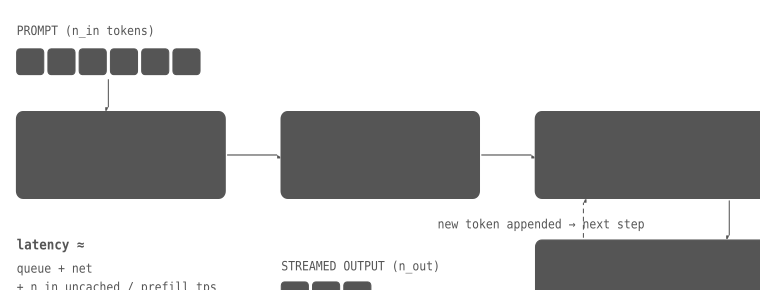

# Day 1 — LLM internals for architects

> Part of the [GenAI Architect study path](../../README.md) · Llm Retrieval Foundations · [Original interactive pack](https://claude.ai/artifact/Dinx4sWEmHCRy354RB9Bf5) · [Offline HTML](../../archive/html/day-01.html)


Day 1 of 30 · Week 1 — LLM & retrieval foundations · Sun 11 Oct 2026

# LLM internals for architects

Tokens, context windows, sampling, long-context vs retrieval, and the cost/latency arithmetic you should be able to do on a whiteboard in a design review.

wk1 ▸ wk2 ▸ wk3 ▸ wk4 + capstone

## Why this matters for the JD

The JD's first must-have is literally *"LLM concepts … embeddings, context windows, token limits"*, and its evaluation line names *"latency/cost"*. The good-to-haves ask for *"cost estimates"* and *"NFRs"*. Every later decision in this plan (RAG vs long-context, model routing, caching, GPU sizing) gets argued in tokens per request, time to first token, and dollars per month. Today you build that arithmetic.

## Concept brief

### A request has two phases with different physics

**Prefill** processes all prompt tokens in parallel. It is compute-bound, fills the KV cache, and sets **time to first token (TTFT)**. **Decode** produces one token per forward pass. It is memory-bandwidth-bound, because every step re-reads the weights and the growing KV cache, and it sets **time per output token (TPOT)**. That is why output tokens cost several times more than input tokens on most price sheets, and why a 4k-token answer feels slower than a 40k-token prompt.



Where the time and money go. Prompt caching skips prefill for a reused prefix; it does nothing for decode.

### Tokens are a billing and capacity unit, and tokenizers differ

- Always count with the *target model's* tokenizer. tiktoken's `o200k_base` is right for current OpenAI/Azure OpenAI models, wrong for Claude, Gemini, Granite or Llama. Providers expose counters: Anthropic's `count_tokens`, Gemini's `countTokens`, and watsonx.ai's `POST /ml/v1/text/tokenization`.
- Non-Latin scripts carry a "token tax". Devanagari text often costs several times more tokens per character than English. For an India-facing deployment that changes cost, context budget and latency. You will measure it in the lab.
- JSON, code, IDs and numbers tokenize poorly. Verbose structured context is expensive context.

### The context window is a budget, not a container

Window = system prompt + tool schemas + conversation history + retrieved context + user turn + **reserved output**. Max output is usually a separate, smaller cap. Overflow behaviour differs by stack: hosted APIs usually reject the request, while local runtimes such as Ollama may silently truncate to `num_ctx`. Ollama defaults to a 4k context on GPUs under 24 GiB, which covers your RTX 3050. Design for *explicit* budgets per slot and fail closed.

Advertised context ≠ effective context. "Lost in the Middle" showed recall dropping for facts buried mid-context. Chroma's 2025 "Context Rot" report found degradation across 18 frontier models even on simple tasks as input grows. RULER shows near-perfect needle scores hiding real long-context weakness.

### KV cache: why context length is a capacity decision

KV bytes/token = 2 (K,V) × layers × kv\_heads × head\_dim × bytes\_per\_value
Llama-3.1-8B fp16: 2 × 32 × 8 × 128 × 2 = 128 KiB/token
→ 128k ctx, 1 user ≈ 16 GiB (more than the fp16 weights, ~15 GiB)
→ 8k ctx, 32 users ≈ 32 GiB

This is why GQA (fewer KV heads), KV-cache quantization, and PagedAttention in vLLM matter. The vLLM team measured 60–80% KV memory waste from fragmentation in earlier serving systems. On self-hosted stacks, max context × concurrency sets the GPU count. On managed APIs it shows up as rate limits (TPM) and provisioned-throughput units.

### Sampling parameters, from an architect's view

- `temperature` rescales logits. `top_k` / `top_p` / `min_p` truncate the tail. Use low values for extraction, classification and grounded Q&A, and higher values for ideation.
- `temperature=0` is *not* a determinism guarantee. Batching, floating-point non-associativity, MoE routing and silent model updates all change outputs. For auditability, pin the model version, log prompt + params + output, and evaluate on distributions.
- Some reasoning models restrict or ignore sampling parameters. Check each provider. Thinking tokens bill as output and add latency, so treat them as a budget too.
- `max_tokens` and stop sequences are cost controls. Set them per route.

### Cost math you should do in your head

cost/req = (fresh\_in × p\_in + cached\_in × p\_in × cache\_mult + out × p\_out) / 1e6
monthly = cost/req × users × req/user/day × working\_days
multi-turn: history is re-sent each turn → cumulative input grows ~quadratically with turns

Prompt caching changes the long-context equation. On Anthropic's API, cache reads bill at 0.1× base input (lower on some newer models), 5-minute writes at 1.25×, and 1-hour writes at 2×. Put the stable prefix first (system prompt, tools, static docs) and variable content last.

## Trade-offs & decision table

### Getting knowledge into the window

| Option | Pick when | Failure modes | Cost / latency |
| --- | --- | --- | --- |
| Prompt only (no external context) | Task needs only general skill: rewrite, classify, extract from the user's own input | Hallucinated facts; stale knowledge | Lowest. Input is small, so TTFT stays small |
| RAG, bounded top-k | Large, changing, permissioned corpus; citations required; 50k-user scale | Retrieval misses (the answer was never in context); chunking breaks meaning; extra infra | Input ~2–8k tokens. Predictable cost. Adds 50–300 ms retrieval |
| Long-context stuffing | One small static corpus or a single long document that needs whole-document reasoning (contract diff, codebase review) | Context rot / lost-in-middle; no per-chunk ACLs; cost scales with every request | Linear in input tokens. Prefill-heavy TTFT, often many seconds at 100k+ |
| Long-context + prompt cache | The same large prefix is reused within the cache TTL (agent sessions, a doc-chat on one file) | Cache misses after the TTL; any prefix edit invalidates; first write costs a premium | Reads cost a fraction of base. TTFT drops sharply on a hit |
| Hybrid: retrieve docs, then read them whole | Answers need a full section or document, not just a snippet | Doc-level recall still depends on retrieval; budget blow-ups | Medium. Cap documents per request |
| Compress / summarise (map-reduce) | Corpus exceeds any window; batch reports | Lossy: summaries drop the detail the question needed; errors compound | Many calls, but parallelisable. High total latency |

### Sampling presets by route

| Route | temperature | top\_p / min\_p | max\_tokens | Why |
| --- | --- | --- | --- | --- |
| Extraction / JSON / classification | 0 | default | tight (≤ schema size) | Stability. Pair with constrained decoding (Day 2) |
| Grounded Q&A (RAG) | 0–0.3 | top\_p 0.9 | 400–800 | Faithfulness over flair. Shorter answers cost less |
| Drafting / summarising | 0.5–0.8 | top\_p 0.9–0.95 | route-specific | Fluency without drift |
| Ideation / synthetic data | 0.9–1.2 | min\_p 0.05–0.1 | capped | Diversity. min\_p keeps coherence at high T |

## Hands-on lab: Token & latency lab (≈75 min)

You will measure your own numbers and turn them into a cost/latency model you can reuse all month. Everything runs natively on Windows 11 with your RTX 3050 6 GB. No WSL2 or Docker needed.

Pinned to the current PyPI releases: tiktoken 0.14.0 · tokenizers 0.23.3 · ollama 0.6.3. All scripts were compiled and checked against the ollama client's response schema. The model-dependent parts were not run against a live GPU in this pack, so your numbers are the result.

### Setup (PowerShell)

**setup.ps1** · `lab/setup.ps1`

```powershell
# 1) Ollama for Windows (native, uses your NVIDIA GPU). Or download the installer from ollama.com
winget install --id Ollama.Ollama -e
ollama pull qwen3:1.7b          # ~1.4 GB, fits comfortably in 6 GB VRAM with an 8-16k context

# 2) Project + venv (Python 3.13)
mkdir genai-day01; cd genai-day01
py -3.13 -m venv .venv
.\.venv\Scripts\Activate.ps1    # if blocked: Set-ExecutionPolicy -Scope CurrentUser RemoteSigned
python -m pip install -U pip
python -m pip install "tiktoken==0.14.0" "tokenizers==0.23.3" "ollama==0.6.3"

# 3) Sanity check
ollama run qwen3:1.7b "Say OK"
python token_lab.py
```

**Network note.** tiktoken downloads its BPE files from `openaipublic.blob.core.windows.net`, and the Qwen tokenizer comes from Hugging Face. A corporate proxy may block either. If so, run on home Wi-Fi once; both cache locally afterwards.

1. **Part A: token tax (10 min).** Compare tokenizers on English, code, JSON, Hindi and Marathi.
   **token_lab.py** · `lab/token_lab.py`

```python
"""Part A - same text, different tokenizers, different bills."""
import tiktoken
from tokenizers import Tokenizer

SAMPLES = {
    "english_policy": "Employees must submit expense claims within 30 days of travel. "
                      "Claims above INR 50,000 require approval from the cost-centre head.",
    "python_code": "def chunk(text: str, size: int = 512) -> list[str]:\n"
                   "    return [text[i:i + size] for i in range(0, len(text), size)]\n",
    "json_payload": '{"employee_id": "LTI-004512", "claims": [{"amount": 48250.75, '
                    '"currency": "INR", "status": "PENDING_APPROVAL"}]}',
    "hindi": "कर्मचारियों को यात्रा के 30 दिनों के भीतर व्यय दावे जमा करने होंगे।",
    "marathi": "कर्मचाऱ्यांनी प्रवासानंतर ३० दिवसांच्या आत खर्चाचे दावे सादर करावेत.",
}

encoders = {
    "o200k_base (GPT-4o/4.1 family)": tiktoken.get_encoding("o200k_base"),
    "cl100k_base (GPT-4/3.5 era)": tiktoken.get_encoding("cl100k_base"),
}
qwen = Tokenizer.from_pretrained("Qwen/Qwen3-1.7B")  # downloads tokenizer.json only (~11 MB)

print(f"{'sample':<16}{'chars':>6}  " + "".join(f"{n.split()[0]:>13}" for n in encoders) + f"{'qwen3':>9}")
for name, text in SAMPLES.items():
    row = [len(enc.encode(text)) for enc in encoders.values()]
    q = len(qwen.encode(text, add_special_tokens=False).ids)
    print(f"{name:<16}{len(text):>6}  " + "".join(f"{n:>13}" for n in row) + f"{q:>9}"
          f"   chars/token(o200k)={len(text)/row[0]:.2f}")

# Look at how a word actually splits
enc = encoders["o200k_base (GPT-4o/4.1 family)"]
for word in ["watsonx.ai", "InstructLab", " cost-centre", "दावे"]:
    ids = enc.encode(word)
    print(f"{word!r:>16} -> {[enc.decode_single_token_bytes(i) for i in ids]}")
```

   *Expected:* a table where English is roughly 4–5 characters per token on `o200k_base`, Devanagari is far lower (more tokens for the same meaning), and `cl100k_base` is worse than `o200k_base` on Indic text. Qwen3 counts differ again. The exact ratios are your finding. Note them in your decision log.
2. **Part B: prefill vs decode on your GPU (20 min).**
   **latency_probe.py** · `lab/latency_probe.py`

```python
"""Part B - measure prefill vs decode, TTFT, and sampling behaviour on your own GPU."""
import time
import ollama

MODEL = "qwen3:1.7b"
OPTS = {"num_ctx": 8192, "seed": 42}

def run(prompt: str, max_out: int = 128, **sampling) -> dict:
    t0 = time.perf_counter()
    ttft, text, final = None, [], None
    for chunk in ollama.chat(
        model=MODEL,
        messages=[{"role": "user", "content": prompt}],
        options={**OPTS, "num_predict": max_out, **sampling},
        think=False,          # Qwen3 is a hybrid reasoning model; keep hidden thinking tokens out of the timing
        stream=True,
    ):
        if ttft is None and chunk.message.content:
            ttft = time.perf_counter() - t0
        text.append(chunk.message.content or "")
        if chunk.done:
            final = chunk
    ns = 1e9
    return {
        "in_tok": final.prompt_eval_count,
        "out_tok": final.eval_count,
        "ttft_s": round(ttft or 0, 3),
        "prefill_tps": round(final.prompt_eval_count / (final.prompt_eval_duration / ns), 1)
                       if final.prompt_eval_duration else None,
        "decode_tps": round(final.eval_count / (final.eval_duration / ns), 1),
        "load_s": round(final.load_duration / ns, 2),
        "text": "".join(text).strip(),
    }

if __name__ == "__main__":
    filler = "The quarterly compliance review covers vendor onboarding, access recertification and audit trails. "
    print("== Prefill scaling: TTFT should grow with input; decode tok/s should stay ~flat ==")
    for reps in (5, 50, 200, 500):
        r = run(filler * reps + "\nSummarise the above in one sentence.", max_out=60)
        print(f"in={r['in_tok']:>5}  out={r['out_tok']:>3}  TTFT={r['ttft_s']:>6}s  "
              f"prefill={r['prefill_tps']} tok/s  decode={r['decode_tps']} tok/s  load={r['load_s']}s")

    print("\n== Sampling: same prompt, 3 runs each, different seeds ==")
    q = "Give a one-line name for an internal HR policy assistant."
    for label, s in {"greedy-ish (T=0)": {"temperature": 0},
                     "balanced (T=0.7, top_p=0.9)": {"temperature": 0.7, "top_p": 0.9},
                     "hot (T=1.3, top_k=100)": {"temperature": 1.3, "top_k": 100}}.items():
        outs = {run(q, max_out=20, seed=seed, **s)["text"] for seed in (1, 2, 3)}
        print(f"{label:<30} distinct outputs={len(outs)}  e.g. {next(iter(outs))[:70]!r}")
```

   *Expected shape:* TTFT rises with input size while decode tok/s stays roughly flat. The first call shows a non-zero `load` (cold start), which is your serverless cold-start lesson. T=0 gives 1 distinct output; T=1.3 usually gives 3. Run `ollama ps` in another terminal and confirm `PROCESSOR` says 100% GPU. If it shows a CPU split, decode speed collapses.
3. **Part C: see the distribution (5 min).**
   **logprob_peek.py** · `lab/logprob_peek.py`

```python
"""Part C - look at the next-token distribution the sampler actually chooses from."""
import math
import ollama

resp = ollama.chat(
    model="qwen3:1.7b",
    messages=[{"role": "user", "content": "Answer with one word. Is the Earth flat? Answer:"}],
    options={"temperature": 0, "num_predict": 3, "num_ctx": 2048},
    think=False,
    logprobs=True,
    top_logprobs=5,
)
print("answer:", resp.message.content)
for pos, lp in enumerate(resp.logprobs or []):
    alts = ", ".join(f"{t.token!r}:{math.exp(t.logprob):.2%}" for t in (lp.top_logprobs or []))
    print(f"pos {pos}: chose {lp.token!r} p={math.exp(lp.logprob):.2%} | top-5: {alts}")
```

   *Expected:* "No" chosen with high probability, plus the alternatives with their probabilities. This is the raw signal behind confidence-based abstention (Day 4).
4. **Part D: mini lost-in-the-middle (20 min).**
   **needle_test.py** · `lab/needle_test.py`

```python
"""Part D - a tiny 'lost in the middle' test: does position/length change recall?"""
import random
import ollama

MODEL = "qwen3:1.7b"
NEEDLE = "Note for auditors: the escrow release code for the Pune data centre is 7319-KESTREL."
QUESTION = "What is the escrow release code for the Pune data centre? Reply with the code only."

random.seed(7)
SUBJ = ["The vendor register", "Access recertification", "The DR runbook", "Change board minutes",
        "The SOC2 evidence pack", "Patch compliance", "The encryption key inventory"]
VERB = ["was reviewed on", "was updated on", "was escalated on", "was signed off on", "was archived on"]
TAIL = ["with two minor findings.", "after a delayed CAB.", "pending owner confirmation.",
        "and no exceptions were raised.", "with the Bengaluru team in copy."]

def filler(n_sentences: int) -> list[str]:
    return [f"{random.choice(SUBJ)} {random.choice(VERB)} 2026-0{random.randint(1,9)}-{random.randint(10,28)} "
            f"{random.choice(TAIL)}" for _ in range(n_sentences)]

def trial(n_sentences: int, depth: float) -> tuple[int, bool]:
    hay = filler(n_sentences)
    hay.insert(int(depth * len(hay)), NEEDLE)
    prompt = "Document:\n" + " ".join(hay) + "\n\n" + QUESTION
    r = ollama.chat(model=MODEL, messages=[{"role": "user", "content": prompt}],
                    options={"temperature": 0, "num_ctx": 16384, "num_predict": 20},
                    think=False)
    return r.prompt_eval_count, "7319-KESTREL" in r.message.content.upper()

if __name__ == "__main__":
    print(f"{'tokens':>7} | " + " | ".join(f"depth {d:.0%}" for d in (0.1, 0.5, 0.9)))
    for n in (60, 250, 500, 900):      # roughly 1k -> 14k tokens
        cells, toks = [], 0
        for d in (0.1, 0.5, 0.9):
            toks, ok = trial(n, d)
            cells.append("  HIT  " if ok else "  miss ")
        print(f"{toks:>7} | " + " | ".join(f"{c:>9}" for c in cells))
```

   *Expected:* HITs at small sizes, then misses appearing as tokens grow, often at 50% depth first. A 1.7B model shows this sooner than frontier models. That is the point: effective context is something you measure, not something you read off a model card.
5. **Part E: the whiteboard model (15 min).** Put in today's list prices and your measured prefill/decode tok/s.
   **cost_model.py** · `lab/cost_model.py`

```python
"""Part E - the architect's back-of-envelope: cost/month and p50 latency for a design option.
Fill PRICES from the provider's current pricing page before you trust any number."""
from dataclasses import dataclass

@dataclass
class Option:
    name: str
    in_tok: int            # prompt tokens per request (system + history + retrieved context + question)
    out_tok: int           # generated tokens per request
    cached_frac: float     # share of input tokens served from a prompt/prefix cache
    price_in: float        # USD per 1M input tokens   <-- fill from pricing page
    price_out: float       # USD per 1M output tokens  <-- fill from pricing page
    cache_read_mult: float = 0.1   # e.g. Anthropic cache reads bill at 0.1x base input
    prefill_tps: float = 5000      # provider/hardware prefill throughput (measure it!)
    decode_tps: float = 60         # per-stream decode speed (measure it!)

    def cost_per_req(self) -> float:
        cached = self.in_tok * self.cached_frac
        fresh = self.in_tok - cached
        return (fresh * self.price_in + cached * self.price_in * self.cache_read_mult
                + self.out_tok * self.price_out) / 1e6

    def latency_s(self, network_s: float = 0.15) -> float:
        fresh = self.in_tok * (1 - self.cached_frac)
        return network_s + fresh / self.prefill_tps + self.out_tok / self.decode_tps

REQ_PER_MONTH = 50_000 * 8 * 22   # 50k employees x 8 questions/day x 22 working days

options = [
    # Placeholder prices - replace with today's list prices for the models you are comparing.
    Option("RAG: 6 chunks x 400 tok", in_tok=3_500, out_tok=350, cached_frac=0.3, price_in=3.0, price_out=15.0),
    Option("Long-context: stuff 120k tok", in_tok=120_000, out_tok=350, cached_frac=0.0, price_in=3.0, price_out=15.0),
    Option("Long-context + prompt cache", in_tok=120_000, out_tok=350, cached_frac=0.9, price_in=3.0, price_out=15.0),
    Option("RAG on small model", in_tok=3_500, out_tok=350, cached_frac=0.3, price_in=0.25, price_out=1.25, decode_tps=150),
]

print(f"Requests/month: {REQ_PER_MONTH:,}")
print(f"{'option':<32}{'$/req':>9}{'$/month':>13}{'p50 latency':>13}")
for o in options:
    print(f"{o.name:<32}{o.cost_per_req():>9.4f}{o.cost_per_req()*REQ_PER_MONTH:>13,.0f}{o.latency_s():>11.2f} s")

# KV-cache memory: why context length is a capacity decision, not just a model spec
def kv_gib(layers, kv_heads, head_dim, tokens, bytes_per=2, concurrent=1):
    return 2 * layers * kv_heads * head_dim * bytes_per * tokens * concurrent / 2**30

print("\nKV cache (fp16):")
print(f"  Qwen3-1.7B  @ 8k ctx, 1 user   : {kv_gib(28, 8, 128, 8_192):.2f} GiB")
print(f"  Llama-3.1-8B @ 128k ctx, 1 user: {kv_gib(32, 8, 128, 131_072):.2f} GiB")
print(f"  Llama-3.1-8B @ 8k ctx, 32 users: {kv_gib(32, 8, 128, 8_192, concurrent=32):.2f} GiB")
```

   *Output with the placeholder prices (verified run):*

   **cost_output.txt**

```text
Requests/month: 8,800,000
option                              $/req      $/month  p50 latency
RAG: 6 chunks x 400 tok            0.0129      113,652       6.47 s
Long-context: stuff 120k tok       0.3653    3,214,200      29.98 s
Long-context + prompt cache        0.0736      648,120       8.38 s
RAG on small model                 0.0011        9,471       2.97 s

KV cache (fp16):
  Qwen3-1.7B  @ 8k ctx, 1 user   : 0.88 GiB
  Llama-3.1-8B @ 128k ctx, 1 user: 16.00 GiB
  Llama-3.1-8B @ 8k ctx, 32 users: 32.00 GiB
```

   Read it like a reviewer. Stuffing 120k tokens costs about 28× RAG per month with these placeholders, and prompt caching recovers most of that gap only if the prefix is actually reused within the TTL.

### Stretch goals

- **Cache-aware cost.** Extend `Option` with a cache-write multiplier and hit rate, then find the break-even hit rate where long-context + cache beats RAG on cost.
- **Context-rot curve.** Run `needle_test.py` with 5 seeds per cell and plot recall vs tokens for `qwen3:1.7b` vs `qwen3:4b`. 4b will need a smaller `num_ctx` to stay on your 6 GB GPU, and finding that limit is part of the exercise.

## GitHub repos to study

[openai/tiktoken](https://github.com/openai/tiktoken)Read `tiktoken_ext/openai_public.py` to see how encodings, regex pre-splits and special tokens are defined. (~19k★, active)

[karpathy/minbpe](https://github.com/karpathy/minbpe)`minbpe/regex.py` and `gpt4.py`: about 200 lines that make BPE, and the multilingual token tax, obvious. (~10.7k★, reference code, stable)

[vllm-project/vllm](https://github.com/vllm-project/vllm)Look at the docs on automatic prefix caching and the KV-cache manager. This is how prompt caching works on self-hosted stacks. (~91k★, v0.31.0 released 5 Oct)

[NVIDIA/RULER](https://github.com/NVIDIA/RULER)The task taxonomy (multi-hop tracing, aggregation) shows why needle tests overstate effective context. See the `rulerv2-ns` branch for v2. (~1.6k★)

## Read / watch

- [Lost in the Middle: How Language Models Use Long Contexts](https://arxiv.org/abs/2307.03172) (Liu et al., Stanford). Read the U-shaped curve figures and the section on why extended-context models are not automatically better.
- [Context Rot: How Increasing Input Tokens Impacts LLM Performance](https://www.trychroma.com/research/context-rot) (Chroma, Jul 2025). Covers 18 models; distractors and haystack structure matter. The best current argument for context engineering.
- [vLLM: Easy, Fast, and Cheap LLM Serving with PagedAttention](https://vllm.ai/blog/2023-06-20-vllm). The KV-cache memory story in one post. It sets up Day 23.

Reference while coding: [Ollama chat API](https://docs.ollama.com/api/chat) · [Ollama context length](https://docs.ollama.com/context-length) · [Anthropic prompt caching](https://platform.claude.com/docs/en/build-with-claude/prompt-caching) · [watsonx.ai API (text tokenization)](https://cloud.ibm.com/apidocs/watsonx-ai)

## Interview questions

**A model now offers a 1M-token context window. Why would you still build RAG?**

**Cost:** stuffing is paid on every request. 8.8M requests a month at 120k tokens versus 3.5k is a ~34× input bill. **Latency:** prefill on 100k+ tokens adds seconds to TTFT. **Quality:** context rot and lost-in-the-middle mean advertised ≠ effective context. **Governance:** RAG enforces document-level ACLs per user, handles freshness without redeploying prompts, and gives chunk-level citations.

Long context wins for one long document that needs holistic reasoning, or for a stable prefix reused under prompt caching. Mature designs combine both: retrieve to narrow, then read whole sections.

**Users say the assistant is "slow". How do you diagnose it?**

Break latency into queue + network + TTFT + (output tokens × TPOT) using traces. High TTFT means a big prompt, a cold start, or queueing/rate limits. Fixes: trim context, cache the prefix, warm pools, provisioned throughput. High total with normal TTFT means long outputs. Fixes: cap `max_tokens`, ask for concise formats, use a smaller or faster model for that route, speculative decoding on self-hosted stacks.

Always stream. Perceived latency is mostly TTFT. Set SLOs on p95 TTFT and p95 end-to-end separately.

**Estimate the monthly LLM cost of an HR assistant for 50k employees.**

State assumptions out loud: ~8 queries per user per working day, 22 days → 8.8M requests. Per request ~3.5k input tokens (system + 6 chunks + question) and ~350 output. Cost = (in × p\_in + out × p\_out)/1e6 × volume. Then run sensitivity: output price is usually 4–5× input, so answer length dominates; multi-turn history grows cumulative input quadratically; Hindi/Marathi users can multiply token counts.

Close with levers: model routing (small model for FAQs), prompt caching for the stable prefix, semantic caching, and per-tenant budgets with alerts.

**The auditors want reproducible outputs. Isn't temperature 0 enough?**

No. Batch composition, floating-point non-associativity across GPU kernels, MoE routing and provider-side model updates all make T=0 non-deterministic. Use a seed where it is supported, but don't rely on it.

The architecture answer: pin model versions (no "latest" aliases), version prompts, log the full request (prompt, retrieved chunk IDs, params, model version) with the response in immutable audit storage, and validate behaviour with eval suites on output distributions, not single runs. If exact replay is required, the system of record is the stored output, not regeneration.

**How do you manage the token budget of a long-running agent conversation?**

Give each slot an explicit budget: system/tools (fixed and cached), memory summary, last N turns verbatim, retrieved context (top-k capped by tokens, not count), and reserved output. Count with the target model's tokenizer or the provider's count endpoint, never a proxy tokenizer.

Past a threshold, summarise older turns into structured memory and drop raw tool outputs once they have been distilled. Fail closed on overflow instead of truncating silently. Watch Ollama-style runtimes, where the default `num_ctx` can quietly cut the prompt.

## Architect's lens: ADR-001

Title
:   Default context strategy for the enterprise knowledge assistant

Status
:   Proposed · 2026-10-11

Context
:   50k employees, ~8.8M requests a month, permissioned and changing corpus, citation requirement, p95 TTFT target under 2 s. Candidate models offer 128k–1M windows. Indic-language users increase token counts.

Options
:   (A) Long-context stuffing per department. (B) Bounded RAG with an ≤8k input budget. (C) B plus prompt caching of the stable prefix, with a gated long-context route for whole-document tasks.

Decision
:   **C.** RAG is the default path with explicit per-slot token budgets and a cached system/tool prefix. A separate "analyse this document" route allows up to 100k tokens, with its own rate limit and model.

Consequences
:   + Predictable cost and TTFT; ACLs enforced at retrieval; citations by design. − We own retrieval quality, so this requires the eval harness from Day 11. Two routes means two SLOs and two cost centres. Revisit if long-context price per token falls about 10× or effective-context benchmarks close the gap.

## Tomorrow

Day 2 — Prompt engineering & structured output: JSON schema, constrained decoding, few-shot, prompt templates and versioning.

## Lab files in this folder

- [`lab/setup.ps1`](lab/setup.ps1)
- [`lab/token_lab.py`](lab/token_lab.py)
- [`lab/latency_probe.py`](lab/latency_probe.py)
- [`lab/logprob_peek.py`](lab/logprob_peek.py)
- [`lab/needle_test.py`](lab/needle_test.py)
- [`lab/cost_model.py`](lab/cost_model.py)
