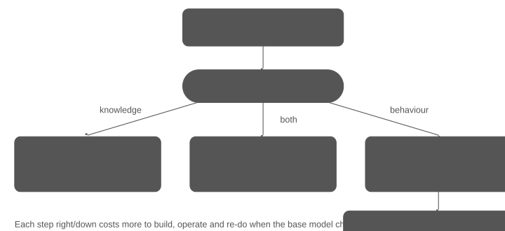

# Day 3 — Fine-tuning vs RAG vs Prompting

> Part of the [GenAI Architect study path](../../README.md) · Llm Retrieval Foundations · [Original interactive pack](https://claude.ai/artifact/EV65ZCxC7i7JJqzPhTcnhV) · [Offline HTML](../../archive/html/day-03.html)


Week 1 · LLM & retrieval foundations · Day 3

# Fine-tuning vs RAG vs prompting

A decision framework you can defend in a design review: what each lever actually changes in the model, LoRA/QLoRA/PEFT mechanics, and where InstructLab-style tuning still earns its cost.

Mon 12 Oct 2026~45 min read + 75 min labpeft 0.21 · trl 1.15 · transformers 5.19

## Why this matters for the JD

The JD lists *"fine-tuning vs RAG"* as a must-have LLM concept and *"RAG optimization"* plus *"multi-provider LLM integration"* as preferred. In architect interviews this is the most common opening question, and the follow-ups test whether you can tie the choice to NFRs: freshness, auditability, cost per request, latency and data residency. You have shipped both sides (Granite/InstructLab tuning and a RAG compliance bot), so the goal today is to turn that experience into a crisp, reusable framework.

## Concept brief

### Three levers, three different things they change

- **Prompting** changes the *input*. No weights move. It steers behaviour the model already has. Cost is paid per request in prompt tokens, forever.
- **RAG** changes the *input at runtime* with retrieved evidence. It is the right tool for *knowledge*: facts that change, need citations, or are permissioned per user. Cost is retrieval latency plus context tokens.
- **Fine-tuning** changes the *weights*. It is the right tool for *behaviour*: output format, tone, domain vocabulary, task skill (classification, extraction, tool-call syntax), and shrinking prompts. It is weak at injecting new facts reliably (Ovadia et al. 2023 found RAG beat unsupervised fine-tuning for knowledge injection), and facts baked into weights cannot be cited, revoked or permission-filtered.

The one-line rule for reviews: **RAG for what the model should know, fine-tuning for how it should behave, prompting until you can prove it is not enough.** The two combine well: RAFT (Zhang et al. 2024) fine-tunes the model to *use* retrieved context better, including ignoring distractor documents.



### PEFT mechanics you should be able to whiteboard

- **LoRA**: freeze W; learn a low-rank update ΔW = B·A with rank r (typically 8–64). Effective scale is `lora_alpha / r` (rsLoRA uses `alpha/√r`, which behaves better at high rank). Trainable params are usually 0.1–2% of the model. Adapters are small files, so you can host many per base model (multi-LoRA serving in vLLM / watsonx deployments).
- **QLoRA**: base weights loaded in 4-bit NF4 with double quantization; LoRA adapters train in bf16 on top. It is what makes 7–8B tuning fit on a single 24 GB card, and 1–2B models fit on your 6 GB 3050.
- **Variants worth naming**: DoRA (magnitude/direction split, slightly better quality, merge before serving), PiSSA and LoftQ initialisations (less quantization error than plain QLoRA), aLoRA (activated LoRA that can share the base model's KV cache). All are config flags in current PEFT.
- **"LoRA learns less and forgets less"** (Biderman et al. 2024): LoRA under-performs full FT on large new-domain skills like code and maths but preserves general ability better. That is the argument for LoRA in enterprise: lower regression risk on everything you did not train for.

### Where InstructLab-style tuning fits now

InstructLab's idea was taxonomy-driven synthetic data generation (SDG) from a small number of seed examples, followed by multi-phase tuning of Granite. The method still wins when you have *little labelled data but clear domain skills* and need an on-prem, auditable training pipeline.

**Status change you should know before an interview:** the `instructlab/instructlab` CLI repo was archived on 23 Apr 2026 and its last PyPI release (0.26.1) dates from May 2025. Red Hat split the components into `sdg_hub` (synthetic data) and `training_hub` (SFT, OSFT continual learning, LoRA via an Unsloth backend). If your RAG compliance bot depends on the InstructLab CLI, note it as a dependency risk in its decision log.

### Platform map

| Need | IBM watsonx | Azure | AWS | GCP |
| --- | --- | --- | --- | --- |
| Managed RAG | watsonx.ai RAG patterns / AutoAI for RAG, watsonx Discovery | AI Foundry + Azure AI Search | Bedrock Knowledge Bases | Vertex AI RAG Engine / Search |
| Managed tuning | watsonx.ai Tuning Studio (prompt tuning; LoRA on supported models) | AI Foundry fine-tuning (SFT, DPO) | Bedrock custom models (FT, continued pretraining) | Vertex AI supervised tuning |
| Self-managed tuning | Red Hat OpenShift AI + training\_hub | AML compute + PEFT/TRL | SageMaker + PEFT/TRL | Vertex custom jobs |

Managed tuning catalogues change often; confirm the model list for your region before committing in a proposal.

## Trade-offs & decision table

| Option | Pick when | Failure modes | Cost / latency |
| --- | --- | --- | --- |
| Prompting (+ few-shot, schema) | Behaviour already exists in the model; fast iteration; low volume; frequently changing rules | Prompt bloat; brittle across model versions; rules ignored under long context; injection surface grows with prompt size | No upfront cost. Every rule and example is paid in input tokens on every call (prompt caching helps) |
| RAG | Facts change; citations or audit needed; per-user permissions; large corpus | Retrieval misses (the main cause of wrong answers); stale index; chunking breaks tables; model ignores or over-trusts context | Embedding + index infra; +50–300 ms retrieval; context tokens per call |
| LoRA / QLoRA | Stable task with a measurable spec: strict JSON, classification, extraction, tone, tool-call format; want a smaller cheaper model; prompt too long | Overfits small data; catastrophic forgetting (less with LoRA); poor paraphrase generalisation of "facts"; must re-tune when the base model is upgraded | Hours of GPU plus data labelling. Serving cost drops if it lets you use a smaller model or a shorter prompt |
| RAG + tuned reader (RAFT) | Domain RAG where the model mis-uses context, e.g. distractors or legal and compliance phrasing | Two pipelines to version; eval must cover retrieval and generation separately | Both costs, usually the best quality per token |
| Full FT / continued pretraining | New language or very specialised corpus; very high volume justifies owning a model | Expensive, regression-prone; you now own model lifecycle, red-teaming and licences | Multi-GPU days to weeks; MLOps team required |

**Break-even math to have ready.** A 1,500-token system prompt × 2M requests/month = 3B input tokens. If a LoRA-tuned model needs a 150-token prompt, you save about 2.7B tokens a month. At, say, $0.50 per 1M input tokens that is about $1,350/month, before counting the possibility of moving to a smaller model. Set that against data, tuning, evals and re-tuning on every base-model upgrade (often 2–4 per year).

## Hands-on lab: same model, three levers

You will run Qwen3-0.6B locally and measure all three approaches on two tasks for a fictional bank: **(A)** behaviour, classifying requests into a strict JSON schema with business rules; **(B)** knowledge, answering 8 internal policy facts. The point is to see with your own numbers that LoRA wins task A with a short prompt, while RAG wins task B, especially on paraphrased questions.

**Time:** about 15 min setup, 5–10 min training on the RTX 3050, and the rest for analysis. Model weights are about 1.5 GB. In bf16 it trains comfortably in 6 GB, so no bitsandbytes is needed for the main path.

### Setup (PowerShell, native Windows; no WSL needed)

**powershell**

```powershell
mkdir day3-ft-vs-rag; cd day3-ft-vs-rag
py -3.13 -m venv .venv
.\.venv\Scripts\Activate.ps1
python -m pip install --upgrade pip
# CUDA build of PyTorch: pick the CUDA index that pytorch.org's selector shows for Windows + pip (e.g. cu128)
python -m pip install torch --index-url https://download.pytorch.org/whl/cu128
python -m pip install "transformers>=5.19" "trl>=1.15" "peft>=0.21" "datasets>=5.1" accelerate
python -c "import torch;print(torch.__version__, torch.cuda.is_available(), torch.cuda.get_device_name(0))"
# save the script below as day3_lab.py, then:
python day3_lab.py baseline
python day3_lab.py train
python day3_lab.py finetuned
```

If `Activate.ps1` is blocked, run `Set-ExecutionPolicy -Scope CurrentUser RemoteSigned` once. If `torch.cuda.is_available()` prints False, you installed the CPU wheel; reinstall from the CUDA index.

### day3\_lab.py

**python · ~200 lines** · saved as `lab/day3_lab.py`

```python
"""Day 3 lab: prompting vs RAG vs LoRA on the same small model.

Two tasks on a fictional bank ("Northwind"):
  A. Behaviour  - classify requests into a strict JSON schema with hidden business rules.
  B. Knowledge  - answer questions about 8 internal policy facts.

Usage (run in order):
  python day3_lab.py baseline   # zero-shot short prompt, then rules + few-shot prompt, then RAG for task B
  python day3_lab.py train      # LoRA SFT on task A + memorised Q&A for task B (~5-10 min on an RTX 3050)
  python day3_lab.py finetuned  # same evals with the adapter loaded (short prompt only), plus FT + RAG
"""
import json, random, re, sys, time
import torch
from transformers import AutoTokenizer, AutoModelForCausalLM

MODEL_ID = "Qwen/Qwen3-0.6B"
ADAPTER_DIR = "out/qwen3-0.6b-lora"
DEVICE = "cuda" if torch.cuda.is_available() else "cpu"
DTYPE = torch.bfloat16 if DEVICE == "cuda" and torch.cuda.is_bf16_supported() else torch.float32
random.seed(7)

# ---------------- Task A: behaviour / format ----------------
SYSTEMS = ["Snowflake", "Salesforce", "core-banking", "HRMS", "Jira", "Kafka"]
ENVS = ["prod", "staging", "dev"]
TRAIN_TPL = {
    "access_request": ["Please grant me read access to the {sys} {env} database.",
                       "I need admin rights on {sys} in {env}.",
                       "Can you add me to the {sys} {env} user group?"],
    "data_export": ["Export all {sys} customer records to a CSV for me.",
                    "I want to download the {sys} table to my laptop.",
                    "Please send a full dump of {sys} data to the vendor."],
    "incident": ["{sys} is down in {env} and users cannot log in.",
                 "We are seeing 500 errors from {sys}.",
                 "{sys} {env} latency spiked to 10 seconds."],
    "policy_question": ["What is the policy on using {sys} from home?",
                        "Am I allowed to install plugins in {sys}?",
                        "Who approves changes to {sys} access rules?"],
}
TEST_TPL = {  # different phrasings: tests generalisation, not memorisation
    "access_request": ["Requesting write permissions to {sys} ({env}) for the migration.",
                       "Could I get onboarded to {sys} {env}?"],
    "data_export": ["Need a copy of every {sys} transaction extracted to Excel.",
                    "Can you share the raw {sys} dataset with our partner?"],
    "incident": ["Alerts firing: {sys} pods crash-looping in {env}.",
                 "Customers report {sys} payments failing."],
    "policy_question": ["Is it okay to use personal email with {sys}?",
                        "What are the rules for sharing {sys} screenshots?"],
}

def label(intent, env):
    if intent == "access_request":
        hi = env == "prod"
        return {"intent": intent, "risk": "high" if hi else "low", "needs_approval": hi}
    if intent == "data_export":
        return {"intent": intent, "risk": "high", "needs_approval": True}
    if intent == "incident":
        return {"intent": intent, "risk": "medium", "needs_approval": False}
    return {"intent": intent, "risk": "low", "needs_approval": False}

def make_rows(tpls, all_envs):
    rows = []
    for intent, tl in tpls.items():
        for t in tl:
            for s in SYSTEMS:
                envs = ENVS if all_envs else [random.choice(ENVS)]
                for e in envs:
                    rows.append((t.format(sys=s, env=e), label(intent, e)))
    return rows

SYS_SHORT = "Classify the request. Reply with JSON only."
SYS_RULES = (
    'Classify the request. Reply with JSON only, exactly this schema: '
    '{"intent": "access_request|data_export|incident|policy_question", '
    '"risk": "low|medium|high", "needs_approval": true|false}. '
    "Rules: access to prod is high risk and needs approval; access to non-prod is low, no approval; "
    "any data export is high risk and needs approval; incidents are medium, no approval; "
    "policy questions are low, no approval.\n"
    'Example: "I need admin rights on Jira in prod." -> {"intent": "access_request", "risk": "high", "needs_approval": true}\n'
    'Example: "We are seeing 500 errors from Kafka." -> {"intent": "incident", "risk": "medium", "needs_approval": false}\n'
    'Example: "Export all HRMS customer records to a CSV for me." -> {"intent": "data_export", "risk": "high", "needs_approval": true}'
)

# ---------------- Task B: knowledge ----------------
FACTS = [
    ("Travel policy TP-4: hotel spend is capped at INR 9,000 per night in metro cities.",
     "What is the hotel cap per night in metro cities under TP-4?",
     "How much can I spend on a hotel per night on a trip to Mumbai?", ["9,000", "9000"]),
    ("Records policy RP-2: customer chat transcripts are retained for 7 years, then purged.",
     "How long are customer chat transcripts retained?",
     "When do we delete old customer chat transcripts?", ["7 years", "seven years"]),
    ("Security policy SP-9: production database passwords rotate every 45 days.",
     "How often do production database passwords rotate?",
     "What's the rotation interval for prod DB passwords?", ["45"]),
    ("HR policy HR-3: new joiners get 18 days of paid leave per year.",
     "How many paid leave days do new joiners get?",
     "How much annual paid leave does a fresh hire receive?", ["18"]),
    ("IT policy IT-7: laptops must be returned within 5 working days of an employee's exit.",
     "Within how many days must laptops be returned after exit?",
     "I'm leaving the company - how long do I have to hand back my laptop?", ["5 working", "five working", "5 days", "five days"]),
    ("Expense policy EX-1: client dinners above INR 12,000 need VP approval.",
     "What client dinner amount needs VP approval?",
     "Above what bill does a client dinner require VP sign-off?", ["12,000", "12000"]),
    ("Remote work policy RW-2: employees may work from abroad for at most 30 days a year.",
     "How many days a year can employees work from abroad?",
     "What's the annual limit on days I can work from abroad?", ["30", "thirty"]),
    ("Incident policy IN-5: Sev-1 incidents must be reported to the CISO within 2 hours.",
     "How fast must Sev-1 incidents be reported to the CISO?",
     "What's the deadline to tell the CISO about a Sev-1 outage?", ["2 hours", "two hours"]),
]
SYS_QA = "You answer questions about Northwind Bank internal policy. Be brief."
STOP = set("a an the to of in on for is are what how do does i my can much many under after with about a's".split())

def words(t):
    return {w.rstrip("s") for w in re.findall(r"[a-z0-9]+", t.lower()) if w not in STOP}

def retrieve(q, k=2):
    ranked = sorted(FACTS, key=lambda f: len(words(q) & words(f[0])), reverse=True)
    return [f[0] for f in ranked[:k]]

# ---------------- model helpers ----------------
def load(adapter=False):
    tok = AutoTokenizer.from_pretrained(MODEL_ID)
    model = AutoModelForCausalLM.from_pretrained(MODEL_ID, dtype=DTYPE).to(DEVICE)
    if adapter:
        from peft import PeftModel
        model = PeftModel.from_pretrained(model, ADAPTER_DIR)
    model.eval()
    return tok, model

def chat(tok, model, system, user, max_new_tokens=80):
    msgs = [{"role": "system", "content": system}, {"role": "user", "content": user}]
    text = tok.apply_chat_template(msgs, tokenize=False, add_generation_prompt=True, enable_thinking=False)
    enc = tok(text, return_tensors="pt").to(DEVICE)
    with torch.no_grad():
        out = model.generate(**enc, max_new_tokens=max_new_tokens, do_sample=False)
    n_in = enc["input_ids"].shape[1]
    return tok.decode(out[0, n_in:], skip_special_tokens=True).strip(), n_in

def eval_a(tok, model, system, rows, name):
    valid = exact = tokens = 0
    t0 = time.time()
    for text, gold in rows:
        out, n_in = chat(tok, model, system, text)
        tokens += n_in
        m = re.search(r"\{.*\}", out, re.S)
        try:
            pred = json.loads(m.group(0)) if m else None
        except json.JSONDecodeError:
            pred = None
        if isinstance(pred, dict):
            valid += 1
            exact += int(pred == gold)
    n = len(rows)
    print(f"[A] {name:<22} valid_json={valid/n:5.0%}  exact_match={exact/n:5.0%}  "
          f"avg_prompt_tokens={tokens/n:5.0f}  sec/req={(time.time()-t0)/n:.2f}")

def eval_b(tok, model, name, use_rag, which="test"):
    hits = 0
    for doc, q_train, q_test, answers in FACTS:
        q = q_test if which == "test" else q_train
        user = q
        if use_rag:
            ctx = "\n".join(retrieve(q))
            user = f"Context:\n{ctx}\n\nQuestion: {q}\nAnswer only from the context."
        out, _ = chat(tok, model, SYS_QA, user, max_new_tokens=60)
        hits += int(any(a.lower() in out.lower() for a in answers))
    print(f"[B] {name:<22} accuracy={hits/len(FACTS):5.0%}  ({which} phrasing)")

TEST_A = random.sample(make_rows(TEST_TPL, all_envs=False), 40)

def baseline():
    tok, model = load()
    eval_a(tok, model, SYS_SHORT, TEST_A, "prompt: short")
    eval_a(tok, model, SYS_RULES, TEST_A, "prompt: rules+3-shot")
    eval_b(tok, model, "no context", use_rag=False)
    eval_b(tok, model, "RAG (keyword top-2)", use_rag=True)

def train():
    from datasets import Dataset
    from peft import LoraConfig
    from trl import SFTConfig, SFTTrainer
    tok = AutoTokenizer.from_pretrained(MODEL_ID)
    model = AutoModelForCausalLM.from_pretrained(MODEL_ID, dtype=DTYPE)
    rows = []
    for text, gold in make_rows(TRAIN_TPL, all_envs=True):
        rows.append({"prompt": [{"role": "system", "content": SYS_SHORT}, {"role": "user", "content": text}],
                     "completion": [{"role": "assistant", "content": json.dumps(gold)}]})
    for doc, q_train, _, _ in FACTS:  # knowledge injection: one phrasing, repeated
        for _ in range(12):
            rows.append({"prompt": [{"role": "system", "content": SYS_QA}, {"role": "user", "content": q_train}],
                         "completion": [{"role": "assistant", "content": doc.split(": ", 1)[1]}]})
    random.shuffle(rows)
    print(f"training rows: {len(rows)}")
    cfg = SFTConfig(
        output_dir=ADAPTER_DIR, num_train_epochs=2, per_device_train_batch_size=4,
        gradient_accumulation_steps=2, learning_rate=2e-4, lr_scheduler_type="cosine",
        warmup_steps=5, logging_steps=10, max_length=384, bf16=(DTYPE == torch.bfloat16),
        save_strategy="no", report_to="none",
    )
    lora = LoraConfig(r=16, lora_alpha=32, lora_dropout=0.05, target_modules="all-linear", task_type="CAUSAL_LM")
    trainer = SFTTrainer(model=model, args=cfg, train_dataset=Dataset.from_list(rows),
                         processing_class=tok, peft_config=lora)
    trainer.model.print_trainable_parameters()
    trainer.train()
    trainer.save_model(ADAPTER_DIR)
    print(f"adapter saved to {ADAPTER_DIR}")

def finetuned():
    tok, model = load(adapter=True)
    eval_a(tok, model, SYS_SHORT, TEST_A, "LoRA: short prompt")
    eval_b(tok, model, "LoRA, no context", use_rag=False, which="train")
    eval_b(tok, model, "LoRA, no context", use_rag=False, which="test")
    eval_b(tok, model, "LoRA + RAG", use_rag=True)

if __name__ == "__main__":
    mode = sys.argv[1] if len(sys.argv) > 1 else "baseline"
    print(f"device={DEVICE} dtype={DTYPE}")
    {"baseline": baseline, "train": train, "finetuned": finetuned}[mode]()
```

### Expected output (shape, not exact numbers)

**illustrative · your numbers will vary**

```text
[A] prompt: short          valid_json= 90%  exact_match=  0-10%  avg_prompt_tokens=   40
[A] prompt: rules+3-shot   valid_json=100%  exact_match= 50-80%  avg_prompt_tokens=  270
[B] no context             accuracy=   0%  (test phrasing)
[B] RAG (keyword top-2)    accuracy= 75-100%  (test phrasing)
training rows: 312
trainable params: ~10M || all params: ~0.6-0.75B || trainable%: ~1.5
[A] LoRA: short prompt     valid_json=100%  exact_match= 90-100%  avg_prompt_tokens=   40
[B] LoRA, no context       accuracy= 75-100%  (train phrasing)   <- memorised
[B] LoRA, no context       accuracy= 25-60%   (test phrasing)    <- paraphrase gap
[B] LoRA + RAG             accuracy= 75-100%  (test phrasing)
```

**What to write down afterwards:** (1) the token saving between "rules+3-shot" and "LoRA: short prompt", projected to 1M requests a month; (2) the gap between train and test phrasing for task B, which is the core argument against "just fine-tune the facts in"; (3) whether LoRA hurt RAG on task B. That last one is a real risk: tuning on context-free Q&A can teach the model to answer from memory and ignore the context.

### Stretch goals

1. **QLoRA on a bigger model.** Switch to `Qwen/Qwen3-1.7B`, install `bitsandbytes` (it has native Windows wheels), load with `BitsAndBytesConfig(load_in_4bit=True, bnb_4bit_quant_type="nf4", bnb_4bit_compute_dtype=torch.bfloat16)`, and compare exact match and VRAM (`torch.cuda.max_memory_allocated()`) with the 0.6B LoRA run.
2. **RAFT-lite.** Change the task-B training rows so that each prompt contains the right policy document plus one distractor document, with the answer taken from the right one. Re-run "LoRA + RAG" and check whether accuracy holds when you set `k=3` in `retrieve()`.

## GitHub repos to study

[huggingface/peft](https://github.com/huggingface/peft)Read `src/peft/tuners/lora/layer.py` to see exactly where B·A is added and scaled, then `docs/source/developer_guides/lora.md` for DoRA, PiSSA, rsLoRA and aLoRA flags.

[huggingface/trl](https://github.com/huggingface/trl)Now at v1.x. Study `trl/trainer/sft_trainer.py` for how prompt-completion data is masked (completion-only loss), and the DPO/GRPO trainers for preference tuning beyond SFT.

[unslothai/unsloth](https://github.com/unslothai/unsloth)The fastest single-GPU LoRA/QLoRA path, with native Windows install options. Look at its notebooks for VRAM-per-model tables, which are useful for sizing estimates in proposals.

[Red-Hat-AI-Innovation-Team/training\_hub](https://github.com/Red-Hat-AI-Innovation-Team/training_hub)The successor to the InstructLab training path. Compare its OSFT (continual learning that limits forgetting) API with plain SFT. Pair with [sdg\_hub](https://github.com/Red-Hat-AI-Innovation-Team/sdg_hub) for the synthetic data side.

## Read / watch

- [Fine-Tuning or Retrieval? Comparing Knowledge Injection in LLMs](https://arxiv.org/abs/2312.05934) (Ovadia et al.). The evidence base for "RAG for knowledge". Read the results section and the paraphrase-augmentation finding.
- [RAFT: Adapting Language Model to Domain Specific RAG](https://arxiv.org/abs/2403.10131) (Zhang et al., Berkeley). How to combine the two levers. Pay attention to the distractor-document training recipe.
- [LoRA Learns Less and Forgets Less](https://arxiv.org/abs/2405.09673) (Biderman et al.). Your answer to "why not full fine-tuning?" Also see the [TRL SFTTrainer docs](https://huggingface.co/docs/trl/sft_trainer) for the current dataset formats.

## Interview questions

1. A business owner says "let's fine-tune the model on our 40,000 policy PDFs so it knows our policies." How do you respond?

Separate knowledge from behaviour. Policies change, need citations and are often permissioned, and weights can do none of that: you cannot cite a weight, revoke one superseded clause, or filter by the user's entitlements. Fine-tuning on raw documents also generalises poorly to paraphrased questions. Recommend RAG over the PDFs with ACL-aware retrieval. Fine-tune only if evals show a behaviour gap, such as answer format, legal tone, or poor use of retrieved context (RAFT). Agree success metrics such as faithfulness and citation accuracy on a golden set before building anything.

2. When does fine-tuning pay for itself against a long prompt?

When the task is stable and high-volume and the prompt carries a lot of rules or examples. Calculate (prompt tokens saved × monthly requests × price) plus the savings from a smaller model, and compare that with the cost of data, tuning, evals and re-tuning on each base-model upgrade. Also count latency: shorter prompts lower time-to-first-token. If rules change weekly, prompting or RAG-over-rules wins whatever the token maths says.

3. LoRA vs QLoRA vs full fine-tuning: how do you choose, and what are the risks?

LoRA is the default: around 1% trainable parameters, small swappable adapters, multi-adapter serving on one base model, and less forgetting. QLoRA is used when memory is the constraint. It has slight quality and speed costs from dequantization, and you should evaluate the merged model in the precision you will actually serve. Full FT only when PEFT plateaus on a large new skill and volume justifies owning the model lifecycle. The risks are regression on untrained abilities and overfitting small data, so keep a general-capability regression suite alongside the task evals.

4. How would you evaluate whether the fine-tuned model is ready for production?

Use three suites. Task evals on a held-out set with paraphrases and edge cases, not drawn from the training templates. A regression suite for general ability, safety and refusal behaviour against the base model. And an online canary with business KPIs. Gate promotion in CI on thresholds for each suite, version the dataset, adapter and prompt together, and keep the base-model path as an instant rollback.

5. Your provider deprecates the base model your LoRA adapter was trained on. What is your plan?

Adapters are tied to exact base weights, so this is a planned event, not an incident. Keep the training data, configs and eval suites versioned so re-tuning is a pipeline run, not a project. Budget 2–4 re-tunes a year. Behind the AI gateway, run the new base model with a re-tuned adapter as a shadow, compare on the golden set, then cut over. For open-weight models hosted yourself, pin the version and you choose the timing. That control is part of the argument for self-hosted PEFT in regulated settings.

## Architect's lens: ADR-007

Title
:   Customisation strategy for the internal compliance assistant

Status
:   Accepted

Context
:   Assistant answers employee questions on around 3,000 policy documents updated weekly. Answers must cite the clause, respect document-level entitlements and return a fixed JSON envelope (answer, citations, confidence, escalate flag) for the workflow engine. Volume is about 1.5M requests a month. Data must stay in-region.

Options
:   (a) Prompting only with a long system prompt and few-shot examples. (b) RAG with hybrid retrieval and ACL filters on a general instruct model. (c) Fine-tune the facts into a model. (d) RAG plus a LoRA adapter trained for the JSON envelope, citation style and abstention behaviour.

Decision
:   Option (b) now, with (d) as a gated follow-up if evals show envelope validity below 99% or abstention errors above target. Option (c) is rejected: weekly policy changes, citation and entitlement requirements cannot be met by weights.

Consequences
:   Positive: fresh answers, auditable citations, no training pipeline on day one. Negative: retrieval quality becomes the main risk, so invest in chunking, hybrid search and a golden set (Days 6–11). If (d) is triggered, the team owns adapter versioning, re-tuning on base-model upgrades, and an eval gate in CI (Day 26).

**Tomorrow, Day 4:** Hallucination control and grounding: citations, abstention, self-check and constrained answers.

Versions checked against PyPI on 12 Oct 2026: peft 0.21.2, trl 1.15.0, transformers 5.19.0, datasets 5.1.0, torch 2.14.1. Repo status checked the same day.

## Lab files in this folder

- [`lab/day3_lab.py`](lab/day3_lab.py)
