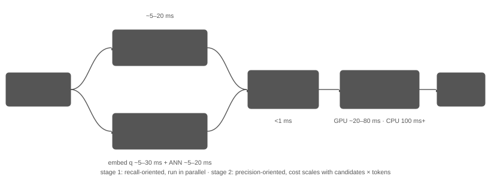

# Day 9 — Hybrid Search & Reranking

> Part of the [GenAI Architect study path](../../README.md) · Production Retrieval · [Original interactive pack](https://claude.ai/artifact/9FHXT7zWwG17V4oT5DhtsJ) · [Offline HTML](../../archive/html/day-09.html)


**Day 9 / 30**Week 2 · Production retrievalSun 18 Oct 2026

# Hybrid search ( BM25 + dense , RRF) and reranking

Two cheap, complementary retrievers cast a wide net; a fusion step merges them without trusting their score scales; one expensive model reads the shortlist and decides the order the LLM sees.

## Why this matters for the JD

The JD names **hybrid search, metadata filtering** and **reranking** explicitly, and lists Azure AI Search and Elastic, the two products where hybrid + RRF is a first-class API. "RAG optimization (chunking, reranking, hybrid, feedback loops)" sits under *Preferred*. In a design review this is where groundedness is won or lost: if the right chunk never reaches the context window, no prompt will save the answer.

## Concept brief

**Why two retrievers.** BM25 matches tokens. It nails error codes, policy numbers, SKUs, acronyms and rare proper nouns, and it degrades gracefully on out-of-domain vocabulary. Dense retrieval matches meaning. It handles paraphrase ("undo a bad release" → "rolling back a deployment") but is weak on exact identifiers, numbers and negation, because a 384-dim vector cannot keep `KB-7741` distinct from `KB-7714`. Their errors are only loosely correlated, so the union of their top-k has much higher recall than either alone.



Latency figures are order-of-magnitude budgets for a 384–1024-dim index and a small cross-encoder; measure your own. Apply the ACL/tenant filter inside both retrievers, never after fusion.

### Fusion: why RRF is the default

BM25 scores are unbounded and depend on query length and corpus IDF; cosine scores live in a narrow band (often 0.6–0.9 for anything vaguely on-topic). Adding them is meaningless, and min-max normalising per query is fragile because one outlier stretches the scale. **Reciprocal Rank Fusion** (Cormack et al., SIGIR 2009) throws scores away and uses only ranks:

`RRF(d) = Σr wr / (k + rankr(d))`, with k ≈ 60. A document ranked #1 by one retriever scores 1/61 ≈ 0.0164; #1 in both scores ≈ 0.0328. Large k flattens the curve, so agreement between retrievers matters more than a single top-1 hit.

Defaults differ by product, and this is a real review question: **Elastic**'s `rrf` retriever defaults to `rank_constant=60` and `rank_window_size=10` (raise the window, or you fuse only ten per side) and supports per-retriever `weight`. **Azure AI Search** uses k=60 and lets you weight vector queries. **Qdrant**'s RRF defaults to **k=2**, very top-heavy; a parameterised `k` arrived in v1.16 and weights in v1.17, and it also offers DBSF (distribution-based score fusion). Weaviate offers `relativeScoreFusion` (normalised scores, alpha-weighted) and `rankedFusion`. Milvus ships `RRFRanker` and `WeightedRanker`. With pgvector you write RRF yourself in SQL over a `tsvector` CTE and a vector CTE.

### Reranking: bi-encoder vs cross-encoder

A bi-encoder embeds query and document separately, which lets you precompute the corpus but means the two never "see" each other. A cross-encoder feeds `[query; document]` through one transformer and outputs a relevance score, so attention runs across both texts. It is much more accurate and cannot be precomputed: cost is O(candidates × tokens) per query. That is why it only ever sees the shortlist. The knobs an architect owns are **candidate depth N** (recall ceiling for the reranker), **final k** (context budget), and **score threshold** (abstain when even the best chunk scores low, which feeds Day 4's hallucination controls).

Evidence worth quoting: Anthropic's contextual-retrieval study measured top-20 retrieval failure falling 35% with contextual embeddings, 49% after adding contextual BM25, and 67% once a reranker was added (retrieve 150, rerank to 20). The gains stack.

### Where IBM / cloud services fit

| Platform | Hybrid | Rerank |
| --- | --- | --- |
| **watsonx** | watsonx.data Milvus (sparse + dense, `RRFRanker`); Elastic via watsonx Discovery | watsonx.ai text rerank API (cross-encoder models served by IBM) |
| **Azure** | AI Search hybrid query, RRF k=60, vector weights | Semantic ranker (L2, managed, per-query billing tier) |
| **AWS** | OpenSearch hybrid query + normalisation/RRF processors; Bedrock Knowledge Bases hybrid mode | Bedrock rerank models (Amazon, Cohere) |
| **GCP** | Vertex AI Vector Search hybrid (dense + sparse); AlloyDB/pgvector DIY | Vertex AI ranking API |
| **Self-hosted** | Elastic / OpenSearch / Qdrant / Weaviate / Milvus / pgvector | bge-reranker-v2-m3, ms-marco MiniLM, mxbai, ColBERT via TEI or vLLM |

## Trade-offs & decision table

### Stage 1: retrieval and fusion

| Option | Pick when | Failure modes | Cost / latency |
| --- | --- | --- | --- |
| BM25 only | Identifier-heavy corpora (tickets, logs, part numbers), no GPU budget, need explainability | Vocabulary mismatch; synonyms; multilingual queries | Cheapest; ms; no embedding refresh on model change |
| Dense only | Conversational queries over prose; cross-lingual | Misses exact codes and numbers; near-duplicate IDs collide; silent drift when the embedding model changes | Embedding cost at ingest + per query; re-index on model swap |
| Hybrid + RRF | Default for enterprise KBs with mixed query types | Fusing a junk list drags in noise; window too small (Elastic default 10); filter applied post-fusion leaks or starves results | Two parallel calls; latency = max(both) + <1 ms |
| Weighted / convex score fusion | You have a labelled set to tune alpha and the query mix is stable | Overfits; score distributions shift when the corpus or model changes; per-query min-max is outlier-sensitive | Same as RRF, plus tuning effort |
| Learned sparse (SPLADE, BGE-M3 sparse) | Want lexical precision with expansion; one model for dense + sparse | Larger postings lists; needs an engine with sparse-vector support | GPU at ingest; query encode cost like dense |

### Stage 2: reranker

| Option | Pick when | Failure modes | Cost / latency |
| --- | --- | --- | --- |
| **Small cross-encoder** (ms-marco-MiniLM-L6, 22.7M params) | English, CPU-only or tight p95; good first step | English web-search bias; 512-token cap truncates long chunks | ~1–5 ms/pair on GPU; CPU is fine for N≤20 |
| **bge-reranker-v2-m3** (0.6B) | Multilingual (Hindi + English), data must stay in VPC | Needs a GPU to hit p95 at N=50; you own scaling and patching | fp16 fits a 6 GB laptop GPU; plan a T4/L4-class GPU in prod |
| **Managed rerank API** (watsonx.ai, Cohere, Bedrock, Azure semantic ranker, Vertex ranking) | Fast time-to-value, no GPU ops, data-residency terms acceptable | Network hop and rate limits; vendor lock; per-search billing grows with N | Priced per search or per 1k docs; +50–200 ms network |
| **LLM listwise rerank** | Low QPS, high-value queries, need reasoning over criteria | Slow, costly, position bias, non-deterministic | Hundreds of ms to seconds; token cost per query |
| **Late interaction (ColBERT)** | Want near cross-encoder quality as a first-stage retriever | Index is 10× + larger (per-token vectors); fewer managed options | Storage-heavy; fast query |

**Review trap:** a reranker cannot recover what stage 1 never returned. Always report *Recall@N of stage 1* separately from *nDCG/MRR@k after rerank*, or you will tune the wrong stage.

## Hands-on: measure what hybrid and reranking buy you (60–90 min)

You will build five retrieval systems over a small enterprise KB that contains deliberate traps (near-duplicate IDs like `KB-7741`/`KB-7714`, paraphrased questions, two VPN error codes) and compare Recall@3, MRR@10 and p50 latency. Everything runs on CPU; CUDA is used automatically if your torch build has it. Models are small: bge-small-en-v1.5 (~33M params) and ms-marco-MiniLM-L6-v2 (~23M).

### Setup (PowerShell, no WSL or Docker needed)

**powershell**

```powershell
mkdir genai-day9; cd genai-day9
py -3.13 -m venv .venv
.\.venv\Scripts\Activate.ps1      # if blocked: Set-ExecutionPolicy -Scope CurrentUser RemoteSigned
python -m pip install --upgrade pip
python -m pip install "sentence-transformers>=6.1" "bm25s>=0.3.13" "faiss-cpu>=1.15"
# Optional GPU: install a CUDA build of torch first using the selector at https://pytorch.org/get-started/locally/
# Save the script below as hybrid_lab.py, then:
python hybrid_lab.py
python hybrid_lab.py --rrf-k 2      # Qdrant's default k: watch how ranking gets top-heavy
```

Versions checked on PyPI today: sentence-transformers 6.1.0, bm25s 0.3.13, faiss-cpu 1.15.1 (has a cp313 Windows wheel), torch 2.14.1. First run downloads ~200 MB of model weights from Hugging Face.

### hybrid\_lab.py

**python** · saved as `lab/hybrid_lab.py`

```python
"""
Day 9 lab: BM25 vs dense vs hybrid (RRF / convex) vs hybrid + cross-encoder rerank.
Runs on CPU in ~1-2 min after first model download; uses CUDA automatically if available.
"""
import time, statistics, argparse
import numpy as np
import bm25s
import faiss
import torch
from sentence_transformers import SentenceTransformer, CrossEncoder

# --- 1. A small enterprise KB with deliberate traps --------------------------------
# Exact identifiers (error codes, KB ids, policy numbers) favour BM25;
# paraphrased questions favour dense; near-duplicate distractors punish both.
CORPUS = [
 ("D01", "ORA-01555 snapshot too old: the undo retention is too short for a long-running query. Increase UNDO_RETENTION or tune the query to finish faster."),
 ("D02", "ORA-01652 unable to extend temp segment: the temporary tablespace is full. Add a tempfile or reduce sort-heavy operations."),
 ("D03", "Oracle performance guide: long-running reports often fail when undo data is overwritten before the query completes; schedule them off-peak."),
 ("D04", "KB-7741 Rolling back a failed payroll deployment: stop the batch scheduler, restore the previous container image tag, then rerun reconciliation."),
 ("D05", "KB-7714 Rolling back a failed CRM deployment: disable the feature flag, redeploy the last green build and clear the CDN cache."),
 ("D06", "Policy HR-217 Working from abroad: employees may work from another country for up to 30 days per year with manager approval and a tax check by Global Mobility."),
 ("D07", "Policy HR-210 Relocation: permanent transfers to another country require an international assignment letter and visa sponsorship from HR."),
 ("D08", "Travel policy: business trips abroad must be booked through the corporate travel portal; per-diem rates depend on the destination city."),
 ("D09", "Home broadband allowance: staff on hybrid contracts can claim up to INR 1,500 per month for internet by uploading the bill in the expenses app."),
 ("D10", "Mobile phone policy: company-issued phones are for business use; personal numbers can be ported only after 24 months."),
 ("D11", "Expense claims must be submitted within 60 days of the transaction date; late claims need director approval."),
 ("D12", "SOX control ITGC-04: production database changes require a ticket, peer review and evidence of approval stored for seven years."),
 ("D13", "GDPR and DPDP data subject requests: respond to access or erasure requests within the statutory deadline; log every request in the privacy register."),
 ("D14", "To reset your SSO password, open the identity portal, choose 'Forgot password' and confirm with the authenticator app push notification."),
 ("D15", "If you are locked out after too many failed sign-in attempts, wait 15 minutes or call the service desk to unlock your account."),
 ("D16", "VPN client error 809 means the network blocked the IKEv2 ports; switch to the SSL-VPN profile or try a different Wi-Fi network."),
 ("D17", "VPN client error 691 means invalid credentials; your password may have expired, so reset it in the identity portal first."),
 ("D18", "Parental leave: birthing parents receive 26 weeks of paid leave; other parents receive 6 weeks, which can be taken within the first year."),
 ("D19", "Sick leave: up to 12 days of paid sick leave per year; a medical certificate is required for absences longer than 3 consecutive days."),
 ("D20", "Laptop refresh: hardware is replaced every 4 years, or earlier if the device fails a diagnostics check by IT."),
 ("D21", "Lost or stolen laptops must be reported to the security operations centre within 1 hour so the device can be remotely wiped."),
 ("D22", "Kubernetes pod stuck in CrashLoopBackOff: check container logs, liveness probe thresholds and missing secrets or config maps."),
 ("D23", "Kubernetes pod stuck in ImagePullBackOff: the registry credentials are wrong or the image tag does not exist."),
 ("D24", "Model gateway quota: each team gets 2 million tokens per day on the shared LLM gateway; request increases through the FinOps form."),
 ("D25", "Prompt and model changes for customer-facing assistants must pass the offline evaluation gate before release."),
 ("D26", "Annual leave carry-over: up to 10 unused days may be carried into the next calendar year; the rest lapse on 31 March."),
]
QUERIES = [  # (query, relevant doc ids)  -- mix of lexical and semantic
 ("ORA-01555", {"D01"}),
 ("why does my overnight report die with 'snapshot too old'", {"D01", "D03"}),
 ("KB-7741 steps", {"D04"}),
 ("how do I undo a bad payroll release", {"D04"}),
 ("can I work remotely from another country for a few weeks?", {"D06"}),
 ("HR-217", {"D06"}),
 ("get reimbursed for home internet", {"D09"}),
 ("vpn error 809", {"D16"}),
 ("VPN says my username or password is wrong", {"D17"}),
 ("I forgot my login password", {"D14"}),
 ("container keeps restarting in k8s", {"D22"}),
 ("my team ran out of LLM tokens today", {"D24"}),
 ("how much time off do new dads get", {"D18"}),
 ("someone stole my work computer", {"D21"}),
 ("ITGC-04 evidence retention", {"D12"}),
 ("unused vacation days next year", {"D26"}),
]
IDS = [d for d, _ in CORPUS]
TEXTS = [t for _, t in CORPUS]

# --- 2. Retrievers -----------------------------------------------------------------
def build_bm25():
    r = bm25s.BM25()                       # default Lucene-style BM25, k1=1.5, b=0.75
    r.index(bm25s.tokenize(TEXTS, stopwords="en", show_progress=False), show_progress=False)
    def search(q, k):
        res, sc = r.retrieve(bm25s.tokenize([q], stopwords="en", show_progress=False),
                             k=min(k, len(TEXTS)), show_progress=False)
        return [(IDS[i], float(s)) for i, s in zip(res[0], sc[0]) if s > 0]
    return search

def build_dense(device):
    m = SentenceTransformer("BAAI/bge-small-en-v1.5", device=device)
    emb = m.encode(TEXTS, normalize_embeddings=True, convert_to_numpy=True).astype("float32")
    index = faiss.IndexFlatIP(emb.shape[1])  # exact cosine (vectors are normalised)
    index.add(emb)
    instr = "Represent this sentence for searching relevant passages: "  # bge query prefix
    def search(q, k):
        qv = m.encode([instr + q], normalize_embeddings=True, convert_to_numpy=True).astype("float32")
        sc, ix = index.search(qv, k)
        return [(IDS[i], float(s)) for i, s in zip(ix[0], sc[0]) if i >= 0]
    return search

# --- 3. Fusion -----------------------------------------------------------------------
def rrf(ranked_lists, k=60, weights=None):
    """Reciprocal Rank Fusion: score(d) = sum_i w_i / (k + rank_i(d)), rank starts at 1."""
    weights = weights or [1.0] * len(ranked_lists)
    fused = {}
    for w, lst in zip(weights, ranked_lists):
        for rank, (doc, _) in enumerate(lst, start=1):
            fused[doc] = fused.get(doc, 0.0) + w / (k + rank)
    return sorted(fused.items(), key=lambda x: x[1], reverse=True)

def convex(ranked_lists, alpha=0.5):
    """Score fusion: alpha*minmax(dense) + (1-alpha)*minmax(bm25). Sensitive to score shapes."""
    def mm(lst):
        if not lst: return {}
        s = np.array([x[1] for x in lst]); lo, hi = s.min(), s.max()
        return {d: (v - lo) / (hi - lo + 1e-9) for d, v in lst}
    bm, de = mm(ranked_lists[0]), mm(ranked_lists[1])
    docs = set(bm) | set(de)
    fused = {d: alpha * de.get(d, 0) + (1 - alpha) * bm.get(d, 0) for d in docs}
    return sorted(fused.items(), key=lambda x: x[1], reverse=True)

def build_reranker(device):
    ce = CrossEncoder("cross-encoder/ms-marco-MiniLM-L6-v2", device=device)
    text_of = dict(CORPUS)
    def rerank(q, candidates, top_n=20):
        cands = [d for d, _ in candidates[:top_n]]
        scores = ce.predict([(q, text_of[d]) for d in cands])
        return sorted(zip(cands, map(float, scores)), key=lambda x: x[1], reverse=True)
    return rerank

# --- 4. Metrics ----------------------------------------------------------------------
def recall_at(ranked, rel, k): return len({d for d, _ in ranked[:k]} & rel) / len(rel)
def mrr_at(ranked, rel, k=10):
    for i, (d, _) in enumerate(ranked[:k], 1):
        if d in rel: return 1 / i
    return 0.0

def main():
    ap = argparse.ArgumentParser()
    ap.add_argument("--rrf-k", type=int, default=60)
    ap.add_argument("--cand", type=int, default=20, help="candidates per retriever / for rerank")
    args = ap.parse_args()
    device = "cuda" if torch.cuda.is_available() else "cpu"
    print(f"device={device}  docs={len(CORPUS)}  queries={len(QUERIES)}")
    bm25, dense, rerank = build_bm25(), build_dense(device), build_reranker(device)
    dense("warm-up", 1); rerank("warm-up", [(IDS[0], 0)])           # exclude load time

    systems = {
        "bm25": lambda q, b, d: b,
        "dense": lambda q, b, d: d,
        "hybrid_rrf": lambda q, b, d: rrf([b, d], k=args.rrf_k),
        "hybrid_convex": lambda q, b, d: convex([b, d], alpha=0.5),
        "hybrid_rrf+rerank": lambda q, b, d: rerank(q, rrf([b, d], k=args.rrf_k), args.cand),
    }
    stats = {n: {"r3": [], "mrr": [], "ms": []} for n in systems}
    misses = []
    for q, rel in QUERIES:
        t0 = time.perf_counter(); b = bm25(q, args.cand); t_b = time.perf_counter() - t0
        t0 = time.perf_counter(); d = dense(q, args.cand); t_d = time.perf_counter() - t0
        for name, fn in systems.items():
            t0 = time.perf_counter(); ranked = fn(q, b, d); t_f = time.perf_counter() - t0
            base = t_b if name == "bm25" else t_d if name == "dense" else t_b + t_d
            stats[name]["r3"].append(recall_at(ranked, rel, 3))
            stats[name]["mrr"].append(mrr_at(ranked, rel))
            stats[name]["ms"].append((base + t_f) * 1000)
            if name in ("bm25", "dense") and ranked and ranked[0][0] not in rel:
                misses.append((name, q, ranked[0][0]))

    print(f"\n{'system':<20}{'Recall@3':>10}{'MRR@10':>9}{'p50 ms':>9}")
    for n, s in stats.items():
        print(f"{n:<20}{np.mean(s['r3']):>10.3f}{np.mean(s['mrr']):>9.3f}{statistics.median(s['ms']):>9.1f}")
    print("\nTop-1 misses by single retrievers (where hybrid earns its keep):")
    for name, q, top in misses:
        print(f"  [{name:5}] {q!r:<62} -> {top}")

if __name__ == "__main__":
    main()
```

### Expected output

Exact numbers depend on model versions. The shape below is what to look for; it is illustrative, not a recorded run.

**text**

```text
device=cpu  docs=26  queries=16

system                Recall@3   MRR@10   p50 ms
bm25                     ~0.65    ~0.60      ~0.3
dense                    ~0.80    ~0.70      ~10
hybrid_rrf               ~0.90    ~0.75      ~11
hybrid_convex            ~0.85    ~0.75      ~11
hybrid_rrf+rerank        ~0.95    ~0.90      ~60

Top-1 misses by single retrievers (where hybrid earns its keep):
  [bm25 ] 'how much time off do new dads get'          -> D19 ...
  [dense] 'KB-7741 steps'                              -> D05 ...
```

1. Read the misses list. Confirm BM25 fails on paraphrase and dense fails on near-duplicate IDs (`KB-7741` vs `KB-7714`, `HR-217` vs `HR-210`).
2. Rerun with `--rrf-k 2` and `--rrf-k 200`. Note which queries flip and why.
3. Rerun with `--cand 5`. The reranker's gain shrinks because stage-1 recall caps it.
4. Write three sentences you could say in a review: what hybrid bought, what rerank cost in ms, and where you would set N.

### Stretch goals

1. **Real benchmark.** Swap the toy KB for BEIR SciFact (~5k docs, 300 test queries) from the Hugging Face dataset `mteb/scifact` (check its config names: corpus, queries, qrels). Compute nDCG@10 with `ranx` and use its built-in fusion methods (RRF, CombSUM, weighted) and paired significance test, so you can claim "+X nDCG, p<0.05" rather than "looks better".
2. **Reranker quality-latency curve.** Replace the cross-encoder with `BAAI/bge-reranker-v2-m3` (on CUDA, call `ce.model.half()` after loading for fp16) and plot nDCG@10 and p95 latency for N = 10, 20, 50, 100. Pick N from the knee of the curve and add a score threshold below which the system abstains.

## GitHub repos to study

[huggingface/sentence-transformers](https://github.com/huggingface/sentence-transformers)

Read `sentence_transformers/cross_encoder/`: how `predict` batches pairs and how `rank` returns `corpus_id`/`score`. Then skim the reranker training docs for hard-negative mining on your own domain.

Canonical home moved from UKPLab · v6.1.0 (Sep 2026) · ~19k★

[xhluca/bm25s](https://github.com/xhluca/bm25s)

Look at how it precomputes BM25 scores into a sparse matrix at index time (why it beats rank\_bm25 by orders of magnitude) and the BM25 variants it supports (Lucene, BM25+, BM25L, ATIRE).

v0.3.13 (Oct 2026) · ~1.8k★

[AnswerDotAI/rerankers](https://github.com/AnswerDotAI/rerankers)

One `Reranker(...)` interface over cross-encoders, ColBERT, LLM rankers and hosted APIs. Study it as a pattern for a provider-agnostic rerank layer behind your AI gateway.

v0.10.0 · ~1.6k★

[FlagOpen/FlagEmbedding](https://github.com/FlagOpen/FlagEmbedding)

Home of BGE-M3 (dense, sparse and multi-vector from one model) and the bge-reranker family. Read the M3 sparse-weight output to see learned-sparse hybrid without a separate BM25 index.

FlagEmbedding 1.4.2 (Aug 2026) · ~12k★

## Read / watch

- Engineering blog · 20 min  
  [Anthropic: Introducing Contextual Retrieval](https://www.anthropic.com/news/contextual-retrieval)  
  The cleanest published ablation of embeddings → +BM25 → +rerank, with failure-rate numbers you can cite and a cost model for preprocessing.
- Official docs · 15 min  
  [Azure AI Search: Relevance scoring in hybrid search using RRF](https://learn.microsoft.com/en-us/azure/search/hybrid-search-ranking)  
  How a managed service implements RRF, vector weighting and recall-size caps. Pair it with Elastic's [rrf retriever reference](https://www.elastic.co/docs/reference/elasticsearch/rest-apis/retrievers/rrf-retriever) to compare defaults.
- Official docs · 15 min  
  [Qdrant: Hybrid and multi-stage queries](https://qdrant.tech/documentation/concepts/hybrid-queries)  
  Prefetch + fusion (RRF, DBSF) + rerank as one query plan. Notice the k=2 default and how weighted RRF is expressed.

## Interview questions

**Why fuse with RRF rather than adding normalised scores? When would you not use RRF?**

BM25 and cosine scores have incompatible, query-dependent distributions; per-query min-max is sensitive to outliers and makes a weak list look as confident as a strong one. RRF uses ranks only, so it needs no calibration and no labels, and it is robust when either retriever or model changes. It is the right default.

I would move to tuned score fusion (convex alpha or DBSF) only with a labelled set showing a statistically significant gain, and I would re-tune on every embedding-model change. RRF's weakness is that it ignores confidence: a list with one strong hit and nine junk items counts the same as a strong list. Weights or a reranker downstream compensate.

**Where do you apply ACL or tenant filters in a hybrid pipeline, and why does it matter?**

Inside each retriever, as a pre-filter (filtered HNSW / filtered postings), never after fusion. Post-filtering has two failure modes: it can starve the result set (top 50 all belong to other tenants, so you return 2) and, if anything logs or caches pre-filter candidates, it leaks content across permission boundaries.

For multi-tenant BM25 also watch IDF: a shared index computes term statistics across tenants, so one tenant's corpus shifts another's scores. For hard isolation use per-tenant indexes or partitions; for soft isolation accept shared stats and document it in the ADR.

**How do you choose the reranker candidate depth N and final k?**

Measure stage-1 Recall@N on a golden set and pick the smallest N where recall plateaus (often 30–100). Then measure reranker latency per N on target hardware and check that p95 fits the budget (for a chat assistant, retrieval + rerank ≤ ~300 ms so time-to-first-token stays under ~1 s).

Final k is set by the context and cost budget and by faithfulness evals. More chunks raise recall but add distractors and tokens. I add a reranker score threshold so the system abstains or asks a clarifying question when nothing scores well.

**Managed rerank API or self-hosted cross-encoder? Defend your choice for a regulated Indian bank.**

Default to self-hosting a multilingual cross-encoder (e.g. bge-reranker-v2-m3) in the bank's VPC on a small GPU pool behind the same gateway as the embedder. Reasons: chunk text leaves the boundary on every query with a managed API, which raises DPDP and RBI outsourcing questions; per-search pricing scales with traffic and N; and an internal endpoint gives predictable p95.

The managed option wins at pilot stage or when the platform is already on a cloud service with in-region processing and contractual guarantees (watsonx.ai on-prem / Cloud Pak for Data, Azure semantic ranker in-region). Put the reranker behind an interface so you can swap later; that is the real mitigation.

**Hybrid shipped and offline nDCG went up, but users say answers got worse. What do you check?**

First, eval set mismatch: the golden set may over-represent keyword queries. Slice metrics by query type using production logs. Second, chunk-level regressions: BM25 may surface boilerplate chunks (headers, TOCs) that match many terms; the reranker should demote them, but check whether those chunks reach the prompt. Third, context ordering and size: more diverse chunks can lower faithfulness. Check end-to-end groundedness, not just retrieval metrics.

Then look at operational causes: fusion window too small, filters applied post-fusion, a tokenizer or stemmer mismatch between index and query, or stale BM25 index vs fresh vectors after an ingestion bug. Roll back via a feature flag and replay the failing queries with tracing on each stage.

## Architect's lens: ADR

**ADR-009 · Retrieval ranking strategy for the enterprise knowledge assistant** · Accepted

Context
:   Corpus of ~2M chunks (policies, runbooks, tickets) in English and Hindi. Queries mix exact identifiers (error codes, policy IDs) and natural-language questions. Target: retrieval + rerank p95 ≤ 300 ms at 50 QPS; data must stay in-region; document-level ACLs.

Options
:   (A) Dense only. (B) Hybrid BM25 + dense with RRF, no reranker. (C) Hybrid + managed rerank API. (D) Hybrid + self-hosted multilingual cross-encoder. (E) Hybrid + LLM listwise rerank.

Decision
:   **D.** BM25 and dense run in parallel with ACL pre-filters, top 50 each; RRF with k=60 and equal weights; bge-reranker-v2-m3 reranks the top 40 on a 2-GPU pool behind the AI gateway; top 6 go to the LLM; reranker score below a tuned threshold triggers abstention. Reranker sits behind an interface so C remains a drop-in fallback.

Rationale
:   On the 400-query golden set, B beat A by a wide margin on identifier queries; D added further nDCG@10 over B. C met quality but sends chunk text out of the boundary per query and has per-search pricing that scales with N. E failed the latency budget.

Consequences
:   We operate a GPU pool (autoscaling, patching, model versioning). Two indexes must stay consistent, so ingestion writes both in one job with a reconciliation check. Any embedding or reranker change goes through the eval gate (Day 26). Revisit fusion weights if query-type mix shifts by more than 15 percentage points in monthly log analysis.

**Tomorrow · Day 10**Advanced RAG: query rewriting, HyDE, multi-query, self-query, GraphRAG, and agentic / corrective RAG.

Prepared for Rahul Bhave · GenAI Architect 30-day plan · library versions checked on PyPI on 18 Oct 2026.

## Lab files in this folder

- [`lab/hybrid_lab.py`](lab/hybrid_lab.py)
