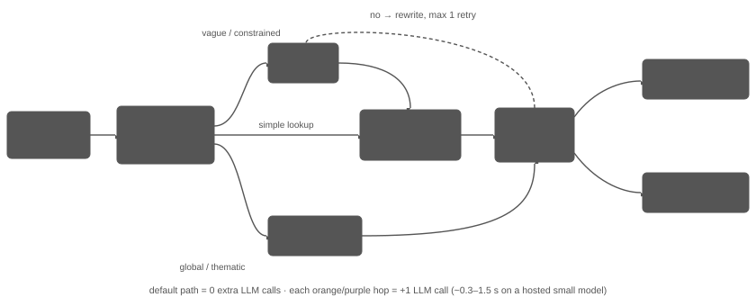

# Day 10 — Advanced RAG

> Part of the [GenAI Architect study path](../../README.md) · Production Retrieval · [Original interactive pack](https://claude.ai/artifact/YPZwhfduVjdgSx5csgT5hE) · [Offline HTML](../../archive/html/day-10.html)


**Day 10 / 30**Week 2 · Production retrievalMon 19 Oct 2026

# Advanced RAG: transform the query , let the system check itself

Query rewriting, HyDE, multi-query, self-query, GraphRAG and agentic / corrective RAG. Each one fixes a specific retrieval failure and each one costs LLM calls. The architect's job is to know which failure you actually have, and to put the expensive path behind a gate.

## Why this matters for the JD

"RAG optimization (chunking, reranking, hybrid, **feedback loops**)" is a Preferred line, and "agentic frameworks (LangChain, LangGraph … planning, guardrails)" is a Must-have. Advanced RAG is where the two meet: the retrieval pipeline stops being a fixed function and becomes a small agent that rewrites, routes, grades and retries. In a review you will be asked to justify every extra LLM hop against **latency/cost** and **hallucination control**.

## Concept brief

Day 9 fixed the *index side* (hybrid + rerank). Today fixes the *query side* and the *control flow*. Group the techniques by the failure they address, not by name:

| Failure you observe | Technique | What it does |
| --- | --- | --- |
| User words ≠ document words ("home wifi" vs "residential broadband") | rewrite multi-query HyDE | Generate better or more queries; HyDE embeds a fake answer so the search is answer-to-answer, not question-to-answer |
| Question carries a constraint ("2023 rules", "only HR") | self-query | LLM extracts a structured metadata filter + semantic text |
| Question needs several facts (multi-hop, comparisons) | decomposition step-back | Split into sub-questions, or ask a more general question first, then merge |
| Question is about the whole corpus ("main themes in 3,000 incident reports") | GraphRAG | Pre-built entity graph + community summaries answer "global" questions that top-k chunks cannot |
| Retrieval sometimes returns junk and the LLM answers anyway | corrective / self-RAG | Grade retrieved chunks; rewrite and retry, fall back to another source, or abstain |
| Mixed traffic: trivial lookups and hard research questions | adaptive / agentic | A router picks no-retrieval, single-shot, or iterative paths per query |



The expensive boxes sit behind a router and a grader. The cheap path stays cheap; escalation is paid for only by the queries that need it. Apply the ACL filter inside the retriever on every path, including retries.

### Query transformations

**Rewrite** (a.k.a. query expansion / condensation) is the one you should always have in a chat product: turn "and what about for contractors?" into a standalone question using conversation history. Without it, follow-up turns retrieve garbage. It is one cheap LLM call and often merges with the router call.

**Multi-query / RAG-Fusion** generates N paraphrases, retrieves for each in parallel, and fuses with RRF (Day 9). It raises recall on vocabulary-mismatch queries at the cost of one generation plus N retrievals. Always keep the original query in the fan-out, or a bad paraphrase set can do worse than baseline. In LangChain 1.x, `MultiQueryRetriever` and `SelfQueryRetriever` now live in the `langchain-classic` package (1.0.8), a signal that the framework expects you to build these patterns in LangGraph instead.

**HyDE** (Gao et al., 2022) asks the LLM to write a hypothetical answer, then embeds that and searches. Questions and answers live in different regions of embedding space; a fake answer lands nearer the real one. It shines zero-shot on prose. It hurts when the LLM's prior is wrong or specific: it invents a number, a product name or an error code, and the search locks onto the invented detail. Treat it as one more list to fuse, not a replacement for the original query.

**Self-query** turns natural language into `{search_text, filter}`. Constrain the output with a JSON schema whose fields are enums of real metadata values, validate it, and fail *open* (drop the filter) if it matches nothing. That is fine for relevance filters. Permission filters are different: they come from the identity token, never from the LLM, and they fail *closed*.

**Decomposition and step-back** (Zheng et al., 2023) handle multi-hop questions: "Compare the 2023 and 2025 business-class rules" becomes two retrievals plus a merge. This is where pipelines turn into plan-and-execute agents (Day 18).

### GraphRAG and its cheaper descendants

Vector RAG answers *local* questions: the answer sits in a few chunks. It fails on *global* questions ("what are the recurring root causes across all P1 incidents this year?") because no top-k slice contains the answer. Microsoft's GraphRAG (Edge et al., 2024) uses an LLM at index time to extract entities and relationships, clusters the graph with Leiden community detection, and pre-writes summaries per community. Global search map-reduces over those summaries; local search walks out from matched entities.

The catch is index cost: every chunk goes through LLM extraction, and updates re-trigger it. **LazyGraphRAG** (Microsoft Research, Nov 2024) defers LLM work to query time, with indexing cost Microsoft reports as equal to vector RAG and about 0.1% of full GraphRAG. **LightRAG** (HKUDS) keeps a graph plus vectors with dual-level (entity / theme) retrieval and incremental inserts, and runs with Ollama. Current versions on PyPI: `graphrag` 3.3.0 (8 Oct 2026, Python 3.11–3.13) and `lightrag-hku` 1.5.7.

### Corrective, self-reflective and agentic RAG

**CRAG** (Yan et al., 2024) adds a lightweight retrieval evaluator that labels results Correct / Ambiguous / Incorrect; Incorrect triggers web search (or another index), Correct triggers a "decompose-then-recompose" filter that strips irrelevant sentences. **Self-RAG** (Asai et al., 2023) trains the generator to emit reflection tokens that decide whether to retrieve and whether its output is supported. **Adaptive-RAG** (Jeong et al., 2024) routes by predicted query complexity. In production, these collapse into one LangGraph pattern: nodes for retrieve / grade / rewrite / generate, a conditional edge on the grade, and a hard iteration budget. LangGraph (1.2.16 today) ships this as its "agentic RAG" tutorial.

**Review trap:** every loop needs a budget (max iterations, max tokens, wall-clock deadline) and a defined terminal state when the budget runs out: abstain with a reason, never "answer anyway". An unbounded grader loop is a latency outage waiting for one bad query.

### Where the managed platforms are

| Platform | Built-in query-side / agentic retrieval |
| --- | --- |
| **watsonx** | No turnkey "advanced RAG" switch: build the graph in LangGraph or watsonx Orchestrate agent flows on Granite models; AutoAI for RAG searches over chunking / retrieval configurations; Milvus in watsonx.data for hybrid + metadata filters |
| **Azure** | AI Search agentic retrieval: an LLM plans sub-queries, runs them in parallel with semantic ranking, and merges; GraphRAG accelerator is a Microsoft open-source project |
| **AWS** | Bedrock Knowledge Bases query modification (decomposition), metadata filters, and GraphRAG backed by Neptune Analytics |
| **GCP** | Vertex AI RAG Engine and Vertex AI Search with query expansion and filters; Agent Builder for agentic flows |

Managed features change quickly; confirm GA status and region availability before you put one in an HLD.

## Trade-offs & decision table

| Technique | Pick when | Failure modes | Cost / latency |
| --- | --- | --- | --- |
| Conversational rewrite | Any multi-turn chat product | Drops a constraint from history; over-specifies; leaks one user's context into a shared cache key | +1 short call; merge with router call |
| Multi-query + RRF | Vocabulary mismatch, short or vague queries; recall is the bottleneck | Paraphrases drift off-topic; dilutes precision for already-good queries; N× retrieval load on the vector DB | +1 call + N parallel retrievals; ~+0.3–1 s |
| HyDE | Zero-shot domains, prose corpora, no labelled data to tune embeddings | Hallucinated specifics steer search; bad for IDs, numbers, recent facts; adds generation latency before retrieval can start | +1 generation (~100–200 tokens) on the critical path |
| Self-query | Rich, reliable metadata (dates, versions, departments, product lines) | Wrong filter silently excludes the answer; invented field values; confusing with ACL filters | +1 structured call; filtered ANN is often faster |
| Decomposition / step-back | Comparisons, multi-hop, "why" questions | Over-decomposes simple questions; sub-answers contradict; merge step hallucinates | +1 plan call + k retrievals + merge |
| GraphRAG (full) | Global, thematic questions over a stable, bounded corpus where the summaries are the product | Index cost and time; stale graph on frequent updates; extraction errors become "facts"; ACLs hard to apply to community summaries that mix documents | LLM call per chunk at index time; global queries map-reduce many summaries |
| LazyGraphRAG / LightRAG | Want graph-style answers without full index cost; corpus changes | Younger code; quality depends heavily on the extraction model; fewer production references | Index ≈ vector RAG (Lazy) or light extraction (LightRAG); more work at query time |
| Corrective (grade → retry → abstain) | High cost of a wrong answer (policy, compliance, finance) | Grader is itself an LLM that can be wrong or biased to "relevant"; loops; p95 explodes without a budget | +1 grading call (batch all k chunks in one call) + optional retry |
| Full agentic RAG | Research-style tasks, multiple tools and sources, users tolerate seconds | Non-deterministic paths, hard to evaluate and debug, tool-use injection surface | Unbounded unless budgeted; 3–20 calls per query |

**Cost math to have ready:** at 100k queries/day, adding one 400-token-in / 80-token-out call to every query adds 48M tokens/day. Gate it so only the ~20–30% of queries with low top-1 rerank score take the transform path, and you pay about a quarter of that. The router and the rerank score threshold from Day 9 are the gates.

## Hands-on: a query-side bake-off on your laptop (60–90 min)

You will run five strategies over a small policy KB with planted traps (vocabulary mismatch, two versions of the travel policy, colloquial phrasing, one out-of-scope question) and compare hit@3, MRR, latency and LLM calls. Everything is local on Ollama: `qwen3:4b` (Q4, ~2.5 GB, fits your RTX 3050 6 GB) and `nomic-embed-text`. No WSL or Docker needed. The code uses plain Python so you can see every LLM hop; stretch goal 1 ports the corrective loop to LangGraph.

### Setup (PowerShell)

**powershell**

```powershell
winget install Ollama.Ollama          # skip if installed; update if think=False errors (old server)
ollama pull qwen3:4b
ollama pull nomic-embed-text
mkdir genai-day10; cd genai-day10
py -3.13 -m venv .venv
.\.venv\Scripts\Activate.ps1          # if blocked: Set-ExecutionPolicy -Scope CurrentUser RemoteSigned
python -m pip install --upgrade pip
python -m pip install "ollama>=0.6.3" "numpy>=2.3" "pydantic>=2.11"
# Save the script below as advanced_rag.py, then:
python advanced_rag.py -v
python advanced_rag.py --only baseline hyde -v     # iterate on one strategy at a time
```

Checked on PyPI today: ollama 0.6.3 (29 Sep 2026), numpy 2.5.4, pydantic 2.13. The script was smoke-tested against a stubbed Ollama client for control flow; retrieval numbers come from your run.

### advanced\_rag.py

**python** · saved as `lab/advanced_rag.py`

```python
"""
Day 10 lab: which query-side RAG technique fixes which failure?
Baseline dense vs multi-query+RRF vs HyDE vs self-query (metadata filter) vs corrective (grade -> rewrite -> abstain).
Runs fully local on Ollama: qwen3:4b (~2.5 GB, fits a 6 GB GPU) + nomic-embed-text.
"""
import argparse, statistics, time
from typing import Literal, Optional

import numpy as np
import ollama
from pydantic import BaseModel

LLM, EMB, K = "qwen3:4b", "nomic-embed-text", 3

# --- 1. A small policy KB with metadata and deliberate traps -----------------------
# Traps: vocabulary mismatch (wifi vs broadband), versioned policies (2023 vs 2025),
# colloquial phrasing (left my laptop in a cab), and one out-of-scope question.
DOCS = [
 {"id": "D01", "dept": "travel",     "year": 2023, "text": "Travel policy 2023: economy class for flights under 6 hours; business class above 6 hours with VP approval. Domestic per diem in India is INR 3,500 per day."},
 {"id": "D02", "dept": "travel",     "year": 2025, "text": "Travel policy 2025 revision: business class only for flights longer than 8 hours. Domestic per diem in India is INR 4,500 per day. Hotels must be booked through Concur."},
 {"id": "D03", "dept": "hr",         "year": 2024, "text": "Remote-work connectivity allowance: employees on hybrid contracts may claim up to INR 1,500 per month towards residential broadband by uploading the ISP invoice."},
 {"id": "D04", "dept": "hr",         "year": 2025, "text": "Parental leave: primary caregivers receive 26 weeks of paid leave; secondary caregivers receive 4 weeks within the first year."},
 {"id": "D05", "dept": "security",   "year": 2025, "text": "Lost or stolen endpoint devices must be reported to the Security Operations Centre within 4 hours through ServiceNow so the device can be remotely wiped."},
 {"id": "D06", "dept": "security",   "year": 2024, "text": "Credential standard: passphrases of at least 14 characters, MFA is mandatory, and periodic rotation is not forced unless a compromise is suspected."},
 {"id": "D07", "dept": "it",         "year": 2025, "text": "Generative AI acceptable use: only approved tools (watsonx.ai, the internal Copilot) may process client material. Client data must never be entered into public chatbots. Prompts are logged for 90 days."},
 {"id": "D08", "dept": "finance",    "year": 2025, "text": "Expense claims must be filed within 30 days of the transaction. Receipts are required above INR 500. Late claims need CFO approval."},
 {"id": "D09", "dept": "hr",         "year": 2025, "text": "Notice period: 60 days for band L5 and above, 30 days below L5. Garden leave is at the manager's discretion."},
 {"id": "D10", "dept": "it",         "year": 2024, "text": "Remote access: the Zscaler client is required when off the corporate network; split tunnelling is disabled for client projects."},
 {"id": "D11", "dept": "facilities", "year": 2025, "text": "Hot-desking: book a desk in the workplace app at least 24 hours ahead; lockers are released every day at 8 pm."},
 {"id": "D12", "dept": "security",   "year": 2025, "text": "Data classification has four levels: Public, Internal, Confidential and Restricted. Restricted data may not leave the India region, in line with the DPDP Act."},
 {"id": "D13", "dept": "hr",         "year": 2023, "text": "Learning budget: up to INR 50,000 per year for professional certifications, subject to a 12-month retention clause."},
 {"id": "D14", "dept": "finance",    "year": 2024, "text": "Corporate cards: personal use is prohibited and statements must be reconciled by the 5th of each month."},
]
TEXT = {d["id"]: d["text"] for d in DOCS}
GOLD = [  # (question, expected doc id or None for out-of-scope)
 ("Can I get reimbursed for my home wifi?", "D03"),
 ("What was the India per diem under the 2023 travel rules?", "D01"),
 ("Under the 2025 travel policy, when can I fly business class?", "D02"),
 ("I left my laptop in a cab, what should I do?", "D05"),
 ("Can I paste a client's contract into ChatGPT?", "D07"),
 ("How long do I have to submit a taxi receipt?", "D08"),
 ("Will the company pay for my AWS certification?", "D13"),
 ("What is on the cafeteria menu on Fridays?", None),
]

# --- 2. Model helpers ----------------------------------------------------------------
CALLS = {"llm": 0}

def embed(texts, kind):
    # nomic-embed-text is asymmetric: it expects task prefixes. Forgetting them costs recall.
    prefix = "search_document: " if kind == "doc" else "search_query: "
    r = ollama.embed(model=EMB, input=[prefix + t for t in texts])
    v = np.asarray(r.embeddings, dtype=np.float32)
    return v / np.linalg.norm(v, axis=1, keepdims=True)

def llm(prompt, schema=None, temperature=0.0):
    """One chat call. With a pydantic schema, Ollama constrains decoding to that JSON schema."""
    CALLS["llm"] += 1
    r = ollama.chat(
        model=LLM,
        messages=[{"role": "user", "content": prompt}],
        format=schema.model_json_schema() if schema else None,
        think=False,                       # qwen3 is a thinking model; we want short, cheap outputs
        options={"temperature": temperature, "num_ctx": 4096},
    )
    out = r.message.content
    return schema.model_validate_json(out) if schema else out.strip()

DOC_VECS = None

def dense(qvec, k=K, allowed=None):
    scores = DOC_VECS @ qvec
    hits = [(DOCS[i]["id"], float(scores[i])) for i in np.argsort(-scores)
            if allowed is None or DOCS[i]["id"] in allowed]
    return hits[:k]

def rrf(lists, k=60):
    fused = {}
    for lst in lists:
        for rank, (doc, _) in enumerate(lst, start=1):
            fused[doc] = fused.get(doc, 0.0) + 1.0 / (k + rank)
    return sorted(fused.items(), key=lambda x: x[1], reverse=True)

# --- 3. Strategies -------------------------------------------------------------------
def baseline(q):
    return dense(embed([q], "query")[0])

class Rewrites(BaseModel):
    queries: list[str]

def multi_query(q, n=3):
    rw = llm(f"Rewrite this employee question as {n} different search queries for a corporate "
             f"policy knowledge base. Use formal policy vocabulary and synonyms.\nQuestion: {q}",
             Rewrites).queries[:n]
    vecs = embed([q] + rw, "query")            # keep the original query in the fan-out
    return rrf([dense(v, k=10) for v in vecs])[:K]

def hyde(q):
    fake = llm(f"Write two sentences from a corporate policy document that would answer: {q}\n"
               f"Invent plausible details. Output only the excerpt.")
    v = embed([fake], "doc")[0]               # it is document-shaped text, so embed it as a document
    return dense(v)

class Filter(BaseModel):
    search_text: str
    dept: Optional[Literal["travel", "hr", "security", "it", "finance", "facilities"]] = None
    year: Optional[int] = None

def self_query(q):
    f = llm("Turn the question into a search query plus an optional metadata filter. "
            "Set 'year' ONLY if the question names a year explicitly. Set 'dept' only if obvious. "
            f"Departments: travel, hr, security, it, finance, facilities.\nQuestion: {q}", Filter)
    allowed = {d["id"] for d in DOCS
               if (f.dept is None or d["dept"] == f.dept) and (f.year is None or d["year"] == f.year)}
    # Relevance filter, not a security filter: fail OPEN if it matches nothing.
    # (An ACL filter must fail CLOSED. Never let an LLM write your ACL filter.)
    return dense(embed([f.search_text], "query")[0], allowed=allowed or None)

class Grade(BaseModel):
    relevant: bool

def corrective(q, retries=1):
    """CRAG-style: retrieve -> grade each chunk -> rewrite and retry -> abstain (empty list)."""
    query = q
    for _ in range(retries + 1):
        hits = baseline(query)
        kept = [(d, s) for d, s in hits
                if llm(f"Does the passage contain information that answers the question? "
                       f"Answer strictly.\nQuestion: {q}\nPassage: {TEXT[d]}", Grade).relevant]
        if kept:
            return kept
        query = llm("A search for this question found nothing relevant. Rewrite it as one keyword-rich "
                    f"search query for a corporate policy knowledge base. Output only the query.\nQuestion: {q}")
    return []

STRATEGIES = {"baseline": baseline, "multi_query": multi_query, "hyde": hyde,
              "self_query": self_query, "corrective": corrective}

# --- 4. Evaluate ---------------------------------------------------------------------
def main():
    global DOC_VECS
    ap = argparse.ArgumentParser()
    ap.add_argument("--only", nargs="*", default=list(STRATEGIES))
    ap.add_argument("-v", "--verbose", action="store_true")
    args = ap.parse_args()

    DOC_VECS = embed([d["text"] for d in DOCS], "doc")
    llm("Say OK.")                                 # warm up: load the model into VRAM
    CALLS["llm"] = 0
    answerable = [g for g in GOLD if g[1]]
    print(f"docs={len(DOCS)} questions={len(GOLD)} (answerable={len(answerable)}) llm={LLM} emb={EMB}\n")
    print(f"{'strategy':<12}{'hit@3':>7}{'MRR':>7}{'p50 s':>8}{'LLM calls':>11}  abstained on OOS?")
    for name in args.only:
        fn = STRATEGIES[name]
        c0, hits, rr, lat, oos = CALLS["llm"], 0, 0.0, [], None
        for q, exp in GOLD:
            t0 = time.perf_counter(); res = fn(q); lat.append(time.perf_counter() - t0)
            ids = [d for d, _ in res]
            if exp is None:
                oos = len(ids) == 0
                continue
            if exp in ids:
                hits += 1; rr += 1 / (ids.index(exp) + 1)
            elif args.verbose:
                print(f"   miss [{name}] {q!r} -> {ids}")
        n = len(answerable)
        print(f"{name:<12}{hits:>4}/{n}{rr / n:>7.2f}{statistics.median(lat):>8.2f}"
              f"{CALLS['llm'] - c0:>11}  {'yes' if oos else 'no'}")

if __name__ == "__main__":
    main()
```

### Expected output

Illustrative shape, not a recorded run. Numbers move with model versions and temperature, and the latency column depends on whether qwen3 is fully on the GPU (check with `ollama ps`).

**text**

```text
docs=14 questions=8 (answerable=7) llm=qwen3:4b emb=nomic-embed-text

strategy      hit@3    MRR   p50 s  LLM calls  abstained on OOS?
   miss [baseline] 'What was the India per diem under the 2023 travel rules?' -> ['D02', 'D08', 'D13']
baseline       ~6/7  ~0.75    0.03          0  no
multi_query    ~7/7  ~0.85    ~1.2          8  no
hyde           ~6/7  ~0.80    ~1.5          8  no
self_query     ~7/7  ~0.90    ~0.9          8  no
corrective     ~6/7  ~0.80    ~2.5        ~26  yes
```

1. Look at which question each strategy rescues. Self-query should fix the 2023-vs-2025 trap; multi-query and HyDE should help "home wifi" and "laptop in a cab".
2. Only `corrective` abstains on the cafeteria question. Every other strategy confidently returns three chunks, and the generator would answer from them. That is the hallucination path from Day 4.
3. Compare LLM calls. Corrective spends ~3 calls per query on grading. Change it to grade all k chunks in one call (return `list[bool]`) and re-measure.
4. Set `temperature=0.7` in `multi_query` and run three times. Note the variance: this is why you need golden-set evals (Day 11) before claiming a gain.

### Stretch goals

1. **Port corrective RAG to LangGraph** (`python -m pip install langgraph`, 1.2.16 today). Make a `StateGraph` with nodes `retrieve`, `grade`, `rewrite`, `abstain`, a conditional edge on the grade, and an `attempts` counter in state. Add an `InMemorySaver` checkpointer and print the state history for the cafeteria question. This previews Day 17.
2. **Router gate.** Run `baseline` first and escalate to `multi_query` or `self_query` only when the top-1 cosine is below a threshold (or the question contains a year). Report hit@3 and total LLM calls versus "always multi-query". This is the ADR below in code.
3. **Optional, slower: LightRAG on the same 14 docs** (`python -m pip install lightrag-hku`, 1.5.7) with its Ollama bindings, then ask a global question ("Which policies impose time limits, and what are they?"). Time the indexing step and count LLM calls. Expect weak entity extraction from a 4B model; a free-tier hosted model gives a fairer picture.

## GitHub repos to study

[microsoft/graphrag](https://github.com/microsoft/graphrag)

Read the indexing pipeline config (entity extraction, community reports) and the query side's local vs global search. Note what each indexing step costs in LLM calls before you propose it.

graphrag 3.3.0 on PyPI · 8 Oct 2026

[HKUDS/LightRAG](https://github.com/HKUDS/LightRAG)

Study the query modes (local, global, hybrid, mix) and the incremental insert path. Compare its storage abstraction (KV, vector, graph backends) with GraphRAG's batch model.

lightrag-hku 1.5.7 on PyPI · Sep 2026

[langchain-ai/langgraph](https://github.com/langchain-ai/langgraph)

Find the agentic and corrective RAG examples and trace how the grade decision becomes a conditional edge. This is the production-shaped version of today's `corrective()`.

langgraph 1.2.16 on PyPI · 16 Oct 2026

[NirDiamant/RAG\_Techniques](https://github.com/NirDiamant/RAG_Techniques)

A notebook per technique (HyDE, query transformations, CRAG, Self-RAG, adaptive retrieval, GraphRAG). Use it as a catalogue; skim the CRAG and adaptive-retrieval notebooks against today's table.

Notebook collection, actively updated

## Read / watch

- Paper · 30 min  
  [Yan et al., Corrective Retrieval Augmented Generation (CRAG)](https://arxiv.org/abs/2401.15884)  
  Read the evaluator design and the three-way Correct / Ambiguous / Incorrect action. Then skim [HyDE (Gao et al.)](https://arxiv.org/abs/2212.10496) for the zero-shot argument.
- Engineering blog · 15 min  
  [Microsoft Research: LazyGraphRAG, setting a new standard for quality and cost](https://www.microsoft.com/en-us/research/blog/lazygraphrag-setting-a-new-standard-for-quality-and-cost/)  
  The cost argument against full GraphRAG, from its own authors, and how deferring LLM work to query time changes the trade-off. Background: the [GraphRAG paper](https://arxiv.org/abs/2404.16130).
- Official docs · 30 min  
  [LangGraph: Build a custom RAG agent](https://docs.langchain.com/oss/python/langgraph/agentic-rag)  
  Retrieve, grade, rewrite and generate as a graph. Use it as the reference for stretch goal 1.

## Interview questions

**When does HyDE help, and when would you refuse to use it?**

It helps on prose corpora where queries are short and phrased very differently from documents, especially zero-shot with a general embedding model: the hypothetical answer moves the query vector into "answer space". It is the cheapest fix when you cannot fine-tune embeddings.

I would not use it as the only query for identifier- or number-heavy corpora, for questions about recent events the LLM has no prior on, or on a tight latency budget, since the generation sits on the critical path before retrieval starts. If used, fuse the HyDE list with the original-query list via RRF and keep BM25 in the mix, so an invented detail cannot dominate.

**Self-query generates metadata filters with an LLM. What could go wrong, and how do you design it safely?**

Three failures: it invents field values that do not exist, it applies a constraint the user did not state (for example assuming the current year), and it excludes the answer silently. Mitigate with a JSON schema whose fields are enums of real values, constrained decoding, validation, an explicit rule to set a field only when stated, and fail-open on zero results with that event logged.

The design point that matters most: relevance filters and permission filters are different things. ACL and tenant filters come from the authenticated identity and are applied by the retrieval service, fail closed, and are never generated or modified by the model. Otherwise a prompt injection turns into a data-access bypass.

**A stakeholder wants GraphRAG because "graphs are more accurate". How do you respond?**

Ask what questions users actually ask. GraphRAG's advantage is on global, sensemaking questions across a corpus; for local fact lookups, hybrid + rerank is usually as good and much cheaper. Sample production or pilot queries and label them local vs global. If global questions are a small share, serve them with a separate, scoped path.

Then put cost and operations on the table: LLM extraction for every chunk at index time, re-indexing on updates, extraction errors that become graph "facts", and ACL problems because community summaries blend documents with different permissions. Offer LazyGraphRAG or LightRAG as a pilot on one bounded corpus with a golden set, and decide on measured answer quality per query type.

**How do you keep a corrective / agentic RAG loop inside a p95 latency SLO?**

Put the cheap path first and gate escalation on a signal (reranker score, grader verdict, router class), so most queries never loop. Give every loop a budget: max one retry, a token cap and a wall-clock deadline, and define what happens when it is exhausted: abstain with a reason or hand off. Batch grading of all k chunks into one call, run independent retrievals in parallel, and use a small, fast model for routing and grading while the large model only generates.

Stream a status to the user while the loop runs and trace each node (Day 27) so you can see which step eats the budget. Report p95 per path, not one blended number.

**Multi-query raised recall@10 by 8 points offline but answer faithfulness dropped. Explain and fix.**

More paraphrases pull in more loosely related chunks. Recall goes up, but precision of the final context drops, and the generator mixes distractors into the answer. Paraphrase drift can also shift the topic (a "2023 travel" question paraphrased without the year retrieves 2025 rules).

Fix: rerank the fused list with a cross-encoder against the *original* question, keep final k small, include the original query in the fan-out, constrain paraphrases to keep entities and constraints, and gate multi-query to low-confidence queries only. Re-measure end-to-end faithfulness and context precision, not just retrieval recall.

## Architect's lens: ADR

**ADR-010 · Query transformation and corrective-retrieval policy for the enterprise knowledge assistant** · Accepted

Context
:   Builds on ADR-009 (hybrid + self-hosted rerank). Pilot logs show ~25% of failed answers come from vocabulary mismatch or versioned documents, and ~5% of questions are out of scope but still get answered. Budget: p95 end-to-end ≤ 4 s, median cost per query must not double. A small set of leadership users asks thematic questions over incident reports.

Options
:   (A) Keep single-shot hybrid + rerank. (B) Always run multi-query + HyDE + grading. (C) Gated: conversational rewrite always; self-query when the question names a version, date or department; multi-query only when top-1 rerank score is below threshold; one batched grading call; max one retry, then abstain. (D) Full agentic RAG with tool choice. (E) GraphRAG over the whole corpus.

Decision
:   **C** for the main assistant, built as a LangGraph graph with a hard budget. A separate, opt-in "insights" path uses LazyGraphRAG/LightRAG over the incident-report corpus only, which has a single permission level.

Rationale
:   On the golden set, C recovers most of B's gain on mismatch and version questions while about 70% of queries take the zero-extra-call path, so median latency and cost barely move. Abstention on out-of-scope questions comes from the grader + budget. B doubles cost for every query; D failed p95 and is hard to evaluate; E has unacceptable index cost and ACL blending across the whole corpus.

Consequences
:   Router threshold and grader prompt become versioned artefacts under the eval gate (Day 26). We must monitor escalation rate and abstention rate as SLIs; a jump in either signals drift or an index problem. Self-query field enums must be regenerated when metadata taxonomies change. Revisit if escalation rate exceeds 40% or abstention exceeds 10% for two weeks.

**Tomorrow · Day 11**RAG evaluation: RAGAS / DeepEval / TruLens, faithfulness, context precision and recall, golden sets, and LLM-as-judge pitfalls.

Prepared for Rahul Bhave · GenAI Architect 30-day plan · library versions checked on PyPI on 19 Oct 2026.

## Lab files in this folder

- [`lab/advanced_rag.py`](lab/advanced_rag.py)
