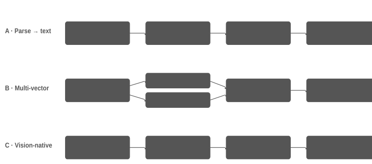

# Day 12 — Multimodal RAG

> Part of the [GenAI Architect study path](../../README.md) · Production Retrieval · [Original interactive pack](https://claude.ai/artifact/2NUkUH2Kw6L9qoh6HeyhSx) · [Offline HTML](../../archive/html/day-12.html)


Week 2 · Production retrieval · Day 12 of 30

# Multimodal RAG: tables, figures and scanned pages

Most enterprise answers sit in a table cell, a chart or a scanned annex, and plain-text extraction loses them. Today you design ingestion that keeps structure and test it against a naive baseline on your own laptop.

Wed 21 Oct 2026
docling 2.141 · docling-core 2.103
colpali-engine 0.3.18
ollama-python 0.6.3

## Why this matters for the JD

The JD's headline use cases are **document Q&A, knowledge assistants and search**, and enterprise documents are PDFs with tables, charts and scans. The "Preferred" line on **RAG optimization (chunking…)** and the must-have on **evaluation (groundedness, faithfulness)** both break first on non-text content. The **multi-provider** line now includes vision models (GPT/Claude/Gemini vision, Granite Vision, Qwen-VL). Expect a design-review question like "your bot can't answer from the rate table on page 14. Why, and what do you change?"

## Concept brief

A multimodal RAG system has two design problems, and people tend to merge them. The first is representation: what you index for each element (a text chunk, a table, a figure, a whole page image). The second is generation input: what the answering model actually sees (the same text, the raw table HTML, or the original pixels). There are three architectures in use, plus hybrids of them.



### A. Parse to text (the "textify" baseline done properly)

A layout model segments each page into typed regions (title, paragraph, table, figure, caption, header and footer). OCR runs only where there is no text layer. A table-structure model (TableFormer in Docling) rebuilds rows and columns. Figures get a VLM caption. The output is Markdown or HTML that keeps reading order and headings, and that feeds the structure-aware chunking from Day 6. This covers most of the value at the lowest index cost. It fails on charts, where the caption is lossy, and on any layout the parser misreads.

### B. Multi-vector: index a proxy, generate from the original

Each element gets a *retrieval representation*, such as an LLM summary of a table ("quarterly premium rates by age band; highest is…") or a VLM description of a chart. The *raw element* goes into a doc store under the same id. At query time you match on the summary and pass the raw table HTML, or the image itself, to the generator. The summary is phrased the way people ask questions. The raw element keeps the exact numbers. This is the LangChain `MultiVectorRetriever` pattern, and it is what today's lab builds.

### C. Vision-native retrieval (ColPali family)

Render every page as an image and embed it with a VLM retriever. ColPali, ColQwen and ColSmol produce one vector per image patch, roughly 1,030 × 128-dim vectors per page, and score queries with ColBERT-style **MaxSim**. No parsing is needed, and it does very well on slide decks, infographics and forms. The costs are architectural.

- **Index size:** 1,030 × 128 × 4 B ≈ **527 KB per page** in float32, against about 3 KB for one 768-d dense vector. At 1M pages that is about 527 GB. Binary quantization brings it to about 16 KB per page, and pooling or a dense first-stage retriever cuts it further.
- **Infra:** you need multi-vector / late-interaction support (Vespa, Qdrant multivector, Milvus, Weaviate multi-vector, or brute force for small corpora).
- **No text:** without text you get no BM25 leg for hybrid search (Day 9), no exact-quote citations, and no text-level PII redaction or field-level ACL. Production systems usually run C alongside A or B rather than instead of them.

### What breaks in practice

- **Tables split by chunking**, so headers get separated from values. Treat each table as an atomic element. For very large tables, chunk by row groups and repeat the header in every chunk.
- **VLMs inventing chart numbers.** A 2B vision model will confidently read "42%" off a bar it cannot resolve. Mark figure-derived facts as approximate, give the original image to the generator for numeric questions, and include chart questions in the golden set.
- **Reading order** on multi-column pages, rotated scans, and footnotes or running headers that pollute every chunk.
- **Tables spanning pages** and merged header cells. Check how your parser stitches them before you trust aggregate answers.
- **Aggregate questions** ("total exposure across all regions") are not retrieval problems. Route them to SQL over extracted tables (text-to-SQL), not to top-k chunks.
- **Parser drift.** A parser upgrade changes chunk boundaries and ids. Store `parser_version` in metadata and treat re-parsing as a planned, evaluated migration.

**Platform map.** Self-hosted: Docling (IBM Research, now LF AI & Data), Unstructured, MinerU, Granite-Docling-258M as an end-to-end page→DocTags VLM. watsonx: Docling and Granite Vision are IBM's own stack, and the watsonx.ai text-extraction service covers managed parsing. Azure: AI Document Intelligence (layout model) feeding AI Search. AWS: Textract and Bedrock Data Automation / Knowledge Bases advanced parsing. GCP: Document AI layout parser feeding Vertex AI RAG Engine or Vector Search.

**Provenance is a feature.** Docling keeps a page number and bounding box for every element. Store them, and the UI can highlight the exact table cell region behind a citation, which compliance reviewers value more than a slightly better retrieval score.

## Trade-offs & decision table

| Option | Pick when | Failure modes | Cost / latency |
| --- | --- | --- | --- |
| **Naive text extraction**pypdf / PyMuPDF | Born-digital prose (policies, contracts) with few tables; prototypes | Tables flattened into number soup; figures and scans invisible; headers and footers mixed into chunks | lowest ms per page, CPU only |
| **Layout-aware parser**Docling, Unstructured `hi_res`, MinerU | Default for mixed enterprise PDFs; self-hosted or data-residency constraints | Misread complex tables; OCR quality on poor scans and Indic scripts; parser upgrades change output | medium about 0.5–3 s per page on CPU, much faster on GPU; model downloads |
| **Managed document AI**Azure DI, Textract, Document AI, watsonx.ai text extraction | You are on that cloud already, need SLAs, forms and key-value extraction, and the scale does not justify running GPUs | Per-page pricing at scale; region availability; lock-in on output schema | per-page fee async APIs, seconds per page |
| **Multi-vector + VLM generation**summary indexed, raw passed | Tables and charts carry the answers (finance, insurance, engineering specs) | Summary misses what users ask; ingestion LLM cost; two stores to keep in sync | ingest-heavy one LLM/VLM call per table or figure at ingest; generation sees more tokens |
| **Vision-native**ColPali / ColQwen / ColSmol | Slides, infographics, forms, scans where parsing fails; small to medium corpora | Huge index; no BM25, no exact quotes; page-level granularity only; harder ACL and PII control | index-heavy about 0.5 MB per page in float32; GPU to embed; VLM at answer time |
| **End-to-end VLM parser**Granite-Docling-258M, VLM pipelines | Complex layouts (equations, code, nested tables) where the classic pipeline struggles | Generative output can hallucinate or loop; slower; needs a GPU in practice | GPU seconds per page; small model, so it fits laptop-class GPUs |

**Ingestion cost model to quote in a review:** `pages × (parse_s/page) / GPU_workers` for throughput, plus `(tables + figures) × (img_tokens + out_tokens) × price` for captioning. A 100k-page corpus averaging 1.5 figures and 0.8 tables per page means about 230k model calls at ingest. Price that before you choose B, and cache by content hash so a re-ingest does not pay twice.

## Hands-on lab · 75 min

**Goal:** ingest a real technical PDF (the Docling technical report, which contains a runtime table and pipeline figures) into a *typed, multi-vector* index. Text chunks use Docling's HybridChunker, tables are indexed by LLM summary and answered from raw Markdown, and figures are described by Granite Vision. Then compare retrieval against a naive pypdf baseline. Everything runs locally through Ollama, with no API keys.

**Fits your laptop:** granite3.2-vision (2.4 GB) and granite3.3:2b each fit in 6 GB VRAM, and Ollama swaps them as needed. Docling runs on CPU by default on Windows, which is fine for a 9-page PDF. No WSL2 or Docker needed.

### Setup (PowerShell)

**powershell**

```powershell
mkdir day12-mmrag; cd day12-mmrag
py -3.13 -m venv .venv
.\.venv\Scripts\Activate.ps1
python -m pip install -U pip
python -m pip install docling pypdf ollama numpy

# Ollama for Windows must be running (tray icon). Pull the three models:
ollama pull nomic-embed-text
ollama pull granite3.2-vision
ollama pull granite3.3:2b

# Sample PDF: Docling Technical Report (arXiv 2408.09869)
Invoke-WebRequest https://arxiv.org/pdf/2408.09869 -OutFile docling_report.pdf

# Optional: silence the Hugging Face symlink warning on Windows
$env:HF_HUB_DISABLE_SYMLINKS_WARNING = "1"
```

On first run Docling downloads its layout and TableFormer weights from Hugging Face (a few hundred MB). For GPU parsing later, install a CUDA build of torch using the selector on pytorch.org. It is optional today.

### Starter code: mmrag.py

**python** · saved as `lab/mmrag.py`

```python
"""
Day 12 - Multimodal RAG on a laptop (Docling + Ollama, no cloud keys).

  py mmrag.py ingest docling_report.pdf      # parse -> elements -> embeddings
  py mmrag.py ask "your question"            # retrieve + grounded answer
  py mmrag.py compare                        # structured vs naive-text retrieval on QUESTIONS

Models (Ollama): nomic-embed-text (embeddings), granite3.2-vision (figures),
granite3.3:2b (table summaries + answers). Swap via env vars below.
"""
import json, os, sys, time
from pathlib import Path

import numpy as np
import ollama

EMBED = os.getenv("EMBED_MODEL", "nomic-embed-text")
VISION = os.getenv("VISION_MODEL", "granite3.2-vision")
LLM = os.getenv("LLM_MODEL", "granite3.3:2b")
OUT = Path("mm_index"); OUT.mkdir(exist_ok=True)
FIG_DIR = OUT / "figures"; FIG_DIR.mkdir(exist_ok=True)

# Edit these after looking at your PDF: mix text, table and figure questions.
QUESTIONS = [
    "Which hardware/thread configuration gave the fastest pages-per-second, and what was it?",
    "What does the architecture figure show about the processing pipeline stages?",
    "Which models does Docling use for layout analysis and table structure?",
]

# ---------- embeddings ----------
def embed(texts, kind):
    # nomic-embed-text is trained with task prefixes; skipping them costs recall.
    prefix = "search_document: " if kind == "doc" else "search_query: "
    vecs = []
    for i in range(0, len(texts), 32):
        r = ollama.embed(model=EMBED, input=[prefix + t for t in texts[i:i + 32]])
        vecs.extend(r.embeddings)
    m = np.asarray(vecs, dtype=np.float32)
    return m / np.linalg.norm(m, axis=1, keepdims=True)

def llm(prompt, model=LLM, images=None):
    msg = {"role": "user", "content": prompt}
    if images:
        msg["images"] = images
    r = ollama.chat(model=model, messages=[msg], options={"temperature": 0})
    return r.message.content.strip()

# ---------- ingest: one record per *element*, typed ----------
def ingest(pdf):
    from docling.document_converter import DocumentConverter, PdfFormatOption
    from docling.datamodel.base_models import InputFormat
    from docling.datamodel.pipeline_options import PdfPipelineOptions
    from docling.chunking import HybridChunker

    opts = PdfPipelineOptions()
    opts.do_table_structure = True          # TableFormer -> real rows/cols
    opts.generate_picture_images = True     # keep figure crops for the VLM
    opts.images_scale = 2.0                 # ~144 dpi crops; VLMs need pixels
    conv = DocumentConverter(format_options={InputFormat.PDF: PdfFormatOption(pipeline_options=opts)})

    t0 = time.perf_counter()
    doc = conv.convert(pdf).document
    print(f"[parse] {pdf}: {len(doc.texts)} text items, {len(doc.tables)} tables, "
          f"{len(doc.pictures)} pictures in {time.perf_counter()-t0:.1f}s")
    (OUT / "doc.md").write_text(doc.export_to_markdown(), encoding="utf-8")

    records = []  # {id, type, page, embed_text, payload}

    # 1) text: structure-aware chunks (headings carried into each chunk)
    chunker = HybridChunker()
    for i, ch in enumerate(chunker.chunk(dl_doc=doc)):
        items = ch.meta.doc_items or []
        if items and all(it.label.value in ("table", "picture") for it in items):
            continue  # tables/figures get their own records below
        page = items[0].prov[0].page_no if items and items[0].prov else None
        ctx = chunker.contextualize(chunk=ch)  # "Heading > Subheading\ntext"
        records.append(dict(id=f"txt{i}", type="text", page=page, embed_text=ctx, payload=ctx))

    # 2) tables: embed a summary, generate from the raw markdown (multi-vector pattern)
    for i, tbl in enumerate(doc.tables):
        md = tbl.export_to_markdown(doc=doc)
        cap = tbl.caption_text(doc) or ""
        page = tbl.prov[0].page_no if tbl.prov else None
        summary = llm(
            "Summarise this table for search indexing in 3 sentences. Name the columns, "
            "what each row represents, and the most notable values.\n"
            f"Caption: {cap}\n\n{md[:6000]}")
        records.append(dict(id=f"tbl{i}", type="table", page=page,
                            embed_text=f"Table. {cap}\n{summary}", payload=f"{cap}\n{md}"))
        print(f"[table] tbl{i} p{page}: {summary[:90]}...")

    # 3) figures: VLM description becomes the searchable text
    for i, pic in enumerate(doc.pictures):
        img = pic.get_image(doc)
        if img is None or min(img.size) < 64:
            continue  # skip logos / icons
        path = FIG_DIR / f"fig{i}.png"; img.save(path)
        cap = pic.caption_text(doc) or ""
        desc = llm(
            "Describe this figure from a technical document for a search index. "
            "State the figure type, the components or axes, and any text or numbers you can read. "
            f"Caption (may be empty): {cap}", model=VISION, images=[str(path)])
        page = pic.prov[0].page_no if pic.prov else None
        records.append(dict(id=f"fig{i}", type="figure", page=page,
                            embed_text=f"Figure. {cap}\n{desc}", payload=f"{cap}\n{desc}", image=str(path)))
        print(f"[figure] fig{i} p{page}: {desc[:90]}...")

    E = embed([r["embed_text"] for r in records], "doc")
    np.save(OUT / "vectors.npy", E)
    (OUT / "records.json").write_text(json.dumps(records, indent=1), encoding="utf-8")

    # naive baseline: plain text per page, fixed 1200-char windows (no tables, no figures)
    from pypdf import PdfReader
    naive = []
    for pno, page in enumerate(PdfReader(pdf).pages, start=1):
        t = page.extract_text() or ""
        naive += [dict(id=f"naive{pno}_{j}", type="text", page=pno, embed_text=t[j:j+1200], payload=t[j:j+1200])
                  for j in range(0, len(t), 1000) if t[j:j+1200].strip()]
    np.save(OUT / "naive_vectors.npy", embed([r["embed_text"] for r in naive], "doc"))
    (OUT / "naive_records.json").write_text(json.dumps(naive), encoding="utf-8")
    counts = {t: sum(r["type"] == t for r in records) for t in ("text", "table", "figure")}
    print(f"[index] structured={counts}  naive={len(naive)} chunks  -> {OUT}/")

# ---------- retrieve + answer ----------
def load(prefix=""):
    recs = json.loads((OUT / f"{prefix}records.json").read_text(encoding="utf-8"))
    return recs, np.load(OUT / f"{prefix}vectors.npy")

def retrieve(q, recs, E, k=4):
    s = E @ embed([q], "query")[0]
    idx = np.argsort(-s)[:k]
    return [(recs[i], float(s[i])) for i in idx]

def ask(q, k=4):
    recs, E = load()
    hits = retrieve(q, recs, E, k)
    ctx = "\n\n".join(f"[{r['id']} | {r['type']} | p.{r['page']}]\n{r['payload'][:2500]}" for r, _ in hits)
    ans = llm(
        "Answer using ONLY the sources below. Cite source ids in square brackets after each claim. "
        "If the sources do not contain the answer, reply exactly: NOT IN SOURCES.\n\n"
        f"{ctx}\n\nQuestion: {q}")
    for r, s in hits:
        print(f"  {s:.3f}  {r['id']:<7} {r['type']:<6} p.{r['page']}")
    print("\n" + ans)

def compare():
    S = load(); N = load("naive_")
    for q in QUESTIONS:
        print(f"\nQ: {q}")
        for name, (recs, E) in (("structured", S), ("naive", N)):
            hits = retrieve(q, recs, E, 4)
            print(f"  {name:<10} " + "  ".join(f"{r['id']}(p{r['page']},{s:.2f})" for r, s in hits))

if __name__ == "__main__":
    cmd = sys.argv[1] if len(sys.argv) > 1 else ""
    if cmd == "ingest": ingest(sys.argv[2])
    elif cmd == "ask": ask(" ".join(sys.argv[2:]))
    elif cmd == "compare": compare()
    else: print(__doc__)
```

### Run it

**powershell**

```powershell
python mmrag.py ingest docling_report.pdf
python mmrag.py compare
python mmrag.py ask "On which hardware and thread count did Docling process the most pages per second?"
python mmrag.py ask "What is the capital of France?"   # should answer NOT IN SOURCES
```

### Expected output (shape; your counts and scores will differ)

**output**

```text
[parse] docling_report.pdf: ~300 text items, 2+ tables, 3+ pictures in 40-120s (CPU)
[table] tbl0 p.N: The table reports Docling runtime on two systems (e.g. an Apple laptop and
        an x86 server) with 4 and 16 threads; columns include ... pages/s ...
[figure] fig0 p.1: The figure is a diagram of the Docling processing pipeline: a PDF is
        parsed, passed through layout analysis and table structure models, ...
[index] structured={'text': 2x, 'table': 2, 'figure': 3}  naive=4x chunks  -> mm_index/

> python mmrag.py compare
Q: Which hardware/thread configuration gave the fastest pages-per-second, and what was it?
  structured tbl0(pN,0.7x)  txt1x(pN,0.6x)  ...
  naive      naiveN_0(pN,0.6x)  naiveM_1(pM,0.5x)  ...   # page text, table flattened

> python mmrag.py ask "On which hardware and thread count ... most pages per second?"
  0.7xx  tbl0    table  p.N
  ...
The fastest configuration was <system> with 16 threads at <n> pages/s [tbl0].
```

### What to observe and write down (10 min)

1. Open `mm_index/doc.md` and compare its runtime table with what pypdf produced. Is the table still a grid?
2. For the table question, does *structured* rank `tbl*` first while *naive* returns page-level text with the numbers out of order?
3. Read every figure description in `records.json`. Mark each number the VLM "read" as correct, wrong or invented. That count is your figure-hallucination rate.
4. Check the abstention: the off-topic question must return `NOT IN SOURCES`.

### Stretch goals

1. **Vision-native leg.** `python -m pip install colpali-engine`, render pages with `pypdfium2` (already installed with Docling, so no Poppler needed on Windows), embed them with `vidore/colSmol-256M` (small enough for 6 GB; colqwen2 is tight), and score with the processor's MaxSim. Report top-1 page accuracy against the structured index on the same questions, plus the per-page index size in KB.
2. **Modality-stratified eval.** Write 12 golden questions (4 text, 4 table, 4 figure), each with the expected element id or page. Compute hit@1 and hit@4 per modality for structured and naive. Then switch figure captioning to `qwen2.5vl:3b` and see whether the figure row moves. This table is the artefact you would show in a design review.

## GitHub repos to study

[docling-project/docling](https://github.com/docling-project/docling) · ~69k ★ · MIT · PyPI release 20 Oct 2026  
Read `docling/pipeline/` (standard vs VLM pipeline) and `docling/models/` to see where layout, OCR, TableFormer and picture description plug in. The examples folder has the chunking and picture-description recipes.

[Unstructured-IO/unstructured](https://github.com/Unstructured-IO/unstructured) · ~15k ★ · Apache-2.0 · PyPI release 20 Oct 2026  
Compare the `partition_pdf` strategies (`fast`, `hi_res`, `ocr_only`, `auto`) and its element types against Docling's model. Note that it requires Python below 3.14, and `hi_res` needs Poppler and Tesseract (easiest under WSL2 on Windows).

[illuin-tech/colpali](https://github.com/illuin-tech/colpali) · ~2.7k ★ · MIT · colpali-engine 0.3.18 (Aug 2026)  
The reference implementation for ColPali, ColQwen and ColSmol. Look at the processors' `score_multi_vector` (MaxSim) and the token-pooling utilities that reduce index size.

[HKUDS/RAG-Anything](https://github.com/HKUDS/RAG-Anything) · ~23k ★ · MIT · active in 2026  
An end-to-end multimodal RAG framework built on LightRAG, with MinerU or Docling parsing. Study how it builds a knowledge graph across text, tables, images and equations, and where that adds ingest cost.

## Read / watch

- [ColPali: Efficient Document Retrieval with Vision Language Models](https://arxiv.org/abs/2407.01449) (Faysse et al., ICLR 2025). Read sections 3–4 for the late-interaction design and the ViDoRe benchmark, and the latency comparison against parse-then-embed pipelines.
- [Docling Technical Report](https://arxiv.org/abs/2408.09869) (IBM Research). It is short, and it is also the PDF you ingest today. Read the architecture and the runtime table before you run the lab.
- [IBM tutorial: multimodal RAG with Docling and Granite](https://www.ibm.com/think/tutorials/build-multimodal-rag-langchain-with-docling-granite). The watsonx-flavoured version of today's lab with LangChain, which you can reuse for an IBM CoE demo. Pair it with Docling's [picture-description example](https://docling-project.github.io/docling/examples/pictures_description/).

## Interview questions

**An insurer's bot answers prose questions well but fails on premium tables. How do you redesign ingestion?**

Diagnose first: look at the chunks. Usually the table was flattened or split away from its header. Fix it in layers.

- Use a layout-aware parser with table structure (Docling/TableFormer, Azure DI layout).
- Make each table an atomic element with its caption and section heading. For large tables, use row-group chunks that repeat the header.
- Index an LLM summary phrased the way users ask, and generate from the raw HTML.
- Route aggregate or computed questions to SQL over the extracted tables.
- Prove it with a golden set stratified by modality, reporting table hit@k and exact-match on numbers.

**When would you choose ColPali-style retrieval over parse-then-embed, and what would you warn the client about?**

Choose it for visually dense corpora where parsing loses meaning (slide decks, infographics, forms, poor scans) and moderate page counts. Warn about four things.

- Index size is about 0.5 MB per page in float32 (16 KB binarized), so 1M pages is hundreds of GB.
- It needs late-interaction support in the vector DB.
- Granularity is the page, so citations are coarse.
- With no text there is no BM25 leg, no quote-level grounding and no text-level PII redaction.

My default is hybrid: a parsed text index for precision and governance, plus a ColPali index for the visual subset, fused with RRF.

**Your VLM captions charts with confident but wrong numbers. What controls do you put in place?**

- Prompt captions to describe structure and trends, and to quote only numbers printed on the chart.
- Tag figure-derived records as approximate in metadata.
- For numeric questions, give the generator the original image, or better the underlying data if a source table exists, rather than the caption.
- Prefer the source spreadsheet or table when the chart has one.
- Add chart questions to the golden set and track a figure-hallucination rate.
- Let the answer abstain or say "approximately" when the only evidence is a figure.

**Design ingestion for 2M scanned and born-digital pages a month. What are the NFRs and the architecture?**

- Event-driven: object-store upload → queue → stateless parser workers on a GPU node pool with autoscaling (KEDA on queue depth).
- Detect a text layer and OCR only the pages without one.
- Use a content-hash for idempotency and a dead-letter queue for poison documents.
- Store the parser and model version on every element.
- Throughput: about 2M ÷ 22 working days ÷ 8 h ≈ 3 pages/s sustained. Size workers for the peak, not the average.
- Track cost per page as a metric, and keep data residency by self-hosting the parser in-region.

**How do you evaluate a multimodal RAG system?**

- Evaluate at three layers.
- **Parse quality:** TEDS for table structure, CER/WER for OCR on a sampled set, and reading-order spot checks.
- **Retrieval:** hit@k and context recall per modality (text, table, figure, scan). A single averaged score hides a broken table path.
- **Generation:** faithfulness and answer correctness, with exact-match for numeric answers.
- Run the suite as a regression gate on every parser, embedding or VLM upgrade, because a parser upgrade is a data migration.

## Architect's lens: ADR-012

Title
:   Ingestion representation for a regulated BFSI document assistant (policies, rate tables, scanned annexures)

Context
:   About 400k pages, about 30% of answer-bearing content in tables, about 10% scanned. India data residency (DPDP), citations required for auditors, existing watsonx.ai tenancy, and a 3-person platform team.

Options
:   (1) pypdf text only. (2) Docling layout parse + table summaries + VLM figure captions (multi-vector). (3) ColQwen page-image retrieval only. (4) Managed cloud document AI.

Decision
:   Option 2, self-hosted in-region on the existing OpenShift GPU pool. Tables are atomic elements and aggregate queries route to SQL. Option 3 runs as a secondary index only for the slide-deck collection, fused with RRF.

Why not
:   (1) fails the table questions in the pilot golden set. (3) alone gives page-level citations, has no BM25 and adds about 200 GB of index. (4) is blocked by residency for some documents and raises per-page cost at re-ingest.

Consequences
:   GPU capacity is needed at ingest. Parser and model versions are pinned and recorded per element, and upgrades go through a re-parse plus an evaluation gate. Captioning cost is budgeted and cached by content hash. The golden set is stratified by modality and owned by the business SME.

## Tomorrow

Day 13: Feedback loops and continuous RAG improvement, plus latency and cost optimisation (semantic caching, prompt caching).

## Lab files in this folder

- [`lab/mmrag.py`](lab/mmrag.py)
