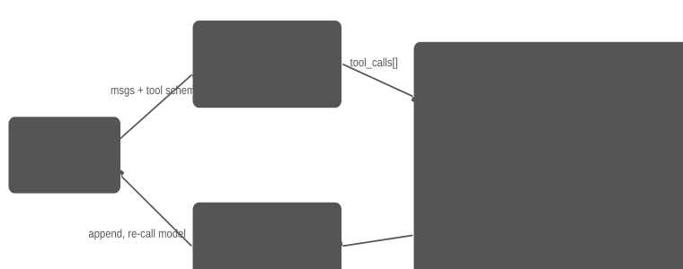

# Day 16 — Tool Calling

> Part of the [GenAI Architect study path](../../README.md) · Agentic Systems · [Original interactive pack](https://claude.ai/artifact/NBH2tEK6ieqiwZBhcxW7b3) · [Offline HTML](../../archive/html/day-16.html)


Week 3 · Agentic systems · Day 16 of 30 · Sun 25 Oct 2026

# Tool & function calling across providers

The model only *proposes* a call. Your executor decides whether it runs, how it runs, and what the model sees back. That executor is where architecture lives: validation, parallelism, retries, approvals, budgets, and one tool contract that survives a provider switch.

OpenAI ResponsesAnthropic MessagesGeminiOllama · qwen3:4b~75 min exercise

## Why this matters for the JD

The JD's **agentic frameworks** line lists "tool calling, memory, planning, multi-agent, guardrails", and **multi-provider LLM integration (OpenAI/Azure OpenAI/Anthropic/Gemini/open-source)** is a preferred skill. Tool calling is where both meet: it is the mechanism behind copilots and workflow automation, and the place where provider APIs differ most. Expect a reviewer to ask "what happens when the model calls the refund tool twice?"

## Concept brief

### The loop, and who owns what



The model never executes anything. Everything in the amber box is yours, and every guarantee you make in a design review lives there.

### Same idea, four wire formats

| Concern | OpenAI Responses | Anthropic Messages | Gemini | Ollama / open models |
| --- | --- | --- | --- | --- |
| Tool def | `{type:"function", name, description, parameters, strict}` | `{name, description, input_schema, strict}` | function declaration: `name, description, parameters` | chat-completions style `{type:"function", function:{…}}`; or pass a Python function |
| Call item | `function_call` with `call_id`; `arguments` is a JSON *string* | `tool_use` block with `id`; `input` is an object | `function_call` with `id` + args object | `message.tool_calls[].function` {name, arguments} |
| Return result | `function_call_output` + `call_id` | `tool_result` + `tool_use_id`, all in **one** user message, before any text; `is_error` | function result keyed by the call `id` | `{role:"tool", tool_name, content}` |
| Parallel control | `parallel_tool_calls` | `tool_choice.disable_parallel_tool_use` | parallel + compositional calling supported | model-dependent |
| Schema guarantee | `strict:true` (all props required, `additionalProperties:false`) | `strict:true` (grammar-constrained; JSON-Schema subset) | `validated` mode | none: validate yourself |
| Scale features | namespaces, `defer_loading`, tool search; programmatic and async tool calling | tool search tool; MCP connector | auto function calling in SDK | — |

**Gotchas reviewers probe.** OpenAI reasoning models need their reasoning items passed back alongside the tool outputs. On Anthropic, splitting parallel `tool_result`s across several user messages quietly trains the model to stop parallelising, and per the docs the newest Claude models (Opus 5.5, Sonnet 5.5) don't accept the forced `any`/`tool` tool\_choice. Ollama's function-to-schema helper marks parameters that have defaults as `required`, so hand-write or generate schemas for anything important. **watsonx.ai**: the chat API takes OpenAI-style `tools`/`tool_choice` for Granite and other hosted models, and Orchestrate wraps the same idea as tools/skills. The executor design below carries over unchanged.

### Error taxonomy: who handles what

- **Malformed or invalid args**: return a compact validation error to the model and allow one repair attempt. Count these as a quality metric.
- **Transient failures** (429, 503, timeout): the executor retries with backoff and jitter, and the model never sees it. Spending tokens on "please try again" is waste.
- **Business errors** (order not found, amount over limit): return them to the model as data so it can explain or re-plan. Don't retry.
- **Policy denials** (RBAC, human rejection): fail closed. Tell the model not to retry, and don't leak why the policy exists.
- **Runaway loops**: enforce a step budget and an identical-call detector, then escalate to a human.

Two facts carry the most weight in a review. **Strict decoding guarantees shape, not meaning**: `amount: 99999` is perfectly schema-valid. And **parallel calls are a concurrency problem**, with ordering, partial failure and duplicate side effects, so treat write tools as transactions with idempotency keys.

## Trade-offs & decision table

| Option | Pick when | Failure mode | Cost / latency |
| --- | --- | --- | --- |
| tool\_choice = auto | Default for assistants: the model decides whether a tool is needed | Skips the tool and answers from parametric memory (hallucinated order status) | Lowest; one extra round-trip only when needed |
| Forced / required tool | Extraction, routing, structured output via a tool | Forces a call even when the question is out of scope; not supported on some newest models | Predictable; always ≥1 round-trip |
| Parallel calls ON | Independent reads (lookups, fan-out search) | Duplicate or conflicting writes; partial failure handling | Cuts wall-clock latency roughly by the fan-out factor |
| Parallel OFF / serialize writes | Any tool with side effects, or ordered workflows | Slower; more turns | +1 model turn per call (~0.5–3 s each) |
| Strict schema decoding | Always when supported, for small and flat schemas | Schema subset limits; first-use compile latency; still semantically wrong values | Small first-call overhead, then cached |
| Validate-and-repair only | Open models (Ollama, vLLM) without constrained decoding | Repair loops burn tokens; small models give up | +1 turn per repair |
| SDK auto-execution | Prototypes, notebooks | No approval gate, no idempotency, opaque retries, hard to trace | Fast to build; expensive to debug |
| Own executor loop | Production | More code to own | Neutral; enables caching and budgets |
| Many tools in context (>20–30) | Rarely; only if they are all hot | Selection accuracy drops; schema tokens on every turn | Schemas billed each turn (mitigate with prompt caching) |
| Tool search / deferred loading / routing | Large catalogs (MCP servers, enterprise APIs) | Retrieval misses the right tool | Extra search step; far fewer prompt tokens |
| Programmatic tool calling | Loops over many items, data-heavy chains | Harder to audit; sandbox needed; vendor-specific | Fewer model turns; intermediate data stays out of context |

## Hands-on: a provider-neutral tool harness

**Goal (60–90 min):** build a support-copilot executor with one canonical tool registry. It renders schemas for four providers, runs locally on Ollama, and enforces validation, parallel execution, retry with backoff, error-as-result, an approval gate with idempotency, and a loop guard. Then score it on an 8-case mini eval.

### Setup (PowerShell)

**powershell**

```powershell
# 1. Ollama for Windows (native, no WSL needed) - https://ollama.com/download
ollama pull qwen3:4b          # ~2.5 GB, fits the RTX 3050 6 GB; fallback: llama3.2:3b
ollama list

# 2. Project
mkdir day16-tools; cd day16-tools
py -3.13 -m venv .venv
.\.venv\Scripts\Activate.ps1   # if blocked: Set-ExecutionPolicy -Scope CurrentUser RemoteSigned
python -m pip install --upgrade pip
python -m pip install "ollama>=0.6.3" "pydantic>=2.14"

# 3. Save tool_harness.py (below), then:
python tool_harness.py --show-schemas   # same tool, 4 provider formats
python tool_harness.py --mock           # tests the loop with a scripted fake model
python tool_harness.py                  # real run + 8-case eval on qwen3:4b
```

### tool\_harness.py

Tested here in `--mock` mode against `ollama` 0.6.3 and `pydantic` 2.14. The real-model run depends on your local Ollama.

**python · tool_harness.py** · saved as `lab/tool_harness.py`

```python
"""
Day 16 - Provider-neutral tool-calling harness (runs locally on Ollama).

One canonical tool registry -> adapters for OpenAI / Anthropic / Gemini / Ollama,
plus a production-style execution loop: Pydantic validation, parallel execution,
timeouts, retries for transient errors, error-as-tool-result, loop guard,
step budget and a human-approval gate for side-effecting tools.

Usage:
  python tool_harness.py --mock            # no model needed: tests the loop logic
  python tool_harness.py                   # real run against Ollama (qwen3:4b)
  python tool_harness.py --model llama3.2:3b
  python tool_harness.py --show-schemas    # print the same tool for 4 providers
"""
from __future__ import annotations

import argparse
import json
import random
import time
import uuid
from concurrent.futures import ThreadPoolExecutor, TimeoutError as FutTimeout
from dataclasses import dataclass, field
from typing import Any, Callable, Literal

from pydantic import BaseModel, Field, ValidationError

# --------------------------------------------------------------------------
# 1. Canonical tool registry
# --------------------------------------------------------------------------

@dataclass
class ToolSpec:
    name: str
    description: str
    args: type[BaseModel]
    fn: Callable[..., Any]
    side_effect: bool = False      # writes -> approval gate + idempotency
    timeout_s: float = 5.0
    retries: int = 2               # only for TransientError

class TransientError(Exception):
    """Retryable failure (timeouts, 429/503 from a downstream API)."""

def strict_schema(model: type[BaseModel]) -> dict:
    """Pydantic JSON schema -> 'strict-mode friendly' schema:
    every property required, additionalProperties false, no titles."""
    s = model.model_json_schema()

    def walk(node: Any) -> None:
        if isinstance(node, dict):
            node.pop("title", None)
            if node.get("type") == "object":
                node["additionalProperties"] = False
                node["required"] = list(node.get("properties", {}).keys())
            for v in node.values():
                walk(v)
        elif isinstance(node, list):
            for v in node:
                walk(v)

    walk(s)
    return s

# ---- adapters: same tool, four wire formats ------------------------------

def to_openai(t: ToolSpec) -> dict:      # Responses API function tool
    return {"type": "function", "name": t.name, "description": t.description,
            "parameters": strict_schema(t.args), "strict": True}

def to_anthropic(t: ToolSpec) -> dict:   # Messages API tool
    return {"name": t.name, "description": t.description,
            "input_schema": strict_schema(t.args), "strict": True}

def to_gemini(t: ToolSpec) -> dict:      # function declaration (OpenAPI-subset schema)
    s = strict_schema(t.args)
    s.pop("additionalProperties", None)  # not part of Gemini's classic schema subset
    return {"name": t.name, "description": t.description, "parameters": s}

def to_ollama(t: ToolSpec) -> dict:      # OpenAI chat-completions style
    return {"type": "function", "function": {
        "name": t.name, "description": t.description,
        "parameters": strict_schema(t.args)}}

# --------------------------------------------------------------------------
# 2. Demo tools (customer-support copilot)
# --------------------------------------------------------------------------

ORDERS = {
    "A100": {"status": "delivered", "total": 2499.0, "carrier": "BlueDart"},
    "A101": {"status": "in_transit", "total": 899.0, "carrier": "Delhivery"},
    "A102": {"status": "cancelled", "total": 15999.0, "carrier": None},
}
REFUNDS: dict[str, dict] = {}       # idempotency store: key -> result

class OrderArgs(BaseModel):
    order_id: str = Field(pattern=r"^A\d{3}$", description="Order id, e.g. A100")

class KBArgs(BaseModel):
    query: str = Field(min_length=3, description="Natural-language search query")

class RefundArgs(BaseModel):
    order_id: str = Field(pattern=r"^A\d{3}$")
    amount: float = Field(gt=0, description="Refund amount in INR")
    reason: Literal["damaged", "late", "cancelled", "other"]

def get_order(order_id: str) -> dict:
    if order_id not in ORDERS:
        raise KeyError(f"order {order_id} not found")
    return {"order_id": order_id, **ORDERS[order_id]}

def get_tracking(order_id: str) -> dict:
    if random.random() < 0.35:                       # flaky downstream
        raise TransientError("carrier API 503")
    o = get_order(order_id)
    return {"order_id": order_id, "carrier": o["carrier"],
            "eta_days": 2 if o["status"] == "in_transit" else 0}

def search_kb(query: str) -> dict:
    kb = {"refund": "Refunds allowed within 30 days; max = order total.",
          "shipping": "Standard shipping 3-5 days; express 1-2 days."}
    hits = [v for k, v in kb.items() if k in query.lower()]
    return {"hits": hits or ["No article found."]}

def issue_refund(order_id: str, amount: float, reason: str) -> dict:
    o = get_order(order_id)
    if amount > o["total"]:
        raise ValueError(f"amount {amount} exceeds order total {o['total']}")
    return {"refund_id": "R-" + uuid.uuid4().hex[:6], "order_id": order_id,
            "amount": amount, "reason": reason}

TOOLS = {t.name: t for t in [
    ToolSpec("get_order", "Look up an order's status and total by order id.", OrderArgs, get_order),
    ToolSpec("get_tracking", "Get carrier and ETA for an order.", OrderArgs, get_tracking, timeout_s=3),
    ToolSpec("search_kb", "Search the support knowledge base for policy articles.", KBArgs, search_kb),
    ToolSpec("issue_refund", "Issue a refund. Side-effecting: requires human approval.",
             RefundArgs, issue_refund, side_effect=True),
]}

# --------------------------------------------------------------------------
# 3. Executor: validate -> approve -> run with timeout/retry -> structured result
# --------------------------------------------------------------------------

TOOL_POOL = ThreadPoolExecutor(max_workers=8)   # runs tool functions
CALL_POOL = ThreadPoolExecutor(max_workers=8)   # runs execute() per call (separate pool -> no nested-pool deadlock)

@dataclass
class Stats:
    calls: int = 0
    invalid_args: int = 0
    tool_errors: int = 0
    retries: int = 0
    blocked: int = 0
    tools_used: list[str] = field(default_factory=list)

def approve(spec: ToolSpec, args: dict, auto: bool | None) -> bool:
    if auto is not None:
        return auto
    ans = input(f"\n  APPROVAL NEEDED -> {spec.name}({args}) [y/N]: ")
    return ans.strip().lower() == "y"

def execute(name: str, raw_args: Any, stats: Stats, auto_approve: bool | None) -> dict:
    stats.calls += 1
    stats.tools_used.append(name)
    spec = TOOLS.get(name)
    if spec is None:
        stats.invalid_args += 1
        return {"ok": False, "error": f"unknown tool '{name}'. Available: {list(TOOLS)}"}
    if isinstance(raw_args, str):                    # some providers send JSON strings
        try:
            raw_args = json.loads(raw_args or "{}")
        except json.JSONDecodeError as e:
            stats.invalid_args += 1
            return {"ok": False, "error": f"arguments were not valid JSON: {e}"}
    try:
        args = spec.args.model_validate(raw_args).model_dump()
    except ValidationError as e:
        stats.invalid_args += 1
        # Give the model a compact, actionable error so it can self-repair.
        errs = [f"{'.'.join(map(str, x['loc']))}: {x['msg']}" for x in e.errors()]
        return {"ok": False, "error": "invalid arguments", "details": errs}

    if spec.side_effect:
        key = f"{name}:{json.dumps(args, sort_keys=True)}"   # idempotency key
        if key in REFUNDS:
            return {"ok": True, "result": REFUNDS[key], "note": "duplicate call - returned cached result"}
        if not approve(spec, args, auto_approve):
            stats.blocked += 1
            return {"ok": False, "error": "rejected by human reviewer; do not retry, tell the user"}

    for attempt in range(spec.retries + 1):
        fut = TOOL_POOL.submit(spec.fn, **args)
        try:
            result = fut.result(timeout=spec.timeout_s)
            if spec.side_effect:
                REFUNDS[key] = result
            return {"ok": True, "result": result}
        except (TransientError, FutTimeout) as e:
            if attempt < spec.retries:
                stats.retries += 1
                time.sleep(0.2 * 2 ** attempt + random.random() * 0.1)  # backoff + jitter
                continue
            stats.tool_errors += 1
            return {"ok": False, "error": f"transient failure after retries: {e!r}", "retryable": False}
        except Exception as e:                       # business error: don't retry
            stats.tool_errors += 1
            return {"ok": False, "error": f"{type(e).__name__}: {e}"}
    return {"ok": False, "error": "unreachable"}

# --------------------------------------------------------------------------
# 4. Agent loop (Ollama chat API)
# --------------------------------------------------------------------------

SYSTEM = ("You are a support copilot. Use tools for any order fact; never guess. "
          "Call independent tools in parallel. If a tool returns ok=false, fix the "
          "arguments once or explain the problem to the user. Answer concisely.")

def run(client, model: str, user_msg: str, auto_approve: bool | None = True,
        max_steps: int = 6, verbose: bool = True) -> tuple[str, Stats]:
    stats = Stats()
    msgs: list[dict] = [{"role": "system", "content": SYSTEM},
                        {"role": "user", "content": user_msg}]
    seen: dict[str, int] = {}
    tools = [to_ollama(t) for t in TOOLS.values()]
    for step in range(max_steps):
        resp = client.chat(model=model, messages=msgs, tools=tools,
                           options={"temperature": 0})
        m = resp.message
        calls = m.tool_calls or []
        msgs.append({"role": "assistant", "content": m.content or "",
                     "tool_calls": [c.model_dump() if hasattr(c, "model_dump") else c
                                    for c in calls]})
        if not calls:
            return m.content or "", stats
        if verbose:
            print(f"  step {step}: {len(calls)} tool call(s) -> "
                  + ", ".join(f"{c.function.name}({dict(c.function.arguments)})" for c in calls))
        # Loop guard: the same call 3x means the model is stuck.
        for c in calls:
            sig = c.function.name + json.dumps(dict(c.function.arguments), sort_keys=True)
            seen[sig] = seen.get(sig, 0) + 1
            if seen[sig] >= 3:
                return "[aborted: repeated identical tool call - escalate to human]", stats
        # Parallel execution of independent calls; results appended in call order.
        futs = [CALL_POOL.submit(execute, c.function.name, dict(c.function.arguments),
                            stats, auto_approve) for c in calls]
        for c, f in zip(calls, futs):
            out = f.result()
            msgs.append({"role": "tool", "tool_name": c.function.name,
                         "content": json.dumps(out)})
    return "[aborted: step budget exhausted]", stats

# --------------------------------------------------------------------------
# 5. Mock client (lets you test the harness with no model)
# --------------------------------------------------------------------------

class _Fn:
    def __init__(self, name, arguments): self.name, self.arguments = name, arguments
class _Call:
    def __init__(self, name, args): self.function = _Fn(name, args)
    def model_dump(self): return {"function": {"name": self.function.name, "arguments": self.function.arguments}}
class _Msg:
    def __init__(self, content="", tool_calls=None): self.content, self.tool_calls = content, tool_calls
class _Resp:
    def __init__(self, msg): self.message = msg

class MockClient:
    """Scripted 'model': parallel calls, a bad-arg call, self-repair, final answer."""
    def chat(self, model, messages, tools, options=None):
        n_tool = sum(1 for m in messages if m["role"] == "tool")
        if n_tool == 0:
            return _Resp(_Msg(tool_calls=[_Call("get_order", {"order_id": "A101"}),
                                          _Call("get_tracking", {"order_id": "A101"}),
                                          _Call("search_kb", {"query": "ok"})]))   # too short -> invalid
        if n_tool == 3:
            return _Resp(_Msg(tool_calls=[_Call("search_kb", {"query": "shipping policy"})]))
        return _Resp(_Msg(content="Order A101 is in transit with Delhivery, ETA ~2 days."))

# --------------------------------------------------------------------------
# 6. Mini eval: tool selection + arg validity + latency
# --------------------------------------------------------------------------

CASES = [
    ("What's the status of order A100?", {"get_order"}),
    ("Where is my order A101 and when will it arrive?", {"get_tracking"}),
    ("What is your refund policy?", {"search_kb"}),
    ("Compare the totals of orders A100 and A102.", {"get_order"}),
    ("Order A100 arrived damaged, refund the full 2499.", {"issue_refund"}),
    ("Refund 99999 on order A101 because it was late.", {"issue_refund", "get_order"}),
    ("What's the capital of France?", set()),
    ("Status of order B999?", {"get_order"}),
]

def evaluate(client, model: str) -> None:
    print(f"\n=== Eval on {model} ({len(CASES)} cases) ===")
    hit = 0; tot = Stats(); t0 = time.perf_counter()
    for q, expected in CASES:
        t = time.perf_counter()
        ans, s = run(client, model, q, auto_approve=True, verbose=False)
        used = set(s.tools_used)
        ok = (expected <= used) if expected else not used
        hit += ok
        for f in ("calls", "invalid_args", "tool_errors", "retries", "blocked"):
            setattr(tot, f, getattr(tot, f) + getattr(s, f))
        print(f"{'PASS' if ok else 'FAIL'} {time.perf_counter()-t:5.1f}s  used={sorted(used)!s:40} q={q[:45]}")
    print(f"\nTool-selection accuracy: {hit}/{len(CASES)}  | calls={tot.calls} "
          f"invalid_args={tot.invalid_args} tool_errors={tot.tool_errors} "
          f"retries={tot.retries}  | total {time.perf_counter()-t0:.1f}s")

if __name__ == "__main__":
    ap = argparse.ArgumentParser()
    ap.add_argument("--model", default="qwen3:4b")
    ap.add_argument("--mock", action="store_true")
    ap.add_argument("--show-schemas", action="store_true")
    ap.add_argument("--no-eval", action="store_true")
    a = ap.parse_args()
    random.seed(7)

    if a.show_schemas:
        t = TOOLS["issue_refund"]
        for fn in (to_openai, to_anthropic, to_gemini, to_ollama):
            print(f"--- {fn.__name__} ---\n{json.dumps(fn(t), indent=2)}")
        raise SystemExit

    if a.mock:
        client = MockClient()
    else:
        from ollama import Client
        client = Client()                       # http://localhost:11434

    print("=== Demo conversation ===")
    ans, st = run(client, a.model, "Where is order A101 and what's your shipping policy?")
    print("\nANSWER:", ans)
    print("STATS:", st)
    if not a.no_eval and not a.mock:
        evaluate(client, a.model)
```

### Expected output

**--mock (verified)**

```text
=== Demo conversation ===
  step 0: 3 tool call(s) -> get_order({'order_id': 'A101'}), get_tracking({'order_id': 'A101'}), search_kb({'query': 'ok'})
  step 1: 1 tool call(s) -> search_kb({'query': 'shipping policy'})

ANSWER: Order A101 is in transit with Delhivery, ETA ~2 days.
STATS: Stats(calls=4, invalid_args=1, tool_errors=0, retries=1, blocked=0, tools_used=[...])
```

In the real run, expect roughly 5–7 of 8 eval cases to pass on `qwen3:4b`, with 2–10 s per case on the 3050. The interesting failures are usually these:

- "capital of France" triggers a needless tool call.
- The 99,999 refund is attempted without checking the order total first. The executor's business rule catches it, and the model has to explain the rejection.
- `B999` fails the regex. Watch whether the model repairs the call or asks the user.

Write those observations down. They are your evidence for "why server-side validation is non-negotiable".

### Stretch goals

1. **Second provider, same registry.** Add a `run_openai()` or `run_anthropic()` loop that uses `to_openai`/`to_anthropic` on a free or trial key, or point the OpenAI SDK at Ollama's OpenAI-compatible endpoint `http://localhost:11434/v1`. Make the 8 cases pass on both, and diff where the wire formats forced changes: call-id matching, JSON-string vs object args, batching tool results into one message.
2. **Real cancellation and tracing.** `future.result(timeout)` stops *waiting* but cannot kill a Python thread. Rewrite the executor with `asyncio` + `asyncio.wait_for` (or a subprocess for CPU-bound tools). Then emit one JSON log line per call (tool, latency\_ms, ok, attempt, args hash) so it can feed into Langfuse on Day 27.

## GitHub repos to study

[ollama/ollama-python](https://github.com/ollama/ollama-python)

Read `ollama/_utils.py` (function → schema conversion and its `required` quirk) and `examples/` for the tool loop. Current release on PyPI: 0.6.3.

[BerriAI/litellm](https://github.com/BerriAI/litellm)

Read the provider transformation code under `litellm/llms/` to see how a gateway maps one tool schema onto Anthropic, Gemini and Bedrock. This is a preview of Day 23.

[ShishirPatil/gorilla](https://github.com/ShishirPatil/gorilla)

Read `berkeley-function-call-leaderboard/`: the BFCL v4 categories (simple, parallel, multiple, irrelevance, multi-turn) and AST-based checking. Borrow the taxonomy for your own golden set.

[anthropics/claude-cookbooks](https://github.com/anthropics/claude-cookbooks)

Read the `tool_use/` notebooks: customer-service agent, forced tool use for extraction, and tool-result error handling.

## Read / watch

- [OpenAI: Function calling guide](https://developers.openai.com/api/docs/guides/function-calling). Covers strict mode, namespaces with `defer_loading`, and tool search. The companion pages on [programmatic tool calling](https://developers.openai.com/api/docs/guides/tools-programmatic-tool-calling) and [async tool calling](https://developers.openai.com/api/docs/guides/async-tool-calling) show where the pattern is heading.
- [Anthropic: Parallel tool use](https://platform.claude.com/docs/en/agents-and-tools/tool-use/parallel-tool-use) and [strict tool use](https://platform.claude.com/docs/en/agents-and-tools/tool-use/strict-tool-use). These cover the result-batching rule, `is_error` for calls that weren't executed, and the strict-schema limits.
- [Berkeley Function-Calling Leaderboard](https://gorilla.cs.berkeley.edu/leaderboard). Use it to choose open models for tool use (check the irrelevance and multi-turn columns, not only the overall score), plus the [Gemini function calling docs](https://ai.google.dev/gemini-api/docs/function-calling) for the third wire format.

## Interview questions

**1. Your agent occasionally sends invalid arguments in production. Where do you enforce correctness?**

At two layers. First, enable strict, grammar-constrained decoding where the provider supports it, which removes shape errors. Second, keep the server-side validator authoritative, because strict mode can't express business rules and open models have no strict mode at all. On failure, return a compact, field-level error as the tool result and allow one bounded repair. Track the invalid-arg rate per model and prompt version as an SLO, and alert on regressions after a model upgrade.

**2. The model issues two parallel calls to issue\_refund . What's your design?**

Treat it as a distributed-systems problem.

- Write tools get an idempotency key derived from normalized args plus the conversation id, with dedupe at the executor and ideally at the downstream API too.
- Disable parallelism for turns that include write tools, or let the executor serialize writes and run reads concurrently.
- Put an approval gate (HITL) or a policy limit on high-value actions.
- On partial failure, return per-call results. On Anthropic, mark calls that weren't executed with `is_error` and the text "not executed".
- Audit-log every write with its call id.

**3. We have 300 internal APIs exposed as tools. How do you keep selection accuracy and cost under control?**

Don't put 300 schemas in every prompt. Accuracy drops and you pay for those schema tokens on every turn.

- Group tools into namespaces or domains.
- Use a router or intent classifier, or the providers' tool search and deferred loading (OpenAI `defer_loading`, Anthropic tool search), to load only a handful of relevant tools.
- Keep the hot set stable so prompt caching covers it.
- Write tool descriptions like API docs, covering when to use and when *not* to use each tool.
- Measure with a BFCL-style golden set that includes "irrelevance" cases where no tool should be called.

**4. How do you design for multi-provider tool calling without lowest-common-denominator lock-in?**

Own a canonical tool contract: name, description, Pydantic/JSON-Schema args, side-effect flag, timeout and auth scope. Keep thin adapters per provider, or a gateway such as LiteLLM for transport. Those adapters absorb the differences: call-id matching, JSON-string vs object args, batching rules for results, and reasoning-item passthrough. Use provider-specific features (strict, tool search, programmatic calling) behind capability flags. Back it with contract tests per provider in CI that replay the same golden cases, so a fallback route to another provider is proven before it's needed.

**5. Walk me through your error-handling policy for tools.**

Classify each error, then route it:

- **Validation errors** go back to the model for a single repair.
- **Transient errors** are retried inside the executor with exponential backoff and jitter behind a circuit breaker, and the model never sees them.
- **Business errors** go back to the model as data.
- **Policy or auth denials** fail closed with a "do not retry" instruction.
- **Timeouts** mean real cancellation (async, or a subprocess). A thread you stop waiting on isn't cancelled.

Wrap the whole loop in a step budget, a token/cost budget and an identical-call detector, and escalate to a human when any of them trips. Also truncate and redact tool outputs. They count against the context window, and they are an injection surface (Day 21).

## Architect's lens

ADR-016 · Tool execution layer for the support copilot

Context
:   The copilot calls 12 internal tools, 3 of which write (refunds, ticket updates, address change). The primary model is on Azure OpenAI, failover goes to Anthropic, and the on-prem Granite path runs on watsonx.ai. Audit requires a trace for every write. The p95 latency target is 6 s.

Options
:   (A) Provider SDK auto-execution per provider. (B) A framework's tool abstraction only (LangChain/LangGraph tools). (C) A canonical tool registry plus our own executor, with thin provider adapters; LiteLLM is allowed for transport.

Decision
:   **C.** The executor owns validation, RBAC scope checks, approval for writes over ₹5,000, idempotency keys, retries, timeouts and tracing. Strict mode is on wherever the provider supports it. Parallel calls are allowed for reads, and writes are serialized. Budgets are 6 model steps and 3 identical calls. LangGraph nodes (Day 17) call this executor rather than raw tools.

Consequences
:   Plus: provider switching becomes a config change proven by contract tests, one audit trail covers every write, and write behaviour is deterministic. Minus: we own about 500 lines of infra code, adapters lag new provider features (tool search, programmatic calling) until we flag them in, and the team needs a golden tool-call eval in CI (Day 26). We revisit this ADR if one provider's hosted agent runtime becomes the standard.

09 · Tomorrow  
**Day 17: LangGraph.** State, nodes, conditional edges, checkpointing, human-in-the-loop and streaming. Today's executor becomes a graph node with a real interrupt for approval.

## Lab files in this folder

- [`lab/tool_harness.py`](lab/tool_harness.py)
