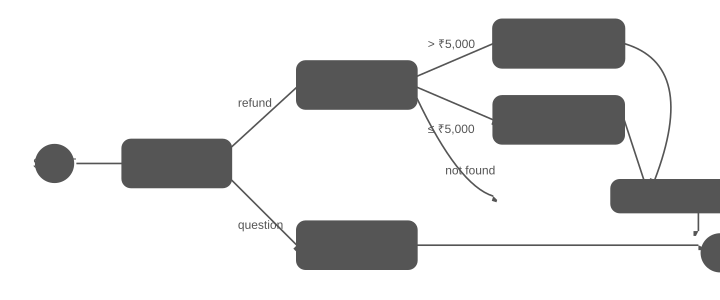

# Day 17 — LangGraph

> Part of the [GenAI Architect study path](../../README.md) · Agentic Systems · [Original interactive pack](https://claude.ai/artifact/PeSez8Vd1QmKFCM5copUpN) · [Offline HTML](../../archive/html/day-17.html)


Week 3 · Agentic systems · Day 17 of 30

# LangGraph: state, edges, checkpoints and the human in the loop

LangGraph is a durable state machine with LLM calls inside some of the states. Today you design one like that: a typed state contract, routing in code, Postgres-grade persistence, an approval pause that survives a restart, and streaming to a UI.

langgraph 1.2.17langgraph-checkpoint-sqlite 3.1.2langchain-ollama 1.1.0~75 min hands-on

## Why this matters for the JD

The JD's "agentic frameworks (LangChain, **LangGraph**, MCP, tool calling, memory, planning, multi-agent, guardrails)" line is mostly about control: who decides the next step, what happens on failure, and where a human signs off. Checkpointing and interrupts map straight to the productionization lines too: resilience, rollback, observability and "workflow automation" use cases that must pause for approval.

## Concept brief

### The five primitives

- **State** — a `TypedDict` (or Pydantic model) that every node reads and partially updates. Each key can carry a **reducer** (`Annotated[list, operator.add]`, `add_messages`) that decides how concurrent or successive writes merge. Without a reducer, the last write wins, and two parallel branches writing the same key raise `InvalidUpdateError`. Treat the state schema as an API contract: version it.
- **Nodes** — plain functions `state → partial update`. Execution runs in **super-steps** (Pregel/BSP model): all nodes scheduled in a step run, their writes are applied through reducers, then the next step is planned. That is what makes fan-out/fan-in deterministic.
- **Edges** — static (`add_edge`), conditional (`add_conditional_edges` with a router returning a node name), or dynamic via `Command(goto=..., update=...)` returned from a node, and `Send()` for map-reduce fan-out. Rule of thumb for reviews: *let the LLM classify, let code route*.
- **Checkpointer** — after every super-step the full state is saved under a `thread_id`. This gives you resume after crash (durable execution), conversation memory, time travel (`get_state_history`, replay or fork from any `checkpoint_id`) and the basis for HITL. Backends: `InMemorySaver` (tests), `SqliteSaver` (local), `PostgresSaver` (production); Redis and other community savers exist.
- **Interrupts** — calling `interrupt(payload)` inside a node stops the run, persists state, and returns the payload under `__interrupt__`. The caller resumes with `graph.invoke(Command(resume=value), config)` on the same `thread_id`, and `interrupt()` returns `value`. The node **restarts from its first line** on resume, so anything before `interrupt()` must be idempotent (no double charge, no duplicate email).



Today's exercise graph. The LLM only classifies; the two routers are pure Python and unit-testable.

### Streaming modes (pick per consumer)

`values` full state per step · `updates` only the node deltas (best for audit/UI timelines) · `messages` LLM tokens with node metadata (chat UX) · `custom` anything you emit via `get_stream_writer()` (progress bars, tool status) · `debug` everything. Pass a list to multiplex, and `subgraphs=True` to see inside nested graphs. Interrupts appear in the stream as an `__interrupt__` chunk, so a UI can render an approval card without polling.

### Where it sits next to IBM / cloud equivalents

watsonx Orchestrate gives you agent flows with approvals as a managed product; LangGraph is the code-first option you can host on watsonx.ai runtime, AKS/EKS/GKE or LangGraph Platform (LangSmith Deployment). Comparable durable-orchestration ideas: AWS Step Functions (callback task tokens for approvals), Azure Durable Functions (`waitForExternalEvent`), Temporal signals. In a review, the honest framing is: LangGraph = Step-Functions-style durability designed for LLM loops, with less operational maturity than Temporal.

**Failure modes reviewers will probe.** (1) Non-idempotent side effects before `interrupt()` run twice. (2) Multiple `interrupt()` calls in one node are matched by order; reordering them across a deploy breaks paused threads. (3) State schema changes break threads already checkpointed; add fields as optional and migrate. (4) Unbounded message lists inflate checkpoint size and token cost; trim or summarize. (5) Cycles without a `recursion_limit` strategy end in `GraphRecursionError` at 3 a.m. (6) `thread_id` is a security boundary: derive it server-side from the authenticated tenant/user, never trust it from the client.

## Trade-offs & decision table

| Option | Pick when | Failure modes | Cost / latency |
| --- | --- | --- | --- |
| Prebuilt agent (`create_agent` / ReAct loop) | Open-ended tool use, few hard business rules, prototype in a day | LLM chooses order of actions; hard to guarantee an approval step; loops | More LLM calls per task; variable latency |
| Explicit StateGraph | Regulated workflows, approvals, SLAs, auditable routing | More code; state-schema drift; over-engineering simple chats | Fewest LLM calls (only where judgment is needed); predictable p95 |
| Functional API (`@entrypoint`/`@task`) | Adding durability + HITL to existing Python code without drawing a graph | Less visual tooling; task results must be serializable | Same as graph; checkpoint per task |
| InMemorySaver | Unit tests, notebooks | Everything lost on restart | Zero |
| SqliteSaver | Single-process demos, edge/desktop apps | File locking under concurrency; no HA | ~ms writes, local disk |
| PostgresSaver | Production, multiple workers, long-paused threads | Table growth (needs TTL/pruning); connection pool exhaustion | One write per super-step; plan for checkpoint size × steps × threads |
| Static `interrupt_before` | Debugging, breakpoints | Not a business-logic tool; no payload to the human | — |
| Dynamic `interrupt()` | Approvals, edits, tool-call review, clarifying questions | Re-run of node prefix on resume; ordering of multiple interrupts | Run sits idle in storage; zero compute while waiting |

## Hands-on: a refund-approval agent that survives restarts

**Goal (60–90 min).** Build the graph above with a local 3B model: LLM triage with structured output, code-based routing, an approval `interrupt()` for refunds over ₹5,000, a SQLite checkpointer, multiplexed streaming, and a history dump that shows every checkpoint. You will stop the process while it is paused and resume it from a fresh process.

### Setup (PowerShell, Windows 11)

**powershell**

```powershell
winget install Ollama.Ollama          # skip if installed; restart terminal
ollama pull qwen2.5:3b                # ~1.9 GB, fits the RTX 3050 6 GB
mkdir day17; cd day17
py -3.13 -m venv .venv
.\.venv\Scripts\Activate.ps1          # if blocked: Set-ExecutionPolicy -Scope CurrentUser RemoteSigned
python -m pip install -U pip
python -m pip install "langgraph==1.2.17" "langgraph-checkpoint-sqlite==3.1.2" "langchain-ollama==1.1.0"
```

No Docker or WSL2 needed today. Want to test without Ollama first? Run `$env:FAKE_LLM="1"` before the script; a rule-based stub replaces the model. Clear it with `Remove-Item Env:FAKE_LLM`.

### refund\_agent.py

**python** · saved as `lab/refund_agent.py`

```python
"""Day 17 - LangGraph refund-approval agent.
State + nodes + conditional edges + SQLite checkpointing + interrupt() HITL + streaming.
Run:  python refund_agent.py            (new ticket, pauses for approval if needed)
      python refund_agent.py --resume T1 approve|reject
      python refund_agent.py --history T1
"""
import os, sys, json, sqlite3
from typing import Literal, Optional, TypedDict, Annotated
import operator

from pydantic import BaseModel, Field
from langgraph.graph import StateGraph, START, END
from langgraph.checkpoint.sqlite import SqliteSaver
from langgraph.types import interrupt, Command
from langgraph.config import get_stream_writer

MODEL = os.getenv("OLLAMA_MODEL", "qwen2.5:3b")
APPROVAL_LIMIT = 5000.0  # INR: refunds above this need a human

# ---------- 1. State: the contract between nodes ----------
class Ticket(TypedDict):
    ticket_id: str
    text: str
    category: Optional[str]
    amount: Optional[float]
    order_found: Optional[bool]
    decision: Optional[str]
    reply: Optional[str]
    audit: Annotated[list[str], operator.add]  # reducer: nodes append, never overwrite

class Triage(BaseModel):
    category: Literal["refund", "question", "other"]
    amount: float = Field(0, description="refund amount in INR, 0 if none")

ORDERS = {"ORD-1001": 1299.0, "ORD-2002": 18999.0}  # fake order system

def get_llm():
    if os.getenv("FAKE_LLM"):  # offline mode: no Ollama needed
        return None
    from langchain_ollama import ChatOllama
    return ChatOllama(model=MODEL, temperature=0)

# ---------- 2. Nodes: plain functions returning partial state ----------
def triage(state: Ticket):
    llm = get_llm()
    if llm is None:
        t = state["text"].lower()
        out = Triage(category="refund" if "refund" in t else "question",
                     amount=next((v for k, v in ORDERS.items() if k.lower() in t), 0))
    else:
        out = llm.with_structured_output(Triage).invoke(
            "Classify this support ticket and extract the refund amount in INR.\n"
            f"Known orders: {json.dumps(ORDERS)}\nTicket: {state['text']}")
    get_stream_writer()({"progress": f"triaged as {out.category}"})  # custom stream event
    return {"category": out.category, "amount": out.amount,
            "audit": [f"triage -> {out.category}, amount={out.amount}"]}

def lookup_order(state: Ticket):
    found = any(k in state["text"] for k in ORDERS)
    return {"order_found": found, "audit": [f"lookup -> found={found}"]}

def human_approval(state: Ticket):
    # Execution pauses here; the payload is surfaced to the caller. On resume,
    # interrupt() returns the value passed in Command(resume=...).
    # NOTE: the node re-runs from the top on resume - keep code before interrupt() idempotent.
    answer = interrupt({"ticket": state["ticket_id"], "amount": state["amount"],
                        "question": "Approve refund above limit?"})
    return {"decision": "approved" if answer == "approve" else "rejected",
            "audit": [f"human -> {answer}"]}

def auto_approve(state: Ticket):
    return {"decision": "approved", "audit": ["auto-approved under limit"]}

def answer_question(state: Ticket):
    llm = get_llm()
    reply = ("Thanks, an agent will reply shortly." if llm is None else
             llm.invoke(f"Reply in 2 sentences to: {state['text']}").content)
    return {"reply": reply, "decision": "n/a", "audit": ["answered question"]}

def write_reply(state: Ticket):
    msg = (f"Refund of INR {state['amount']:.0f} {state['decision']}."
           if state["category"] == "refund" and state.get("order_found")
           else "We could not find that order; please share the order ID.")
    return {"reply": msg, "audit": ["reply written"]}

# ---------- 3. Conditional edges: routing is code, not LLM whim ----------
def route_category(state: Ticket) -> Literal["lookup_order", "answer_question"]:
    return "lookup_order" if state["category"] == "refund" else "answer_question"

def route_amount(state: Ticket) -> Literal["human_approval", "auto_approve", "write_reply"]:
    if not state["order_found"]:
        return "write_reply"
    return "human_approval" if state["amount"] > APPROVAL_LIMIT else "auto_approve"

def build(checkpointer):
    g = StateGraph(Ticket)
    for name, fn in [("triage", triage), ("lookup_order", lookup_order),
                     ("human_approval", human_approval), ("auto_approve", auto_approve),
                     ("answer_question", answer_question), ("write_reply", write_reply)]:
        g.add_node(name, fn)
    g.add_edge(START, "triage")
    g.add_conditional_edges("triage", route_category)
    g.add_conditional_edges("lookup_order", route_amount)
    g.add_edge("human_approval", "write_reply")
    g.add_edge("auto_approve", "write_reply")
    g.add_edge("write_reply", END)
    g.add_edge("answer_question", END)
    return g.compile(checkpointer=checkpointer)

def run(graph, inp, tid):
    cfg = {"configurable": {"thread_id": tid}}
    for mode, chunk in graph.stream(inp, cfg, stream_mode=["updates", "custom"]):
        if mode == "custom":
            print("  [custom]", chunk)
        elif "__interrupt__" in chunk:
            print("  PAUSED ->", chunk["__interrupt__"][0].value)
        else:
            for node, upd in chunk.items():
                print(f"  [{node}]", {k: v for k, v in (upd or {}).items() if k != "audit"})
    snap = graph.get_state(cfg)
    print("next:", snap.next or "(done)", "| reply:", snap.values.get("reply"))

if __name__ == "__main__":
    conn = sqlite3.connect("checkpoints.db", check_same_thread=False)
    graph = build(SqliteSaver(conn))
    args = sys.argv[1:]
    if args[:1] == ["--resume"]:
        run(graph, Command(resume=args[2]), args[1])
    elif args[:1] == ["--history"]:
        for s in graph.get_state_history({"configurable": {"thread_id": args[1]}}):
            print(s.config["configurable"]["checkpoint_id"][:13], s.next, s.values.get("audit", [])[-1:])
    else:
        tickets = {"T1": "I want a refund for ORD-2002, the laptop arrived broken.",
                   "T2": "Please refund ORD-1001, wrong size.",
                   "T3": "What are your support hours?"}
        for tid, text in tickets.items():
            print(f"\n=== {tid}: {text}")
            run(graph, {"ticket_id": tid, "text": text, "audit": []}, tid)
```

### Run it

**powershell**

```powershell
python refund_agent.py                      # T1 pauses, T2 auto-approves, T3 answered
# close the terminal here if you like: state is in checkpoints.db
python refund_agent.py --resume T1 approve  # new process picks up the paused thread
python refund_agent.py --history T1         # every checkpoint, newest first
Remove-Item checkpoints.db                  # reset before re-running from scratch
```

### Expected output (verified with FAKE\_LLM=1; real model replies will differ in wording)

**output**

```text
=== T1: I want a refund for ORD-2002, the laptop arrived broken.
  [custom] {'progress': 'triaged as refund'}
  [triage] {'category': 'refund', 'amount': 18999.0}
  [lookup_order] {'order_found': True}
  PAUSED -> {'ticket': 'T1', 'amount': 18999.0, 'question': 'Approve refund above limit?'}
next: ('human_approval',) | reply: None

=== T2: Please refund ORD-1001, wrong size.
  ...
  [auto_approve] {'decision': 'approved'}
  [write_reply] {'reply': 'Refund of INR 1299 approved.'}
next: (done) | reply: Refund of INR 1299 approved.

--- after --resume T1 approve
  [human_approval] {'decision': 'approved'}
  [write_reply] {'reply': 'Refund of INR 18999 approved.'}
next: (done) | reply: Refund of INR 18999 approved.

--- --history T1  (6 checkpoints: __start__ → triage → lookup → human_approval → write_reply → done)
```

**What to observe.** Add a `print("entered human_approval")` as the first line of `human_approval`: it prints on the first run *and* on resume. That is the idempotency trap in one line. Also note that `audit` accumulates across nodes because of its reducer, while `decision` is simply overwritten.

### Stretch goals

1. **Edit, not just approve.** Let the human resume with `{"action":"edit","amount":9000}` and return a `Command(goto="write_reply", update={...})` from the node. Then fork history: take the checkpoint before `human_approval` from `get_state_history`, call `graph.update_state(old_config, {"amount": 4000})` and re-run from it to show the auto-approve path. That is time travel, and it is how you replay incidents.
2. **Stream to a UI.** Wrap the graph in a FastAPI endpoint that streams `stream_mode=["updates","custom","messages"]` as Server-Sent Events, and a second `POST /threads/{id}/resume` endpoint. Derive `thread_id` from a fake auth header, not the request body.

## GitHub repos to study

- [langchain-ai/langgraph](https://github.com/langchain-ai/langgraph)  
  Read `libs/langgraph/langgraph/pregel/` for the super-step loop and `libs/checkpoint*/` to see exactly what a checkpoint row contains.
- [langchain-ai/agent-inbox](https://github.com/langchain-ai/agent-inbox)  
  An inbox UI for interrupted threads; study the interrupt payload schema (accept / edit / respond / ignore) as a reusable HITL contract.
- [langchain-ai/open\_deep\_research](https://github.com/langchain-ai/open_deep_research)  
  A real multi-step graph with subgraphs, a clarification interrupt and configurable models; good for seeing state design at scale.
- [langchain-ai/langgraph-supervisor-py](https://github.com/langchain-ai/langgraph-supervisor-py)  
  Preview for tomorrow: how a supervisor is just a graph with handoff tools and `Command(goto=...)`.

## Read / watch

- [LangGraph docs — Interrupts](https://docs.langchain.com/oss/python/langgraph/interrupts): the rules on resume, multiple interrupts, and validation loops. Read the "rules of interrupts" part twice.
- [LangGraph docs — Persistence](https://docs.langchain.com/oss/python/langgraph/persistence): threads, checkpoints, super-steps, replay and `update_state`; pair with [Durable execution](https://docs.langchain.com/oss/python/langgraph/durable-execution).
- [LangGraph docs — Streaming](https://docs.langchain.com/oss/python/langgraph/streaming): all stream modes, subgraph streaming, and custom writers.

## Interview questions

**1. Why would you choose LangGraph over a ReAct agent loop for an insurance-claims assistant?**

Because the business has hard rules: claims above a threshold need a human, certain checks must always run, and auditors need to see why a path was taken. In a ReAct loop the model decides the order of actions, so those guarantees are probabilistic. In a StateGraph the LLM classifies and extracts, routing is deterministic code with unit tests, the approval is a durable `interrupt()`, and every step is a checkpoint you can replay. I keep a ReAct sub-agent inside one node where open-ended tool use is useful.

**2. A paused approval sits for three days and the pod is redeployed twice. What makes resume work, and what can break it?**

The checkpointer (Postgres in prod) stores state per `thread_id` after every super-step; any worker can resume with `Command(resume=...)`. Breakers: a state-schema change that is not backward compatible, renaming the paused node, reordering multiple `interrupt()` calls in that node, or a non-idempotent side effect before the interrupt that re-fires. Mitigations: additive optional fields, versioned graphs (route old threads to the old version), side effects in their own node after the approval, and a TTL policy for abandoned threads.

**3. How do reducers matter for parallel branches?**

Nodes in the same super-step write concurrently. A key without a reducer accepts one write per step; two branches writing it raise `InvalidUpdateError`. With a reducer (`operator.add`, `add_messages`, or a custom merge) writes are combined deterministically at the end of the step. Design rule: parallel branches write to separate keys or to a reducer-backed collection, and a join node consolidates.

**4. How do you stream an agent to a web UI and handle approvals without polling?**

Expose an SSE or WebSocket endpoint that iterates `graph.stream(..., stream_mode=["messages","updates","custom"])`: tokens for the chat bubble, updates for a step timeline, custom events for tool progress. When an `__interrupt__` chunk arrives, the UI renders an approval card from its payload and the stream closes. The approve button calls a resume endpoint that streams the rest. Thread IDs come from the authenticated session, and every resume is authorized and audited.

**5. What are the cost and scaling implications of checkpointing?**

One write per super-step, sized by the whole state. A 20-step agent with a 200 KB message history writes about 4 MB per run; at 100k runs a day that is around 400 GB a day before pruning. Controls: keep large blobs (documents, retrieved chunks) out of state and store references; trim or summarize messages; use durability modes (`exit`/`async`/`sync`) to trade safety for latency; partition and expire checkpoint tables; size the connection pool to worker concurrency.

## Architect's lens — ADR-017

**Orchestration and persistence for the refund / claims assistant** · Status: Accepted

Context
:   Customer-support assistant on watsonx.ai (Granite) with Azure OpenAI as fallback. Refunds above ₹5,000 need a supervisor's approval, which can take up to 72 h. Auditors require a per-ticket decision trail. Expected 20k tickets/day across 4 API replicas.

Options
:   (A) ReAct agent with an "ask\_human" tool and in-memory state. (B) LangGraph StateGraph with `interrupt()` + PostgresSaver. (C) LangGraph for the LLM steps, Temporal or Step Functions for the long-running approval workflow.

Decision
:   B. Routing is deterministic code; approval is a durable interrupt; the checkpoint history is the audit trail (exported to the audit store nightly). C was rejected for now because it adds a second orchestration runtime for one approval step; revisit if cross-system sagas (payments, ERP) appear.

Consequences
:   + Restart-safe pauses, replay for incident analysis, unit-testable routers. − Graph and state schema need versioning; paused threads pin a graph version. − Postgres growth: checkpoint TTL 30 days, documents stored by reference. − Side effects (refund API) live only in a post-approval node with an idempotency key.

**Tomorrow · Day 18:** Multi-agent patterns — supervisor, hierarchical, swarm/handoffs, ReAct vs plan-and-execute, and when not to go multi-agent.

## Lab files in this folder

- [`lab/refund_agent.py`](lab/refund_agent.py)
