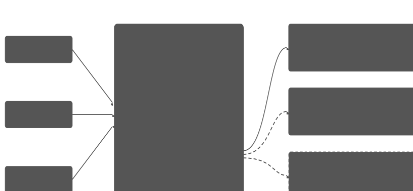

# Day 23 — Model Serving & Gateways

> Part of the [GenAI Architect study path](../../README.md) · Cloud Production Architecture · [Original interactive pack](https://claude.ai/artifact/GUGoV42wGTA2nXf8k241kn) · [Offline HTML](../../archive/html/day-23.html)


Week 4 · Cloud, production & architecture · Day 23 of 30

# Model serving & AI gateways

Two layers that decide your latency, cost and blast radius: the engine that turns GPUs into tokens, and the gateway that decides which engine, which provider, and whether this caller is allowed to ask at all.

vLLM 0.32LiteLLM 1.106.6OllamaTGI: maintenance mode~75 min hands-on

## Why this matters for the JD

The JD asks for "API deployment, model endpoints … scaling, cost controls" and, as preferred, "multi-provider LLM integration (OpenAI/Azure OpenAI/Anthropic/Gemini/open-source)". Both live here. A gateway is where you enforce quotas, fallback, caching and cost attribution, and the serving engine is where self-hosted throughput and GPU cost are won or lost. Expect a review question like "what happens when Azure OpenAI returns 429 at 10:05 on a Monday?"

## Concept brief

### Layer 1: the serving engine (tokens per GPU-second)

Decode is memory-bandwidth-bound: every new token re-reads the weights plus that sequence's KV cache. Throughput comes from keeping many sequences in flight, which makes **KV-cache memory** the real capacity constraint, not FLOPs.

KV bytes / token = 2 (K,V) × layers × kv\_heads × head\_dim × bytes\_per\_elem
Llama-3.1-8B, FP16: 2 × 32 × 8 × 128 × 2 = 131,072 B ≈ 128 KiB / token
→ one 8k-token sequence ≈ 1 GiB of KV. A 24 GB GPU after ~16 GB of weights fits ~7 such sequences.
→ FP8 KV cache halves this; GQA (8 KV heads vs 32 Q heads) already cut it 4×.

- **Continuous batching**: new requests join the running batch at each decode step instead of waiting for the batch to drain. This is the main reason vLLM/SGLang beat naive HF `generate()` by an order of magnitude.
- **PagedAttention** (vLLM): KV cache in fixed-size blocks, like OS virtual memory, so there is near-zero fragmentation and prefixes can be shared.
- **Prefix caching** (vLLM automatic prefix caching, SGLang RadixAttention): reuse the KV of a shared system prompt or RAG preamble. It is large for agents and RAG with fixed instructions, and it only pays if the router sends similar prompts to the same replica.
- **Chunked prefill**: split long prompts so one 30k-token RAG request does not stall everyone's decode (protects p95 inter-token latency).
- **Speculative decoding**: a draft model or n-gram proposes tokens and the target verifies them. It cuts latency at low concurrency and helps less at saturation.
- **Quantization**: AWQ/GPTQ (INT4 weights), FP8 on Hopper/Ada and newer. It trades a small quality loss for memory, which buys batch size. Always re-run your eval set.
- **Parallelism**: tensor parallel within a node (NVLink), pipeline parallel across nodes, and data parallel (replicas) for throughput.

**SLO metrics to quote in reviews:** TTFT (time to first token, dominated by queueing + prefill), TPOT/ITL (time per output token, dominated by decode batch size), throughput (tokens/s per GPU), and goodput (requests meeting both SLOs). Raising the batch size raises throughput and worsens TPOT, so you tune that knob against the SLO.

### Layer 2: the AI gateway (who, where, how much)

A gateway is an L7 proxy that understands tokens. Its responsibilities fall into four groups:

- **Identity & policy**: virtual keys per team/app, RBAC on which models each key may call, and PII and guardrail hooks.
- **Admission control**: RPM *and* TPM limits, daily or monthly budgets, priority tiers. TPM is hard because output length is unknown until the end, so you reserve `max_tokens` up front and reconcile afterwards.
- **Routing & resilience**: load balancing across deployments (round-robin, least-busy, latency-based, cost-based, usage-based), retries with backoff, cooldowns (a circuit breaker per deployment), ordered fallbacks on 429/5xx/timeout, context-window fallback, and content-policy fallback.
- **Economics & telemetry**: exact and semantic caching, cost attribution per key, OTel traces, and token and latency dashboards.



Gateway pipeline order matters. Reject (2) before you spend a cache lookup or model call. Scope the cache (3) per tenant and per model so one tenant's answers never reach another.

### Kubernetes-native direction

Plain round-robin across vLLM replicas wastes prefix caches and ignores queue depth. The Kubernetes **Gateway API Inference Extension** (GA) adds model-aware routing: an endpoint picker scores pods by KV-cache utilisation, queue length and prefix affinity. Its endpoint-picker code has now moved to the **llm-d** project. Envoy AI Gateway was renamed **Agent Router** (now an Agentic AI Foundation project) and implements this on Envoy. You will go deeper on Day 25.

### Mapping to clouds & IBM

| Concern | Azure | AWS | GCP | IBM |
| --- | --- | --- | --- | --- |
| Managed endpoint | Azure OpenAI / AI Foundry (PTU or standard) | Bedrock (on-demand, provisioned throughput) | Vertex AI (provisioned throughput) | watsonx.ai foundation models, deploy-on-demand |
| Gateway | API Management "AI gateway" policies (token limit, semantic cache, backend pool + circuit breaker) | API Gateway + Lambda/LiteLLM; Bedrock cross-region inference profiles for capacity | Apigee LLM policies | watsonx.ai model gateway / LiteLLM in front of watsonx (LiteLLM has a `watsonx/` provider) |
| Self-host | AKS + vLLM / KAITO | EKS or SageMaker + vLLM | GKE + vLLM (GIE support) | OpenShift AI (vLLM runtime on KServe) |

**Supply chain matters for gateways.** On 24 March 2026, `litellm` 1.82.7 and 1.82.8 on PyPI were compromised with a credential stealer. A gateway holds every provider key, which makes it the highest-value secret store in the stack. Pin exact versions with hashes (`--require-hashes`), prefer signed or pinned images, and give the gateway workload identity instead of long-lived keys where the cloud allows.

## Trade-offs & decision table

### Serving engines

| Option | Pick when | Failure modes | Cost / latency |
| --- | --- | --- | --- |
| **vLLM** | Default for self-hosted production on NVIDIA/AMD. Broad model coverage, OpenAI-compatible server, LoRA multiplexing. | KV OOM / preemption under bursty long prompts. Upgrades can change defaults, so pin and re-benchmark. Linux only (WSL on Windows). | Best general throughput per GPU. Tune `--max-num-seqs` and `--gpu-memory-utilization`. |
| **SGLang** | Agentic or structured workloads with heavy prefix reuse (RadixAttention), fast constrained decoding. | Smaller ecosystem, so check model and hardware support. | Gains depend on prompt overlap. They shrink with unique prompts. |
| **TGI** | Existing HF Inference Endpoints estates only. | **In maintenance mode**: bug fixes only, and HF itself points to vLLM/SGLang. Don't pick it for new builds. | Fine today. Migration cost later. |
| **Ollama / llama.cpp** | Dev laptops, edge, CPU or small GPU, air-gapped demos. | Limited concurrency. Not a multi-tenant production server. | Cheapest to run. Poor throughput under load. |
| **Managed (Azure OpenAI, Bedrock, Vertex, watsonx.ai)** | Frontier models, no GPU ops team, compliance features included. | Regional quota 429s, model deprecation schedules, noisy neighbours on pay-as-you-go. | Per-token pricing. Provisioned throughput gives predictable latency at a committed spend. |

### Gateways

| Option | Pick when | Failure modes | Notes |
| --- | --- | --- | --- |
| **LiteLLM proxy** | Multi-provider fast, virtual keys and budgets, Python teams, 100+ providers incl. watsonx. | Another stateful tier (Postgres + Redis for shared limits). Supply-chain exposure (see above). | Repo now describes a Rust core with a Python SDK. Benchmark the overhead yourself. |
| **Agent Router (ex-Envoy AI Gateway)** | Platform teams already on Envoy/Gateway API, K8s-native, inference-aware routing. | Envoy/K8s expertise needed. Fewer turnkey budget UIs. | Fits the GIE / llm-d direction. |
| **Cloud-native (APIM, Apigee)** | Single-cloud estates that want existing API governance, private endpoints and audit. | Cloud lock-in. Fewer provider adapters. | Good when the security team already runs APIM. |
| **Build your own** | Only a thin, specific policy layer on top of one of the above. | You will rebuild retries, streaming and token counting badly. | Today's exercise shows why. |

### Failure modes that show up in reviews

- **Retry storms**: client retries × gateway retries × SDK retries multiply load on a provider that is already throttling. Retry in exactly one layer, with jittered backoff, and honour `Retry-After`.
- **Fallback is a behaviour change**: GPT-class to Llama-class changes tool-call formats, refusal style and JSON adherence. Every model in a fallback chain must pass the same eval gate, and the response should record which model actually served it.
- **Streaming plus fallback**: once the first token reaches the client you cannot switch silently. Fall back before the first token only, and set a TTFT timeout.
- **Cache leakage**: a semantic cache without tenant and ACL scoping can serve one user's answer to another. Never cache answers that came from retrieval over permissioned documents unless the ACL set is part of the key.
- **Gateway as a single point of failure**: run it stateless with N+1 replicas, keep shared state in Redis, and fail *closed* on auth but *open* (with alerting) on the cache.

## Hands-on: build and break a mini AI gateway

**Goal (60–90 min):** put a LiteLLM `Router` behind FastAPI with per-key rate limits, daily token quotas, an exact-match cache and fallback. Then load-test it, kill the primary model and watch the fallback and its latency cost. Everything runs on your RTX 3050 through Ollama. The code was dry-run on Python 3.13 with LiteLLM 1.106.6.

### Setup (PowerShell)

**PowerShell**

```powershell
winget install Ollama.Ollama
ollama pull qwen2.5:1.5b
ollama pull llama3.2:1b

mkdir day23-gateway; cd day23-gateway
py -3.13 -m venv .venv
.\.venv\Scripts\Activate.ps1
python -m pip install --upgrade pip
python -m pip install "litellm==1.106.6" fastapi "uvicorn[standard]" httpx
```

If Ollama is already installed, skip the `winget` line. Both models together use under 3 GB of VRAM, so they fit your 6 GB card.

### gateway.py

**gateway.py** · `lab/gateway.py`

```python
"""Day 23 - mini AI gateway: LiteLLM Router + FastAPI.
Features: fallback routing, retries+cooldown, per-key rate limit (token bucket),
per-key daily token quota, exact-match cache (temperature==0 only), metrics.
Run:  uvicorn gateway:app --port 8080
Env:  CHAOS=1   -> primary points at a dead port (forces fallback)
      MOCK=1    -> no Ollama needed (canned responses, for a dry run)
      GEMINI_API_KEY -> adds a free-tier cloud model as last-resort fallback
"""
import hashlib, json, os, time
from collections import defaultdict
from fastapi import FastAPI, Header, HTTPException
from pydantic import BaseModel
from litellm import Router

OLLAMA = "http://localhost:11434"
DEAD = "http://localhost:59999"      # nothing listens here
MOCK = os.getenv("MOCK") == "1"

def dep(name, model, base=None):
    p = {"model": model}
    if base: p["api_base"] = base
    if MOCK and base != DEAD: p["mock_response"] = f"[mock answer from {name}]"
    return {"model_name": name, "litellm_params": p}

model_list = [
    dep("chat-primary", "ollama_chat/qwen2.5:1.5b", DEAD if os.getenv("CHAOS") == "1" else OLLAMA),
    dep("chat-backup",  "ollama_chat/llama3.2:1b", OLLAMA),
]
chain = ["chat-backup"]
if os.getenv("GEMINI_API_KEY"):
    model_list.append(dep("chat-cloud", "gemini/gemini-2.5-flash"))
    chain.append("chat-cloud")

router = Router(
    model_list=model_list,
    fallbacks=[{"chat-primary": chain}],
    num_retries=1,          # retry same group once before falling back
    allowed_fails=2,        # failures/min before a deployment is cooled down
    cooldown_time=30,       # seconds a failing deployment is skipped
    timeout=60,
)

# ---- per-key policy (in prod: Redis + a config/DB, never in-process) ----
KEYS = {"team-a": {"rpm": 10, "daily_tokens": 20_000},
        "team-b": {"rpm": 3,  "daily_tokens": 2_000}}
buckets = {k: {"tokens": v["rpm"], "ts": time.monotonic()} for k, v in KEYS.items()}
used_tokens = defaultdict(int)
cache: dict[str, dict] = {}
metrics = defaultdict(int)

def take_token(key: str) -> bool:
    b, rpm = buckets[key], KEYS[key]["rpm"]
    now = time.monotonic()
    b["tokens"] = min(rpm, b["tokens"] + (now - b["ts"]) * rpm / 60)
    b["ts"] = now
    if b["tokens"] >= 1:
        b["tokens"] -= 1
        return True
    return False

class ChatIn(BaseModel):
    messages: list[dict]
    temperature: float = 0.0
    max_tokens: int = 256

app = FastAPI(title="mini-ai-gateway")

@app.post("/v1/chat")
async def chat(body: ChatIn, x_api_key: str = Header(...)):
    if x_api_key not in KEYS:
        raise HTTPException(401, "unknown key")
    if not take_token(x_api_key):
        metrics["rate_limited"] += 1
        raise HTTPException(429, "rate limit exceeded", headers={"Retry-After": "6"})
    if used_tokens[x_api_key] + body.max_tokens > KEYS[x_api_key]["daily_tokens"]:
        metrics["quota_exceeded"] += 1
        raise HTTPException(429, "daily token quota exhausted")

    ck = None
    if body.temperature == 0:      # only deterministic requests are cacheable
        ck = hashlib.sha256(json.dumps([body.messages, body.max_tokens], sort_keys=True).encode()).hexdigest()
        if ck in cache:
            metrics["cache_hits"] += 1
            return {**cache[ck], "cache": "hit", "latency_ms": 0}

    t0 = time.perf_counter()
    try:
        r = await router.acompletion(model="chat-primary", messages=body.messages,
                                     temperature=body.temperature, max_tokens=body.max_tokens)
    except Exception as e:
        metrics["upstream_errors"] += 1
        raise HTTPException(503, f"all deployments failed: {type(e).__name__}")
    ms = int((time.perf_counter() - t0) * 1000)
    tokens = r.usage.total_tokens if r.usage else 0
    used_tokens[x_api_key] += tokens
    served_by = r.model or "?"
    metrics[f"served_by:{served_by}"] += 1
    out = {"answer": r.choices[0].message.content, "served_by": served_by, "tokens": tokens}
    if ck: cache[ck] = out
    return {**out, "cache": "miss", "latency_ms": ms}

@app.get("/metrics")
def get_metrics():
    return {"counters": dict(metrics), "tokens_used": dict(used_tokens)}
```

### loadtest.py

**loadtest.py** · `lab/loadtest.py`

```python
"""Fire concurrent requests at the gateway and summarise outcomes."""
import asyncio, statistics, sys, time
import httpx

URL = "http://localhost:8080/v1/chat"

async def one(c, i, key):
    body = {"messages": [{"role": "user", "content": f"In one sentence, what is a KV cache? (#{i % 4})"}],
            "temperature": 0, "max_tokens": 64}
    t = time.perf_counter()
    r = await c.post(URL, json=body, headers={"X-API-Key": key})
    return r.status_code, (time.perf_counter() - t) * 1000, r.json()

async def main(n=12, key="team-a"):
    async with httpx.AsyncClient(timeout=120) as c:
        res = await asyncio.gather(*(one(c, i, key) for i in range(n)))
    ok = [r for r in res if r[0] == 200]
    lat = sorted(r[1] for r in ok)
    print(f"key={key} sent={n} ok={len(ok)} 429={sum(r[0]==429 for r in res)} 503={sum(r[0]==503 for r in res)}")
    if lat:
        print(f"p50={statistics.median(lat):.0f}ms  p95={lat[int(0.95*(len(lat)-1))]:.0f}ms")
    print("served_by:", {r[2]['served_by'] for r in ok}, " cache hits:", sum(r[2]['cache']=='hit' for r in ok))

if __name__ == "__main__":
    asyncio.run(main(int(sys.argv[1]) if len(sys.argv) > 1 else 12, sys.argv[2] if len(sys.argv) > 2 else "team-a"))
```

### Run it

1. Terminal 1: start the gateway.
   **Terminal 1**

```text
uvicorn gateway:app --port 8080
```
2. Terminal 2: hit it with a burst from each team.
   **Terminal 2**

```text
.\.venv\Scripts\Activate.ps1
python loadtest.py 12 team-a
python loadtest.py 6 team-b
curl.exe -s http://localhost:8080/metrics
```
3. Stop the gateway (Ctrl+C), then restart it with the primary pointed at a dead port.
   **Terminal 1 (chaos mode)**

```text
$env:CHAOS="1"; uvicorn gateway:app --port 8080
# afterwards: Remove-Item Env:CHAOS
```
4. Re-run `python loadtest.py 4 team-a` and compare `served_by` and latency with step 2.

### Expected output (shape; your latencies will differ)

**Console**

```text
key=team-a sent=12 ok=10 429=2 503=0
p50=1850ms  p95=4200ms
served_by: {'qwen2.5:1.5b'}  cache hits: 0
key=team-b sent=6 ok=3 429=3 503=0
p50=9ms  p95=9ms                      <- same prompts as before: all cache hits
served_by: {'qwen2.5:1.5b'}  cache hits: 3
{"counters":{"rate_limited":5,"served_by:qwen2.5:1.5b":10,"cache_hits":3},"tokens_used":{"team-a":...,"team-b":0}}

# chaos run (CHAOS=1)
key=team-a sent=4 ok=4 429=0 503=0
p50=~+2000ms over normal
served_by: {'llama3.2:1b'}  cache hits: 0
```

**What to notice.** (a) team-b's 3 RPM bucket rejects the burst with 429s and a `Retry-After` header. (b) In the concurrent burst, identical prompts all *miss* the cache because they arrive before the first one completes. That is a cache stampede, and it is why real gateways add request coalescing. (c) In chaos mode every request is served by `llama3.2:1b` and pays roughly 2 s extra for the failed attempt and retry before the fallback. That is the cost of `num_retries`. After `allowed_fails` the primary is cooled down and later calls skip it. Write down what TTFT SLO you would set and whether you would keep the retry. (d) team-b's hits were answers cached by team-a. That is the cross-tenant leakage from section 3. Fix it by adding `x_api_key` (in production: tenant + prompt version + ACL group) to the cache key.

**No GPU free right now?** Set `$env:MOCK="1"` before starting the gateway to dry-run all the policy logic with canned answers.

### Stretch goals

1. **Streaming + TTFT-aware fallback.** Add `/v1/chat/stream` using `router.acompletion(..., stream=True)` and return SSE. Measure TTFT. Implement "fall back only if no token within 3 s" with `asyncio.wait_for` on the first chunk, and add single-flight coalescing (an `asyncio.Future` per cache key) to fix the stampede.
2. **Swap in production parts.** Replace your hand-rolled gateway with the LiteLLM *proxy* (`config.yaml` with `router_settings`, virtual keys, budgets), using Docker Desktop with Postgres and Redis. Then, in **WSL2**, run `vllm serve Qwen/Qwen2.5-0.5B-Instruct --gpu-memory-utilization 0.8 --max-model-len 4096` and register it as the primary. vLLM has no native Windows support, so this step needs WSL2 with CUDA. Compare p95 against Ollama at a concurrency of 8.

## GitHub repos to study

[vllm-project/vllm](https://github.com/vllm-project/vllm)

Read `vllm/v1/core/sched/` (the scheduler: continuous batching, preemption, chunked prefill) and the KV cache manager. This is where your capacity maths becomes code.

[BerriAI/litellm](https://github.com/BerriAI/litellm)

Read `litellm/router.py` for how fallbacks, cooldowns and retry policies interact, then the proxy's budget and rate-limit hooks. These are the parts you would defend in a design review.

[vllm-project/production-stack](https://github.com/vllm-project/production-stack)

A Helm reference stack: vLLM engines, a prefix-aware request router, LMCache KV offload, and Prometheus/Grafana dashboards. Study its router and its dashboard metrics.

[theagentrouter/agent-router](https://github.com/theagentrouter/agent-router)

Formerly Envoy AI Gateway (old links redirect). Read the CRDs for backend security policies, token-based rate limiting and provider fallback to see how a K8s-native gateway models these concepts.

## Read / watch

- [Efficient Memory Management for LLM Serving with PagedAttention](https://arxiv.org/abs/2309.06180) (Kwon et al., SOSP 2023). Read sections 3–4. It is the foundation of every modern engine.
- [LiteLLM: Fallbacks (provider failover)](https://docs.litellm.ai/docs/proxy/reliability) and [Router: load balancing](https://docs.litellm.ai/docs/routing). These cover `fallbacks`, `context_window_fallbacks`, `content_policy_fallbacks`, `allowed_fails`, `cooldown_time` and the routing strategies. Note that the `mock_testing_*` flags only work on the Router SDK, not on the proxy since v1.85.
- [Gateway API Inference Extension](https://github.com/kubernetes-sigs/gateway-api-inference-extension) README. Read it for the model-aware routing model, and note that its endpoint picker has moved to llm-d.

## Interview questions

**A self-hosted 8B model meets its p50 but p95 TTFT spikes to 6 s at peak. Walk me through diagnosis.**

TTFT is queueing plus prefill. Check the engine's waiting-queue depth and KV-cache utilisation. If KV is near 100%, requests are being preempted or queued: cap `max_model_len`, use an FP8 KV cache, or add replicas. If a few very long RAG prompts dominate, enable chunked prefill so they stop blocking others, and consider routing long-context traffic to a separate pool. If the load balancer is round-robin, switch to prefix- and queue-aware routing. Autoscale on queue depth or KV utilisation, not CPU.

**Why do you need TPM limits as well as RPM, and how do you enforce TPM before you know the output length?**

Providers meter tokens, and one 100k-token request can cost as much as 500 small ones, so RPM alone lets a single caller exhaust the shared quota. Enforce TPM by counting prompt tokens exactly, reserving `max_tokens` for output at admission, and refunding the unused part when the response completes. Keep the counters in Redis with sliding windows so every gateway replica sees the same state. Cap `max_tokens` per key so reservations stay honest.

**Design the fallback chain for a customer-support copilot whose primary is Azure OpenAI.**

Primary: the same model in a second Azure region or deployment, which keeps behaviour identical (PTU in the home region, pay-as-you-go spillover). Next, a different provider's comparable model that has passed the same eval suite and uses prompt variants kept in the prompt registry. Last, a smaller self-hosted model limited to low-risk intents, or a graceful degradation message. Fall back on 429, 5xx, timeouts and context-length errors, and never on 4xx auth or validation errors. Log the serving model on every response, check data residency for each hop, and pre-first-token fallback only for streaming.

**When would you not put a central AI gateway in front of model calls?**

When a single team uses a single provider at low volume, it adds a hop, a stateful tier and a secret store without paying for itself. A thin SDK wrapper with retries is enough. The same goes for latency-critical on-device or edge inference. The case for a gateway arrives with the second team or the second provider, or with a requirement for chargeback, central guardrails or key rotation.

**Semantic caching: where does it help, and what can go wrong?**

It helps with repetitive FAQ-style traffic (support, HR policy) and can deflect a meaningful share of calls. Risks: false hits from a threshold that is too loose ("cancel my order" vs "cancel my subscription"), stale answers after source documents change, and cross-tenant or ACL leakage. Mitigations: scope keys by tenant, model, prompt version and ACL group, apply a TTL plus invalidation on reindex, set a conservative threshold tuned on a labelled set, and leave out personalised or tool-using turns. Prefer provider prompt caching and engine prefix caching first, because they are exact and safe.

## Architect's lens: ADR-023

Title
:   Centralise all LLM access through a self-hosted AI gateway

Context
:   Six product teams call Azure OpenAI, watsonx.ai and a self-hosted vLLM pool directly with their own keys. There is no chargeback, keys sit in app configs, 429 incidents cascade, and every team writes its own retry logic.

Options
:   (A) Shared SDK wrapper library. (B) Cloud-native APIM AI-gateway policies. (C) LiteLLM proxy (self-hosted, HA, Postgres + Redis). (D) Agent Router on the existing Envoy/K8s platform.

Decision
:   **C now, with D re-evaluated in 2 quarters.** LiteLLM covers every provider in the estate including watsonx, ships virtual keys, budgets and fallbacks today, and keeps the OpenAI-compatible contract, so apps stay portable. Deploy it as 3+ stateless replicas behind an internal load balancer on private endpoints. Pin the image digest and verify hashes. Provider keys live only in Key Vault or Secrets Manager, accessed via workload identity.

Consequences
:   + Central quotas, chargeback, one place for guardrails and OTel. + Provider swaps become config. − A new tier-1 dependency (needs an SLO, on-call and DR), 5–20 ms added latency to verify in load tests, and a concentrated supply-chain and secret risk. − Fallback models must pass the same eval gate in CI (Day 26). Revisit if self-hosted traffic exceeds 50% and needs inference-aware K8s routing.

**Tomorrow · Day 24** — Containerizing GenAI services: FastAPI + streaming + Docker best practices (multi-stage builds, secrets, health checks). Today's gateway becomes the thing you containerize.

## Lab files in this folder

- [`lab/gateway.py`](lab/gateway.py)
- [`lab/loadtest.py`](lab/loadtest.py)
