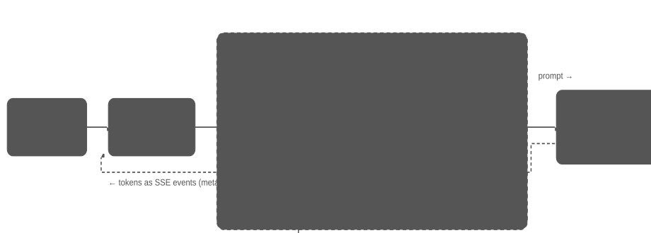

# Day 24 — Containerizing GenAI Services

> Part of the [GenAI Architect study path](../../README.md) · Cloud Production Architecture · [Original interactive pack](https://claude.ai/artifact/WtfvQcKFBbQhC2A1epwysJ) · [Offline HTML](../../archive/html/day-24.html)


GenAI Architect · 30-day plan · Week 4 — Cloud, production & architecture

# Day 24 — Containerizing GenAI services

FastAPI streaming, Docker images that build fast and run safe, and the operational details that decide whether a token stream survives a load balancer, a deploy and a disconnecting client.

**Mon 2 Nov 2026**Hands-on ≈ 75 minTested on FastAPI 0.162.0 · uvicorn 0.54.0 · ollama-python 0.6.3

1 · WHY THIS MATTERS FOR THE JD

## The JD's "productionization" line is mostly this day

The must-have *CI/CD & productionization* block names Docker, API deployment, model endpoints, observability, scaling and cost controls. All of them start at the container boundary: the image is the unit you scan, version, roll back and autoscale. The good-to-haves (Python backend/APIs, secrets, network segmentation, resilience) are decided in the Dockerfile and compose file too.

In a design review you will be asked how the stream behaves behind a proxy, what happens on SIGTERM mid-answer, and how you stop a burst from queueing 200 requests onto 2 GPU slots. Today gives you defensible answers and a working reference.

2 · CONCEPT BRIEF

## A GenAI container is a long-lived-request service

A normal REST pod answers in 50 ms. An LLM call holds a connection for 5–90 s, its cost is set by tokens rather than requests, and the scarce resource (GPU slots or provider TPM quota) sits outside the pod. Nearly every container decision follows from that.



Guards run before the stream opens, so they can still return real HTTP status codes. Once the first byte is sent, failures can only be reported in-band as an `error` event.

### Five ideas to own

1. **Status codes only exist before the first byte.** After headers go out with 200, a mid-stream failure must be an in-band `event: error`. So auth, validation, quota and load-shedding go in dependencies that run before the generator. Clients must treat a stream without `done` as failed.
2. **SSE over WebSockets for token streaming.** It is plain HTTP, so it passes through API gateways, WAFs and APIM policies, it reconnects natively with `Last-Event-ID`, and it is one-directional, which matches generation. FastAPI ships it natively since 0.135.0 (`fastapi.sse.EventSourceResponse`), with a 15 s keep-alive ping and `X-Accel-Buffering: no` set for you. Pick WebSockets only for duplex use cases such as voice or barge-in.
3. **Concurrency is a GPU property.** Uvicorn workers and async give you thousands of open sockets, but the backend has N decode slots (Ollama's `OLLAMA_NUM_PARALLEL`, vLLM's batch budget, a provider's TPM). Cap in-flight generations per replica, shed load with 429 and `Retry-After`, and scale on in-flight count or queue depth, not CPU.
4. **Cancellation saves money.** When the user closes the tab, close the upstream call (`aclose()` on the stream). If you don't, the GPU keeps generating tokens nobody reads, and on a paid API you are billed for them.
5. **Liveness ≠ readiness, and draining is a feature.** Liveness checks the process only. If it checks the model backend, a backend blip restarts every pod at once. Readiness checks dependencies and flips to 503 on SIGTERM. The grace period must be longer than your longest stream (`stop_grace_period` / `terminationGracePeriodSeconds` > uvicorn `--timeout-graceful-shutdown`).

### Image hygiene that reviewers check

- Multi-stage build: uv in the builder with a cache mount and `uv sync --locked`; the runtime gets only `.venv` and code. There's no compiler or package manager to exploit, and the image is smaller and faster to pull during scale-out.
- Gateway images are small. Model weights never go in the API image: they live on a volume, a model registry or a separate serving image (KServe storage-initializer, vLLM with a PVC). If you put a 5 GB model inside a 300 MB API image, every deploy and cold start pays for pulling it.
- Non-root UID, read-only root FS, `cap_drop: ALL`, `no-new-privileges`. Secrets arrive as mounted files (`/run/secrets`, CSI Secrets Store, IBM Secrets Manager) or as BuildKit `--mount=type=secret` at build time. Never use `ENV` or `ARG` for secrets: those land in image history.
- Exec-form `CMD` so uvicorn is PID 1 and gets SIGTERM. Logs go to stdout as one JSON object per line, with request id, TTFT and token counts, so cost and latency can be reconstructed later.

**Cloud mapping.** The same image runs on Azure Container Apps / AKS (in front of Azure OpenAI via private endpoint), AWS ECS Fargate / EKS (Bedrock via VPC endpoint), GCP Cloud Run / GKE (Vertex AI), and IBM Cloud Code Engine / Red Hat OpenShift (watsonx.ai). On OpenShift, the non-root and arbitrary-UID rules are enforced by default SCCs, so build images that run under any UID and keep files group-0 writable where needed.

3 · TRADE-OFFS & DECISION TABLE

## Choices you will defend

| Decision | Options | Pick when | Failure mode | Cost / latency impact |
| --- | --- | --- | --- | --- |
| Streaming transport | SSE · WebSocket · chunked NDJSON · no streaming | SSE for chat UIs and APIs; WS for duplex/voice; NDJSON for service-to-service; non-streaming for batch and tool-call steps | Proxy buffering holds the whole answer (nginx, some APIM tiers); LB idle timeout cuts long streams at 60 s | Same tokens, but perceived latency drops to TTFT. Streaming makes post-hoc output guardrails harder. |
| Base image | `python:3.13-slim` · distroless · Chainguard/Wolfi · UBI9 · alpine | slim as the default; distroless/Chainguard for low-CVE mandates; UBI on OpenShift/IBM estates | alpine's musl breaks or slows wheels (numpy, tokenizers); distroless has no shell for debugging | Image size drives pull time, which drives scale-out latency |
| Dependency install | uv + lockfile · pip + requirements hash · poetry | uv: 10–100× faster, lockfile-first, official Docker guide | Unlocked installs drift: "worked yesterday" and LangChain minor-version breaks | Build minutes in CI; layer cache hit rate |
| Process model | 1 uvicorn proc/container · gunicorn + N uvicorn workers · `--workers N` | One process per container on Kubernetes, scaled by replicas; multiple workers on single VMs | Per-worker semaphores multiply the real concurrency cap; in-memory caches split across workers | Memory × workers; GPU contention is unchanged |
| Backpressure | Queue unbounded · bounded semaphore + 429 · external queue (Redis/SQS) + async job | Semaphore + 429 for interactive; queue + webhook/poll for long jobs over 60 s | Unbounded queue: TTFT grows without limit, then everything times out at once | 429s cost a retry; queues cost infrastructure but smooth GPU utilisation |
| Model location | In API image · separate serving container · managed API | Separate serving (vLLM/KServe/Ollama) or managed API. Almost never inside the API image. | Multi-GB images, 5-minute cold starts, CPU pods requesting GPUs | Managed: per-token cost, zero idle. Self-host: GPU-hours, pays off at sustained utilisation. |
| Secrets | ENV · mounted file · secret manager SDK at boot · workload identity | Workload identity (no secret at all) > mounted file > SDK fetch. ENV only for non-sensitive config. | ENV leaks via `docker inspect`, crash dumps and child processes; ARG leaks via image history | Negligible; workload identity removes rotation toil |

4 · HANDS-ON EXERCISE · 60–90 MIN

## Build a streaming LLM gateway and containerize it properly

You will build a FastAPI service that streams tokens from a local Ollama model over SSE. It has auth from a mounted secret, load-shedding with 429, first-token and inter-token timeouts, upstream cancellation on disconnect, liveness and readiness probes, and JSON logs. Then you'll ship it as a hardened multi-stage image.

**Windows note.** Steps 1–4 run natively in PowerShell. Steps 5–6 need **Docker Desktop with the WSL2 backend**. Ollama stays native on Windows, so it uses your RTX 3050 directly and the container reaches it at `host.docker.internal:11434`. That avoids NVIDIA-in-WSL2 GPU passthrough setup for today.

1. **Model + project setup** (PowerShell). `qwen2.5:1.5b` is about 1 GB and leaves VRAM headroom for 2 parallel streams.
   **PowerShell**

```powershell
ollama pull qwen2.5:1.5b
mkdir genai-gateway; cd genai-gateway; mkdir app, secrets
New-Item app\__init__.py -ItemType File
py -3.13 -m venv .venv
.\.venv\Scripts\Activate.ps1
python -m pip install --upgrade pip
python -m pip install "fastapi>=0.135" "uvicorn[standard]>=0.54" "ollama>=0.6.3" "httpx>=0.28" uv
```
2. **Create `app/main.py`**. This is the whole service:
   **app/main.py** · `lab/app/main.py`

```python
"""Day 24 — streaming LLM gateway: FastAPI SSE + Ollama, container-ready."""
import asyncio
import json
import logging
import os
import time
import uuid
from collections.abc import AsyncIterable
from contextlib import asynccontextmanager
from pathlib import Path

from fastapi import Depends, FastAPI, Header, HTTPException, Request
from fastapi.responses import JSONResponse
from fastapi.sse import EventSourceResponse, ServerSentEvent
from ollama import AsyncClient, ResponseError
from pydantic import BaseModel, Field

# ---- config: 12-factor, env only ------------------------------------------
OLLAMA_HOST = os.getenv("OLLAMA_HOST", "http://localhost:11434")
MODEL = os.getenv("MODEL", "qwen2.5:1.5b")
MAX_CONCURRENCY = int(os.getenv("MAX_CONCURRENCY", "2"))      # GPU slots, not CPU cores
FIRST_TOKEN_TIMEOUT_S = float(os.getenv("FIRST_TOKEN_TIMEOUT_S", "30"))
INTER_TOKEN_TIMEOUT_S = float(os.getenv("INTER_TOKEN_TIMEOUT_S", "15"))
MAX_STREAM_S = float(os.getenv("MAX_STREAM_S", "120"))
API_KEY_FILE = Path(os.getenv("API_KEY_FILE", "/run/secrets/api_key"))

logging.basicConfig(level=logging.INFO, format="%(message)s")
log = logging.getLogger("gateway")
logging.getLogger("httpx").setLevel(logging.WARNING)  # no per-call noise

def jlog(**kv) -> None:
    """One JSON object per line on stdout: the container runtime ships it."""
    log.info(json.dumps({"ts": round(time.time(), 3), **kv}))

@asynccontextmanager
async def lifespan(app: FastAPI):
    app.state.llm = AsyncClient(host=OLLAMA_HOST)
    app.state.sem = asyncio.Semaphore(MAX_CONCURRENCY)
    app.state.inflight = 0
    app.state.draining = False
    app.state.api_key = API_KEY_FILE.read_text().strip() if API_KEY_FILE.exists() else None
    jlog(evt="startup", model=MODEL, ollama=OLLAMA_HOST, auth=bool(app.state.api_key))
    yield
    app.state.draining = True          # SIGTERM -> readyz goes 503, LB stops routing
    jlog(evt="shutdown", inflight=app.state.inflight)

app = FastAPI(title="genai-gateway", lifespan=lifespan)

class ChatIn(BaseModel):
    prompt: str = Field(min_length=1, max_length=4000)
    max_tokens: int = Field(256, ge=1, le=1024)

# ---- probes ----------------------------------------------------------------
@app.get("/healthz")
async def healthz():
    """Liveness: is THIS process alive? Never call dependencies here."""
    return {"status": "ok"}

@app.get("/readyz")
async def readyz(request: Request):
    """Readiness: can we serve traffic right now? Checks the model backend."""
    if request.app.state.draining:
        return JSONResponse({"status": "draining"}, status_code=503)
    try:
        await asyncio.wait_for(request.app.state.llm.show(MODEL), timeout=2)
    except Exception as e:  # noqa: BLE001
        return JSONResponse({"status": "unready", "reason": type(e).__name__}, status_code=503)
    return {"status": "ready", "model": MODEL, "inflight": request.app.state.inflight}

# ---- guards (run BEFORE the stream opens, so they can return real HTTP codes)
def require_key(request: Request, authorization: str | None = Header(default=None)):
    key = request.app.state.api_key
    if key and authorization != f"Bearer {key}":
        raise HTTPException(401, "missing or bad bearer token")

def admit(request: Request):
    """Load-shed instead of queueing forever: 429 + Retry-After when GPU slots are full."""
    if request.app.state.sem.locked():
        raise HTTPException(429, "busy", headers={"Retry-After": "2"})

# ---- the streaming endpoint -------------------------------------------------
@app.post("/v1/chat/stream", response_class=EventSourceResponse,
          dependencies=[Depends(require_key), Depends(admit)])
async def chat_stream(body: ChatIn, request: Request) -> AsyncIterable[ServerSentEvent]:
    rid = uuid.uuid4().hex[:8]
    t0 = time.perf_counter()
    ttft_ms, n_chunks, usage, outcome = None, 0, {}, "ok"
    st = request.app.state
    async with st.sem:
        st.inflight += 1
        stream = None
        try:
            yield ServerSentEvent(event="meta", data={"request_id": rid, "model": MODEL})
            stream = await st.llm.chat(
                model=MODEL,
                messages=[{"role": "user", "content": body.prompt}],
                stream=True,
                options={"num_predict": body.max_tokens},
            )
            async with asyncio.timeout(MAX_STREAM_S):              # hard wall-clock cap
                while True:
                    budget = FIRST_TOKEN_TIMEOUT_S if ttft_ms is None else INTER_TOKEN_TIMEOUT_S
                    try:
                        part = await asyncio.wait_for(anext(stream), timeout=budget)
                    except StopAsyncIteration:
                        break
                    if await request.is_disconnected():
                        outcome = "client_disconnected"
                        break
                    tok = part.message.content
                    if tok:
                        if ttft_ms is None:
                            ttft_ms = round((time.perf_counter() - t0) * 1000)
                        n_chunks += 1
                        yield ServerSentEvent(event="token", data=tok, id=str(n_chunks))
                    if part.done:
                        usage = {"prompt_tokens": part.prompt_eval_count,
                                 "completion_tokens": part.eval_count}
            if outcome == "ok":
                yield ServerSentEvent(event="done", data={
                    "request_id": rid, "ttft_ms": ttft_ms, "chunks": n_chunks,
                    "total_ms": round((time.perf_counter() - t0) * 1000), **usage})
        except TimeoutError:
            outcome = "timeout"
            yield ServerSentEvent(event="error", data={"code": "upstream_timeout", "request_id": rid})
        except ResponseError as e:
            outcome = "upstream_error"
            yield ServerSentEvent(event="error", data={"code": "upstream_error",
                                                       "status": e.status_code, "request_id": rid})
        except (asyncio.CancelledError, GeneratorExit):
            outcome = "cancelled"   # client went away mid-yield
            raise
        finally:
            if stream is not None:
                await stream.aclose()   # closes the HTTP call -> Ollama stops generating
            st.inflight -= 1
            jlog(evt="chat", rid=rid, outcome=outcome, ttft_ms=ttft_ms, chunks=n_chunks,
                 total_ms=round((time.perf_counter() - t0) * 1000), **usage)
```
3. **Run it natively** and probe it. Without a secret file, auth is off.
   **PowerShell**

```powershell
$env:API_KEY_FILE = "secrets\api_key.txt"   # doesn't exist yet → auth disabled
uvicorn app.main:app --port 8000
# second terminal:
curl.exe -s localhost:8000/healthz
curl.exe -s localhost:8000/readyz
curl.exe -N -X POST localhost:8000/v1/chat/stream -H "Content-Type: application/json" -d '{\"prompt\":\"Say hi in 5 words\"}'
```

   Use `curl.exe`, not `curl` (PowerShell's alias for Invoke-WebRequest buffers the response). `-N` disables curl's buffering so you see tokens arrive.
4. **Create `loadtest.py`** and run `python loadtest.py 4`. It sends 4 concurrent streams against `MAX_CONCURRENCY=2`, then aborts one stream after 3 chunks.
   **loadtest.py** · `lab/loadtest.py`

```python
"""Fire N concurrent streams; report TTFT, 429s, and test a mid-stream disconnect."""
import asyncio
import json
import sys
import time

import httpx

URL = "http://localhost:8000/v1/chat/stream"
HEADERS = {}  # e.g. {"Authorization": "Bearer <key>"} when the secret is mounted

async def one(client: httpx.AsyncClient, i: int, abort_after: int | None = None):
    t0 = time.perf_counter()
    ttft, text, event = None, [], None
    async with client.stream("POST", URL, headers=HEADERS,
                             json={"prompt": "In 3 sentences, why do containers help LLM apps?",
                                   "max_tokens": 120}) as r:
        if r.status_code != 200:
            return {"i": i, "status": r.status_code, "retry_after": r.headers.get("retry-after")}
        async for line in r.aiter_lines():
            if line.startswith("event:"):
                event = line.split(":", 1)[1].strip()
            elif line.startswith("data:"):
                data = json.loads(line[5:].strip())
                if event == "token":
                    ttft = ttft or round((time.perf_counter() - t0) * 1000)
                    text.append(data)
                    if abort_after and len(text) >= abort_after:
                        return {"i": i, "status": "aborted_by_client", "chunks": len(text)}
                elif event in ("done", "error"):
                    return {"i": i, "status": 200, "event": event, "client_ttft_ms": ttft,
                            "server": data, "preview": "".join(text)[:60]}
    return {"i": i, "status": "stream_ended_without_done"}

async def main(n: int):
    async with httpx.AsyncClient(timeout=httpx.Timeout(10, read=60)) as c:
        results = await asyncio.gather(*(one(c, i) for i in range(n)))
        for r in results:
            print(r)
        print("--- disconnect test ---")
        print(await one(c, 99, abort_after=3))

if __name__ == "__main__":
    asyncio.run(main(int(sys.argv[1]) if len(sys.argv) > 1 else 4))
```
5. **Containerize.** Add `pyproject.toml`, `Dockerfile`, `.dockerignore`, `compose.yaml`, then lock the dependencies.
   **pyproject.toml** · `lab/pyproject.toml`

```toml
[project]
name = "genai-gateway"
version = "0.1.0"
requires-python = ">=3.13"
dependencies = [
    "fastapi>=0.135",        # fastapi.sse landed in 0.135.0; tested on 0.162.0
    "uvicorn[standard]>=0.54",
    "ollama>=0.6.3",
]

[dependency-groups]
dev = ["httpx>=0.28"]
```
   **Dockerfile** · `lab/Dockerfile`

```dockerfile
# syntax=docker/dockerfile:1
# ---------- stage 1: build the venv with uv (cached, reproducible) ----------
FROM python:3.13-slim AS builder
COPY --from=ghcr.io/astral-sh/uv:0.13.6 /uv /uvx /bin/
ENV UV_COMPILE_BYTECODE=1 \
    UV_LINK_MODE=copy \
    UV_PYTHON_DOWNLOADS=0 \
    UV_NO_DEV=1
WORKDIR /app
# deps layer: only re-runs when the lockfile changes; cache mount survives builds
RUN --mount=type=cache,target=/root/.cache/uv \
    --mount=type=bind,source=uv.lock,target=uv.lock \
    --mount=type=bind,source=pyproject.toml,target=pyproject.toml \
    uv sync --locked --no-install-project

# ---------- stage 2: runtime (no uv, no compilers, non-root) ----------
FROM python:3.13-slim AS runtime
RUN groupadd --system --gid 10001 app \
 && useradd --system --uid 10001 --gid app --no-create-home app
WORKDIR /app
COPY --from=builder --chown=app:app /app/.venv /app/.venv
COPY --chown=app:app app ./app
ENV PATH="/app/.venv/bin:$PATH" \
    PYTHONUNBUFFERED=1 \
    PYTHONDONTWRITEBYTECODE=1
USER app
EXPOSE 8000
# slim has no curl: use the stdlib. Liveness only -> /healthz, never /readyz.
HEALTHCHECK --interval=15s --timeout=3s --start-period=20s --retries=3 \
  CMD ["python", "-c", "import urllib.request,sys; sys.exit(0 if urllib.request.urlopen('http://127.0.0.1:8000/healthz', timeout=2).status == 200 else 1)"]
# exec form = uvicorn is PID 1 and receives SIGTERM directly
CMD ["uvicorn", "app.main:app", "--host", "0.0.0.0", "--port", "8000", \
     "--timeout-graceful-shutdown", "25", "--proxy-headers", "--no-access-log"]
```
   **.dockerignore** · `lab/.dockerignore`

```
.venv
__pycache__
*.pyc
.git
secrets/
.env
*.log
```
   **compose.yaml** · `lab/compose.yaml`

```yaml
services:
  api:
    build: .
    image: genai-gateway:dev
    ports: ["8000:8000"]
    environment:
      OLLAMA_HOST: http://host.docker.internal:11434   # Ollama runs natively on Windows (GPU stays simple)
      MODEL: qwen2.5:1.5b
      MAX_CONCURRENCY: "2"
      API_KEY_FILE: /run/secrets/api_key
    secrets: [api_key]
    read_only: true                 # immutable root FS
    tmpfs: [/tmp]
    cap_drop: [ALL]
    security_opt: ["no-new-privileges:true"]
    stop_grace_period: 30s          # > uvicorn's 25s graceful drain
    deploy:
      resources:
        limits: { cpus: "1.0", memory: 512M }
secrets:
  api_key:
    file: ./secrets/api_key.txt
```
   **PowerShell (Docker Desktop running)**

```powershell
uv lock
# random API key into the mounted secret (never in compose env)
-join ((48..57)+(97..122) | Get-Random -Count 32 | % {[char]$_}) | Set-Content -NoNewline secrets\api_key.txt
docker compose up --build -d
docker compose ps            # STATUS should become "healthy" within ~20s
docker image ls genai-gateway:dev
docker compose logs -f api
```
6. **Prove the hardening.** Set `HEADERS = {"Authorization": "Bearer <key>"}` in `loadtest.py` (key from `secrets\api_key.txt`), then run:
   **PowerShell**

```powershell
python loadtest.py 4
docker compose exec api id                         # uid=10001(app) — not root
docker compose exec api sh -c "touch /app/x"       # Read-only file system
docker inspect genai-gateway-api-1 --format "{{json .Config.Env}}"   # no API key in here
docker compose stop api                            # watch logs: shutdown waits for in-flight streams
```

### Expected output

The output below comes from a run of this exact code against a stub model server. Your TTFT and text will differ with the real model, but the shape is the same:

**python loadtest.py 4**

```text
{'i': 0, 'status': 200, 'event': 'done', 'client_ttft_ms': 282, 'server': {'request_id': '1ee83b64', 'ttft_ms': 227, 'chunks': 7, 'total_ms': 1438, 'prompt_tokens': 5, 'completion_tokens': 7}, ...}
{'i': 1, 'status': 200, 'event': 'done', 'client_ttft_ms': 242, ...}
{'i': 2, 'status': 200, 'event': 'done', 'client_ttft_ms': 1658, 'server': {'ttft_ms': 1636, ...}}   <- admitted, then waited on the semaphore
{'i': 3, 'status': 429, 'retry_after': '2'}
--- disconnect test ---
{'i': 99, 'status': 'aborted_by_client', 'chunks': 3}

# server log (stdout, JSON lines)
{"evt": "chat", "rid": "1ee83b64", "outcome": "ok", "ttft_ms": 227, "chunks": 7, "total_ms": 1439, "prompt_tokens": 5, "completion_tokens": 7}
{"evt": "chat", "rid": "b454a0d0", "outcome": "cancelled", "ttft_ms": 204, "chunks": 3, "total_ms": 609}
```

**Look at request 2.** It passed `admit()`, because the other two had not yet acquired the semaphore, and then it queued: TTFT went from ~230 ms to ~1.6 s. That is the check-then-acquire race. It is harmless here, but under real load it lets queues build behind a "429 guard". Stretch goal 1 fixes it.

**If `/readyz` returns 503 inside the container** with ConnectError, Ollama is listening on 127.0.0.1 only. Set a user environment variable `OLLAMA_HOST=0.0.0.0:11434`, restart Ollama, and allow it only on the Private network profile in Windows Firewall.

### Stretch goals

1. **Atomic admission.** Replace `sem.locked()` plus `async with` with a counter that is checked and incremented in one step in the dependency (or `asyncio.wait_for(sem.acquire(), 0.05)`). Release it in the generator's `finally`. Then re-run the load test and confirm the queued request turns into a 429. Also explain why the limit still holds only per replica, and what you'd use across replicas (a Redis token bucket, or gateway rate-limits in LiteLLM / APIM / API Connect).
2. **Resumable streams + image budget.** Buffer events per `request_id` (an in-memory dict is fine here) and honour the `Last-Event-ID` header so a reconnecting client resumes from chunk N. Then run `docker scout cves genai-gateway:dev` (or Trivy). Try `gcr.io/distroless/python3-debian12` or a UBI9 Python base for the runtime stage, and record size, CVE count and cold-start time in a 3-row table.

5 · GITHUB REPOS TO STUDY

## Read the code, not the README

[astral-sh/uv-docker-example](https://github.com/astral-sh/uv-docker-example) · Astral · ~0.8k★

Compare `Dockerfile` with `multistage.Dockerfile`: cache mounts, bind-mounted lockfile, and why the project is installed after its dependencies.

[fastapi/full-stack-fastapi-template](https://github.com/fastapi/full-stack-fastapi-template) · ~46k★

`backend/Dockerfile` and `compose*.yml`: the official uv-based image, the prestart pattern for migrations, and Traefik health and labels.

[ollama/ollama-python](https://github.com/ollama/ollama-python) · ~10.6k★

`ollama/_client.py`: how `AsyncClient` streams NDJSON over httpx, and so why closing the iterator closes the upstream request.

[docker/genai-stack](https://github.com/docker/genai-stack) · Docker · ~5.4k★

`docker-compose.yml`: a multi-service GenAI stack (LLM, Neo4j vector store, API, UI) with healthcheck-gated `depends_on`. Note its trade-offs too: it is a demo, so look at what it doesn't harden.

6 · READ / WATCH

## Three primary sources

- [FastAPI — Server-Sent Events](https://fastapi.tiangolo.com/tutorial/server-sent-events/). The native `EventSourceResponse`/`ServerSentEvent` API, keep-alive pings, `Last-Event-ID` resumption. Pair it with [FastAPI in Containers](https://fastapi.tiangolo.com/deployment/docker/) for the official guidance on one process per container.
- [uv — Using uv in Docker](https://docs.astral.sh/uv/guides/integration/docker/). Version pinning (tag or sha256), `UV_COMPILE_BYTECODE`, `UV_LINK_MODE=copy`, intermediate layers, multi-stage.
- [Docker — Build secrets](https://docs.docker.com/build/building/secrets/) and [Building best practices](https://docs.docker.com/build/building/best-practices/). Secret mounts versus ARG/ENV leakage, base image choice, layer ordering, pinning by digest.

7 · INTERVIEW QUESTIONS

## Architect-level, with model answers

**1. Your chat API streams fine locally but users behind the corporate gateway get the whole answer at once after 40 s. Diagnose and fix.**

Something on the path is buffering: nginx/ingress `proxy_buffering`, an APIM or API gateway response policy, a WAF inspecting bodies, or compression middleware (gzip buffers until a block fills). Fix it hop by hop. Send `X-Accel-Buffering: no` and `Cache-Control: no-cache` (FastAPI's SSE response does this), disable gzip for `text/event-stream`, set the ingress annotation to turn buffering off, and raise LB idle timeouts above your max stream length. Keep-alive comments stop idle cut-offs. Verify with `curl -N` at each hop. If a hop cannot stream (some WAFs), it needs a bypass route for the stream path, or fall back to polling for that client population.

**2. How do you size and autoscale a stateless GenAI gateway in front of a self-hosted vLLM pool?**

The gateway is I/O-bound and cheap: a couple of replicas at 0.5–1 vCPU handle thousands of open streams. The constraint is the backend. Cap in-flight requests per gateway replica so that the sum across replicas is at or below the backend's effective concurrency (KV-cache-bound batch size), and shed with 429 above that. Autoscale the gateway on in-flight or open connections (KEDA on a Prometheus metric), not CPU, which stays low while the GPU is saturated. Autoscale vLLM on queue depth, KV-cache utilisation or TTFT p95. Include a cold-start budget: model load takes minutes, so keep a warm minimum and scale ahead on schedule if traffic is predictable.

**3. A pod is SIGTERMed mid-deploy while 30 users are mid-answer. What should happen, and how do you configure it?**

Readiness flips to 503 immediately, so new traffic routes elsewhere. Existing streams finish within a drain window, and the process exits after that. Configure it like this: exec-form CMD so the app is PID 1 and gets the signal; uvicorn `--timeout-graceful-shutdown` set to around the p99 stream length; Kubernetes `terminationGracePeriodSeconds` (or compose `stop_grace_period`) longer than that; optionally a `preStop` sleep of a few seconds so endpoint removal propagates before shutdown starts. Streams longer than the window get an `error` event with a retryable code, and the client re-issues the request (or resumes with `Last-Event-ID` if you buffer). Rolling updates use `maxUnavailable: 0`.

**4. Why not just bake the model weights into the image so deploys are "atomic"?**

It couples two release cadences (code weekly, model monthly), inflates images to many GB so every scale-out and node replacement pays minutes of pull time, multiplies registry storage per tag, and often violates licence or data-handling controls on the registry. The better approach is to version the model separately (registry or object store with a digest), mount it via a PVC, a storage-initializer (KServe) or node-local cache, and pin the model digest in the deployment manifest. You keep atomic, reviewable rollbacks without the image weight. The exception is small edge or air-gapped models where the pull path doesn't exist.

**5. Where do secrets for Azure OpenAI or watsonx.ai live in this design, and what does a reviewer check?**

Preferably nowhere: use workload identity (AKS Workload Identity to Entra ID, IRSA/EKS Pod Identity, GKE Workload Identity, IBM Cloud trusted profiles) so the pod gets short-lived tokens. Where a key is unavoidable, it comes from a vault (Key Vault, Secrets Manager, IBM Secrets Manager) via the CSI driver as a mounted file, read at startup, never logged, and rotated without a rebuild. The reviewer checks: no secrets in ENV or ARG or image layers (`docker history`, scanners), build-time credentials only via `--mount=type=secret`, the egress path to the model endpoint is private (private endpoint or VPC endpoint, no public IP), and logs redact prompts or PII per policy.

8 · ARCHITECT'S LENS

## ADR-024: Streaming transport and backpressure for the knowledge-assistant API

Status

Proposed · 2026-11-02

Context

Chat UI and two internal consumers need token streaming. Traffic passes through corporate APIM and a WAF. The backend is a self-hosted vLLM pool with about 48 concurrent sequences at target latency, plus Azure OpenAI as overflow. Peak demand is about 3× capacity for 20-minute windows (Monday 10:00 IST). Users abandon roughly 15% of answers mid-stream.

Options

(A) WebSockets with an unbounded server queue. (B) SSE over HTTP, with a per-replica semaphore, 429 + Retry-After, and overflow to Azure OpenAI. (C) Async jobs: POST returns a job id, the client polls or subscribes.

Decision

**B.** SSE passes APIM and WAF unchanged and reuses existing HTTP auth and logging. Admission control is enforced before the stream opens. Upstream calls are cancelled on disconnect. Overflow routing lives in the gateway (LiteLLM-style fallback) rather than in clients. C is kept for batch summarisation jobs over 60 s.

Consequences

+ Bounded TTFT under burst; about 15% GPU time recovered from abandoned streams; no new protocol through security review. − Clients must handle 429 and in-band `error` events (SDK work). Per-replica caps need a shared limiter (Redis) once there are more than 3 replicas. Output guardrails must run incrementally or on the final buffer, not before the first token. Overflow to Azure OpenAI adds per-token cost, so track it as a budget KPI.

Tomorrow · Day 25 — Kubernetes for GenAI: HPA/KEDA autoscaling, GPU scheduling, KServe, Helm and canary releases.

## Lab files in this folder

- [`lab/app/main.py`](lab/app/main.py)
- [`lab/loadtest.py`](lab/loadtest.py)
- [`lab/pyproject.toml`](lab/pyproject.toml)
- [`lab/Dockerfile`](lab/Dockerfile)
- [`lab/.dockerignore`](lab/.dockerignore)
- [`lab/compose.yaml`](lab/compose.yaml)
