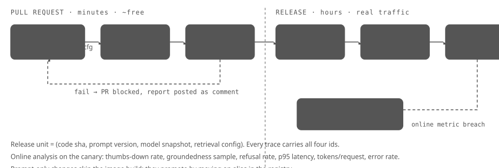

# Day 26 — CI/CD for GenAI

> Part of the [GenAI Architect study path](../../README.md) · Cloud Production Architecture · [Original interactive pack](https://claude.ai/artifact/H19QZwXQhxwBhQbevysbCh) · [Offline HTML](../../archive/html/day-26.html)


Day 26 of 30 · Week 4 — Cloud, production & architecture

# CI/CD for GenAI: eval gates, versioned prompts, safe rollback

A prompt edit is a production change with no compiler to catch it. Today is about treating prompts, models and retrieval config as release artefacts: test them in the pipeline, promote them by pointer, and roll back in seconds.

unit testsreplay eval gatenightly live evalblue-green / canaryauto-rollback

## Why this matters for the JD

The JD's "CI/CD & productionization" line names **testing, rollback and observability**, and the preferred list asks for **prompt versioning and eval dashboards**. In design reviews the question you'll get is "what stops a bad prompt from reaching 50k users, and how fast can you undo it?" Today gives you a defensible answer and a working pipeline to point at.

## Concept brief

### What is different from classic CI/CD

- **Four things change behaviour, not one.** Code, prompt template, model (and its provider-side snapshot), and retrieval config (chunking, embedding model, index, top-k, reranker). Each needs its own version id, and a release is the *tuple* of all four. Log that tuple on every trace.
- **Tests are statistical.** Same input, different output. You gate on *rates over a golden set* (pass rate ≥ floor, no more than X% drop vs production) rather than on single assertions. Pin `temperature=0` and a seed in CI to reduce noise, but never assume determinism across provider updates.
- **Evals cost money and time.** A 300-case LLM-as-judge suite on a hosted model can cost more than the build. So you tier them: cheap deterministic checks on every PR, the full judge suite nightly or pre-release, and online evals on live traffic.
- **The model can change under you.** A provider alias like `*-latest` is an unversioned dependency. Pin dated snapshots, and run the nightly live eval to catch drift you didn't ship.
- **Rollback should not need a build.** If prompts live in a registry and the app resolves an alias (`production → v7`) at runtime with a short cache TTL, rollback is a pointer move. Code and model-serving changes still use blue-green or canary.



Gates get more expensive and more realistic left to right. The cheap ones run on every PR; the costly ones run before or during release.

### The three layers of evaluation in a pipeline

1. **Deterministic checks** (every PR, milliseconds): JSON schema validity, required fields, citation ids exist in the retrieved set, abstention string present when it should be, banned-phrase and PII regex, token-count budget. These catch most breakages and never flake.
2. **Model-graded checks** (pre-merge on a sample, or nightly on the full set): faithfulness, answer relevance, context precision via RAGAS/DeepEval/promptfoo `llm-rubric`. Pin the judge model and version its rubric too, or your metric moves when the judge changes.
3. **Online checks** (during canary): user feedback, sampled judge scores on live traces (Langfuse/Phoenix from Day 27), latency and cost per request. These drive automated promotion or rollback through an analysis step such as an Argo Rollouts `AnalysisTemplate`.

### Cloud and watsonx equivalents

| Concern | watsonx | Azure | AWS | GCP |
| --- | --- | --- | --- | --- |
| Prompt versions | Prompt template assets in projects, promoted to deployment spaces | Prompty files in repo; AI Foundry prompt flow | Bedrock Prompt Management (versions + aliases) | Vertex AI prompt management |
| Offline eval | watsonx.governance evaluations | Azure AI Foundry evaluation SDK, callable from Actions/DevOps | Bedrock model and RAG evaluation jobs | Vertex Gen AI evaluation service |
| Progressive deploy | OpenShift + Argo Rollouts / OpenShift GitOps | AKS + Argo/Flagger, or Container Apps revisions with traffic split | EKS + Argo, or ECS/CodeDeploy blue-green | GKE + Argo, or Cloud Run traffic split |
| Monitoring for rollback | watsonx.governance monitors (quality, drift) | Azure Monitor + AI Foundry tracing | CloudWatch + Bedrock invocation logs | Cloud Monitoring + Vertex logging |

## Trade-offs & decision table

### Which eval to run where

| Option | Pick when | Failure mode | Cost / latency |
| --- | --- | --- | --- |
| Deterministic asserts | Always, on every PR. Structured output, citations, abstention, PII. | Passes answers that are well-formed but wrong. | Free, seconds. |
| Record / replay cassettes | PR checks without a live model or API key; reproducible diffs. | Stale cassettes hide provider drift; contributors forget to re-record. | Free in CI; one live run per prompt change. |
| Live small-set eval | Prompt or retrieval change that cassettes can't cover; 20–50 cases. | Flaky at threshold edges; needs secrets in CI. | Cents to a few dollars, 1–5 min. |
| LLM-as-judge full suite | Nightly and pre-release; faithfulness and relevance at scale. | Judge bias (length, self-preference), judge version drift. | Highest; budget it per run and cap concurrency. |
| Shadow traffic | Model swap or major retrieval change; compare on real queries. | Doubles inference spend; must not write side effects (tool calls!). | 2× tokens for the shadowed share. |
| Canary + online analysis | Any user-facing change with enough traffic for a signal. | Low traffic gives noisy metrics; slow-burning quality issues slip past. | Normal cost; release takes hours. |

### Where prompts live

| Option | Pick when | Failure mode | Rollback speed |
| --- | --- | --- | --- |
| In code (git only) | Small team, prompts change with code, strict review needed. | Every prompt tweak needs a deploy; domain experts can't edit. | Minutes (redeploy). |
| Registry with aliases | Langfuse, MLflow Prompt Registry, Bedrock Prompt Management, watsonx prompt assets. | Edits bypass CI unless the registry is wired to the gate; runtime dependency on registry. | Seconds (move alias), bounded by client cache TTL. |
| Hybrid: git is source of truth, CI syncs to registry | Enterprise default. Review in PRs, runtime resolution by alias. | Two systems can disagree if someone edits in the UI. | Seconds, with a git audit trail. |

### Deployment strategy for model-serving and app code

| Strategy | Pick when | Failure mode | GenAI-specific cost |
| --- | --- | --- | --- |
| Blue-green | Self-hosted model swap (vLLM image + weights), clean cutover, instant switch back. | Session or conversation state tied to the old stack; caches are cold on green. | Two full GPU pools during the switch. Expensive for large models. |
| Canary | App, prompt or API-model changes with steady traffic. | Need sticky routing so one conversation doesn't flip between versions. | Small extra capacity. |
| Feature flag / alias | Prompt and routing changes, per-tenant rollout. | Flag sprawl; untested flag combinations. | None. |

**Rollback trap:** rolling back the prompt but not the index. If a release re-chunked or re-embedded the corpus, the old prompt now runs against new retrieval. Keep the previous index (or a versioned alias such as an Elastic/Azure AI Search index alias) until the release is confirmed, and roll the tuple back together.

## Hands-on exercise · 75–90 min

**Build an eval-gated prompt release pipeline.** You'll version two prompts for an IT ticket-triage task (structured JSON with citations and abstention), gate the candidate against a production baseline on an 8-case golden set, wire it into GitHub Actions with record/replay, and practise promotion and rollback by alias. Everything runs locally on a 3B model; it fits in 6 GB VRAM.

### Setup (PowerShell)

**PowerShell**

```powershell
# Ollama for Windows: https://ollama.com/download  (native, no WSL2 needed)
ollama pull qwen2.5:3b          # ~1.9 GB, fits in 6 GB VRAM

mkdir genai-eval-gate; cd genai-eval-gate
mkdir prompts, data, tests, baselines, cassettes, .github\workflows
py -3.13 -m venv .venv
.\.venv\Scripts\Activate.ps1
python -m pip install --upgrade pip
python -m pip install "ollama>=0.6" "pytest>=9"
```

Then create the files below (same folder layout). The registry holds both versions; `v2` adds an explicit abstention rule and a priority definition.

**prompts/registry.json** · `lab/prompts/registry.json`

```json
{
  "ticket_triage": {
    "aliases": {
      "production": "v1",
      "candidate": "v2"
    },
    "versions": {
      "v1": {
        "model": "qwen2.5:3b",
        "system": "You triage IT support tickets. Use ONLY the context passages. Reply as JSON.",
        "template": "Context:\n{context}\n\nTicket: {ticket}\n\nReturn category (one of: access, network, hardware, software, unknown), priority (P1-P4), a one-sentence answer, and cited_ids (ids of passages you used)."
      },
      "v2": {
        "model": "qwen2.5:3b",
        "system": "You triage IT support tickets for an enterprise helpdesk. Use ONLY the context passages below. If the context does not answer the ticket, set category to \"unknown\", answer exactly \"I don't have enough information to answer.\" and cited_ids to []. Never invent passage ids.",
        "template": "Context passages (id: text):\n{context}\n\nTicket: {ticket}\n\nReturn JSON with: category (access|network|hardware|software|unknown), priority (P1 = outage for many users, P4 = how-to question), answer (one sentence, grounded in the passages), cited_ids (list of passage ids used)."
      }
    }
  }
}
```
**data/golden.jsonl — 8 cases, 2 of them must abstain** · saved as `lab/data/golden.jsonl`

```
{"id": "g01", "ticket": "I can't log in to the VPN since my password reset this morning.", "context": {"kb12": "After a password reset, VPN tokens are re-synced within 30 minutes. Sign out of the VPN client and sign in again.", "kb40": "Printers on floor 3 use the PRN-03 queue."}, "expect": {"category": "access", "cited": ["kb12"]}}
{"id": "g02", "ticket": "Whole Pune office has no Wi-Fi, 200 people affected.", "context": {"kb07": "Site-wide Wi-Fi outages are P1. Raise a bridge with the network on-call and check the WLC dashboard.", "kb12": "After a password reset, VPN tokens are re-synced within 30 minutes."}, "expect": {"category": "network", "priority": "P1", "cited": ["kb07"]}}
{"id": "g03", "ticket": "My laptop battery swells and the trackpad is lifting.", "context": {"kb21": "Swollen batteries are a safety hazard. Stop using the device and book a hardware swap at the IT desk.", "kb40": "Printers on floor 3 use the PRN-03 queue."}, "expect": {"category": "hardware", "cited": ["kb21"]}}
{"id": "g04", "ticket": "How do I install Python 3.13 from the company portal?", "context": {"kb33": "Developer tools, including Python, are installed from Software Center > Developer > Python. Pick the 3.13 package.", "kb07": "Site-wide Wi-Fi outages are P1."}, "expect": {"category": "software", "priority": "P4", "cited": ["kb33"]}}
{"id": "g05", "ticket": "What is the cafeteria menu for Friday?", "context": {"kb40": "Printers on floor 3 use the PRN-03 queue.", "kb21": "Swollen batteries are a safety hazard."}, "expect": {"category": "unknown", "abstain": true}}
{"id": "g06", "ticket": "Teams keeps crashing when I share my screen.", "context": {"kb35": "If Teams crashes during screen share, clear the Teams cache (%appdata%\\Microsoft\\Teams) and update the GPU driver.", "kb12": "VPN tokens re-sync after a password reset."}, "expect": {"category": "software", "cited": ["kb35"]}}
{"id": "g07", "ticket": "Can you approve my travel reimbursement?", "context": {"kb33": "Developer tools are installed from Software Center.", "kb07": "Site-wide Wi-Fi outages are P1."}, "expect": {"category": "unknown", "abstain": true}}
{"id": "g08", "ticket": "I need access to the finance SharePoint site for the Q3 audit.", "context": {"kb15": "SharePoint access requests go through the Access Portal. The site owner approves within one business day.", "kb35": "Clear the Teams cache if it crashes."}, "expect": {"category": "access", "cited": ["kb15"]}}
```
**llm.py — live / replay / mock providers** · saved as `lab/llm.py`

```python
"""Provider layer: live Ollama, record/replay cassettes, and a mock for gate-logic tests.

LLM_MODE=live    -> call Ollama, and write every response to cassettes/ (record)
LLM_MODE=replay  -> read cassettes/ only; a missing entry is a hard error (CI default)
LLM_MODE=mock    -> deterministic fake answers, for unit-testing the gate itself
"""
import hashlib, json, os, time
from pathlib import Path

CASSETTES = Path(__file__).parent / "cassettes"

SCHEMA = {
    "type": "object",
    "properties": {
        "category": {"type": "string", "enum": ["access", "network", "hardware", "software", "unknown"]},
        "priority": {"type": "string", "enum": ["P1", "P2", "P3", "P4"]},
        "answer": {"type": "string"},
        "cited_ids": {"type": "array", "items": {"type": "string"}},
    },
    "required": ["category", "priority", "answer", "cited_ids"],
}

def _key(model: str, messages: list[dict]) -> str:
    raw = json.dumps({"model": model, "messages": messages, "schema": SCHEMA}, sort_keys=True)
    return hashlib.sha256(raw.encode()).hexdigest()[:16]

def chat(model: str, messages: list[dict], case: dict | None = None) -> dict:
    """Return {"content": str, "latency_ms": float, "in_tokens": int, "out_tokens": int}."""
    mode = os.getenv("LLM_MODE", "replay")
    key = _key(model, messages)
    path = CASSETTES / f"{key}.json"

    if mode == "replay":
        if not path.exists():
            raise RuntimeError(f"No cassette {path.name}. Run once with LLM_MODE=live and commit cassettes/.")
        return json.loads(path.read_text(encoding="utf-8"))

    if mode == "mock":
        exp = (case or {}).get("expect", {})
        body = {
            "category": exp.get("category", "unknown"),
            "priority": exp.get("priority", "P3"),
            "answer": "I don't have enough information to answer." if exp.get("abstain") else "See the cited passage.",
            "cited_ids": exp.get("cited", []),
        }
        return {"content": json.dumps(body), "latency_ms": 120.0, "in_tokens": 180, "out_tokens": 40}

    import ollama  # live mode only
    t0 = time.perf_counter()
    resp = ollama.chat(model=model, messages=messages, format=SCHEMA,
                       options={"temperature": 0, "seed": 42, "num_ctx": 4096})
    out = {
        "content": resp.message.content,
        "latency_ms": round((time.perf_counter() - t0) * 1000, 1),
        "in_tokens": resp.prompt_eval_count or 0,
        "out_tokens": resp.eval_count or 0,
    }
    CASSETTES.mkdir(exist_ok=True)
    path.write_text(json.dumps(out, indent=2), encoding="utf-8")
    return out
```
**eval_gate.py — score, compare, exit non-zero on regression** · saved as `lab/eval_gate.py`

```python
"""Eval gate: score a prompt version on the golden set and compare to the production baseline.

Exit code 0 = gate passed, 1 = regression (blocks the PR / deployment).
Usage:  python eval_gate.py --prompt ticket_triage --alias candidate
        python eval_gate.py --prompt ticket_triage --alias production --write-baseline
"""
import argparse, json, statistics, sys
from pathlib import Path
from llm import chat

ROOT = Path(__file__).parent
ABSTAIN = "i don't have enough information"
# Price card per 1M tokens, so the gate also reports cost. Local Ollama is free; these
# placeholder numbers stand in for whatever hosted model you would run in production.
PRICE_IN, PRICE_OUT = 0.15, 0.60

GATE = {
    "min_pass_rate": 0.80,        # absolute floor
    "max_pass_drop": 0.05,        # vs production baseline
    "min_schema_rate": 1.00,      # structured output must never break
    "max_p95_ratio": 1.30,        # latency budget vs baseline
    "max_cost_ratio": 1.25,       # cost budget vs baseline
}

def load_prompt(name: str, alias: str) -> tuple[str, dict]:
    reg = json.loads((ROOT / "prompts" / "registry.json").read_text(encoding="utf-8"))[name]
    version = reg["aliases"].get(alias, alias)  # accept an alias or a raw version id
    return version, reg["versions"][version]

def score_case(case: dict, raw: str) -> dict:
    exp = case["expect"]
    try:
        out = json.loads(raw)
        schema_ok = all(k in out for k in ("category", "priority", "answer", "cited_ids"))
    except json.JSONDecodeError:
        return {"schema_ok": False, "passed": False, "reason": "invalid JSON"}
    if not schema_ok:
        return {"schema_ok": False, "passed": False, "reason": "missing keys"}

    cited = set(out["cited_ids"])
    checks = {
        "category": out["category"] == exp["category"],
        "no_invented_ids": cited <= set(case["context"]),          # groundedness, cheap form
    }
    if exp.get("abstain"):
        checks["abstained"] = ABSTAIN in out["answer"].lower() and not cited
    else:
        checks["cites_expected"] = set(exp.get("cited", [])) <= cited
    if "priority" in exp:
        checks["priority"] = out["priority"] == exp["priority"]
    failed = [k for k, v in checks.items() if not v]
    return {"schema_ok": True, "passed": not failed, "reason": ", ".join(failed) or "ok"}

def run(name: str, alias: str) -> dict:
    version, p = load_prompt(name, alias)
    cases = [json.loads(l) for l in (ROOT / "data" / "golden.jsonl").read_text(encoding="utf-8").splitlines() if l.strip()]
    rows = []
    for c in cases:
        ctx = "\n".join(f"{k}: {v}" for k, v in c["context"].items())
        messages = [{"role": "system", "content": p["system"]},
                    {"role": "user", "content": p["template"].format(context=ctx, ticket=c["ticket"])}]
        r = chat(p["model"], messages, case=c)
        rows.append({"id": c["id"], **score_case(c, r["content"]), **{k: r[k] for k in ("latency_ms", "in_tokens", "out_tokens")}})

    lat = sorted(r["latency_ms"] for r in rows)
    p95 = lat[min(len(lat) - 1, round(0.95 * (len(lat) - 1)))]
    cost = sum(r["in_tokens"] * PRICE_IN + r["out_tokens"] * PRICE_OUT for r in rows) / 1e6
    return {
        "prompt": name, "version": version, "model": p["model"], "n": len(rows),
        "pass_rate": round(sum(r["passed"] for r in rows) / len(rows), 3),
        "schema_rate": round(sum(r["schema_ok"] for r in rows) / len(rows), 3),
        "p95_latency_ms": p95, "median_latency_ms": statistics.median(lat),
        "cost_per_1k_requests_usd": round(cost / len(rows) * 1000, 4),
        "rows": rows,
    }

def gate(cand: dict, base: dict | None) -> list[str]:
    fails = []
    if cand["pass_rate"] < GATE["min_pass_rate"]:
        fails.append(f"pass_rate {cand['pass_rate']} < floor {GATE['min_pass_rate']}")
    if cand["schema_rate"] < GATE["min_schema_rate"]:
        fails.append(f"schema_rate {cand['schema_rate']} < {GATE['min_schema_rate']}")
    if base:
        if base["pass_rate"] - cand["pass_rate"] > GATE["max_pass_drop"]:
            fails.append(f"pass_rate dropped {base['pass_rate']} -> {cand['pass_rate']}")
        if cand["p95_latency_ms"] > base["p95_latency_ms"] * GATE["max_p95_ratio"]:
            fails.append(f"p95 latency {cand['p95_latency_ms']}ms > {GATE['max_p95_ratio']}x baseline")
        if base["cost_per_1k_requests_usd"] and cand["cost_per_1k_requests_usd"] > base["cost_per_1k_requests_usd"] * GATE["max_cost_ratio"]:
            fails.append(f"cost/1k ${cand['cost_per_1k_requests_usd']} > {GATE['max_cost_ratio']}x baseline")
    return fails

def report_md(cand: dict, base: dict | None, fails: list[str]) -> str:
    def b(k): return base[k] if base else "-"
    lines = [f"## Eval gate: `{cand['prompt']}` {cand['version']} ({cand['model']})",
             f"**{'FAILED' if fails else 'PASSED'}**", "",
             "| metric | baseline | candidate |", "|---|---|---|"]
    for k in ("pass_rate", "schema_rate", "p95_latency_ms", "cost_per_1k_requests_usd"):
        lines.append(f"| {k} | {b(k)} | {cand[k]} |")
    lines += ["", "| case | passed | reason |", "|---|---|---|"]
    lines += [f"| {r['id']} | {'yes' if r['passed'] else 'no'} | {r['reason']} |" for r in cand["rows"]]
    if fails:
        lines += ["", "### Blocking", *[f"- {f}" for f in fails]]
    return "\n".join(lines)

if __name__ == "__main__":
    ap = argparse.ArgumentParser()
    ap.add_argument("--prompt", default="ticket_triage")
    ap.add_argument("--alias", default="candidate")
    ap.add_argument("--write-baseline", action="store_true")
    a = ap.parse_args()

    res = run(a.prompt, a.alias)
    base_path = ROOT / "baselines" / f"{a.prompt}.json"
    if a.write_baseline:
        base_path.write_text(json.dumps(res, indent=2), encoding="utf-8")
        print(f"Baseline written for {res['version']}: pass_rate={res['pass_rate']}")
        sys.exit(0)

    base = json.loads(base_path.read_text(encoding="utf-8")) if base_path.exists() else None
    fails = gate(res, base)
    md = report_md(res, base, fails)
    (ROOT / "eval_report.md").write_text(md, encoding="utf-8")
    print(md)
    sys.exit(1 if fails else 0)
```
**promote.py — promotion and rollback are the same pointer move** · saved as `lab/promote.py`

```python
"""Move a prompt alias. Rollback is the same operation pointed backwards: no rebuild, no redeploy.

python promote.py ticket_triage production v2      # promote
python promote.py ticket_triage production v1      # roll back
"""
import json, sys
from datetime import datetime, timezone
from pathlib import Path

REG = Path(__file__).parent / "prompts" / "registry.json"
name, alias, version = sys.argv[1:4]
reg = json.loads(REG.read_text(encoding="utf-8"))
if version not in reg[name]["versions"]:
    sys.exit(f"Unknown version {version}")
old = reg[name]["aliases"].get(alias)
reg[name]["aliases"][alias] = version
REG.write_text(json.dumps(reg, indent=2), encoding="utf-8")
with open(REG.parent / "CHANGELOG.log", "a", encoding="utf-8") as f:   # audit trail
    f.write(f"{datetime.now(timezone.utc).isoformat()} {name} {alias}: {old} -> {version}\n")
print(f"{name}:{alias} {old} -> {version}")
```
**tests/test_gate.py — test the gate, not just the prompt** · saved as `lab/tests/test_gate.py`

```python
"""Tests for the gate itself (LLM_MODE=mock), so a broken scorer can't silently pass bad prompts."""
import json, os, sys
from pathlib import Path
sys.path.insert(0, str(Path(__file__).parents[1]))
os.environ["LLM_MODE"] = "mock"
import eval_gate as g

CASE = {"context": {"kb1": "x"}, "expect": {"category": "access", "cited": ["kb1"]}}

def test_invalid_json_fails():
    assert g.score_case(CASE, "not json")["schema_ok"] is False

def test_invented_citation_fails():
    raw = json.dumps({"category": "access", "priority": "P3", "answer": "a", "cited_ids": ["kb1", "kb99"]})
    assert g.score_case(CASE, raw)["passed"] is False

def test_mock_run_passes_gate():
    res = g.run("ticket_triage", "candidate")
    assert res["pass_rate"] == 1.0 and g.gate(res, res) == []

def test_regression_is_blocked():
    res = g.run("ticket_triage", "candidate")
    worse = {**res, "pass_rate": 0.7}
    assert any("dropped" in f or "floor" in f for f in g.gate(worse, res))
```
**.github/workflows/eval-gate.yml** · saved as `lab/github/workflows/eval-gate.yml`

```yaml
name: eval-gate
on:
  pull_request:
    paths: ["prompts/**", "data/**", "eval_gate.py", "llm.py", "cassettes/**"]
  schedule:
    - cron: "30 20 * * *"        # nightly live run, 02:00 IST
  workflow_dispatch:

permissions:
  contents: read
  pull-requests: write

jobs:
  gate:
    runs-on: ubuntu-latest
    env:
      LLM_MODE: ${{ github.event_name == 'pull_request' && 'replay' || 'live' }}
    steps:
      - uses: actions/checkout@v5
      - uses: actions/setup-python@v6
        with:
          python-version: "3.13"
      - run: python -m pip install pytest ollama
      - name: Unit-test the gate
        run: python -m pytest -q tests
      - name: Start Ollama (live runs only)
        if: env.LLM_MODE == 'live'
        run: |
          curl -fsSL https://ollama.com/install.sh | sh
          ollama serve & sleep 5
          ollama pull qwen2.5:3b
      - name: Run eval gate
        id: gate
        run: python eval_gate.py --prompt ticket_triage --alias candidate
      - name: Post report on the PR
        if: always() && github.event_name == 'pull_request'
        env:
          GH_TOKEN: ${{ github.token }}
        run: gh pr comment ${{ github.event.pull_request.number }} --body-file eval_report.md --edit-last --create-if-none
```

### Run it

**PowerShell**

```powershell
# 1. Test the gate logic itself (no model needed)
python -m pytest -q tests

# 2. Dry run of the whole flow with the mock provider
$env:LLM_MODE = "mock"
python eval_gate.py --alias production --write-baseline
python eval_gate.py --alias candidate

# 3. Real run on your GPU: records cassettes as it goes
Remove-Item baselines\*.json -ErrorAction SilentlyContinue
$env:LLM_MODE = "live"
python eval_gate.py --alias production --write-baseline   # baseline = v1
python eval_gate.py --alias candidate                     # gate v2 against it
echo "exit code: $LASTEXITCODE"                            # 0 = pass, 1 = blocked

# 4. Replay: what CI runs on a PR. Same result, no GPU, no network
$env:LLM_MODE = "replay"
python eval_gate.py --alias candidate

# 5. Promote, then roll back (a pointer move, no rebuild)
python promote.py ticket_triage production v2
python promote.py ticket_triage production v1
Get-Content prompts\CHANGELOG.log
```

### Expected output

The mock run and pytest are deterministic (I ran them before sending this): four tests pass, and the gate prints a `PASSED` table with `pass_rate 1.0`. The live run varies by model. With `qwen2.5:3b`, expect `v1` to miss one or both abstain cases (g05, g07), because it has no abstention rule. `v2` should match or beat it. A typical report looks like this:

**eval_report.md (live, illustrative)** · saved as `lab/eval_report.md`

```
Baseline written for v1: pass_rate=0.75
## Eval gate: `ticket_triage` v2 (qwen2.5:3b)
**PASSED**

| metric | baseline | candidate |
|---|---|---|
| pass_rate | 0.75 | 1.0 |
| schema_rate | 1.0 | 1.0 |
| p95_latency_ms | 1840.2 | 1712.6 |
| cost_per_1k_requests_usd | 0.0702 | 0.0815 |

| case | passed | reason |
|---|---|---|
| g01 | yes | ok |
| g05 | yes | ok |
...
exit code: 0
```

Laptop latency for a 3B model on an RTX 3050 is usually a few hundred ms to ~2 s per case. The first call is slower while the model loads. If the gate fails on latency only, that is load noise; run it again with the model already warm, which is also the lesson about latency gates on shared CI runners.

### Stretch goals

1. **Make the gate catch a real regression.** Add a `v3` that drops the "never invent passage ids" line and asks for "at least two citations". Run it live. The `no_invented_ids` check should fail, the job should exit 1, and the report should name the failing cases. Then add a promptfoo config with an `llm-rubric` faithfulness assertion that uses Ollama as the judge, and compare what each tool catches.
2. **Runtime alias resolution with rollback SLO.** Wrap the triage call in a small FastAPI service (Day 24) that resolves `production` from the registry with a 30 s cache. Promote `v2`, send traffic, roll back to `v1`, and measure how long until every response carries `prompt_version=v1` in its trace metadata. That number is your rollback SLO.

**Windows notes.** Ollama runs natively on Windows, so no WSL2 is needed for the exercise. Running the workflow locally with `act` needs Docker Desktop with the WSL2 backend. The CI live job installs Ollama on the Ubuntu runner with CPU only, so a 3B model there takes a few minutes. Use `qwen2.5:0.5b` for the nightly job if time matters, and keep a separate baseline per model.

## GitHub repos to study

#### [promptfoo/promptfoo](https://github.com/promptfoo/promptfoo)

Read `examples/` for YAML eval configs with `assert` types, and the [GitHub Action](https://promptfoo.dev/docs/integrations/github-action) that posts before/after prompt diffs on PRs. Acquired by OpenAI in March 2026; check the licence and roadmap before you standardise on it.

#### [confident-ai/deepeval](https://github.com/confident-ai/deepeval)

Pytest-native LLM tests (`assert_test`, `deepeval test run`). Read how metrics set thresholds and how `GEval` builds a judge rubric. This is the closest match to your QA-automation background.

#### [mlflow/mlflow](https://github.com/mlflow/mlflow)

Look at `mlflow/genai/`: the Prompt Registry (immutable versions plus mutable aliases) and `mlflow.genai.evaluate` with scorers. A good reference for the registry data model.

#### [argoproj/argo-rollouts](https://github.com/argoproj/argo-rollouts)

Study `examples/` for blue-green with `prePromotionAnalysis` and canary steps with Prometheus-backed `AnalysisTemplate`s. Swap the HTTP error-rate query for a groundedness or thumbs-down metric.

## Read / watch

- [DeepEval: Unit Testing in CI/CD](https://deepeval.com/docs/evaluation-unit-testing-in-ci-cd). How to structure LLM tests so they run in GitHub Actions, with thresholds and per-test-case reporting.
- [Langfuse: Prompt Version Control](https://langfuse.com/docs/prompt-management/features/prompt-version-control). The version and label model (`production`, `staging`), client-side caching and how rollback works in practice.
- [Argo Rollouts: Blue-Green](https://argo-rollouts.readthedocs.io/en/latest/features/bluegreen/), then the [Analysis](https://argo-rollouts.readthedocs.io/en/latest/features/analysis/) page. Preview vs active services, auto-promotion and analysis-driven abort.

## Interview questions

**Your LLM evals are non-deterministic. How do you build a CI gate that doesn't flake?**

Separate determinism by layer. Every PR runs deterministic checks (schema, citation validity, abstention, PII) plus replayed responses, which can't flake. Model-graded evals gate on aggregate rates over a golden set with a tolerance band (for example "no more than 3 points below production"), not on single cases. For borderline results I re-run the failing subset n times and use majority or a confidence interval. Temperature 0 and pinned model snapshots reduce noise but don't remove it. The full judge suite runs nightly, where a flake costs a ticket rather than a blocked merge.

**What exactly do you version in a GenAI release, and why?**

The tuple: code commit, prompt version, model id with dated snapshot, and retrieval config (embedding model, chunker settings, index version, top-k, reranker). Plus judge model and rubric version for the evals themselves. Any one of these can change behaviour on its own, so each gets an immutable id and every trace logs all of them. Without that, "quality dropped on Tuesday" can't be traced to a cause, and rollback is guesswork.

**A business analyst wants to edit prompts in a UI without waiting for a deploy. How do you allow that safely?**

Use a registry with aliases, but make edits create new immutable versions that start under a `candidate` label. A webhook or scheduled job runs the eval gate against that version, and only a pass, plus an approver in a protected environment, moves the `production` alias. Git stays the audit record (CI syncs registry to repo, or the reverse). The app resolves the alias with a short cache TTL, so rollback is moving the pointer back. RBAC separates who can edit from who can promote.

**Blue-green or canary for swapping a self-hosted 70B model for a newer one?**

For a weights swap, blue-green gives the cleanest cutover and instant switch-back, but it needs two full GPU pools for the duration. That's the expensive part, so I keep the overlap short and plan GPU quota for it. If the GPU budget can't cover that, I'd run canary at the gateway level (LiteLLM or an API gateway routes 5% to the new pool) with sticky routing per conversation. Either way, shadow traffic first in staging to compare outputs, warm the KV and prefix caches on the new pool, and use online analysis on refusal rate, groundedness samples, latency and error rate to drive promotion or abort.

**How would you prevent "eval overfitting", where the golden set keeps passing but users complain?**

Treat the golden set as a living dataset: sample production traces weekly (stratified by intent and by low-feedback scores), have SMEs label them, and add them to the set. Keep a hidden holdout that prompt authors can't see. Track online metrics (thumbs-down, escalation rate) next to offline scores on one dashboard; if they diverge, the eval set has gone stale. Rotate in adversarial and prompt-injection cases from red-teaming, and re-baseline the judge against human labels each quarter.

## Architect's lens

**ADR-026: Prompt release and rollback mechanism for the enterprise knowledge assistant** · Status: Accepted

Context

Prompts change weekly and are edited by both engineers and domain SMEs. Each rebuild and redeploy of the app takes about 25 minutes. A bad prompt last quarter caused 40 minutes of ungrounded answers before the rollback finished. Compliance requires an audit trail of every production prompt.

Options

**A.** Prompts in code, shipped with the image (canary deploy). **B.** Registry-only, edited in the UI, alias resolved at runtime. **C.** Hybrid: git is the source of truth, CI runs the eval gate and syncs approved versions to the registry; the app resolves the `production` alias with a 30 s TTL.

Decision

**C.** PR checks run deterministic and replayed evals. Merging creates a registry version labelled `candidate`. Promotion to `production` needs the nightly live eval to pass and approval in a GitHub protected environment. Rollback is moving the alias back, which is available to on-call without a deploy.

Consequences

Rollback drops from ~25 min to under 1 min (TTL-bound). The app now depends at runtime on the registry, so we keep a last-known-good prompt bundled in the image as a fallback. UI edits are disabled in production projects so the two sources can't drift. Retrieval-config changes still go through image deploys and are out of scope for this mechanism. We'll revisit that when index aliases are in place.

## Tomorrow

Day 27: GenAI observability with Langfuse, LangSmith, Arize Phoenix and the OpenTelemetry GenAI semantic conventions, plus eval dashboards and cost tracking. Today's trace metadata (the release tuple) is what you'll instrument.

## Sources

- <https://promptfoo.dev/docs/integrations/github-action>
- <https://github.com/promptfoo/promptfoo>
- <https://github.com/promptfoo/promptfoo/releases>
- <https://www.npmjs.com/package/promptfoo>
- <https://finance.yahoo.com/news/openai-acquires-promptfoo-secure-ai-174904138.html>
- <https://github.com/confident-ai/deepeval>
- <https://pypi.org/project/deepeval/>
- <https://deepeval.com/docs/evaluation-unit-testing-in-ci-cd>
- <https://deepeval.com/changelog/changelog-2026>
- <https://github.com/mlflow/mlflow>
- <https://mlflow.org/docs/latest/genai/prompt-registry/manage-prompt-lifecycles-with-aliases/>
- <https://langfuse.com/docs/prompt-management/features/prompt-version-control>
- <https://github.com/argoproj/argo-rollouts>
- <https://github.com/argoproj/argo-rollouts/releases>
- <https://argo-rollouts.readthedocs.io/en/latest/features/bluegreen/>
- <https://argo-rollouts.readthedocs.io/en/latest/features/analysis/>
- <https://pypi.org/project/ollama/>
- <https://ollama.com/download>

## Lab files in this folder

- [`lab/prompts/registry.json`](lab/prompts/registry.json)
- [`lab/data/golden.jsonl`](lab/data/golden.jsonl)
- [`lab/llm.py`](lab/llm.py)
- [`lab/eval_gate.py`](lab/eval_gate.py)
- [`lab/promote.py`](lab/promote.py)
- [`lab/tests/test_gate.py`](lab/tests/test_gate.py)
- [`lab/github/workflows/eval-gate.yml`](lab/github/workflows/eval-gate.yml)
- [`lab/eval_report.md`](lab/eval_report.md)
