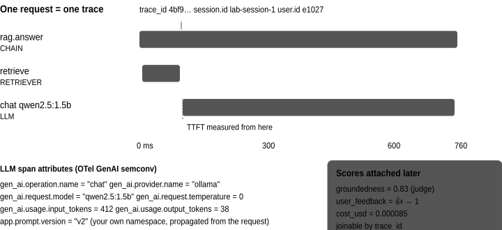
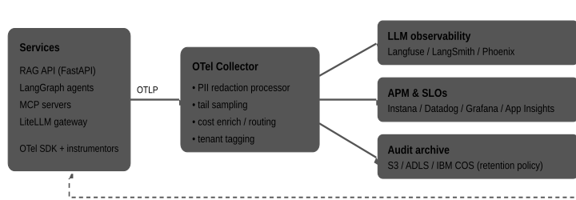

# Day 27 — GenAI Observability

> Part of the [GenAI Architect study path](../../README.md) · Cloud Production Architecture · [Original interactive pack](https://claude.ai/artifact/TL9YSofunx3xNvZxxisTrr) · [Offline HTML](../../archive/html/day-27.html)


Week 4 · Cloud, production & architecture

# Day 27 — GenAI observability

Tracing, prompt versioning, eval dashboards and cost tracking: Langfuse, LangSmith, Arize Phoenix and the OpenTelemetry GenAI semantic conventions.

Thu 5 Nov 2026langfuse 5.1.0arize-phoenix 21.0.0langsmith 0.14.17opentelemetry-sdk 1.45.2

## Why this matters for the JD

The JD lists **observability** twice: under CI/CD & productionization ("testing, observability, rollback, scaling, cost controls") and as a preferred skill ("GenAI observability: tracing, prompt versioning, eval dashboards").

It is also where the **evaluation** must-have (groundedness, latency/cost) runs in production, and where **responsible AI** (PII masking) has to be enforced, because traces are full of prompts and retrieved documents.

## Concept brief

Classic APM answers "is it up and fast?". GenAI observability also has to answer "was the answer right, what did it cost, and which prompt, model and retrieval produced it?". The unit of analysis is a **trace**: a tree of spans for one user request, where each span is typed (chain, retriever, LLM, tool, agent, guardrail, evaluator) and carries GenAI attributes such as model, token usage, prompt version and retrieved document IDs. Scores (user feedback, LLM-judge, heuristic) attach to traces or spans after the fact.



chainretrieverLLM call

The waterfall shows where latency goes (here the LLM dominates), and the attributes make it queryable: cost per prompt version, p95 per model, and groundedness per retriever config.

### The four layers you design

1. **Instrumentation.** Auto-instrumentors patch SDKs (OpenAI, Anthropic, Bedrock, LangChain/LangGraph, LlamaIndex). There are two attribute dialects: **OpenInference** (Arize; `llm.token_count.prompt`, `openinference.span.kind`) and **OTel GenAI semconv** (`gen_ai.*`, span name `"{operation} {model}"`). OpenLLMetry (Traceloop) and the OTel contrib `instrumentation-genai` packages emit `gen_ai.*`. Langfuse v4+/v5 and Phoenix ingest both.
2. **Transport and policy.** Use OTLP into an **OpenTelemetry Collector**. This is where you redact PII from `gen_ai.input.messages`, apply tail sampling (keep 100% of errors, thumbs-down and high-cost traces, and around 5–10% of the rest), and fan out to several backends.
3. **Backends.** An LLM-native store (Langfuse, LangSmith, Phoenix, Opik) for trace drill-down, prompts, datasets and evals. Your existing APM (Datadog, Grafana/Tempo, Instana, App Insights) for SLOs and on-call. Cold storage (S3/ADLS/COS) for audit retention.
4. **Feedback loop.** Online evaluators score sampled production traces. Bad traces get promoted into datasets, and those datasets become the CI eval gates from Day 26. Prompt versions are linked to traces, so a regression points to a specific version.



Keep instrumentation vendor-neutral and put policy in the Collector. Swapping Langfuse for LangSmith then means changing an exporter, with no code changes.

### Where the standard actually stands (Nov 2026)

All `gen_ai.*` attributes are still at **Development** stability. In June 2026 (semconv v1.42.0) the GenAI conventions moved into their own repo, `open-telemetry/semantic-conventions-genai`, which had no tagged release as of Dash0's September explainer. The required attributes are `gen_ai.operation.name` and `gen_ai.provider.name`, which replaced the older `gen_ai.system`. Prompt and completion content goes in an **event** (`gen_ai.client.inference.operation.details` carrying `gen_ai.input.messages` / `output.messages`), not in span attributes, and capturing it is opt-in per instrumentation. In a design review: build on the semconv, pin instrumentor versions, and expect attribute renames.

### Cloud and IBM mapping

| Platform | Native GenAI telemetry | Note for architects |
| --- | --- | --- |
| IBM | watsonx.governance (prompt-template monitoring, quality/drift metrics, AI Factsheets); Instana for traces | Governance gives model-risk evidence; Instana gives runtime traces. Usually you need both, joined on a request ID. |
| Azure | AI Foundry tracing → Application Insights (OTel-based) | Easiest path if you are already on Azure Monitor. Content capture is a flag, so check it against your DPDP posture. |
| AWS | Bedrock model-invocation logging → CloudWatch/S3; AgentCore observability | Invocation logs are per call, not trace trees. Add OTel spans for retrieval and tools. |
| GCP | Vertex AI + Cloud Trace / Cloud Logging | OTLP export into Cloud Trace works; LLM-specific views are thinner than in Langfuse or Phoenix. |

## Trade-offs & decision table

| Option | Pick when | Failure modes | Cost / latency |
| --- | --- | --- | --- |
| Langfuse (OSS, MIT core) | You need self-hosting for data residency, prompt management, datasets and evals in one place, and framework-agnostic OTel ingest | Self-hosting means running Postgres, ClickHouse, Redis and S3, which you then own. SDK majors move fast (v3→v4→v5 within about 18 months). | Async batched export, so negligible on the request path. Infra cost grows with ClickHouse volume. |
| LangSmith | The team is heavily on LangChain/LangGraph and SaaS is acceptable | Self-hosting is an enterprise-tier deal. Pricing is per trace with retention tiers, which gets expensive at high QPS. | Background thread export. Cost scales with trace count, so sample. |
| Arize Phoenix (OSS) | Local dev, eval-heavy work (evals library, experiments), OpenInference ecosystem; on-prem with simple deployment | Single-node SQLite by default, so production needs Postgres. Fewer governance features than commercial Arize AX. | Free. Runs on a laptop (`phoenix serve`). |
| Existing APM only (Datadog / Instana / App Insights) | The org mandates one pane of glass and only SLOs matter | Weak prompt/eval UX: no datasets, no prompt diffing, no judge scores. | Often the most expensive per GB of span data once prompt content is included. |
| Raw OTel + Collector fan-out (recommended base) | Multi-vendor or multi-cloud estate, or you want to avoid lock-in | You own the semconv drift, Collector config and redaction rules. | Collector hop adds about 1 ms off-path. Tail sampling needs memory sized for the decision wait window. |

**Content-capture rule of thumb:** log token counts, model and IDs at 100%. Log prompt and completion text only after redaction, only for sampled traces, and with a shorter retention than metadata. That one policy covers most of the DPDP and EU AI Act logging questions you will get in a review.

## Hands-on lab · 60–90 min

**Goal:** instrument a small RAG pipeline with OpenTelemetry, view the trace tree in a local Phoenix server, and build a **cost/latency ledger per prompt version** from the same spans with a vendor-neutral `SpanProcessor`. Everything runs natively on Windows 11 with no Docker or WSL2. Tested on Python 3.13 with the versions in the header.

### Setup (PowerShell)

PowerShell
```text
# 1) Ollama for Windows (native installer from ollama.com), then pull a 6 GB-VRAM-friendly model
ollama pull qwen2.5:1.5b

# 2) Project + venv
mkdir day27-obs; cd day27-obs
py -3.13 -m venv .venv
.\.venv\Scripts\Activate.ps1          # if blocked: Set-ExecutionPolicy -Scope CurrentUser RemoteSigned
python -m pip install --upgrade pip
python -m pip install "arize-phoenix==21.0.0" "arize-phoenix-otel==0.17.2" `
    openinference-instrumentation-openai "openai>=2" "opentelemetry-sdk==1.45.2"

# 3) Start the local Phoenix server in its own terminal (UI + OTLP on :6006, SQLite in ~\.phoenix)
phoenix serve
```

### Starter code — obs\_lab.py

obs\_lab.py
`lab/obs_lab.py`

```python
"""Day 27 lab: trace a mini RAG pipeline with OpenTelemetry -> Phoenix, and build a
cost/latency/quality ledger from the same spans (vendor-neutral SpanProcessor)."""
import contextvars, os, statistics, time
from collections import defaultdict

from openai import OpenAI
from opentelemetry import trace
from opentelemetry.sdk.trace import SpanProcessor
from phoenix.otel import register
from openinference.instrumentation.openai import OpenAIInstrumentor

PHOENIX = os.getenv("PHOENIX_ENDPOINT", "http://localhost:6006/v1/traces")
MODEL = os.getenv("LAB_MODEL", "qwen2.5:1.5b")
BASE_URL = os.getenv("LAB_BASE_URL", "http://localhost:11434/v1")  # Ollama's OpenAI-compatible API

# Shadow price list (USD per 1M tokens). Local models are "free", but pricing them as if they
# were a hosted model is how you build the business case before choosing a provider.
PRICES = {MODEL: {"in": 0.15, "out": 0.60}}

PROMPT_VERSION = contextvars.ContextVar("prompt_version", default="?")

class CostLedger(SpanProcessor):
    """Reads token usage from LLM spans. Understands both OpenInference attributes
    (llm.token_count.*) and OTel GenAI semconv (gen_ai.usage.*), so it survives a swap
    of instrumentation library."""

    def __init__(self):
        self.rows = []

    def on_start(self, span, parent_context=None):
        # Stamp request-scoped metadata on EVERY span (incl. auto-instrumented LLM spans),
        # the same idea as Langfuse's propagate_attributes(). Enables group-by-version.
        span.set_attribute("app.prompt.version", PROMPT_VERSION.get())

    def on_end(self, span):
        a = span.attributes or {}
        tin = a.get("gen_ai.usage.input_tokens", a.get("llm.token_count.prompt"))
        tout = a.get("gen_ai.usage.output_tokens", a.get("llm.token_count.completion"))
        if tin is None:
            return
        model = a.get("gen_ai.request.model", a.get("llm.model_name", MODEL))
        p = PRICES.get(model, next(iter(PRICES.values())))
        self.rows.append({
            "version": a.get("app.prompt.version", "?"),
            "ms": (span.end_time - span.start_time) / 1e6,
            "tin": tin, "tout": tout,
            "usd": tin / 1e6 * p["in"] + tout / 1e6 * p["out"],
        })

    def report(self):
        by = defaultdict(list)
        for r in self.rows:
            by[r["version"]].append(r)
        print(f"\n{'prompt':<8}{'calls':>6}{'p50 ms':>9}{'p95 ms':>9}{'tok in':>8}{'tok out':>8}{'$/1k req':>10}")
        for v, rs in sorted(by.items()):
            ms = sorted(r["ms"] for r in rs)
            p95 = ms[min(len(ms) - 1, int(0.95 * len(ms)))]
            usd = sum(r["usd"] for r in rs) / len(rs) * 1000
            print(f"{v:<8}{len(rs):>6}{statistics.median(ms):>9.0f}{p95:>9.0f}"
                  f"{sum(r['tin'] for r in rs):>8}{sum(r['tout'] for r in rs):>8}{usd:>10.4f}")

# ---- tracing setup -------------------------------------------------------------------------
tp = register(project_name="day27-observability", endpoint=PHOENIX, batch=True, verbose=False)
ledger = CostLedger()
# GOTCHA: phoenix.otel replaces its exporter on add_span_processor() unless told not to.
tp.add_span_processor(ledger, replace_default_processor=False)
OpenAIInstrumentor().instrument(tracer_provider=tp)
tracer = trace.get_tracer("day27.lab")

client = OpenAI(base_url=BASE_URL, api_key="ollama")

DOCS = {
    "kb-01": "Employees may carry forward at most 10 days of unused annual leave into the next year.",
    "kb-02": "Expense claims above INR 50,000 need approval from a cost-centre head within 7 days.",
    "kb-03": "Production access requires a ticket, manager approval and expires after 8 hours.",
    "kb-04": "Laptops must be encrypted with BitLocker; USB mass storage is blocked by policy.",
}
PROMPTS = {
    "v1": "Answer the question using the context.\nContext:\n{ctx}\nQuestion: {q}",
    "v2": ("You are a policy assistant. Answer ONLY from the context in one sentence and cite the "
           "doc id in brackets. If the context does not contain the answer, reply exactly: "
           "I don't know.\nContext:\n{ctx}\nQuestion: {q}"),
}
QUESTIONS = [
    "How many leave days can I carry forward?",
    "Who approves an expense claim of INR 80,000?",
    "How long does production access last?",
    "What is the office Wi-Fi password?",  # unanswerable: tests abstention
]

def retrieve(q, k=2):
    with tracer.start_as_current_span("retrieve") as s:
        s.set_attribute("openinference.span.kind", "RETRIEVER")
        s.set_attribute("input.value", q)
        qw = set(q.lower().split())
        ranked = sorted(DOCS.items(), key=lambda kv: -len(qw & set(kv[1].lower().split())))[:k]
        for i, (doc_id, text) in enumerate(ranked):  # OpenInference retrieval attribute layout
            s.set_attribute(f"retrieval.documents.{i}.document.id", doc_id)
            s.set_attribute(f"retrieval.documents.{i}.document.content", text)
        return ranked

def groundedness(answer, ctx):
    """Cheap lexical proxy (0..1). In production use an LLM judge or NLI model - see stretch goal."""
    aw = {w.strip(".,[]").lower() for w in answer.split() if len(w) > 3}
    cw = {w.strip(".,").lower() for w in ctx.split()}
    return round(len(aw & cw) / max(1, len(aw)), 2)

def answer(q, version):
    token = PROMPT_VERSION.set(version)
    try:
        return _answer(q, version)
    finally:
        PROMPT_VERSION.reset(token)

def _answer(q, version):
    with tracer.start_as_current_span("rag.answer") as root:
        root.set_attribute("openinference.span.kind", "CHAIN")
        root.set_attribute("input.value", q)
        root.set_attribute("session.id", "lab-session-1")
        docs = retrieve(q)
        ctx = "\n".join(f"[{d}] {t}" for d, t in docs)
        resp = client.chat.completions.create(
            model=MODEL, temperature=0, max_tokens=120,
            messages=[{"role": "user", "content": PROMPTS[version].format(ctx=ctx, q=q)}],
        )
        text = resp.choices[0].message.content.strip()
        g = groundedness(text, ctx)
        root.set_attribute("output.value", text)
        root.set_attribute("eval.groundedness", g)
        print(f"[{version}] {q[:42]:<44} g={g:<5} -> {text[:70]}")
        return text

if __name__ == "__main__":
    t0 = time.time()
    for v in PROMPTS:
        for q in QUESTIONS:
            answer(q, v)
    tp.force_flush()
    ledger.report()
    print(f"\nDone in {time.time() - t0:.1f}s. Open http://localhost:6006 -> project 'day27-observability'.")
```

### Run it

1. Terminal 1: `phoenix serve`, then open `http://localhost:6006`.
2. Terminal 2: `python obs_lab.py`. On the RTX 3050 the first call takes a few seconds while the model loads into VRAM. That is a cold-start outlier; find it in the p95.
3. In Phoenix, open project **day27-observability**. Each trace has a CHAIN → RETRIEVER + LLM tree. Click the LLM span to see input messages, token counts and `app.prompt.version`.

### Expected output (shape; your numbers will differ)

console
```text
[v1] How many leave days can I carry forward?     g=0.71  -> Employees can carry forward up to 10 days of unused annual leave.
[v1] What is the office Wi-Fi password?           g=0.25  -> The context does not mention a Wi-Fi password, but ...
[v2] How many leave days can I carry forward?     g=0.86  -> You can carry forward at most 10 days [kb-01].
[v2] What is the office Wi-Fi password?           g=0.0   -> I don't know.
...
prompt   calls   p50 ms   p95 ms  tok in tok out  $/1k req
v1           4      620     3900     281      96    0.0233
v2           4      540      910     421      60    0.0195

Done in 9.8s. Open http://localhost:6006 -> project 'day27-observability'.
```

**What to notice:** v2 sends more input tokens (a longer system prompt) but often costs *less* per request because the answers are shorter. The first v1 call carries the cold-start p95. The "Wi-Fi" question shows abstention behaviour per version, and that is the signal you would turn into an online evaluator.

**Gotcha I hit while testing:** `phoenix.otel`'s `TracerProvider.add_span_processor()` *replaces* its default exporter unless you pass `replace_default_processor=False`. Without the flag the ledger works and Phoenix silently shows nothing. Expect this kind of silent export drop in production too, so alert on "spans received = 0".

### Stretch goals

1. **Swap to the OTel GenAI semconv instrumentor.** Change one import to `from opentelemetry.instrumentation.openai_v2 import OpenAIInstrumentor` and install the pinned pair below. LLM spans are renamed `chat qwen2.5:1.5b` and carry `gen_ai.*`, and the ledger keeps working unchanged. When I tested this, the latest `opentelemetry-util-genai` (1.3b0) broke the latest instrumentor (2.4b0) with a `ModuleNotFoundError`. That is a real example of why you pin GenAI instrumentation in a lockfile.

   PowerShell
   ```text
python -m pip install "opentelemetry-instrumentation-openai-v2==2.4b0" "opentelemetry-util-genai==1.1b0"
```
2. **Dual-export to Langfuse Cloud (free tier) through plain OTLP.** Add a second `BatchSpanProcessor(OTLPSpanExporter(endpoint="https://cloud.langfuse.com/api/public/otel/v1/traces", headers={"Authorization": "Basic <base64 pk:sk>"}))` with `replace_default_processor=False`. Compare how each tool renders the same trace. Then replace the lexical `groundedness()` with an LLM-judge call on the same local model and post the result as a score (Langfuse `create_score`, or a Phoenix span annotation). Look at how far the judge's scores spread when you re-run the same inputs.

## GitHub repos to study

All four had PyPI releases in the last six weeks (Langfuse 5.1.0 and Phoenix 21.0.0 on 30 Oct, OpenInference on 31 Oct, contrib instrumentation-genai in its 2026 beta line).

[github.com/langfuse/langfuse](https://github.com/langfuse/langfuse)Search the repo for its OTel ingestion path to see how OTLP spans and `gen_ai.*` attributes become observations with ClickHouse cost fields. Also look at the self-host `docker-compose.yml` for the real infrastructure footprint.

[github.com/Arize-ai/phoenix](https://github.com/Arize-ai/phoenix)See `packages/phoenix-otel` (the `register()` you used) and `packages/phoenix-evals` for how judges are templated, rate-limited and batched.

[github.com/Arize-ai/openinference](https://github.com/Arize-ai/openinference)The `spec/` folder defines the OpenInference attribute dialect. Compare it line by line with the OTel GenAI semconv; the mismatches are what your Collector may need to translate.

[open-telemetry/opentelemetry-python-contrib · instrumentation-genai](https://github.com/open-telemetry/opentelemetry-python-contrib/tree/main/instrumentation-genai)The reference semconv implementations (OpenAI, Vertex AI, LangChain and others) and `util/opentelemetry-util-genai`. See how message-content capture is gated by environment variables.

## Read / watch

- [Dash0 — OpenTelemetry GenAI semantic conventions explained](https://www.dash0.com/knowledge/opentelemetry-genai-semantic-conventions-explained) (updated Sept 2026). The clearest current summary of stability, the repo move, required attributes and content-capture events.
- [Langfuse — Python SDK v5 / JS SDK v6 changelog](https://langfuse.com/changelog/2026-10-14-python-sdk-v5-js-sdk-v6) plus the [v4 → v5 upgrade guide](https://langfuse.com/docs/observability/sdk/upgrade-path/python-v4-to-v5). Read these for `should_export_span` filtering, gzip OTLP, and the removal of trace-level I/O setters (set input/output on the root observation instead).
- [Arize Phoenix — Setup using Phoenix OTEL](https://arize.com/docs/phoenix/tracing/how-to-tracing/setup-tracing/setup-using-phoenix-otel). Covers `register()` options (batch, protocol, auto\_instrument) and how projects and sessions map onto OTel resources.

## Interview questions

**How is observability for an LLM app different from classic APM, and what would you instrument first?**

APM covers availability and latency. LLM apps also fail silently: a 200 OK can still carry a hallucinated answer. So you add (a) typed span trees (retrieval, LLM, tool, guardrail) so you can localise failures, (b) GenAI attributes such as model, tokens, prompt version and doc IDs so you can slice cost and quality, and (c) scores (feedback, judge) joined by trace ID. I would instrument first: the LLM call with token usage, then retrieval with document IDs and scores, then propagate request-scoped tags (tenant, user, prompt version, feature flag) onto every span. Without that propagation you cannot answer "which version regressed?".

**Langfuse vs LangSmith vs Phoenix for a regulated Indian bank. Defend your pick.**

Data residency and DPDP push towards self-hosting, which favours Langfuse (OSS with prompt management, datasets and evals) or Phoenix. LangSmith self-host is an enterprise contract and is LangChain-centric. I would pick Langfuse self-hosted in-region, behind a private endpoint with SSO/RBAC, fed by an OTel Collector that redacts PII before export. Phoenix would serve developer laptops and offline eval experiments. The lock-in hedge is that all instrumentation is OTel, so the backend is an exporter choice. The cost I accept is running ClickHouse, Postgres and S3, with backups and upgrades.

**Prompts and retrieved chunks contain PII. How do you keep traces useful and compliant?**

Use tiered capture. Metadata (tokens, model, latency, IDs, hashes) goes at 100%. Content goes only after redaction (Presidio or regex processors in the Collector, or Langfuse's mask function at the SDK), only on sampled traces, with shorter retention and RBAC that limits who can view content. Store doc IDs instead of chunk text where you can, because the source system is the record. Encrypt at rest, keep audit logs of who viewed traces, and handle deletion requests by user ID. Per the semconv, content belongs in events, which makes it easy to drop or route separately.

**How do you track and control token cost across teams and providers?**

Emit `gen_ai.usage.input_tokens/output_tokens`, model and provider on every LLM span, plus `tenant`, `team` and `feature` tags. Compute cost from a versioned price table, in the backend (Langfuse model definitions) or in the Collector, and include cached-token and batch discounts. Dashboards show cost per request, per feature and per successful outcome. Enforce budgets at the gateway (LiteLLM or an AI gateway: per-key quotas, fallback to cheaper models) instead of in observability. Alert on anomalies such as an agent loop that suddenly uses ten times the tokens per trace.

**What sampling strategy would you use at 2,000 RPS, and what is the risk?**

Use head sampling at the SDK for cost control only if necessary, and prefer tail sampling in the Collector: keep 100% of errors, slow traces (above the p99 threshold), negative feedback, guardrail triggers and high-cost traces, plus 5–10% of the rest stratified by tenant. Metrics such as tokens and latency histograms come from unsampled data, so cost dashboards stay exact. The risks: sampled-out traces cannot be judged later, so online evals need their own stratified sample; and tail sampling needs all spans of a trace on the same Collector (load-balancing exporter keyed by trace ID) and memory sized for the decision wait window.

## Architect's lens — ADR-027

Title
:   Vendor-neutral GenAI telemetry through OpenTelemetry, with a self-hosted LLM observability backend

Status
:   Accepted · Nov 2026

Context
:   Our enterprise knowledge assistant runs on Azure OpenAI and watsonx.ai, behind a LiteLLM gateway, with LangGraph agents and MCP tools. We need trace-level debugging, prompt-version attribution, online eval scores and per-team cost, while meeting DPDP data-residency rules and keeping existing on-call tooling (Instana).

Options
:   (A) LangSmith SaaS with its SDK. (B) Vendor SDK per tool (Langfuse SDK, Phoenix register). (C) OTel SDK plus GenAI instrumentors → OTel Collector (redact, tail-sample, fan out) → self-hosted Langfuse + Instana + COS archive. (D) APM only.

Decision
:   Option C. Instrumentation uses only OTel APIs and pinned instrumentors. Request-scoped attributes (`tenant`, `app.prompt.version`, `feature`) are propagated to all spans. Content capture is redacted and sampled. Langfuse is the system of record for prompts, datasets and scores.

Consequences
:   + The backend can be swapped through exporter config. + One redaction choke point for audit. + Exact cost metrics alongside sampled traces. − We own semconv drift while `gen_ai.*` is in Development (mitigation: lockfile pins and a contract test asserting required attributes). − We run Langfuse's ClickHouse/Postgres/Redis/S3 stack (mitigation: managed Postgres and Redis, ClickHouse sizing by monthly span volume). − Two UIs for engineers (Langfuse for quality, Instana for SLOs), joined on trace ID.

**Tomorrow · Day 28:** Security, governance & responsible AI: OWASP Top 10 for LLM apps, RBAC, secrets, encryption, network segmentation, audit, EU AI Act and India's DPDP Act.

## Lab files in this folder

- [`lab/obs_lab.py`](lab/obs_lab.py)
