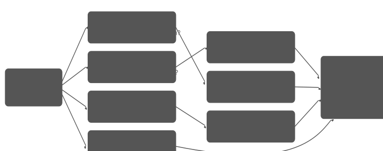

# Day 29 — Architect deliverables

> Part of the [GenAI Architect study path](../../README.md) · Cloud Production Architecture · [Original interactive pack](https://claude.ai/artifact/9S2Rx5ohx77x8WCzMMZjCW) · [Offline HTML](../../archive/html/day-29.html)


Week 4 · Cloud, production & architecture · Day 29 of 30

# Architect deliverables: HLD/LLD, NFRs, ADRs, token-cost model, DR

The documents that get a GenAI design through an architecture review board, and the numbers behind them. Today you build a cost and capacity model you can defend line by line.

Sat 7 Nov 2026~75 min hands-onCPU only · no GPU neededtiktoken 0.14 · LiteLLM price map

## Why this matters for the JD

The JD lists **HLD/LLD, NFRs, decision logs, cost estimates** and **scalability, resilience, DR, compliance** as good-to-haves, and "explaining complex AI simply to stakeholders" as a soft skill. In practice these decide the interview. Panels for architect roles stop asking "what is RAG" and start asking "what does it cost at 50k users, what happens when the provider is down, and where did you write that decision down".

## Concept brief

### The deliverable set, and the question each one answers



NFRs come first because every later number (cost, capacity, RTO) is a consequence of them. The ADR log runs across everything.

### GenAI NFRs differ from classic web NFRs

A classic NFR sheet covers availability, latency and throughput. A GenAI sheet adds quality, safety and cost as first-class, measurable requirements, and changes the units for the rest.

| Category | Example target (knowledge assistant) | How it is measured |
| --- | --- | --- |
| Answer quality | Faithfulness ≥ 0.90, answer relevance ≥ 0.85 on a 300-question golden set; abstains on ≥ 90% of unanswerable questions | RAGAS/DeepEval in CI (Day 11, 26) |
| Latency | TTFT p95 ≤ 1.5 s; full answer p95 ≤ 6 s; retrieval p95 ≤ 300 ms | OTel GenAI spans (Day 27) |
| Throughput | Sustain **peak tokens per minute**, not RPS. A 3k-token prompt and a 50-token prompt are not the same request. | Gateway metrics, provider 429 rate |
| Cost | ≤ $0.005 per answered query; ≤ $X per active user per month; hard budget alert at 80% | LiteLLM / Langfuse cost tracking |
| Safety | 0 PII leaks in red-team suite; prompt-injection block rate ≥ 95% on a known attack set | Guardrail eval suite (Day 21, 28) |
| Freshness | Source change visible in answers within 4 h; deletions within 1 h (right-to-erasure) | Index lag metric per source |
| Availability | 99.9% for "answer with citations"; 99.95% for degraded "search results only" mode | Synthetic probes per mode |
| Residency & audit | Prompts and completions processed in-region (India / EU data zone); 1-year audit log of prompts, sources and user | Policy + config review |

### HLD vs LLD for a GenAI system

#### HLD

- C4 context + container diagrams
- Trust boundaries: where prompts, documents and PII cross networks or tenants
- Model provider(s), gateway, vector store, identity provider
- Data flows for ingest, query and feedback
- NFR summary, cost envelope, DR tier

#### LLD

- Prompt contracts: template ID, version, input/output JSON schema
- Chunking and index schema, metadata filters, ACL fields
- Agent graph state schema, tool contracts, retries, timeouts
- Fallback chain and circuit-breaker thresholds
- Eval thresholds that gate each release

### The token-cost and capacity model

T\_in = system + k × chunk + history + query + Σ(aux calls: rewrite, guard, judge)
T\_out = answer + Σ(aux outputs)
Cost/month = Q\_month × (1 − semantic\_cache\_hit)
× [ T\_in × ((1−c)·P\_in + c·P\_cached) + T\_out × P\_out ]
Peak TPM = Q\_peak\_per\_min × (1 − cache\_hit) × (T\_in + T\_out)

Three things surprise stakeholders. First, input dominates RAG cost: retrieved context is usually 70–85% of tokens, so `k` and chunk size are cost levers, not just quality levers. Second, quota and provisioned capacity (Azure PTU, Bedrock provisioned throughput, watsonx dedicated deployments) are sized on **peak TPM**, which a monthly average hides by 4–6×. Third, a point estimate is the wrong output. Give P50 and P90 and name the assumption that drives the spread, which is almost always adoption.

### DR and resilience: failure modes specific to GenAI

- **Provider or regional outage, or capacity exhaustion (429s).** Mitigate with a gateway fallback chain: same model in a second region, then a different provider's model with a prompt variant you have already evaluated.
- **Model retirement and silent version changes.** Pin model versions, track retirement dates in the ADR log, and run the golden set before every switch.
- **Embedding model loss.** Vectors from different embedding models are not interchangeable. If the embedding model is retired, your RTO becomes the full re-embed time. Keep the source documents as the system of record and treat the index as derived data.
- **Index corruption or bad ingest.** Snapshot the index, version ingests, and be able to roll back to the previous snapshot.
- **Prompt or guardrail regression.** Version prompts like code, with rollback (Day 26).

Design **degraded modes** explicitly, from best to worst: full answer → answer from a smaller fallback model → "search results only" with links and no generation → static "service unavailable, here is the intranet search". Each mode gets its own availability target. That one idea usually satisfies a review board's DR question better than active-active everything.

### Explaining it to stakeholders

Translate every metric into the reader's unit. A CFO wants cost per employee per month and the P90 case. A CISO wants where data goes and who can see what. A business owner wants accuracy expressed as "out of 100 questions, about 90 get a correct, cited answer, 7 get 'I don't know, ask HR', and 3 are wrong in ways we catch through feedback". Avoid "the model knows" and "AI decides". Say "the system retrieves policy text and summarises it, with a link to the source".

## Trade-offs & decision tables

### Capacity purchasing model

| Option | Pick when | Failure mode | Cost / latency |
| --- | --- | --- | --- |
| **Pay-as-you-go (serverless tokens)** | Pilot, spiky or unknown load, < ~40% steady utilisation | 429s at peak; noisy-neighbour latency; quota is per region and per subscription | Linear in tokens; latency variance highest |
| **Provisioned throughput (PTU, Bedrock PT, watsonx dedicated)** | Steady, predictable load; latency SLO is contractual | Paying for idle capacity; overflow still needs PAYG spillover; term commitments | Fixed monthly; lowest, most stable latency |
| **Self-hosted open model (vLLM / KServe on GPUs)** | Strict residency or air-gap; very high steady volume; fine-tuned small model is good enough | You own GPU capacity, patching, scaling and evals; quality gap vs frontier models | GPU $/hr ÷ measured tokens/hr; break-even only at high utilisation |
| **Hybrid: small model default, frontier model on escalation** | Most enterprise assistants | Router misclassification; two prompt sets to maintain and evaluate | Typically 40–70% cheaper than frontier-only |

### DR posture

| Posture | RTO (generation) | Pick when | Watch out for |
| --- | --- | --- | --- |
| Degraded mode only | Instant to search-only | Internal, non-critical assistant | Users notice; set expectations in the SLA |
| Multi-region, same provider | Minutes (gateway failover) | Residency allows a second region in the same data zone | Correlated provider-wide incidents; quota in the secondary region |
| Multi-provider fallback | Seconds to minutes | Customer-facing or regulated workflow | Prompt and eval drift between models; extra DPA / legal review |
| Active-active multi-region + replicated index | Near zero | Revenue-critical, global users | 2× index cost; consistency of ACL updates across regions |

## Hands-on: cost & capacity model for 50k employees

**Goal (75 min):** build a model that turns workload assumptions into $/month, $/query, P50/P90 and peak TPM for six models, then use the output to write one NFR sheet, one ADR and a one-paragraph exec summary. Prices come from LiteLLM's public price map, so the script stays current.

**Price caveat.** The LiteLLM map tracks list prices. Before you quote a client, check the provider's pricing page for the exact region and data-zone SKU, and any enterprise discount.

### Setup (PowerShell)

**PowerShell**

```powershell
mkdir genai-day29; cd genai-day29
py -m venv .venv
.\.venv\Scripts\Activate.ps1
python -m pip install --upgrade pip
python -m pip install "tiktoken==0.14.0"
# save the script below as cost_model.py, then:
python cost_model.py
python cost_model.py --list granite      # find other model keys
python cost_model.py --cache-hit 0.3 --prompt-cache 0.1
```

The first run downloads the ~3.5 MB price map and the tiktoken BPE file. If your corporate proxy blocks `openaipublic.blob.core.windows.net`, the script falls back to a chars÷4 estimate and tells you so.

### cost\_model.py

**cost_model.py · Python 3.13 · stdlib + tiktoken** · saved as `lab/cost_model.py`

```python
"""
Day 29 - Token-cost & capacity model for an enterprise GenAI assistant.
Stdlib + tiktoken only. Prices come from LiteLLM's public price map
(cached to prices.json), so the numbers move when providers change prices.

Usage:
    python cost_model.py                 # base case, prints report + writes cost_report.md
    python cost_model.py --users 50000 --adoption 0.35 --cache-hit 0.25
"""
from __future__ import annotations

import argparse
import json
import pathlib
import random
import statistics
import urllib.request
from dataclasses import dataclass, replace

import tiktoken

PRICE_URL = (
    "https://raw.githubusercontent.com/BerriAI/litellm/main/"
    "model_prices_and_context_window.json"
)
PRICE_CACHE = pathlib.Path(__file__).with_name("prices.json")

# Keys must exist in LiteLLM's price map. Run with --list granite to search.
MODELS = [
    "gpt-5-mini",
    "azure/gpt-4.1-mini",
    "claude-haiku-4-5",
    "claude-sonnet-4-5",
    "gemini/gemini-2.5-flash",
    "watsonx/ibm/granite-4-h-small",
]

SYSTEM_PROMPT = """You are the ACME internal knowledge assistant. Answer only from the
provided context. Cite sources as [doc_id]. If the context is insufficient,
say so and suggest who to contact. Never reveal personal data. Respond in the
user's language. Keep answers under 200 words unless asked for detail."""

@dataclass(frozen=True)
class Workload:
    users: int = 50_000
    adoption: float = 0.35          # share of employees active on a working day
    queries_per_user: float = 6.0   # per active user per day
    working_days: int = 22
    peak_factor: float = 4.0        # peak-hour QPS vs. average working-hour QPS
    working_hours: float = 9.0
    k_chunks: int = 6               # retrieved chunks per query
    chunk_tokens: int = 350
    history_tokens: int = 600       # condensed conversation memory
    query_tokens: int = 40
    output_tokens: int = 280
    rewrite_calls: float = 1.0      # extra small LLM calls (query rewrite, guard)
    rewrite_in: int = 300
    rewrite_out: int = 40
    semantic_cache_hit: float = 0.15   # answered without an LLM call
    prompt_cache_share: float = 0.0    # share of input billed at cached rate
    #  (system prompt is static -> cacheable; set e.g. 0.1 to model it)

def load_prices(refresh: bool = False) -> dict:
    if refresh or not PRICE_CACHE.exists():
        print(f"Downloading price map -> {PRICE_CACHE.name}")
        with urllib.request.urlopen(PRICE_URL, timeout=60) as r:
            PRICE_CACHE.write_bytes(r.read())
    return json.loads(PRICE_CACHE.read_text(encoding="utf-8"))

def count_tokens(text: str) -> int:
    # o200k_base is the GPT-4o/4.1/5 tokenizer. Other vendors differ by
    # roughly 10-25%; treat this as an estimate and calibrate from real logs.
    try:
        return len(tiktoken.get_encoding("o200k_base").encode(text))
    except Exception as e:  # first run downloads the BPE file; corp proxies block it
        print(f"[warn] tiktoken unavailable ({type(e).__name__}); using chars/4 heuristic")
        return max(1, len(text) // 4)

def per_query_tokens(w: Workload, system_tokens: int) -> tuple[int, int]:
    main_in = system_tokens + w.k_chunks * w.chunk_tokens + w.history_tokens + w.query_tokens
    tin = main_in + int(w.rewrite_calls * w.rewrite_in)
    tout = w.output_tokens + int(w.rewrite_calls * w.rewrite_out)
    return tin, tout

def monthly(w: Workload, price: dict, system_tokens: int) -> dict:
    tin, tout = per_query_tokens(w, system_tokens)
    q_month = w.users * w.adoption * w.queries_per_user * w.working_days
    llm_q = q_month * (1 - w.semantic_cache_hit)
    p_in = price.get("input_cost_per_token") or 0.0
    p_out = price.get("output_cost_per_token") or 0.0
    p_cached = price.get("cache_read_input_token_cost") or p_in
    in_cost_q = tin * ((1 - w.prompt_cache_share) * p_in + w.prompt_cache_share * p_cached)
    cost = llm_q * (in_cost_q + tout * p_out)
    # capacity: peak tokens-per-minute is what you size quotas/PTUs/GPUs on
    avg_qps = q_month / w.working_days / (w.working_hours * 3600)
    peak_qps = avg_qps * w.peak_factor * (1 - w.semantic_cache_hit)
    peak_tpm = peak_qps * 60 * (tin + tout)
    return {
        "queries": q_month,
        "tin": tin,
        "tout": tout,
        "cost": cost,
        "per_query": cost / q_month,
        "per_user": cost / (w.users * w.adoption),
        "peak_qps": peak_qps,
        "peak_tpm": peak_tpm,
        "fits_ctx": tin <= (price.get("max_input_tokens") or 10**9),
    }

def monte_carlo(w: Workload, price: dict, sys_t: int, n: int = 2000) -> tuple[float, float]:
    rng = random.Random(42)
    out = []
    for _ in range(n):
        s = replace(
            w,
            adoption=min(1.0, max(0.05, rng.gauss(w.adoption, w.adoption * 0.3))),
            queries_per_user=max(1.0, rng.lognormvariate(0, 0.4) * w.queries_per_user),
            output_tokens=int(max(50, rng.gauss(w.output_tokens, w.output_tokens * 0.35))),
            k_chunks=rng.choice([max(1, w.k_chunks - 2), w.k_chunks, w.k_chunks + 2]),
        )
        out.append(monthly(s, price, sys_t)["cost"])
    out.sort()
    return statistics.median(out), out[int(0.9 * n)]

def main() -> None:
    ap = argparse.ArgumentParser()
    ap.add_argument("--users", type=int, default=50_000)
    ap.add_argument("--adoption", type=float, default=0.35)
    ap.add_argument("--cache-hit", type=float, default=0.15)
    ap.add_argument("--prompt-cache", type=float, default=0.0)
    ap.add_argument("--refresh", action="store_true")
    ap.add_argument("--list", metavar="TEXT", help="search model keys and exit")
    a = ap.parse_args()

    prices = load_prices(a.refresh)
    if a.list:
        print("\n".join(k for k in prices if a.list.lower() in k.lower()))
        return

    w = Workload(users=a.users, adoption=a.adoption,
                 semantic_cache_hit=a.cache_hit, prompt_cache_share=a.prompt_cache)
    sys_t = count_tokens(SYSTEM_PROMPT)
    tin, tout = per_query_tokens(w, sys_t)

    lines = [
        "# Token-cost model",
        f"Users {w.users:,} | adoption {w.adoption:.0%} | {w.queries_per_user} q/user/day | "
        f"semantic-cache hit {w.semantic_cache_hit:.0%}",
        f"System prompt = {sys_t} tokens (o200k_base or heuristic). "
        f"Per query: {tin:,} in / {tout:,} out",
        "",
        "| Model | $/month | $/query | $/active user | P50 | P90 | peak TPM |",
        "|---|---:|---:|---:|---:|---:|---:|",
    ]
    for m in MODELS:
        p = prices.get(m)
        if not p:
            lines.append(f"| {m} | not in price map (try --list) | | | | | |")
            continue
        r = monthly(w, p, sys_t)
        p50, p90 = monte_carlo(w, p, sys_t)
        flag = "" if r["fits_ctx"] else " ⚠ ctx"
        lines.append(
            f"| {m}{flag} | {r['cost']:,.0f} | {r['per_query']:.5f} | {r['per_user']:.2f} | "
            f"{p50:,.0f} | {p90:,.0f} | {r['peak_tpm']:,.0f} |"
        )

    # Sensitivity: which lever moves cost most? (on the first model)
    base_p = prices[MODELS[0]]
    base = monthly(w, base_p, sys_t)["cost"]
    lines += ["", f"## Sensitivity on {MODELS[0]} (each lever -25%)", "| Lever | Δ cost |", "|---|---:|"]
    for field in ["k_chunks", "chunk_tokens", "output_tokens", "history_tokens", "queries_per_user"]:
        v = getattr(w, field)
        nv = type(v)(v * 0.75) if isinstance(v, float) else max(1, int(v * 0.75))
        c = monthly(replace(w, **{field: nv}), base_p, sys_t)["cost"]
        lines.append(f"| {field} {v}→{nv} | {(c - base) / base:+.1%} |")

    report = "\n".join(lines)
    print(report)
    pathlib.Path("cost_report.md").write_text(report, encoding="utf-8")
    print("\nWrote cost_report.md")

if __name__ == "__main__":
    main()
```

### Expected output (base case, price map of 7 Nov 2026)

**output**

```text
# Token-cost model
Users 50,000 | adoption 35% | 6.0 q/user/day | semantic-cache hit 15%
System prompt = 73 tokens (o200k_base or heuristic). Per query: 3,113 in / 320 out

| Model | $/month | $/query | $/active user | P50 | P90 | peak TPM |
|---|---:|---:|---:|---:|---:|---:|
| gpt-5-mini | 2,785 | 0.00121 | 0.16 | 2,690 | 5,136 | 2,269,594 |
| azure/gpt-4.1-mini | 3,450 | 0.00149 | 0.20 | 3,338 | 6,309 | 2,269,594 |
| claude-haiku-4-5 | 9,254 | 0.00401 | 0.53 | 8,935 | 16,914 | 2,269,594 |
| claude-sonnet-4-5 | 27,762 | 0.01202 | 1.59 | 26,804 | 50,743 | 2,269,594 |
| gemini/gemini-2.5-flash | 3,405 | 0.00147 | 0.19 | 3,293 | 6,286 | 2,269,594 |
| watsonx/ibm/granite-4-h-small | 555 | 0.00024 | 0.03 | 536 | 1,014 | 2,269,594 |

## Sensitivity on gpt-5-mini (each lever -25%)
| Lever | Δ cost |
|---|---:|
| k_chunks 6→4 | -12.3% |
| chunk_tokens 350→262 | -9.3% |
| output_tokens 280→210 | -9.9% |
| history_tokens 600→450 | -2.6% |
| queries_per_user 6.0→4.5 | -25.0% |

Wrote cost_report.md
```

Your system-prompt token count will differ slightly with real tiktoken. Notice three things: the Granite row is about 5× cheaper than gpt-5-mini; P90 is close to 2× the base case, driven by adoption and queries per user; and the 15% semantic-cache hit rate barely moves peak TPM. Read your quota needs from peak TPM, not from the monthly bill.

### Steps

1. **Run and read (15 min).** Run the base case. Then answer from the sensitivity table: which single lever would you pull first to cut cost 20% without hurting quality? (Hint: cutting k from 6 to 4 is worth ~12%, and reranking from Day 9 usually keeps the quality.)
2. **Calibrate (15 min).** Replace the defaults with real numbers from your compliance-bot traces in Langfuse or watsonx.governance: mean input and output tokens, aux calls per query. Note the ratio of modelled to measured tokens.
3. **Write the NFR sheet (15 min).** Copy the NFR table from section 2 into `docs/nfr.md` and set targets you could defend. Put the peak TPM figure under Throughput.
4. **Write ADR-0007 (20 min).** Use the MADR template below for "Primary LLM and fallback chain for the knowledge assistant". Cite the cost table and your eval scores as evidence, and add a *Revisit when* trigger.
5. **Exec summary (10 min).** Five sentences for a CFO: cost per employee per month (P50 and P90), what drives the range, and what you will measure in the pilot to narrow it.

**docs/decisions/0007-primary-llm.md · MADR 4 style** · saved as `lab/primary-llm.md`

```
---
status: proposed            # proposed | accepted | superseded by ADR-00xx
date: 2026-11-07
decision-makers: GenAI architect, platform lead, CISO delegate
---
# Primary LLM and fallback chain for the knowledge assistant

## Context and Problem Statement
50k employees, ~35% daily adoption, India + EU data residency, faithfulness >= 0.90.
Which model serves the default path, and what do we fail over to?

## Decision Drivers
* Cost per answered query <= $0.005 at P90 load
* Faithfulness / abstention scores on the 300-question golden set
* In-region processing; contractual SLA; model retirement horizon

## Considered Options
* Option A: ...   * Option B: ...   * Option C: ...

## Decision Outcome
Chosen option: "...", because ... (link cost_report.md + eval run ID)

### Consequences
* Good, because ...
* Bad, because ...

### Confirmation
CI eval gate on every prompt/model change; monthly cost review vs model.

## Revisit when
* Price change > 30% on any shortlisted model
* Provider announces retirement of the pinned version
* Golden-set faithfulness drops > 3 points for two consecutive weeks
```

### Stretch goals

- **Self-hosted break-even column.** Run `ollama run llama3.2:3b --verbose` on your RTX 3050, read the *eval rate* (tokens/s), and add a row: GPU $/hr ÷ (tokens/s × 3600 × utilisation). Find the utilisation at which a cloud A10G or L4 beats gpt-5-mini. That number belongs in an ADR.
- **DR rebuild-time calculator.** Add a function: corpus chunks ÷ measured embedding throughput (time `ollama` with `nomic-embed-text` on 1,000 chunks) = re-embed RTO. Compare 2M vs 20M chunks and decide whether you need a hot standby index.

## GitHub repos to study

[adr/madr](https://github.com/adr/madr)The MADR template set (full, minimal, bare). Read `template/adr-template.md` and the "Confirmation" section, which most teams skip.

[architecture-decision-record/architecture-decision-record](https://github.com/architecture-decision-record/architecture-decision-record)Joel Parker Henderson's ADR collection, now under its own org. Browse the examples folder and the comparison of Nygard, Tyree-Akerman and MADR formats.

[thomvaill/log4brains](https://github.com/thomvaill/log4brains)Docs-as-code ADR tooling that publishes your `docs/decisions` folder as a searchable static site. Look at how it links superseded decisions.

[BerriAI/litellm](https://github.com/BerriAI/litellm)Read `model_prices_and_context_window.json` (today's price source) and the budget / spend-tracking proxy docs, which is how you enforce the cost NFR at runtime.

## Read / watch

- [AWS Well-Architected Generative AI Lens](https://docs.aws.amazon.com/wellarchitected/latest/generative-ai-lens/generative-ai-lens.html) (updated Nov 2025). Read the reliability and cost-optimisation pillars; they make a ready-made review checklist.
- [Azure Well-Architected: design principles for AI workloads](https://learn.microsoft.com/en-us/azure/well-architected/ai/design-principles). Useful for the non-determinism and "design for change" framing that review boards respond to.
- [Azure OpenAI provisioned throughput sizing](https://learn.microsoft.com/en-us/azure/foundry/openai/how-to/provisioned-throughput-sizing). Shows how a vendor turns peak TPM and prompt/response shape into capacity units, which is exactly the input your model produces.

## Interview questions

**Q1 Estimate the monthly LLM cost of a RAG assistant for 50,000 employees. Walk me through it.**

Start from usage, not price: 50k × ~35% daily active × ~6 queries × 22 days ≈ 2.3M queries a month. Tokens per query: a ~100-token system prompt, 6 chunks × 350, ~600 of history, the question, plus one rewrite/guard call, so ~3.1k in and ~300 out. Multiply by list prices and subtract the semantic-cache hit rate. With a mini-class model that is a few thousand dollars a month; with a frontier model it is roughly 10× more.

Then give a range. P90 is about 2× because adoption is uncertain. Name the levers: k and chunk size (input is ~80% of tokens), output length, routing simple queries to a smaller model, prompt caching of the static prefix. Finally, say that the pilot replaces assumptions with measured token counts from traces.

**Q2 Which NFRs are specific to GenAI, and how do you make "quality" testable?**

Quality, safety, cost per query, freshness and abstention are GenAI-specific. Latency splits into TTFT and total time, and throughput is measured in tokens per minute. Quality becomes testable by fixing a versioned golden set with expected sources, choosing metrics (faithfulness, context recall, answer relevance, abstention on unanswerable questions), calibrating the LLM judge against human labels, and setting thresholds that act as CI gates. A requirement like "accurate answers" is rejected. A requirement like "faithfulness ≥ 0.90 on golden set v3, judged by model X with agreement κ ≥ 0.7 against humans" is accepted.

**Q3 The LLM provider has a regional outage. What does your design do?**

The gateway's circuit breaker trips on error rate or latency and routes to the next entry in the fallback chain: the same model in a paired region inside the same data zone, then a different model whose prompt variant has passed the golden set. If all generation paths fail, the UI drops to search-results-only mode with source links, which has its own higher availability target. Users see a banner. Afterwards, the incident review checks whether answers from the fallback model met the quality threshold. The ADR records why we accept, for example, 15 minutes of degraded mode rather than paying for active-active.

**Q4 What goes in an ADR for a GenAI system that wouldn't appear in a traditional one?**

Evidence and expiry. Evidence means the eval run IDs and cost model behind the choice, because model choices are empirical. Expiry means explicit revisit triggers: price changes, model retirement dates, eval drift, new regulation. GenAI decisions go stale faster than database choices. I also record the prompt and embedding versions the decision was tested with, since changing either can invalidate it. Superseded ADRs stay in the log so the reasoning history survives.

**Q5 When does provisioned throughput or self-hosting beat pay-as-you-go?**

When steady utilisation is high and predictable, or when a latency SLO or residency rule forces it. Compute break-even as committed monthly cost divided by the PAYG cost at expected tokens. If the load sits above that line for most hours, commit. Otherwise use PAYG with provisioned capacity only for the base load and PAYG spillover for peaks. Self-hosting adds the GPU operating cost and an eval burden, so it usually wins only for air-gapped environments, very high volume on a small fine-tuned model, or strict sovereignty. On watsonx, a dedicated Granite deployment on-prem is the typical example.

## Architect's lens

### ADR-0012 · Resilience posture for the enterprise knowledge assistant Accepted

Context
:   Internal assistant for 50k employees across India and the EU. The business owner has accepted a 99.9% availability target. Data must stay in-region. The primary model is served pay-as-you-go from one provider region. Budget does not allow doubling index and GPU capacity.

Options
:   (A) Degraded mode only. (B) Multi-region within the same provider and data zone, plus degraded mode. (C) Multi-provider fallback. (D) Active-active multi-region with a replicated index.

Decision
:   **B.** The gateway fails over to the paired region within the same data zone. If both fail, the UI falls back to search-only mode. The vector index is snapshotted every 6 hours and can be rebuilt from source in under 8 hours (measured). Embedding model version is pinned, and its retirement date is tracked.

Consequences
:   Covers regional outages and quota exhaustion at roughly 10–15% extra cost (reserved quota in the second region). It does not cover a provider-wide outage, which we accept and mitigate with search-only mode. C becomes the decision if the assistant moves into a customer-facing workflow.

Revisit when
:   Provider-wide incident longer than 1 h · assistant used in a regulated workflow · second-region quota unavailable.

## Tomorrow

**Day 30, capstone:** full system-design walkthrough, "design an enterprise knowledge assistant for 50k employees", plus a 20-question mock interview. Keep today's cost report and ADRs; you will reuse them.

## Lab files in this folder

- [`lab/cost_model.py`](lab/cost_model.py)
- [`lab/primary-llm.md`](lab/primary-llm.md)
