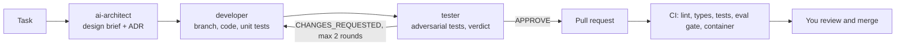

# Three-agent pipeline

Changes to this repo can be run through three Claude Code agents, each with one job and a narrow set of things it may touch. The definitions are in `.claude/agents/`; the orchestration is the `/pipeline` command in `.claude/commands/pipeline.md`.



| Agent | Reads | May write | Must not |
|---|---|---|---|
| `ai-architect` | whole repo | `docs/architecture/designs/`, `docs/architecture/adr/` | touch `src/`, `tests/`, `evals/`, `.github/`; commit |
| `developer` | design brief, code | `src/`, `tests/` (new files), docs, config | change the design, weaken tests or gates, push, merge |
| `tester` | design brief, branch diff | `tests/`, `evals/` (additions only) | edit `src/` or the developer's tests, push, merge |

The tester is given the design brief and the branch, not the developer's report, so its verdict is independent of the developer's reasoning.

## Use it

In a Claude Code session on this repo:

```text
/pipeline Wire LLMPlanner behind a setting, with RulePlanner as the offline default
```

The run ends with an open pull request. Nothing is merged by an agent; the last step is yours.

## Scheduled runs

A scheduled task can run the pipeline unattended. It takes the first unchecked item in [`docs/backlog.md`](../backlog.md), does one item per run, and never starts a new one while a pipeline pull request is still open. Reorder or edit the backlog to steer it. It does not merge.

## What it does not do

- It does not replace CI. The agents run the same four checks locally, and CI runs them again plus the container build.
- It does not decide what to build. Give it one task with a clear outcome; split large work into several runs.
- It does not merge. To change that, edit the last line of `.claude/commands/pipeline.md`, and consider a branch protection rule that requires CI first.
